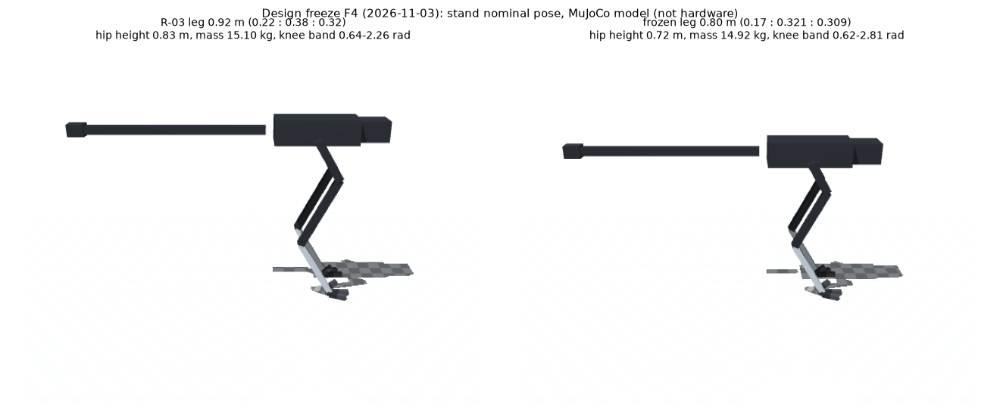

# 형상 동결 (F4, 2026-11-03 사용자 결정)

[형상 동결 계획](DESIGN_FREEZE_PLAN.ko.md)의 F4 결정 기록이다. 이후 형상을 다시 여는 조건은 계획 §2의 원칙 3을 따른다: 재현되는 모델 오류이거나 필수 운동의 구체적 제약 위반일 때만 연다. 강화학습 정체만으로는 열지 않는다.

## 결정

| 항목 | 결정 | 근거 |
|---|---|---|
| 다리 | **합 0.80 m, 타조 비율**: 허벅지 0.17, 정강이 0.321, 발등뼈 0.309 m | F1([증거 193](evidence/193-shape-scan/README.md)): 고관절 11.1 m/s 0.84, 무릎(접힘 2.6) 1.00, 엎드린 배 간격 8 cm. 처음 요구 "다리 0.7–0.8 m급"과 같다 |
| 무릎 | RS04 + 허벅지 위 4절 링크 a 0.154, b 0.261, c 0.093 m, β 115.7°, branch −1. 범위 0.616–2.807 rad | F1 탐색 최선(점수 1.00, 여유 1.2배, 모듈 속도 ×1·×0.9) |
| 고관절 pitch | RS04 + 증속 벨트 0.70 | F1에서 0.80 m 다리의 최선 벨트비 |
| 나머지 축·모터·질량 | R-03 B안 그대로(`rev3_b.json`). 총질량 14.92 kg | 증거 186–187 |
| 꼬리 | R-03 그대로(뿌리 엉덩이 뒤 20 cm, 98 cm) | 계산으로 비교하지 못했다(F1에 몸통 pitch 모델이 없음). 바꾸면 형상을 다시 여는 것이므로 현 상태로 동결한다 |
| 기본 서기 자세 | R-03과 같은 관절각(고관절 −0.5273, 무릎 1.0, 발목 −0.9997) | 1a 통과 정책 `r3_s1ho`와 행동 정의가 같아 그대로 이어 학습할 수 있다(증거 190: 정책은 기본 자세와 관계없이 무게중심을 맞춘다) |
| 1b 범위 | 달리기 뒤로 미루고 축소한다. 3단계 달리기 판정 뒤 1b-lite(넘어지는 중 회복, 앉은 자세)를 먼저 한다. 옆·뒤 바닥 기상은 비RL 경로 탐색으로 가능성부터 확인한다 | 사용자 결정 |

## 설정 파일 (단일 원천)

- `sim/rl/rev3_l80.json`: 축 설정. `leg`, `fourbar`, 고관절 벨트, `joint_range`(무릎 0.2–2.85, 발목 −2.95–0.2)
- `sim/rl/realism_robstride_l80.json`: 실물 모터 조건. `realism_robstride_rev3.json`과 고관절 pitch 벨트비만 다르다
- `RunEnv(model_rev=3, rev3_config='sim/rl/rev3_l80.json')`: MJCF의 세 다리 구간을 `run_env.set_leg`로 바꾼다. 무릎 4절 링크는 허벅지 길이를 따른다

## 바뀌는 순서 (계획 §3 F5)

1a 서기 재통과([증거 195](evidence/195-l80-stand/README.md)) → 2 걷기 → 3 달리기(B/A 판정) → 1b-lite → 4 회전 → 5 점프(궤적 탐색 먼저) → 6 험지 → 1b 전체 → 7 상황 판단.

## 한계

- 짧은 다리의 이점은 계산(설계 보폭)으로만 확인했다. 실제 달리기 부하는 학습한 뒤에 확인한다.
- 다리 구간의 질량은 길이에 비례해 줄였다. 4절 링크 배치와 자기충돌은 3단계 전에 점검한다.
- ROS URDF/Gazebo는 아직 R-02 형상이다.
