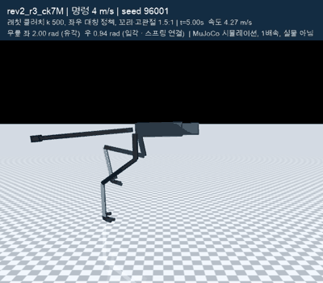
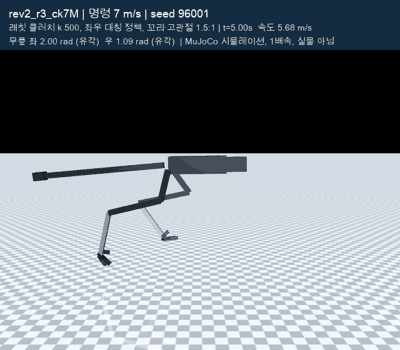
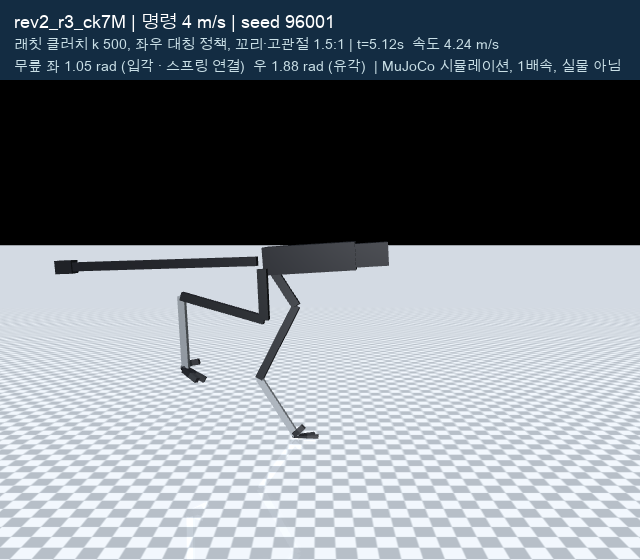
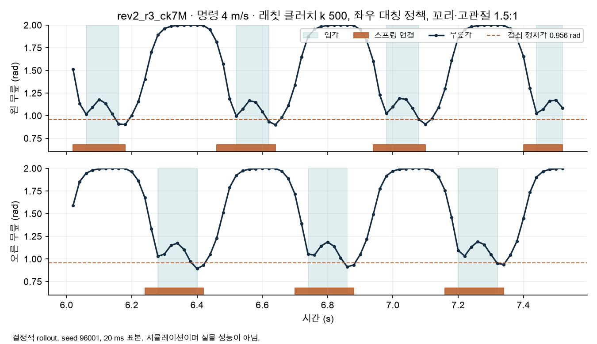
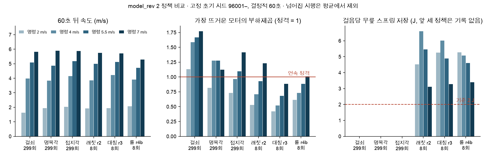
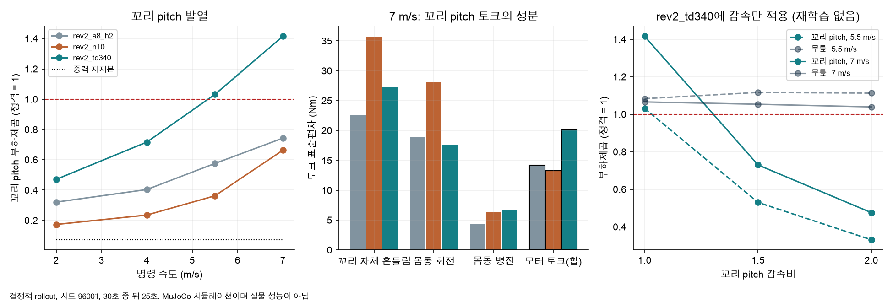
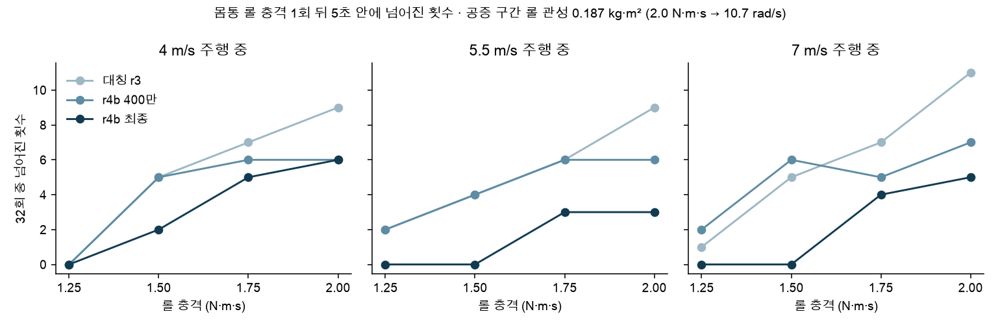

# 증거 164 · 모델 개정 2 — 무릎 스프링·클러치·발열·외란 (2026-10-12 ~ 10-13)

MuJoCo 동역학 시뮬레이션 결과다. 실물 시험이 아니며 40 km/h 달성도 아니다. 2026-10-13 사용자 요청으로 일시정지한 시점의 기록이고, **최종 정책은 아직 정하지 않았다.**

- 환경: `sim/rl/run_env.py` (`model_rev=2`, 8축 + 꼬리 2축, 11.29 kg, 물리 1 ms · 제어 20 ms), 학습 `sim/rl/train_run.py` (PPO), 좌우 대칭 정책 `sim/rl/sym_policy.py`.
- 판정 방식: 초기 시드 96001부터 고정, 결정적 정책, 60초, 명령 2 / 4 / 5.5 / 7 m/s. 스크립트 [`rev2/rev2_accept.py`](rev2/rev2_accept.py), [`rev2/train/disturb_tol.py`](rev2/train/disturb_tol.py).
- 기준은 결과를 보기 전에 [`rev2/train/gates_r.json`](rev2/train/gates_r.json)에 적었다.
- 발열 지표 "부하제곱" = (모터 토크 ÷ 연속 정격 토크)²의 시간 평균. 1.0이 연속 정격이다.

## 영상 (실제 시뮬레이션 렌더, 1배속)

| `rev2_r3_ck7M` · 명령 4 m/s | `rev2_r3_ck7M` · 명령 7 m/s (실제 5.7 m/s) |
|---|---|
|  |  |
| [10초 MP4](rev2/train/media/rev2_r3_ck7M_4mps.mp4) | [10초 MP4](rev2/train/media/rev2_r3_ck7M_7mps.mp4) |

다른 정책: [`rev2_a8_h2`](rev2/train/media/rev2_a8_h2_4mps.mp4) · [`rev2_n10`](rev2/train/media/rev2_n10_4mps.mp4) · [`rev2_td340`](rev2/train/media/rev2_td340_4mps.mp4) · [`rev2_r4b`](rev2/train/media/rev2_r4b_4mps.mp4) (모두 4 m/s, 시드 96001, 10초).
각 영상 옆 `.json`에 조건·프레임 수·모델 SHA-256과 "렌더한 실행이 렌더 없는 실행과 일치" 확인이 들어 있다. 재생성: `.venv-sim/bin/python make_media.py <명령> <run>`.

| 접지 순간 (4 m/s) | 무릎 각도와 스프링 연결 (4 m/s) |
|---|---|
|  |  |

## 정책 비교

원자료 [`rev2_summary.json`](rev2/train/media/rev2_summary.json). 앞 세 정책은 299회 판정, 뒤 세 정책은 **8회 점검**이라 같은 무게로 읽으면 안 된다.

| 정책 | 바꾼 것 | 시행 수 | 전도 (2/4/5.5/7) | 속도 m/s (2/4/5.5/7) | 가장 뜨거운 모터 (2/4/5.5/7) | 걸음당 스프링 저장 J |
|---|---|---|---|---|---|---|
| `rev2_a8_h2` | 걸쇠 정지각 0.956 rad, 명목 무릎 1.5 rad | 299 | 0/0/0/0 | 1.63/3.99/5.08/5.83 | 1.13/1.59/1.67/1.77 | 걸쇠 연결 0회 |
| `rev2_n10` | 명목 무릎 1.0 rad | 299 | 0/0/0/1 | 1.95/3.84/4.86/5.89 | 0.81/1.27/1.27/1.12 | 입각의 0.8 %만 연결 |
| `rev2_td340` | 접지각 클러치 k 340 | 299 | 0/0/0/0 | 2.04/4.14/5.19/5.88 | 0.73/0.97/1.09/1.42 | 0.01–0.6 |
| `rev2_r2` | 래칫 클러치 k 500, 꼬리·고관절 1.5:1, 저장 보상 | 8 | 0/0/1/1 | 1.93/3.86/4.99/5.75 | 0.53/0.71/0.93/1.23 | 4.5/6.6/5.5/3.1 |
| `rev2_r3_ck7M` | + 좌우 대칭 정책, 자기충돌·풀림 손실 벌점 | 8 | 0/0/0/0 | 1.93/4.23/5.13/5.72 | 0.42/0.52/0.68/0.88 | 5.2/6.0/4.9/3.3 |
| `rev2_r4b` | + 롤 충격을 키워 학습 | 8 | 0/0/0/0 | 2.07/3.91/4.73/5.29 | 0.62/0.73/0.89/1.01 | 5.3/5.1/4.6/3.4 |

`rev2_r3_ck7M` (8회)의 나머지 항목: 클러치 입각 연결 100 %, 걸릴 때 생기는 에너지 0 J, 풀릴 때 손실은 모터 양의 일의 0.2–0.4 %, 자기충돌 0, 관절 한계 근접 0. 스프링을 빼면 무릎 부하제곱이 0.30/0.50/0.68/0.88 → 0.68/1.33/1.73/1.88로 오르고, 7 m/s에서는 8회 중 1회 넘어진다.

## 원인 조사 요약

| 질문 | 확인한 것 | 근거 |
|---|---|---|
| 걸쇠가 왜 안 걸리나 | 무릎을 초당 5.4–6.4 rad로 펴는 도중에 접지하고, 정지각 0.956 rad는 접지 뒤에 지나간다. 다리 길이 문제가 아니라 정지각과 보행 작동 범위의 불일치다. | [`geometry_probe.py`](rev2/train/geometry_probe.py), [`geometry_replay.py`](rev2/train/geometry_replay.py) |
| 꼬리가 왜 뜨거운가 | 0.40 kg·m² 꼬리를 보폭 주파수로 가감속하는 관성 토크(표준편차 20.1 Nm). 중력·관절 한계·서보 포화가 아니다. 1.5:1 감속으로 1.42 → 0.73. | [`tail_probe.py`](rev2/train/tail_probe.py), [`tail_dynamics.py`](rev2/train/tail_dynamics.py),  |
| 무작위화에서 왜 넘어지나 | 요 충격만 빼면 전도 18/25/36 → 0/0/1 (59회 중). | [`td340_dr_parts.jsonl`](rev2/train/td340_dr_parts.jsonl) |
| 7 m/s 무릎이 왜 뜨거웠나 (`rev2_r2`) | 좌우 비대칭(왼 1.22, 오른 0.65). 대칭 정책으로 0.88. | [`r2_spring_off_8.jsonl`](rev2/train/r2_spring_off_8.jsonl), `sim/rl/sym_policy.py` |
| 롤 충격 2.0 N·m·s에서 왜 넘어지나 | 추적한 사례는 두 발이 공중일 때 충격이 들어온다. 그 자세의 전신 롤 관성 0.187 kg·m² → 10.7 rad/s, 0.12초에 전도 판정(기울기 0.8 rad). 공중에서는 롤을 받을 축이 없다. | [`roll_diag_inertia.py`](rev2/train/roll_diag_inertia.py), [`roll_diag_inertia_r4b.txt`](rev2/train/roll_diag_inertia_r4b.txt) |

## 기준 대비 현재 상태 (`rev2_r3_ck7M`, 8회 점검 기준)

| 기준 (`gates_r.json`) | 상태 |
|---|---|
| 전도 0/299 | 미판정 (8회 중 0) |
| 모든 모터 부하제곱 ≤ 1.0 | 미판정 (8회 평균 최고 0.88) |
| 클러치 입각 ≥ 95 % 연결, 걸림 에너지 0, 풀림 손실 < 1 % | 미판정 (8회: 100 %, 0 J, 0.2–0.4 %) |
| 스프링 ≥ 2 J/걸음, 빼면 무릎 발열 +10 % 이상 | 미판정 (8회: 3.3–6.0 J, +114–166 %) |
| 관절 한계 근접 < 1 %, 자기충돌 0 | 미판정 (8회: 0, 0) |
| 충격 1회: 요·피치·롤 2.0 N·m·s, 밀기 10 N·s 전도 0/16 | **롤 미달** (롤 2.0: 32회 중 9/9/11, 1.25: 0/2/1). 요 2.5·피치 4.0·밀기 10은 8회 중 0 |
| 학습 무작위화 60초 전도 0/59 | 미판정 |

## 실패·정정

- `rev2_r1`: 스프링 저장이 0 J에 가까워 500만 스텝에서 중단. 저장 보상을 추가했다.
- `rev2_r4`: 롤 충격을 한 번에 너무 키워 학습이 무너져 150만 스텝에서 중단. 설정값에 (질량 ÷ 5 kg) = 2.26이 곱해진다는 것을 놓쳤다(설정 0.3–2.4 → 실제 0.7–5.4 N·m·s).
- `rev2_r5` (발열 벌점 2.5배): 300만 지점에서 속도가 4.73 m/s로 떨어지고 롤 내성도 후퇴. 최종 평가는 일시정지로 실행하지 않았다.
- 롤 2.0 N·m·s 기준은 물리 근거 없이 정한 값이었다. 기준은 고치지 않고 "미달"로 둔다.
- 8회 점검의 "롤 2.0에서 0/0/2"는 표본이 작아 낙관적이었다. 32회 값이 위 그림이다.

## 확인하지 못한 것

- 뒤 세 정책의 고정 시드 299회 판정과 학습 무작위화 60초 판정.
- 발열을 지키는 최고 속도. 현재 7 m/s 명령에서 5.3–5.7 m/s(19–21 km/h)이고, 6–11.1 m/s 명령 스캔은 일시정지로 결과가 없다.
- 학습 시드는 실행마다 1개다.
- 래칫 클러치의 풀림·재장전 기구는 가정이다(CAD 없음). 꼬리·고관절 1.5:1 감속기의 질량·백래시는 모델에 없다.
- 저장한 스프링 에너지 중 추진으로 되돌아가는 양은 걸음 단위로 재지 않았다.

## 보고서

[RAPTOR 최종 설계 검증 보고서 1.8 (PDF, 104쪽)](../../reports/final-20261012/RAPTOR_final_design_verification_v1.8_20261012.pdf)는 `rev2_td340`과 꼬리 과열 원인까지 담고 있다. `rev2_r1`–`r5`와 외란 한계는 아직 보고서에 넣지 않았고 이 문서가 최신이다.

이 폴더는 작업 폴더 `output/pdf/RAPTOR_최종문서_20261012/evidence/`의 사본이다. 스크립트 사용법의 경로는 작업 폴더 기준이다.
