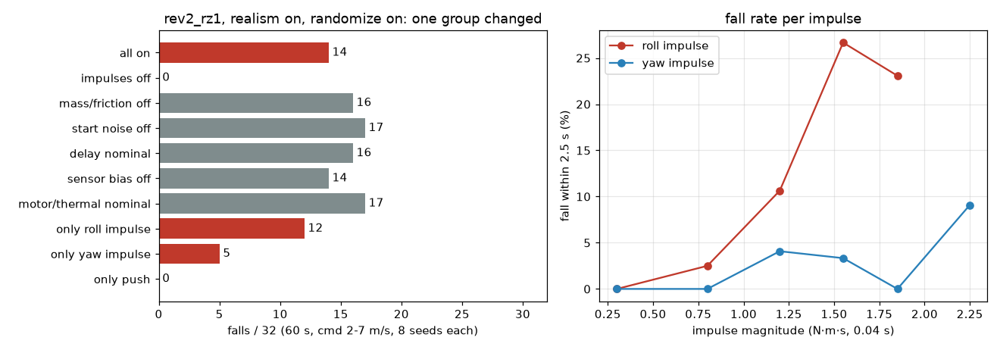

# 166 무작위화 전도 원인 분해 (rev2_rz1, 학습 없음)

2026-10-29, 사용자 지시 "진행". 증거 165의 `rev2_rz1`이 무작위화 60초 평가에서 14/32 넘어진 원인을 항목별로 껐다 켜며 찾았다. 학습은 하지 않았다. 모두 MuJoCo 시뮬레이션 결과다.

## 결론

- 넘어짐은 **몸통 순간 충격**(좌우 roll, 회전 yaw)에서 나온다. 충격만 끄면 14/32 → **0/32**.
- 실물화 계층(지연·센서 바이어스·모터/열 값 흔들기)과 질량·마찰·시작 자세 흔들기는 하나씩 꺼도 14~17/32로 차이가 없다(시드 흐름이 바뀌는 정도의 흔들림).
- 실물 조건 학습은 효과가 있었다. 기존 `rev2_r3_ck7M`은 실물 조건에서 충격이 없어도 16/32 넘어졌는데, `rev2_rz1`은 0/32다.
- 남은 약점은 실물 조건과 관계없이 원래 있던 **충격 내구성**이다. 실물화를 끈 원래 정책도 충격이 있으면 11/32 넘어진다.



## 1. 항목별 끄기 (`rev2_rz1`, 실물화 on, 무작위화 on, 60초, 명령 2/4/5.5/7 m/s × 시드 5000–5007)

| 바꾼 항목 | 2 | 4 | 5.5 | 7 | 합계 |
|---|---|---|---|---|---|
| 모두 켬 (증거 165 재현) | 1/8 | 3/8 | 5/8 | 5/8 | **14/32** |
| 순간 충격 끔 (yaw·roll 충격, 밀기) | 0/8 | 0/8 | 0/8 | 0/8 | **0/32** |
| 몸통 질량·발 마찰·토크 상한 흔들기 끔 | 3/8 | 3/8 | 4/8 | 6/8 | 16/32 |
| 시작 자세 잡음·시작 속도·시작 열 끔 | 2/8 | 7/8 | 4/8 | 4/8 | 17/32 |
| 지연 명목 2스텝 고정 | 1/8 | 3/8 | 6/8 | 6/8 | 16/32 |
| IMU 바이어스·엔코더 오프셋 끔 | 1/8 | 3/8 | 5/8 | 5/8 | 14/32 |
| 모터·마찰·열·주변온도 값 명목 고정 | 1/8 | 3/8 | 6/8 | 7/8 | 17/32 |
| roll 충격만 남김 | 3/8 | 4/8 | 3/8 | 2/8 | **12/32** |
| yaw 충격만 남김 | 1/8 | 1/8 | 2/8 | 1/8 | **5/32** |
| 밀기만 남김 | 0/8 | 0/8 | 0/8 | 0/8 | 0/32 |

## 2. 충격 세기별 넘어짐 (충격 뒤 2.5초 안 넘어짐, 위 표 roll만·yaw만 실행)

충격은 `RunEnv._disturb`의 기존 설정이다. roll 초당 0.1회 · 0.1–0.9, yaw 초당 0.15회 · 0.2–1.0에 실질량 비(11.3 kg/5)를 곱해 0.04초 동안 가한다. 60초 판에서 roll 약 6회, yaw 약 9회가 들어간다. 학습 판은 15초다.

| 충격 크기 (N·m·s) | roll | yaw |
|---|---|---|
| < 0.6 | 0/27 | 0/10 |
| 0.6–1.0 | 1/40 | 0/93 |
| 1.0–1.4 | 5/47 | 2/49 |
| 1.4–1.7 | 4/15 | 2/60 |
| 1.7–2.0 | 3/13 | 0/38 |
| 2.0–2.5 | – | 3/33 |

넘어뜨린 가장 작은 충격은 roll 0.83, yaw 1.06 N·m·s다.

## 3. 정책·실물화 교차 비교 (같은 충격 설정, 60초 × 4속도 × 8)

| 정책 | 평가 조건 | 충격 있음 | 충격 없음 |
|---|---|---|---|
| `rev2_r3_ck7M` | 실물화 off | 11/32 | 0/32 |
| `rev2_r3_ck7M` | 실물화 on | 27/32 | 16/32 |
| `rev2_rz1` | 실물화 on | 14/32 | 0/32 |
| `rev2_rz1` | 실물화 off | 22/32 | 0/32 |

`rev2_rz1`은 실물 조건에 맞춰져 실물화를 끈 환경에서는 충격에 더 약하다(22/32).

## 구분

| 구분 | 내용 |
|---|---|
| 확인 | 충격을 끄면 실물 조건에서 넘어짐 0/32. 실물화 계층 항목은 넘어짐 원인이 아님. 실물 조건 학습으로 충격 없는 넘어짐 16/32 → 0/32 |
| 실패 | 1 N·m·s 이상 roll 충격에 약 10–27 % 넘어짐 |
| 미검증 | 이 충격 크기가 실물에서 어떤 밀기에 해당하는지 측정하지 않음. 시드 8개라 항목별 ±3 정도 차이는 구분하지 못함. 299회 판정 안 함 |
| 다음 한 단계 | 충격 내구성 보강 이어 학습: 학습 판 길이를 늘리거나 roll 충격 빈도를 높여 `rev2_rz1`에서 이어 학습한 뒤 같은 표로 비교 |

## 재현

저장소 루트에서 `.venv-sim`으로:

```
python docs/evidence/166-realism-dr-fall-ablation/eval/ablate.py sim/rl/runs/rev2_rz1 <group> <cmd> 8
python docs/evidence/166-realism-dr-fall-ablation/eval/plot.py
```

`group`: all, impulse, plant, init, delay, sensor, motor, only_roll, only_yaw, only_push. 정책 파일은 증거 165 `policy/`에 있다. 결과는 `eval/ablation_results.jsonl`(표 1), `eval/impulse_log.jsonl`(표 2, 충격 시각·크기 포함), `eval/compare_results.jsonl`(표 3)이다. `rev2_rz1` 실물화 off는 args.json에서 `realism`만 뺀 복사본으로 돌렸다.
