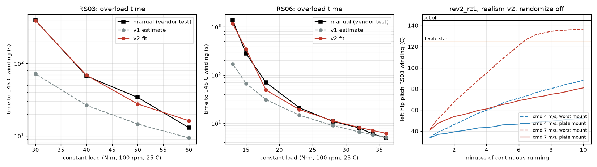

# 167 RobStride 공개 자료로 시뮬레이션 값 맞추기 (realism v2, 학습 없음)

2026-10-29, 사용자 지시 "진행해". 실물 실험 없이 공개 자료만으로 시뮬레이션 모터 값을 실물에 맞췄다(사용자 결정: 실물 제작·실측 없음). 학습은 하지 않았고 모두 MuJoCo 시뮬레이션 결과다.

## 결론

- **열:** RobStride 공식 매뉴얼의 과부하 시험표(부하별 145 °C 도달 시간)에 열 모델을 맞췄다. 기존 추정값(v1)은 실제보다 2~5배 빨리 뜨거워졌다(RS03 30 N·m: 매뉴얼 393초, v1 72초, v2 390초).
- **마찰:** 매뉴얼의 무부하 전류로 무부하 끌림 토크를 계산했다(RS03 1.42 N·m @200 rpm). 기존 모델은 그 절반(0.72 N·m)이었다.
- **관성:** 기존 값 RS03 0.0203 kg·m²는 K-Scale K-Bot 공개 모델의 0.02와 같다. 바꾸지 않았다.
- **지연:** 기존 범위 0~6 ms(기본 2 ms)는 CAN 1 Mbps 계산값(모터 10개 왕복 약 1.5~3 ms)과 맞는다. 바꾸지 않았다.
- **`rev2_rz1`을 v2로 평가(학습 없음):** 명목 조건 넘어짐 0/32, 7 m/s 명령에서 5.71 m/s, 20초 권선 최고 38 °C. 무작위화 60초는 13/32(v1 14/32)이고, 충격을 빼면 0/32다.
- **10분 연속 주행(7 m/s 명령):** 매뉴얼 방열판 조건에서는 고관절 RS03이 81 °C로 감액이 없었다. 가장 나쁜 장착 조건에서는 6분쯤 125 °C를 넘어 출력이 최대 60% 줄었고(감액 0.40), 넘어지지는 않았다. 속도는 5.9에서 5.25 m/s로 떨어졌다.



## 1. 출처

| 항목 | 출처 | 값 |
|---|---|---|
| RS03 과부하 시간 | [RobStride/Product_Information@384cc56](https://github.com/RobStride/Product_Information) `RS03User Manual261013.pdf` p.11 | 60/50/40/30 N·m → 13/34/67/393초, 20 N·m 연속(215×220 mm 알루미늄 방열판, 25 °C, 100 rpm) |
| RS03 정지(stall) 과부하 | 같은 쪽 | 60/50/40/30/20 N·m → 1/4/9/25/190초, 13 N·m 연속 |
| RS06 과부하 시간 | 같은 저장소 `RS06User Manual260713.pdf` p.10 | 36/34/32/28/23/18/15/13 N·m → 5/6/8/11/21/70/280/1360초, 11 N·m 연속(130×160 mm) |
| 무부하 전류 | 두 매뉴얼 1.3절 | RS03 0.6 Arms(200 rpm), RS06 0.98 Arms ±10 %(480 rpm) |
| 토크 상수 | 두 매뉴얼 1.3절 | RS03 2.36, RS06 1.09 N·m/Arms |
| 권선 보호 온도 | 두 매뉴얼 | 145 °C(실제 한계 180 °C), 정지 시 한 상의 발열은 회전 시의 1.414배 |
| 통신 | RS03 매뉴얼 2.1절 | CAN 1 Mbps |
| 관성·마찰 비교 | [kscalelabs/kbot-joystick@211f9a2](https://github.com/kscalelabs/kbot-joystick) `robot/kbot/robot.mjcf` | robstride_03 armature 0.02, frictionloss 0.2(식별 자료 없음. K-Scale `sysid` 저장소에는 Feetech만 있음) |

조사했지만 찾지 못한 것: RobStride 백래시 값, 실사용 발열 후기, 실측 통신 지연. 깃허브 이슈, 레딧, 포럼을 찾았지만 RobStride에 대한 수치 보고는 없었다.

## 2. 열 모델 맞춤 (`eval/thermal_fit.py`, 결과 `eval/thermal_fit.json`)

기존 2노드 모델(권선–하우징–주변)과 손실식 1.5·I²·r_line·(1+0.00393(T−25)), I = τ/kt_out은 그대로 쓰고, 4개 값(r_th_wh, r_th_ha, c_th_w, c_th_h)만 회전 시험표에 맞췄다. 오차는 로그 시간 기준이고, 연속 정격 부하는 145 °C 아래에서 포화하도록 조건을 걸었다.

| 모터 | 값 | v1 추정 | v2 맞춤 |
|---|---|---|---|
| RS03 | r_wh / r_ha (K/W) | 0.874 / 0.835 | 0.520 / 1.421 |
| RS03 | c_w / c_h (J/K) | 31.3 / 148 | 47.8 / 699 |
| RS06 | r_wh / r_ha (K/W) | 1.252 / 0.791 | 1.038 / 1.283 |
| RS06 | c_w / c_h (J/K) | 17.6 / 148.7 | 21.1 / 1152 |

RS03의 c_h 699 J/K는 215×220 mm 알루미늄판 약 6 mm 두께(약 0.77 kg × 0.9 J/gK)에 해당해 크기가 그럴듯하다. RS06의 c_h는 오래 걸리는 한두 점에만 걸려 있어서 정확도가 낮다.

**맞지 않는 부분:** 정지(stall) 시험표는 v2로도 재현되지 않는다. RS03 60 N·m에서 매뉴얼은 1초, 모델은 10.5초다. 매뉴얼에 따르면 정지 보호는 상별 온도 계산과 별도의 "blocking overload" 보호를 함께 쓴다. 모델은 상별 발열을 다루지 않으므로, 정지 상태로 큰 토크를 버티는 경우는 모델이 낙관적이다. 달리는 동안에는 관절이 계속 회전하므로 영향이 작다고 판단했지만, 확인하지는 않았다.

**장착 조건:** 매뉴얼 값은 큰 알루미늄 방열판에 붙인 시험이다. 로봇 다리에 붙였을 때의 방열은 모르므로 무작위화 범위를 넓혔다(r_th_ha ×0.8–2.0, c_th_h ×0.2–1.25. 0.2배는 방열판이 없는 모터만의 열용량에 가깝다).

## 3. 마찰

출력축 기준 무부하 끌림 = 무부하 전류 × 토크 상수다. 쿨롱 마찰 0.3 N·m(추정, K-Scale은 0.2)를 빼고 남는 값을 점성 계수로 놓았다. RS03은 b = (1.42−0.3)/20.9 = 0.053, RS06은 (1.07−0.3)/50.3 = 0.015 N·m·s/rad다. 외부 감속단만큼 관절 쪽으로 환산했다. 고관절 roll은 벨트 1.5배라 쿨롱 ×1.5, 점성 ×2.25이고, 무릎은 4절 링크 rms 비 1.35라 쿨롱 ×1.35, 점성 ×1.82다. 무부하 전류에는 철손도 들어 있으므로 속도에 비례하는 항으로 보는 것은 근사다.

## 4. `rev2_rz1` 평가 (v2, 학습 없음)

| 조건 | 2 | 4 | 5.5 | 7 m/s 명령 | 비고 |
|---|---|---|---|---|---|
| 명목 20초 × 8: 넘어짐 · 속도 · 권선 최고 | 0 · 1.89 · 32.9 °C | 0 · 4.24 · 33.4 °C | 0 · 5.19 · 34.8 °C | 0 · 5.71 · 38.2 °C | v1: 34.6/37.1/40.9/46.4 °C |
| 무작위화 60초 × 8: 넘어짐 | 1/8 | 3/8 | 5/8 | 4/8 | 합계 13/32(v1 14/32) |
| 무작위화, 충격 없음 | 0/8 | 0/8 | 0/8 | 0/8 | 0/32 |

10분 연속 주행(`eval/long_run.py`, 무작위화 끔, 왼쪽 고관절 pitch RS03이 가장 뜨거움):

| 명령 | 장착 | 10분 뒤 고관절 | 최소 감액 | 속도 변화 |
|---|---|---|---|---|
| 4 m/s | 방열판 | 52 °C | 1.0 | 4.3 유지 |
| 4 m/s | 가장 나쁨 | 86 °C | 1.0 | 4.3 유지 |
| 7 m/s | 방열판 | 80 °C | 1.0 | 5.7–5.9 유지 |
| 7 m/s | 가장 나쁨 | 136 °C | 0.40 | 5.9 → 5.25 |

## 구분

| 구분 | 내용 |
|---|---|
| 확인 | 회전 과부하 시간이 매뉴얼과 대체로 맞음(RS03 4점 중 3점 ±20 % 이내, 60 N·m은 +25 %). 마찰은 무부하 전류와 일치. 새 값에서도 `rev2_rz1`이 명목 조건에서 넘어지지 않음 |
| 실패 | 정지 과부하 시간은 재현하지 못함. 무작위화 넘어짐 13/32(충격 때문, 증거 166) |
| 미검증 | 로봇에 장착했을 때의 방열, 백래시, 실제 통신 지연 분포(공개 수치 없음). 매뉴얼 표는 제조사 시험값이고 독립적으로 검증된 값이 아님 |
| 다음 한 단계 | v2 설정으로 `rev2_rz1`에서 이어 학습. 충격 내구성 보강(학습 판 길이를 늘리고 roll 충격 빈도를 높임) |

## 재현

저장소 루트에서 `.venv-sim`으로 실행한다. `thermal_fit.py`는 약 70초 걸린다. 평가용 run 폴더는 `rev2_rz1` 복사본이고, args.json의 `realism`만 `sim/rl/realism_robstride_v2.json`으로 바꿨다. v1(`realism_robstride.json`)은 증거 165 재현용으로 그대로 둔다.

```
python docs/evidence/167-robstride-public-data-fit/eval/thermal_fit.py
python docs/evidence/165-realism-robstride-training/eval/temp_probe.py <run_v2> nodr 8
python docs/evidence/166-realism-dr-fall-ablation/eval/ablate.py <run_v2> all|impulse <cmd> 8
python docs/evidence/167-robstride-public-data-fit/eval/long_run.py <run_v2> <cmd> 600 plate|worst
python docs/evidence/167-robstride-public-data-fit/eval/plot.py
```
