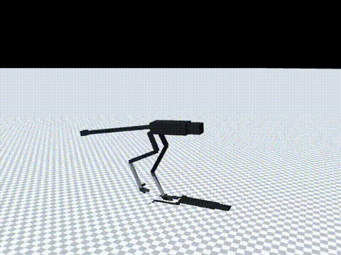

# 168 충격 내구성 이어 학습 rev2_rz2 (실패, 미채택)과 원인 진단

2026-10-29, 사용자 지시 "계속 진행해". 증거 166에서 무작위화 넘어짐의 원인으로 확인된 몸통 순간 충격(특히 좌우 roll)에 버티도록 `rev2_rz1`에서 이어 학습했다. 모두 MuJoCo 시뮬레이션 결과다.

## 결론

- `rev2_rz2`는 **미채택**이다. 충격 넘어짐이 줄지 않았고(기본 충격 16/32, `rz1`은 13/32), 최고 속도도 5.71에서 5.51 m/s로 떨어졌다.
- 원인 진단: 좌우 충격으로 넘어질 때는 충격 뒤 1.5초 동안 **고관절 roll 행동이 범위 끝(±0.3 rad)에 붙어 있는 시간이 58 %**였다. 버틴 경우는 3 %였다. 고관절 roll 토크는 한계에 닿지 않았고(포화 0.2 %), 관절은 기구 한계의 64 %까지만 썼다. 모터 힘이 모자란 것이 아니라, 정책이 명령할 수 있는 범위(`SCALE_RUN['hip_roll']=0.3`)가 옆으로 발을 디딜 만큼 넓지 않은 것으로 보인다.
- 다음 시도(증거 169): `scale_override {"hip_roll": 0.5}` 옵션으로 범위를 관절 한계 ±0.5 rad까지 넓히고, 같은 조건으로 이어 학습한다.

## 학습

`rev2_rz1`에서 시작해 10,076,160스텝을 학습했다. `sim/rl/realism_robstride_v2.json`(증거 167)을 쓰고, 학습 판을 15초에서 30초로 늘리고, roll 충격 빈도를 0.1에서 0.2회/초로 올렸다(세기는 같음). 학습 판 길이 평균은 약 1,050/1,500스텝이었고 보상은 오르지 않았다(`policy/progress.csv`).

## 결과 (60초 × 명령 2/4/5.5/7 m/s × 시드 5000–5007, v2 실물화)

| 정책 | 조건 | 2 | 4 | 5.5 | 7 | 합계 |
|---|---|---|---|---|---|---|
| `rev2_rz1` (증거 167) | 무작위화, roll 0.1/s | 1/8 | 3/8 | 5/8 | 4/8 | **13/32** |
| `rev2_rz2` | 무작위화, roll 0.1/s | 1/8 | 6/8 | 4/8 | 5/8 | 16/32 |
| `rev2_rz1` | 무작위화, roll 0.2/s | 5/8 | 6/8 | 7/8 | 7/8 | 25/32 |
| `rev2_rz2` | 무작위화, roll 0.2/s | 2/8 | 7/8 | 6/8 | 8/8 | 23/32 |
| `rev2_rz2` | 무작위화, 충격 없음 | 0/8 | 0/8 | 0/8 | 0/8 | 0/32 |
| `rev2_rz2` | 실물화 끔, roll 0.1/s | 2/8 | 6/8 | 6/8 | 7/8 | 21/32 |

명목 20초 × 8(`eval/probe_nominal.jsonl`): 넘어짐 0, 속도 1.94 / 3.99 / 4.93 / 5.51 m/s, 권선 최고 40.5 °C.
10분 연속 주행(`eval/long_run.jsonl`): 7 m/s 명령에서 방열판 조건은 고관절 71 °C(9분 시점), 가장 나쁜 장착 조건은 134 °C에서 감액 0.40. 넘어짐은 없었다.

## 원인 진단 (`eval/roll_diag.py`, `eval/roll_diag_rz1.jsonl`)

`rev2_rz1`, roll 충격만 켜고 나머지는 무작위화했다. 명령 2/4/5.5/7 m/s × 8회. 1 N·m·s 이상의 roll 충격 73회를 넘어진 경우와 버틴 경우로 나눴다.

| 구분 | 횟수 | 평균 충격 | hip roll 행동 포화 시간 | hip roll 각 / 관절 한계 | hip roll 토크 / 한계 (최대) | 토크 포화 시간 | 최대 기울기 |
|---|---|---|---|---|---|---|---|
| 넘어짐 | 12 | 1.48 N·m·s | **58.5 %** | 0.64 | 0.70 | 0.2 % | 0.84 rad |
| 버팀 | 61 | 1.35 N·m·s | 2.9 % | 0.50 | 0.92 | 1.2 % | 0.30 rad |

넘어진 경우는 충격이 조금 더 크고 기울기도 크므로, 행동 포화가 넘어짐의 원인인지 결과인지는 이 표만으로 가를 수 없다. 범위를 넓혀 학습한 결과(증거 169)로 확인한다.

## 구분

| 구분 | 내용 |
|---|---|
| 확인 | 학습 조건(30초 판, roll 충격 2배)만 바꾼 이어 학습으로는 충격 넘어짐이 줄지 않음. 넘어질 때 hip roll 행동이 범위 끝에 붙음 |
| 실패 | `rev2_rz2` 미채택(넘어짐 16/32, 속도 감소) |
| 미검증 | 행동 포화와 넘어짐의 인과 관계. 시드 8개 |
| 다음 한 단계 | hip roll 범위를 ±0.5 rad로 넓혀 이어 학습(증거 169) |
