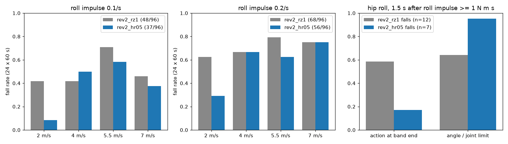

# 169 고관절 roll 명령 범위 확대 rev2_hr05 (채택)

2026-10-29, 사용자 지시 "계속 진행해". 증거 168 진단에서는 좌우 충격으로 넘어질 때 고관절 roll 행동이 명령 범위 끝(±0.3 rad)에 붙어 있었다. 그래서 이 범위를 관절 한계인 ±0.5 rad까지 넓혀 `rev2_rz1`에서 이어 학습했다. 모두 MuJoCo 시뮬레이션 결과이며, 능동축 수는 바뀌지 않았다.

## 결론

- `rev2_hr05`를 **새 최선 정책으로 채택**한다. 24시드 기준 넘어짐이 줄었다.
  - 기본 충격 조건: 48/96 → 37/96.
  - roll 충격 2배 조건: 68/96 → 56/96.
  - 두 조건 합계: 116/192 → 93/192, Fisher p = 0.024.
- 명목 조건(충격·무작위화 없음)에서는 넘어짐이 0이다. 7 m/s 명령 시 실제 속도는 5.71에서 **6.08 m/s**로 올랐다.
- 개선은 저속(2 m/s)에 몰려 있다. 4–7 m/s에서는 넘어짐이 비슷하다.
- 넘어진 경우를 보면, 고관절 roll 행동이 범위 끝에 붙는 시간은 58 %에서 17 %로 줄었다. 대신 관절 각이 **기구 한계의 95 %**까지 간다. 이제 남은 한계는 명령 범위가 아니라 관절 가동 범위(±0.5 rad)다.
- 빨라진 만큼 발열은 조금 늘었다. 7 m/s로 10분 달리면, 가장 나쁜 장착 조건에서 권선이 138 °C(`rz1`은 137 °C)까지 오르고 감액 계수가 0.32(`rz1`은 0.40)까지 내려간다. 넘어지지는 않았다.

## 바꾼 것

- `sim/rl/run_env.py`: `RunEnv(scale_override={관절 종류: rad})` 추가. 기본값은 None이며, 이때 기존과 같다.
- `sim/rl/train_run.py`: `--scale-override '{"hip_roll": 0.5}'` 옵션 추가.
- `eval/make_init.py`: `rev2_rz1`을 넓어진 범위에 맞게 다시 표현해 시작점으로 썼다.
  - 고관절 roll 출력 행·bias·log_std를 0.3/0.5배로 줄였다.
  - 대응하는 last_action 관측 정규화도 같은 배율로 맞췄다.
  - 변환 전후 관절 목표의 최대 차이는 5.96e-7 rad로, 시작 정책은 사실상 같다.
- `docs/evidence/166-.../eval/ablate.py`: 시작 시드를 지정하는 인자(기본 5000)를 추가했다. 기존 호출은 그대로 동작한다.

## 학습

- 시작점: `rev2_rz1`(변환본). 10M 스텝을 학습해 누적 57.4M 스텝이 됐다.
- 조건: realism v2, 30초 판, roll 충격 0.2회/초. 범위 확대 외의 조건은 증거 168(`rz2`)과 같다.
- 기록: `policy/args.json`, `policy/progress.csv`.

## 결과

조건: 60초 판 × 명령 2/4/5.5/7 m/s × 시드 5000–5023, v2 실물화, 무작위화.

| 정책 | roll 충격 | 2 | 4 | 5.5 | 7 | 합계 |
|---|---|---|---|---|---|---|
| `rev2_rz1` | 0.1/s | 10/24 | 10/24 | 17/24 | 11/24 | 48/96 |
| `rev2_hr05` | 0.1/s | **2/24** | 12/24 | 14/24 | 9/24 | **37/96** |
| `rev2_rz1` | 0.2/s | 15/24 | 16/24 | 19/24 | 18/24 | 68/96 |
| `rev2_hr05` | 0.2/s | **7/24** | 16/24 | 15/24 | 18/24 | **56/96** |

- 데이터 위치:
  - 시드 5000–5007: `eval/ablate.jsonl`. `rz1`의 이 구간은 증거 167·168에 있다.
  - 시드 5008–5023: `eval/ablate_more_seeds.jsonl`.
- 처음 8시드만 보면 13 → 10, 25 → 19로 줄었지만 p = 0.6 / 0.18로 유의하지 않았다. 그래서 16시드를 더 돌렸다.
- 같은 8시드에서 충격만 끈 조건은 세 경우(roll 0.1/s, 0.2/s, 실물화 끔) 모두 0/32였다.
- 실물화를 끈 조건(roll 0.1/s)은 18/32다. `rz2`는 21/32였다.

명목 20초 × 8(`eval/probe_nominal.jsonl`):

| 명령 (m/s) | 2 | 4 | 5.5 | 7 |
|---|---|---|---|---|
| `rz1` 속도 (m/s) | 1.89 | 4.24 | 5.19 | 5.71 |
| `hr05` 속도 (m/s) | 1.94 | 4.16 | 5.42 | **6.08** |
| `hr05` 넘어짐 | 0/8 | 0/8 | 0/8 | 0/8 |

- `hr05` 권선 최고 온도는 38.9 °C였다.

10분 연속 주행(`eval/long_run.jsonl`, 10분 시점):

| 명령 | 장착 | 속도 | 권선 최고 | 최저 감액 | 넘어짐 |
|---|---|---|---|---|---|
| 4 m/s | 방열판 | 4.31 | 54 °C | 1.0 | 없음 |
| 4 m/s | 가장 나쁨 | 4.30 | 92 °C | 1.0 | 없음 |
| 7 m/s | 방열판 | 6.31 | 90 °C | 1.0 | 없음 |
| 7 m/s | 가장 나쁨 | 5.17 | 138 °C | 0.32 | 없음 |

## roll 충격 진단 (`eval/roll_diag_hr05.jsonl`, 증거 168과 같은 방법)

| 정책 | 구분 | 횟수 | 행동 범위 끝에 붙은 시간 | 관절 각 / 한계 | 토크 / 한계 | 최대 기울기 |
|---|---|---|---|---|---|---|
| `rz1` | 넘어짐 | 12 | 58.5 % | 0.64 | 0.70 | 0.84 rad |
| `hr05` | 넘어짐 | 7 | 17.0 % | **0.95** | 0.61 | 0.80 rad |
| `hr05` | 버팀 | 76 | 0.1 % | 0.58 | 0.97 | 0.26 rad |

- 대상은 1 N·m·s 이상의 roll 충격이다.
- 버틴 경우에는 토크를 한계 가까이 쓰고 각도는 덜 쓴다. 넘어진 경우에는 그 반대로, 각도는 한계까지 쓰지만 토크는 덜 쓴다.
- 넘어진 경우는 7회뿐이라 표본이 적다.

## 구분

| 구분 | 내용 |
|---|---|
| 확인 | 명령 범위 확대로 넘어짐 감소(두 조건 합계 p = 0.024)와 최고 속도 6.08 m/s. 명목 조건 넘어짐 0. 넘어질 때 행동 포화가 줄고 관절 한계에 닿음 |
| 실패 | 4–7 m/s 넘어짐은 줄지 않음. 고속 장시간 주행의 발열은 조금 늘어남(가장 나쁜 장착 조건에서 감액 0.32) |
| 미검증 | 고관절 roll 기구 한계 ±0.5 rad가 실제 설계에서 넓힐 수 있는 값인지. 각 속도별 차이의 유의성(속도별 24시드) |
| 다음 한 단계 | 고속 넘어짐의 원인 분해. 관절 한계 확대(설계 변경)가 필요한지 확인 |
