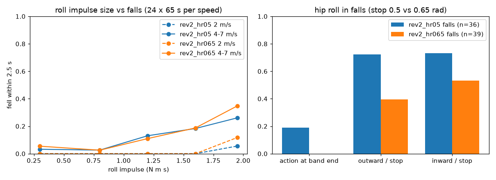
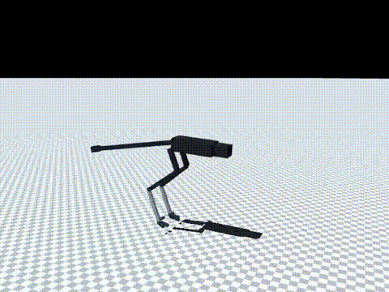

# 170 고속 충격 넘어짐 원인 분해와 고관절 roll ±0.65 rad 시도 rev2_hr065 (미채택)

2026-10-29, 사용자 지시 "계속 진행해". 증거 169에서 채택한 `rev2_hr05`는 4–7 m/s에서 넘어짐이 줄지 않았다. 그 원인을 나누고, 고관절 roll 범위를 더 넓혀(±0.65 rad) 이어 학습해 봤다. 모두 MuJoCo 시뮬레이션 결과다. 능동축 수는 바뀌지 않았다.

## 결론

- `rev2_hr065`는 **미채택**이다. 현재 최선은 그대로 `rev2_hr05`다.
  - 넘어짐: 기본 충격 41/96(`hr05`는 37/96, p = 0.66), 좌우 충격 2배 58/96(`hr05`는 56/96).
  - 명목 속도는 7 m/s 명령에서 6.24 m/s로 조금 올랐다(`hr05`는 6.08 m/s).
- 고관절 roll 범위는 더 이상 한계가 아니다.
  - `hr065`가 넘어질 때 행동이 범위 끝에 붙은 시간은 0 %였다.
  - 바깥쪽 각도는 기구 한계의 40 %만 썼다.
- 남은 넘어짐은 **속도에 따른 한계**로 보인다. 좌우 충격 크기별 넘어짐(아래 그림)은 다음과 같다.
  - 2 m/s에서는 1.8 N·m·s까지 0회다.
  - 4–7 m/s에서는 1 N·m·s를 넘으면 13–26 %가 넘어진다.
  - 두 정책의 곡선이 거의 같다.
  - 이전 r4 진단(`docs/evidence/164-rev2-spring-clutch/rev2/train/roll_diag_inertia.py`)에서 확인한 사실, 즉 공중에 떠 있을 때는 좌우 회전을 바로잡을 수단이 없다는 점과 방향이 맞는다. 다만 이번에는 공중에 뜬 시간 비율을 직접 재지 않았다.
- 4–7 m/s에서는 회전(yaw) 충격만으로도 넘어진다. `hr05`의 충격 종류별 넘어짐(24회 기준)은 아래와 같다.

| 충격 종류 | 2 m/s | 4 m/s | 5.5 m/s | 7 m/s |
|---|---|---|---|---|
| 좌우(roll)만 | 1 | 13 | 14 | 5 |
| 회전(yaw)만 | 1 | 10 | 4 | 2 |
| 밀기만 | 0 | 1 | 1 | 0 |

이 로봇에는 고관절 yaw 축이 없어서, 회전 충격은 꼬리와 발 마찰로만 버틴다.

## 진단 순서

1. **충격 종류별 분리** (`eval/ablate_groups.jsonl`, `hr05`, 24시드): 위 표.
2. **방향을 나눈 고관절 roll 사용량** (`eval/roll_diag_signed.py`, `eval/roll_diag_signed_hr05.jsonl`)
   - 두 관절 축이 모두 +x이므로, 바깥쪽은 왼쪽 +q, 오른쪽 −q다.
   - 1 N·m·s 이상의 좌우 충격 뒤 넘어진 36회 중 21회는 바깥쪽 끝(한계의 95 % 이상)까지 갔다. 버틴 239회 중에서는 21회였다.
3. **기구 한계만 넓히기** (`eval/ablate_range.py`, `eval/ablate_outward_stop.jsonl`)
   - 재학습 없이 바깥쪽 기구 한계만 0.65 또는 0.8 rad로 넓혔다. 두 경우 모두 38/96으로, 기준 37/96과 같았다.
   - 넓힌 상태에서도 바깥쪽 각도는 최대 0.503 rad였다. 다리는 기구 한계가 아니라 명령 범위 끝(±0.5 rad)에 머물러 있었다.
4. **명령 범위와 기구 한계를 함께 ±0.65 rad로** (`rev2_hr065`): 결과는 아래와 같다.

±0.65 rad를 고른 근거는 공개 MJCF의 고관절 roll 범위다.

| 로봇 | 범위 | 출처 |
|---|---|---|
| Agility Cassie | −15° ~ +22.5° | mujoco_menagerie@f3b6013 `agility_cassie/cassie.xml` |
| Unitree H1 | ±0.43 rad | unitree_mujoco@1eb6642 `h1.xml` |
| Berkeley Humanoid | ±0.61 rad | mujoco_menagerie@f3b6013 `berkeley_humanoid.xml` |
| Unitree G1 | 안쪽 0.52, 바깥쪽 2.97 rad | unitree_mujoco@1eb6642 `g1_29dof.xml` |

±0.65 rad는 이 범위의 넓은 쪽 끝에 해당하고, 실제 설계에서 가능한지는 확인하지 않았다.

## 바꾼 것

- `sim/rl/run_env.py`: `RunEnv(range_override={관절 종류: rad})` 추가. 대칭 기구 한계 ±rad로 MJCF 범위를 대체한다. 기본값은 None이며 이때 기존과 같다.
- `sim/rl/train_run.py`: `--range-override` 옵션 추가.
- `eval/make_init.py`(증거 169판 수정): 원래 범위를 원본 args에서 읽고, 기구 한계 인자를 받는다.
  - `hr05` → ±0.65 변환본으로 200스텝을 같은 조건에서 돌렸다. 139스텝 전까지 관절 목표 차이는 2.7e-6 rad였다.
  - 그 뒤에는 수치 오차가 보행 동역학에서 커져 최대 0.008 rad까지 벌어졌다.

## 학습

- 시작점: `rev2_hr05`(변환본). 10M 스텝을 학습해 누적 67.5M 스텝이 됐다.
- 조건: `--scale-override` / `--range-override '{"hip_roll": 0.65}'`. 나머지는 `hr05`와 같다(v2 실물화, 30초 판, roll 충격 0.2회/초).

## 결과 (`hr065`, 60초 × 명령 2/4/5.5/7 m/s × 시드 5000–5023)

| 조건 | 2 | 4 | 5.5 | 7 | 합계 | `hr05` |
|---|---|---|---|---|---|---|
| 무작위화, roll 0.1/s | 2 | 11 | 14 | 14 | 41/96 | 37/96 |
| 무작위화, roll 0.2/s | 5 | 15 | 14 | 24 | 58/96 | 56/96 |
| 실물화 끔, roll 0.1/s | 4 | 10 | 16 | 18 | 48/96 | (8시드 18/32) |
| 충격 없음 (세 조건) | 0 | 0 | 0 | 0 | 0/96 | 0 |

명목 20초 × 8(`eval/probe_nominal.jsonl`):

| 명령 (m/s) | 2 | 4 | 5.5 | 7 |
|---|---|---|---|---|
| 속도 (m/s) | 1.96 | 4.26 | 5.41 | 6.24 |

- 명목 조건에서 넘어짐은 0이었고, 권선 최고 온도는 38 °C였다.

10분 연속 주행(`eval/long_run.jsonl`)에서 7 m/s 명령의 결과는 다음과 같다.

| 장착 조건 | 속도 | 권선 최고 | 최저 감액 |
|---|---|---|---|
| 방열판 | 6.10 m/s | 80 °C | 1.0 |
| 가장 나쁨 | 6.08 m/s | 138 °C | 0.36 |

- 4 m/s 가장 나쁜 장착 조건에서는 106 °C였다(`hr05`는 92 °C).
- 넘어짐은 없었다.

## 구분

| 구분 | 내용 |
|---|---|
| 확인 | 고관절 roll 범위는 남은 넘어짐의 원인이 아님(기구 한계만 넓혀도, 범위를 함께 넓혀 재학습해도 같음). 4–7 m/s에서 1 N·m·s 넘는 좌우 충격과 회전 충격에 넘어짐 |
| 실패 | `rev2_hr065` 미채택 |
| 미검증 | 고속 넘어짐이 공중에 뜬 시간 때문인지(이번에는 직접 재지 않음). 충격 크기 분포가 실제 환경과 맞는지(공개 근거 없음) |
| 다음 한 단계 | 고속에서 충격 직후 공중에 뜬 시간과 발 디딤 위치를 측정해 원인 확정. 회전 충격 대책으로 고관절 yaw 축이 필요하면 능동축 추가이므로 사용자에게 먼저 보고 |
