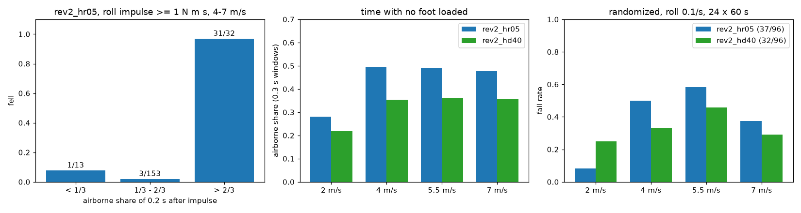
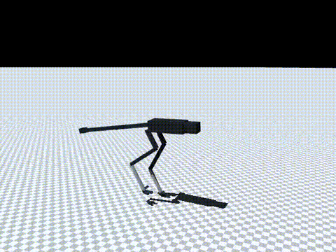

# 171 고속 넘어짐은 공중에 뜬 순간의 충격: 걸음 착지 비율 0.40 rev2_hd40 (조건부, 기본 미채택)

2026-10-29, 사용자 지시 "계속 진행해". 증거 170에서 남은 4–7 m/s 넘어짐의 원인을 찾았다. 그리고 학습 보상의 걸음 일정을 바꿔 공중에 뜬 시간을 줄여 봤다. 모두 MuJoCo 시뮬레이션 결과이며, 능동축 수는 바뀌지 않았다.

## 결론

- **원인**: 고속 넘어짐은 두 발이 모두 공중에 떠 있을 때 좌우 충격을 받아서 생긴다. 근거는 `rev2_hr05`, 1 N·m·s 이상 좌우 충격, 4–7 m/s다.
  - 충격 뒤 0.2초 중 2/3 넘게 공중에 있었으면 32회 중 31회 넘어졌다.
  - 그 0.2초 동안 발이 땅에 닿아 있었으면 153회 중 3회만 넘어졌다.
  - 넘어짐은 충격 뒤 0.04–0.4초(중앙값 약 0.2초)에 일어나, 한 걸음보다 빠르다.
  - 넘어짐 판정을 무시하고 2초를 더 돌려도 32회 중 회복은 0회였다. 모두 2.4–3 rad까지 기울었으므로 진짜 넘어짐이다.
- **왜 고속에서만**: 보상의 걸음 일정(`gait` 항, 가중치 −8)이 원인이다.
  - 이 일정은 한 발이 땅에 닿는 비율을 2 m/s에서 0.41, 3 m/s 이상에서 0.28(타조 기준)로 정한다.
  - 그 결과 실제로 공중에 뜬 시간이 2 m/s에서 28 %, 4–7 m/s에서 48–50 %였다.
- **시도**: `--gait-duty-min 0.4`로 고속 착지 비율 하한을 0.40으로 올리고 `rev2_hr05`에서 이어 학습했다(`rev2_hd40`).
  - 4–7 m/s 공중 시간이 35–36 %로 줄었다.
  - 1 N·m·s 이상 좌우 충격 뒤 넘어짐이 35/198에서 13/220으로 줄었다.
- **판단**: 충격에는 강해졌지만 속도와 다른 조건에서 손해가 있어, 기본 정책은 그대로 `rev2_hr05`다. `rev2_hd40`은 충격 내구성 후보로 보존한다. 중간값 0.34(`rev2_hd34`, 증거 172)로 절충을 시험한다.

| 항목 | `hr05` | `hd40` |
|---|---|---|
| 무작위화 넘어짐, 좌우 충격 0.1/s | 37/96 | 32/96 |
| 무작위화 넘어짐, 좌우 충격 0.2/s | 56/96 | **40/96** |
| 두 조건 합계 | 93/192 | **72/192** (p = 0.039) |
| 2 m/s 넘어짐, 좌우 충격 0.1/s | **2/24** | 6/24 |
| 실물화 끔 | **59/96** | 76/96 (p = 0.011) |
| 7 m/s 명령 명목 속도 | **6.08 m/s** | 5.55 m/s |
| 10분 7 m/s, 가장 나쁜 장착 | 138 °C, 감액 0.32 | 136 °C, **감액 0.47** |

## 실물화를 껐을 때 나빠지는 것

`hd40`은 실물화를 전부 끄면 넘어짐이 늘었다. 2 m/s에서는 16/24로, `hr05`의 5/24보다 많았다(p = 0.003). 그래서 4 m/s에서 실물화 블록을 하나씩 끄고 24시드로 다시 쟀다(`eval/ablate_realism_drop.jsonl`, `eval/realism_drop/`).

| 끈 블록 | `hr05` | `hd40` |
|---|---|---|
| 없음(v2 전부) | 12 | 8 |
| delay | 15 | 16 |
| encoder | 12 | 10 |
| friction | 12 | 11 |
| imu | 11 | 8 |
| thermal | 11 | 12 |
| motor + thermal | 13 | 9 |
| 전부(실물화 끔) | 16 | 20 |

- motor 블록을 끄면 thermal도 함께 꺼야 한다(`realism.py`).
- 블록 하나만 끄면 두 정책이 비슷하다. `hd40`이 특정 블록에 더 약하지는 않다.
- 실물화를 전부 끈 조건은 학습 때 보지 못한 조합이다. 실물 목표 조건은 v2이므로 이 결과는 위험 신호로만 기록한다.

## 바꾼 것

- `sim/rl/run_env.py`: `RunEnv(gait_duty_min=...)` 추가. 걸음 일정의 착지 비율 하한으로 `GAIT_DUTY` 0.28을 대체한다. 기본값은 None이며 이때 기존과 같다.
- `sim/rl/train_run.py`: `--gait-duty-min` 옵션 추가.
- `eval/roll_diag_air.py`: 증거 170 진단에 충격 시점의 발 접지와 공중 시간(0.1 / 0.2 / 0.3초), 기울기를 더했다.
- `eval/recover_check.py`: 넘어짐 판정 뒤에도 2초를 더 돌려 회복하는지 확인한다.

## 학습

- 시작점: `rev2_hr05`. 10M 스텝을 학습해 누적 67.5M 스텝이 됐다.
- 조건: `--gait-duty-min 0.4`. 나머지는 `hr05`와 같다(v2 실물화, 30초 판, 좌우 충격 0.2회/초, 고관절 roll ±0.5).
- 기록: `policy/`.

## 결과

조건: 60초 판 × 명령 2/4/5.5/7 m/s × 시드 5000–5023, v2 실물화(`eval/ablate.jsonl`).

| `hd40` 조건 | 2 | 4 | 5.5 | 7 | 합계 |
|---|---|---|---|---|---|
| 무작위화, 좌우 충격 0.1/s | 6 | 8 | 11 | 7 | 32/96 |
| 무작위화, 좌우 충격 0.2/s | 6 | 12 | 12 | 10 | 40/96 |
| 실물화 끔, 좌우 충격 0.1/s | 16 | 20 | 20 | 20 | 76/96 |

- 충격만 끈 조건은 v2에서 0/96, 실물화 끔에서 2/96이었다.
- 같은 조건의 `hr05` 실물화 끔 결과(5/16/19/19 = 59/96)는 `eval/ablate_hr05_norz24.jsonl`에 있다.

명목 20초 × 8(`eval/probe_nominal.jsonl`):

| 명령 (m/s) | 2 | 4 | 5.5 | 7 |
|---|---|---|---|---|
| `hd40` 속도 (m/s) | 1.93 | 4.08 | 5.03 | 5.55 |

- 넘어짐은 0이었고, 권선 최고 온도는 38 °C였다.

10분 연속 주행(`eval/long_run.jsonl`):

| 명령 | 장착 | 속도 | 권선 최고 | 감액 |
|---|---|---|---|---|
| 4 m/s | 방열판 | 4.12 | 57 °C | 1.0 |
| 4 m/s | 가장 나쁨 | 4.12 | 101 °C | 1.0 |
| 7 m/s | 방열판 | 5.56 | 73 °C | 1.0 |
| 7 m/s | 가장 나쁨 | 5.51 | 136 °C | 0.47 |

- 넘어짐은 없었다.

## 구분

| 구분 | 내용 |
|---|---|
| 확인 | 고속 넘어짐의 원인은 공중에 뜬 순간의 좌우 충격(31/32 대 3/153). 원인은 착지 비율 0.28 걸음 일정. 비율 0.40으로 공중 시간과 충격 넘어짐이 줄어듦(합계 p = 0.039) |
| 실패 | `hd40`은 속도 −9 %, 2 m/s 넘어짐 증가, 실물화를 전부 끄면 약함. 기본 정책으로는 미채택 |
| 미검증 | 실물화 전부 끔에서 약해지는 원인(블록 하나씩 끄면 차이 없음). 타조 기준 0.28이 이 로봇 크기에 맞는지 |
| 다음 한 단계 | 중간값 0.34(`rev2_hd34`)로 속도와 충격 내구성 절충 시험(증거 172) |
