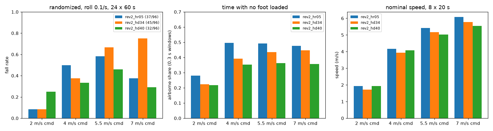
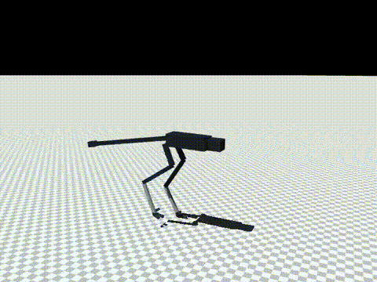

# 172 걸음 착지 비율 중간값 0.34 rev2_hd34 (미채택)

2026-10-30, 사용자 지시 "계속 진행해". 증거 171의 `rev2_hd40`(착지 비율 하한 0.40)은 충격에 강해졌지만 속도가 9 % 줄었다. 그래서 중간값 0.34로 속도와 충격 내구성을 함께 지킬 수 있는지 시험했다. 모두 MuJoCo 시뮬레이션 결과이며, 능동축 수는 바뀌지 않았다.

## 결론

- `rev2_hd34`는 **미채택**이다. 기본 정책은 그대로 `rev2_hr05`이고, 충격 내구성 후보도 그대로 `rev2_hd40`이다.
- 공중 시간은 예상대로 `hr05`와 `hd40`의 중간이다(4–7 m/s에서 39–45 %).
- 그러나 넘어짐은 중간이 아니었다. 고속에서는 오히려 가장 많았다.
  - 좌우 충격 0.1/s: 45/96. `hr05`는 37/96(p = 0.31), `hd40`은 32/96이다.
  - 7 m/s에서 18/24 넘어졌다(`hr05` 9/24, `hd40` 7/24). 직전 충격은 좌우 8회, 회전 7회였다.
  - 두 조건 합계는 99/192로 `hr05`의 93/192와 차이가 없다(p = 0.61). `hd40`의 72/192보다는 나쁘다(p = 0.008).
- 속도도 중간이 아니었다. 7 m/s 명령에서 5.77 m/s로, `hr05` 6.08과 `hd40` 5.55 사이다. 2 m/s 명령에서는 1.72 m/s로 셋 중 가장 느리다.
- 비율 하나에 정책 하나씩만 학습했으므로, 이 비단조성이 착지 비율 때문인지 학습 한 번의 편차 때문인지는 구분하지 못했다.

| 항목 | `hr05` (0.28) | `hd34` (0.34) | `hd40` (0.40) |
|---|---|---|---|
| 무작위화 넘어짐, 좌우 충격 0.1/s | 37/96 | 45/96 | **32/96** |
| 무작위화 넘어짐, 좌우 충격 0.2/s | 56/96 | 54/96 | **40/96** |
| 두 조건 합계 | 93/192 | 99/192 | **72/192** |
| 실물화 끔, 좌우 충격 0.1/s | 59/96 | **57/96** | 76/96 |
| 4–7 m/s 공중 시간 | 48–50 % | 39–45 % | 35–36 % |
| 1 N·m·s 이상 좌우 충격 뒤 넘어짐, 4–7 m/s | 35/198 | 28/210 | **13/220** |
| 7 m/s 명령 명목 속도 | **6.08 m/s** | 5.77 m/s | 5.55 m/s |
| 10분 7 m/s, 가장 나쁜 장착 | 138 °C, 감액 0.32 | 136 °C, 감액 0.47 | 136 °C, 감액 0.47 |

- 충격 뒤 0.2초 중 2/3 넘게 공중에 있었으면 26회 중 24회 넘어졌다. 땅에 닿아 있었으면 184회 중 4회였다. 증거 171과 같은 양상이다.

## 학습

- 시작점: `rev2_hr05`. 10M 스텝을 학습해 누적 67.5M 스텝이 됐다.
- 조건: `--gait-duty-min 0.34`. 나머지는 `hd40`과 같다(v2 실물화, 30초 판, 좌우 충격 0.2회/초, 고관절 roll ±0.5).
- 코드 변경은 없다(증거 171의 옵션을 그대로 썼다). 기록은 `policy/`에 있다.

## 결과

조건: 60초 판 × 명령 2/4/5.5/7 m/s × 시드 5000–5023(`eval/ablate.jsonl`).

| `hd34` 조건 | 2 | 4 | 5.5 | 7 | 합계 |
|---|---|---|---|---|---|
| 무작위화, 좌우 충격 0.1/s | 2 | 9 | 16 | 18 | 45/96 |
| 무작위화, 좌우 충격 0.2/s | 4 | 12 | 17 | 21 | 54/96 |
| 실물화 끔, 좌우 충격 0.1/s | 5 | 11 | 20 | 21 | 57/96 |

- 충격만 끈 조건에서는 v2에서 0/96, 0/96이었고, 실물화 끔에서 1/96이었다.

명목 20초 × 8(`eval/probe_nominal.jsonl`):

| 명령 (m/s) | 2 | 4 | 5.5 | 7 |
|---|---|---|---|---|
| `hd34` 속도 (m/s) | 1.72 | 3.94 | 5.16 | 5.77 |

- 넘어짐은 0이었고, 권선 최고 온도는 37 °C였다.

10분 연속 주행(`eval/long_run.jsonl`):

| 명령 | 장착 | 속도 | 권선 최고 | 감액 |
|---|---|---|---|---|
| 4 m/s | 방열판 | 3.98 | 51 °C | 1.0 |
| 4 m/s | 가장 나쁨 | 3.98 | 84 °C | 1.0 |
| 7 m/s | 방열판 | 5.91 | 75 °C | 1.0 |
| 7 m/s | 가장 나쁨 | 5.54 | 136 °C | 0.47 |

- 넘어짐은 없었다.
- 공중 시간 진단은 `eval/roll_diag_air_hd34.jsonl`에 있다(증거 171의 `roll_diag_air.py`).

## 구분

| 구분 | 내용 |
|---|---|
| 확인 | 착지 비율을 올리면 공중 시간이 단계적으로 준다(50 → 42 → 36 %). 공중 충격이 넘어짐 원인이라는 결과를 재현했다(24/26 대 4/184) |
| 실패 | `hd34`는 넘어짐과 속도 모두 `hr05`·`hd40`보다 낫지 않다. 미채택 |
| 미검증 | 비단조 결과가 학습 편차인지(비율마다 학습 1회). 평지 외 지형에서의 보행(지형 시험은 아직 없다) |
| 다음 한 단계 | 최선 정책(`hr05`)과 후보(`hd40`)를 재학습 없이 험지(울퉁불퉁·경사·옆 경사·계단)에서 시험해 현재 한계를 수치로 기록 |
