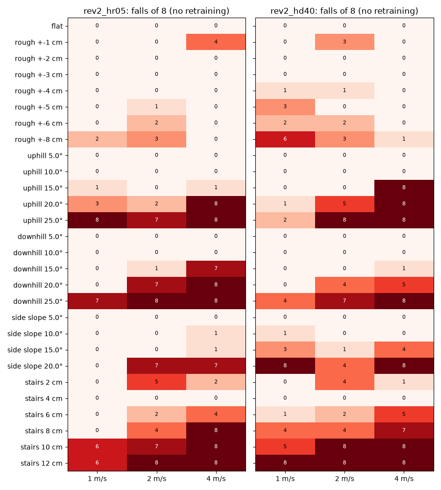
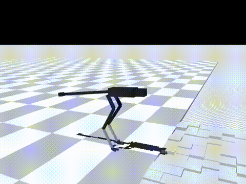
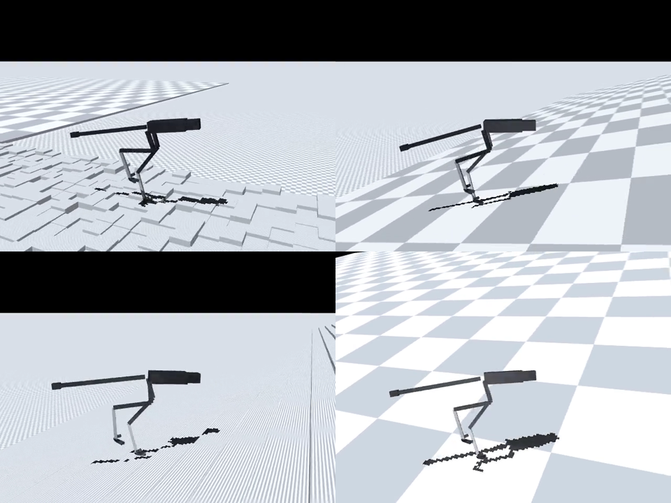

# 173 험지 무재학습 시험: 평지 학습 정책이 걸을 수 있는 지형 범위

2026-10-30, 사용자 질문 "험한 지형에서도 잘 걸어가니? 산이나 지형이 험한데??". 지금까지 학습과 평가는 모두 평지에서만 했다. 그래서 현재 최선 `rev2_hr05`와 후보 `rev2_hd40`을 재학습 없이 험지에 올려 어디까지 걷는지 쟀다. 모두 MuJoCo 시뮬레이션 결과이며, 능동축 수는 바뀌지 않았다.

## 결론

- 평지에서만 학습한 정책도 **완만한 험지는 걷는다**. 아래 범위는 `hr05` 기준으로, 1/2/4 m/s 명령 각 8회에서 넘어짐이 0–1회였다.
  - 오르막·내리막 10°까지
  - 옆 경사 15°까지
  - 울퉁불퉁 ±4 cm까지(±1 cm 4 m/s는 아래 이상 결과 참고)
  - 계단 한 칸 4 cm
- **산길 수준은 못 걷는다**.
  - 오르막·내리막 20° 이상
  - 계단 8 cm 이상(2 m/s 이상)
  - 옆 경사 20°(2 m/s 이상)
  - 위 조건에서는 대부분 넘어진다.
- 느리게 걸을수록 버틴다. `hr05`는 1 m/s에서 내리막 20°, 옆 경사 20°, 계단 8 cm를 모두 넘어짐 0/8로 통과했다. 4 m/s에서는 이 지형들에서 7–8/8 넘어졌다.
- `hd40`은 경사에서 조금 낫고, 옆 경사와 울퉁불퉁에서는 더 나쁘다. 전체 넘어짐은 `hd40` 193/672, `hr05` 180/672로 비슷하다. 기본 정책은 그대로 `hr05`다.
- 결론적으로, 산길을 걸으려면 **지형을 넣은 학습이 필요하다**.

영상은 `media/*.mp4`에 있다. 모두 `hr05`, 2 m/s, 시드 5000이다.

| 영상 | 결과 |
|---|---|
| 울퉁불퉁 ±4 cm | 완주 |
| 오르막 15° | 완주 |
| 계단 10 cm | 9.6초에 넘어짐 |
| 옆 경사 20° | 4.2초에 넘어짐 |

## 시험 방법

스크립트는 `eval/terrain_probe.py`, 전체 실행은 `eval/run_sweep.sh`, 결과는 `eval/terrain.jsonl`이다.

- 정책: `rev2_hr05`, `rev2_hd40`. 학습한 그대로 쓰고 재학습하지 않았다.
- 조건
  - 충격과 무작위화는 껐다.
  - v2 실물화는 명목값으로 켰다.
  - 명령은 직진 1/2/4 m/s, 시드는 5000–5007이다.
- 지형은 `sim/rl/terrain.py`로 만들고, 바닥을 40 m로 넓혔다.
  - 울퉁불퉁: 20 cm 칸마다 높이를 ±a 범위에서 무작위로 정했다.
  - 오르막·내리막: 진행 방향 경사다.
  - 옆 경사: 진행 방향에 직각인 경사다.
  - 계단: 오르기만 시험했다. 한 칸 깊이는 35 cm다.
- 성공 조건: 10초 동안 넘어지지 않거나 18 m 지점까지 가면 성공이다.
- 넘어짐 판정
  - 몸통 기울기 0.8 rad 초과
  - 몸통이 땅에 닿음
  - 발밑 지면 기준 엉덩이 높이가 시작값의 절반 미만
  - `RunEnv` 자체 판정은 절대 높이를 써서 경사에서 맞지 않으므로 이 판정을 따로 썼다.

## 시험 바닥에서 찾은 문제

1. **`terrain.py`의 울퉁불퉁 바닥(높이맵)이 쓸 수 없는 상태다.**
   - ±0.5 cm 바닥, 높이를 모두 0으로 만든 바닥에서도 1.2초 만에 넘어졌다.
   - 그동안 발 상자가 바닥 아래 4–5 cm에서 접촉했다.
   - 같은 높이맵에 공이나 상자 하나만 떨어뜨리면 정상이다. 즉 이 로봇의 발과 높이맵의 조합에서만 생긴다.
   - 그래서 이번 시험에서는 울퉁불퉁 바닥을 20 cm 상자 칸으로 다시 만들었다(`terrain_probe.py`의 `add_rough_boxes`).
   - 증거 81에서 지형 학습이 처음부터 무너진 것도 이 문제 때문일 수 있다. 확인은 하지 않았다.
2. **기존 평지 접촉도 무르다.**
   - 평지에서 2 m/s로 걸을 때 발이 바닥에 파고드는 깊이는 중앙값 0.9 cm, 최대 2.7 cm였다.
   - 바닥 접촉 설정은 MuJoCo 기본값이다(solref 0.02).
   - 평지에서는 모서리가 없어 문제가 드러나지 않았다. 반면 상자 칸이나 계단 모서리에서는 파고든 발이 옆면에 걸릴 수 있다.
3. 2번 때문으로 보이는 이상 결과가 있다.
   - 높이 차가 거의 없는 상자 칸(±0.2 cm 이하)에서 넘어진다.
   - 울퉁불퉁 ±1 cm(`hr05` 4 m/s 4/8)와 계단 2 cm(2 m/s 5/8)가 그보다 높은 ±2–4 cm, 4 cm보다 더 많이 넘어진다.
   - 이 낮은 단차 결과는 실제 보행 한계라기보다 시험 바닥의 영향일 가능성이 있다.

## 구분

| 구분 | 내용 |
|---|---|
| 확인 | 평지 학습 정책의 무재학습 지형 범위: 경사 10°, 옆 경사 15°, 울퉁불퉁 ±4 cm, 계단 4 cm까지 넘어짐 0–1/8(4 m/s 울퉁불퉁 ±1 cm만 4/8). 경사 20° 이상과 계단 8 cm 이상은 대부분 넘어짐. 느릴수록 버팀 |
| 실패 | 산길 수준(경사 20° 이상, 계단 8 cm 이상) 보행 불가. `terrain.py` 높이맵 바닥은 이 로봇에 쓸 수 없음 |
| 미검증 | 접촉이 무른 것(평지에서 0.9–2.7 cm 파고듦)이 실제 지면과 맞는지, 낮은 단차 이상 결과의 원인. 내리막 계단, 미끄러운 바닥, 지형과 충격을 함께 넣은 조건 |
| 다음 한 단계 | 바닥 접촉 강성을 공개 자료와 비교해 정한다. 그다음 `terrain.py` 울퉁불퉁을 상자 방식으로 고치고, 쉬운 지형부터 단계식 지형 학습(`hr05`에서 이어서) |
