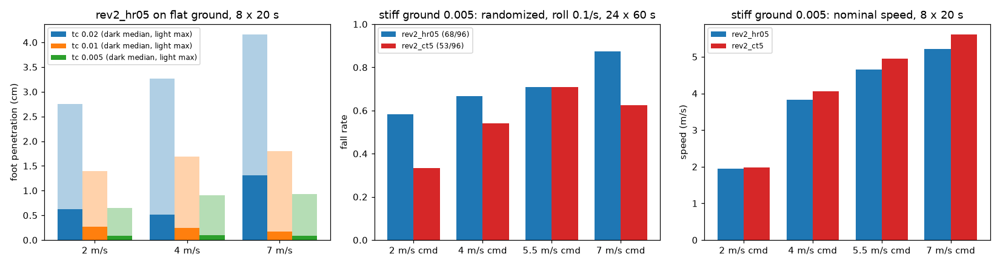
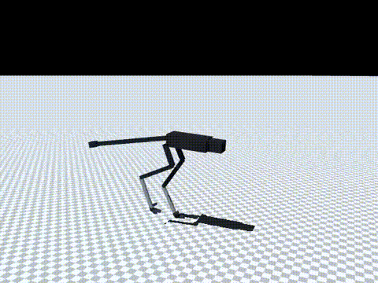
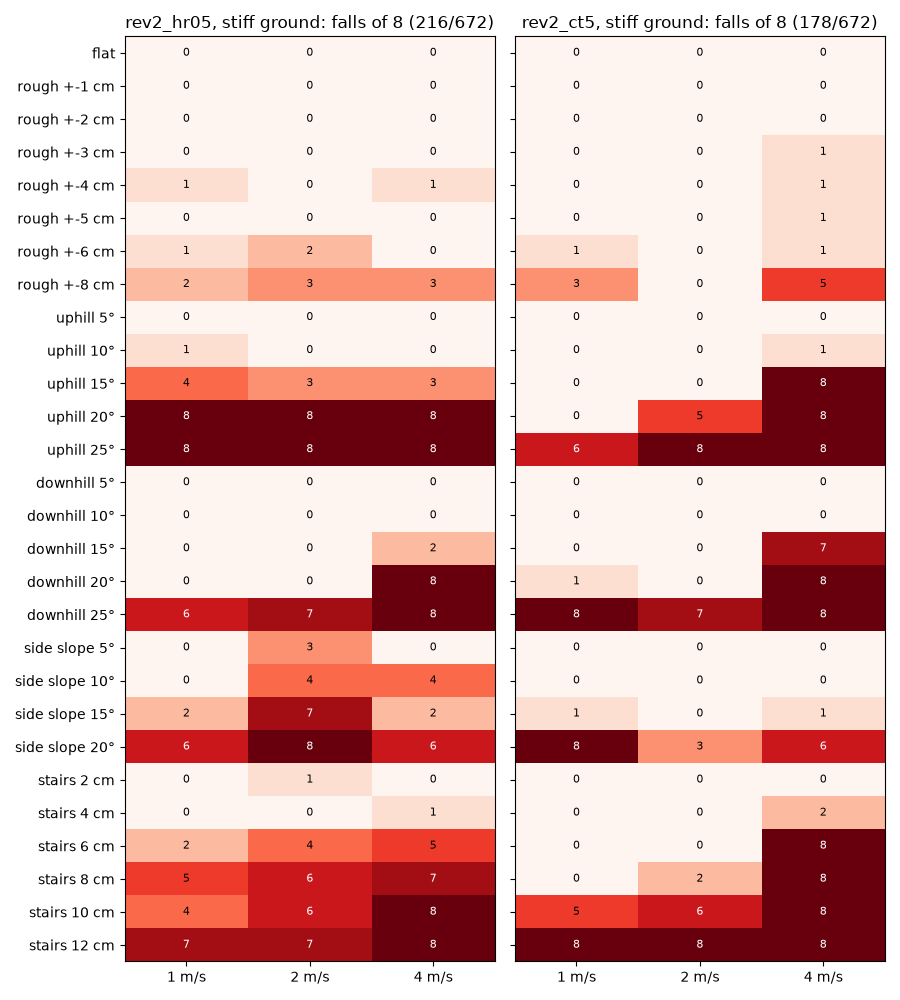

# 174 바닥 접촉 강성 0.005: 단단한 바닥 기준 rev2_ct5 (채택)

2026-10-30, 사용자 지시 "진행". 증거 173의 험지 시험에서 발이 바닥으로 파고드는 현상을 발견했다. 지금까지 모든 학습과 평가는 MuJoCo 기본 접촉 설정(solref 시간상수 0.02 s) 위에서 했다. 이 값이 실제 지면과 맞는지 공개 모델과 비교했고, 단단한 바닥으로 바꿔 이어 학습했다. 모두 MuJoCo 시뮬레이션 결과이며, 능동축 수는 바뀌지 않았다.

## 결론

- **기존 바닥은 너무 물렀다**. `rev2_hr05`가 평지를 달릴 때 발이 바닥에 파고든 깊이는 다음과 같다(`eval/contact_hr05.jsonl`).
  - 2 m/s: 중앙값 0.6 cm, 최대 2.8 cm
  - 7 m/s: 중앙값 1.3 cm, 최대 4.2 cm
- **새 기준은 접촉 시간상수 0.005 s**다. 이 값에서 발이 파고드는 깊이는 중앙값 0.1 cm, 최대 0.9 cm다.
  - 근거 1: mujoco_menagerie의 Agility Cassie가 같은 값을 쓴다(`agility_cassie/cassie.xml`, `solref="0.005 1"`, 시뮬레이션 간격 0.5 ms).
  - 근거 2: MuJoCo 문서는 시간상수를 시뮬레이션 간격의 2배 이상으로 두라고 한다. 이 모델의 간격은 1 ms이므로 0.005 s는 5배다.
  - 참고: menagerie의 Go1·Go2·ANYmal C는 시간상수를 기본값으로 두고, 발의 `solimp` 폭만 발 반지름에 맞춘다.
- 이전 수치 일부는 무른 바닥 덕이었다.
  - `hr05`를 재학습 없이 단단한 바닥에 올리면 7 m/s 명령 속도가 6.08에서 5.21 m/s로 떨어진다.
  - 무작위화 넘어짐은 37/96에서 68/96으로 늘어난다.
  - 따라서 증거 173 이전의 넘어짐·속도 수치는 이번부터의 수치와 직접 비교할 수 없다.
- 단단한 바닥에서 `hr05`를 10M 스텝 이어 학습한 `rev2_ct5`를 **새 최선 정책으로 채택**한다. 같은 단단한 바닥에서 `hr05`보다 넘어짐이 적고 더 빠르다.

| 단단한 바닥(0.005) | `hr05` (무재학습) | `ct5` | p |
|---|---|---|---|
| 무작위화 넘어짐, 좌우 충격 0.1/s | 68/96 | **53/96** | 0.036 |
| 무작위화 넘어짐, 좌우 충격 0.2/s | 84/96 | **72/96** | 0.041 |
| 실물화 끔, 좌우 충격 0.1/s | 75/96 | **56/96** | 0.005 |
| 두 충격 조건 합계 | 152/192 | **125/192** | 0.003 |
| 7 m/s 명령 명목 속도 | 5.21 m/s | **5.61 m/s** | |
| 험지 넘어짐(28지형 × 1/2/4 m/s × 8회) | 216/672 | **178/672** | |

## 단단한 바닥의 효과

- 증거 173에서 낮은 단차에서 넘어지던 이상 결과가 사라졌다(`hr05` 무재학습 기준).
  - 울퉁불퉁 ±1 cm, 4 m/s: 4/8 → 0/8
  - 계단 2 cm, 2 m/s: 5/8 → 1/8
  - 무른 바닥에서 파고든 발이 모서리에 걸렸던 것으로 본다.
- 대신 가파른 경사는 더 어려워졌다. 같은 `hr05`에서 오르막 20°, 2 m/s가 2/8 → 8/8이 됐다.
- 이 비교는 `tp_tc.py`를 임시로 써서 8시드로 했으며, 결과 파일은 남기지 않았다. 아래 험지 표가 같은 조건의 전체 결과다.

## 바꾼 것

- `sim/rl/run_env.py`: `RunEnv(contact_tc=...)`를 추가했다. 모든 접촉의 solref 시간상수를 바꾼다. 기본값은 None이며 이때 기존과 같다.
- `sim/rl/train_run.py`: `--contact-tc` 옵션을 추가했다.
- `eval/contact_probe.py`: 시간상수별 평지 보행과 발이 파고드는 깊이를 잰다.

## 학습

- 시작점: `rev2_hr05`. 10M 스텝을 학습해 누적 67.5M 스텝이 됐다.
- 조건: `--contact-tc 0.005`. 나머지는 `hr05`와 같다(v2 실물화, 30초 판, 좌우 충격 0.2회/초, 고관절 roll ±0.5, 착지 비율 기본 0.28).
- 기록은 `policy/`에 있다.

## 결과 (단단한 바닥, 60초 판 × 명령 2/4/5.5/7 m/s × 시드 5000–5023, `eval/ablate.jsonl`)

| 정책 | 조건 | 2 | 4 | 5.5 | 7 | 합계 |
|---|---|---|---|---|---|---|
| `ct5` | 좌우 충격 0.1/s | 8 | 13 | 17 | 15 | 53/96 |
| `ct5` | 좌우 충격 0.2/s | 12 | 19 | 19 | 22 | 72/96 |
| `ct5` | 실물화 끔 | 8 | 14 | 18 | 16 | 56/96 |
| `hr05` | 좌우 충격 0.1/s | 14 | 16 | 17 | 21 | 68/96 |
| `hr05` | 좌우 충격 0.2/s | 20 | 21 | 21 | 22 | 84/96 |
| `hr05` | 실물화 끔 | 10 | 20 | 22 | 23 | 75/96 |

명목 20초 × 8(`eval/probe_nominal_*.jsonl`):

| 명령 (m/s) | 2 | 4 | 5.5 | 7 |
|---|---|---|---|---|
| `ct5` 속도 | 1.98 | 4.06 | 4.95 | 5.61 |
| `hr05` 속도 | 1.95 | 3.83 | 4.65 | 5.21 |

- 두 정책 모두 명목 조건에서는 넘어짐이 0이었다.

10분 연속 주행, `ct5`(`eval/long_run.jsonl`):

| 명령 | 장착 | 속도 | 권선 최고 | 감액 |
|---|---|---|---|---|
| 4 m/s | 방열판 | 4.03 | 51 °C | 1.0 |
| 4 m/s | 가장 나쁨 | 4.04 | 84 °C | 1.0 |
| 7 m/s | 방열판 | 5.66 | 82 °C | 1.0 |
| 7 m/s | 가장 나쁨 | 5.92 | 138 °C | 0.36 |

- 넘어짐은 없었다.

## 험지 (단단한 바닥, 무재학습, 증거 173과 같은 방법, `eval/terrain.jsonl`)

- `ct5`는 1–2 m/s에서 다음 지형을 넘어짐 0–1/8로 걷는다.
  - 오르막·내리막 15°
  - 옆 경사 15°
  - 울퉁불퉁 ±6 cm
  - 계단 6 cm
  - 오르막 20°와 계단 8 cm는 1 m/s에서만 버틴다.
- 4 m/s에서는 경사 15°와 계단 6 cm에서 7–8/8 넘어진다. 이 조건은 `hr05`보다 나쁘다.
- 경사 25°와 계단 12 cm는 두 정책 모두 걷지 못한다.

## 구분

| 구분 | 내용 |
|---|---|
| 확인 | 기존 바닥은 무름(파고듦 최대 4.2 cm), 0.005에서 최대 0.9 cm. 단단한 바닥에서 `ct5`가 `hr05`보다 넘어짐이 적고(합계 p = 0.003) 빠름(5.61 m/s) |
| 실패 | 단단한 바닥에서는 충격 넘어짐이 무른 바닥 때보다 많다(`ct5` 53/96). 산길 수준(경사 20° 이상, 계단 8 cm 이상)은 여전히 걷지 못함 |
| 미검증 | 0.005가 실제 지면·발바닥 고무와 얼마나 맞는지(공개 모델 값을 따랐고, 지면 종류별 자료는 없음). 흙이나 풀처럼 무른 지면 |
| 다음 한 단계 | 단단한 바닥에서 `ct5`로부터 단계식 지형 학습. 그 전에 `terrain.py`의 높이맵 울퉁불퉁을 상자 방식으로 고침 |
