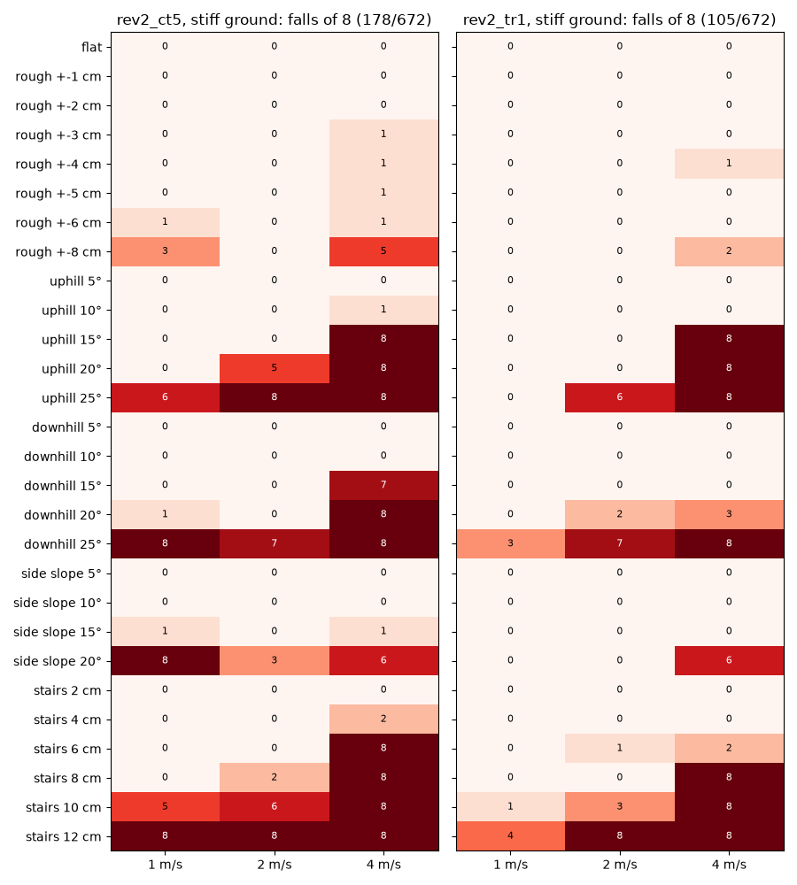
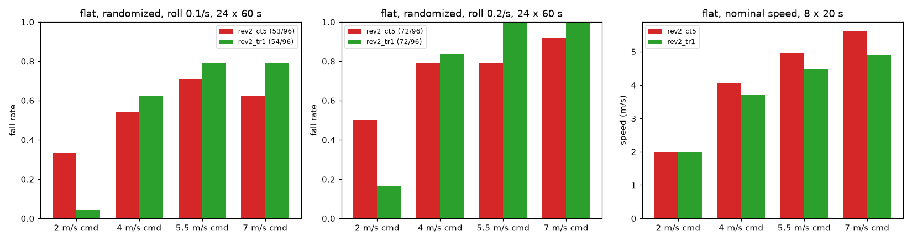
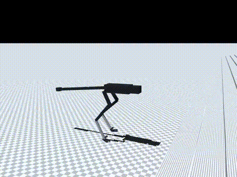
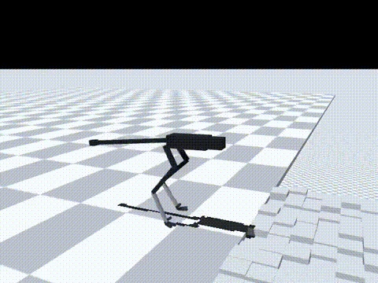

# 175 지형 학습 1단계 rev2_tr1: 험지 넘어짐 178→105, 대신 고속 평지 손해 (조건부, 기본 미채택)

2026-10-30, 사용자 지시 "진행"(증거 173 다음 단계 3: 쉬운 지형부터 단계식 학습). 단단한 바닥(접촉 시간상수 0.005, 증거 174)에서 `rev2_ct5`를 시작점으로 지형을 섞어 이어 학습했다. 모두 MuJoCo 시뮬레이션 결과이며, 능동축 수는 바뀌지 않았다.

## 결론

- **험지는 크게 좋아졌다.** 28지형 × 1/2/4 m/s × 8회에서 넘어짐이 178/672에서 105/672로 줄었다(p < 0.001).
  - 1–2 m/s에서 넘어짐 0/8로 걷는 범위(`ct5` → `tr1`):
    - 오르막: 15° → **20°**(1 m/s는 25°도 0/8)
    - 내리막: 15° → 15°(20°는 0/8, 2/8)
    - 옆 경사: 10° → **20°**
    - 울퉁불퉁: ±5 cm → **±8 cm**
    - 계단: 6 cm → **8 cm**(6 cm 2 m/s만 1/8)
  - 4 m/s에서는 내리막 15°(7/8 → 0/8)와 계단 6 cm(8/8 → 2/8)가 좋아졌다. 오르막 15° 이상과 계단 8 cm 이상은 그대로 8/8이다.
- **산길 목표(1–2 m/s, 경사 20°, 계단 10 cm, 울퉁불퉁 ±8 cm)에는 아직 못 미친다.**
  - 경사 20°: 오르막 0/8·0/8, 내리막 0/8·2/8
  - 울퉁불퉁 ±8 cm: 0/8·0/8
  - 계단 10 cm: 1/8·3/8
  - 1단계 학습 상한이 계단 8 cm, 경사 16°였으므로 2단계에서 더 높인다.
- **평지 저속은 좋아지고, 고속은 나빠졌다.**
  - 2 m/s 충격·무작위화 넘어짐: 20/48 → 5/48(p < 0.001)
  - 4–7 m/s 넘어짐: 105/144 → 121/144(p = 0.03)
  - 전체 합계는 같다(좌우 충격 0.1/s 53 → 54/96, 0.2/s 72 → 72/96)
  - 7 m/s 명령 속도: 5.61 → 4.90 m/s(−13 %)
  - 10분 4 m/s, 가장 나쁜 장착: 권선 84 → 137 °C, 출력 제한 1.0 → 0.41
  - 10분 7 m/s, 가장 나쁜 장착: 367초에 넘어짐(`ct5`는 넘어지지 않음)
- **판단**
  - 기본 정책은 그대로 `rev2_ct5`다(평지 고속).
  - `rev2_tr1`은 저속 험지 후보로 보존한다.
  - 고속 손해는 학습의 2/3를 지형 위 0–3 m/s 직진에 쓴 탓으로 본다. 확인은 하지 않았다.
  - 2단계 `rev2_tr2`는 평지 비율을 1/3에서 1/2로 올리고 난이도 상한을 1.0으로 올려 `tr1`에서 이어 학습한다(증거 176).

| 항목 | `ct5` | `tr1` | p |
|---|---|---|---|
| 험지 넘어짐(672회) | 178 | **105** | < 0.001 |
| 평지 충격·무작위화, 2 m/s(48회) | 20 | **5** | < 0.001 |
| 평지 충격·무작위화, 4–7 m/s(144회) | **105** | 121 | 0.03 |
| 실물화 끔, 좌우 충격 0.1/s(96회) | **56** | 67 | 0.13 |
| 7 m/s 명령 명목 속도 | **5.61 m/s** | 4.90 m/s | |
| 10분 4 m/s, 가장 나쁜 장착 | **84 °C, 감액 1.0** | 137 °C, 감액 0.41 | |
| 10분 7 m/s, 가장 나쁜 장착 | **138 °C, 감액 0.36, 완주** | 367초 넘어짐 | |

영상은 `media/*.mp4`에 있다. 모두 `tr1`, 2 m/s, 시드 5000이며 넷 다 완주했다.

- 울퉁불퉁 ±6 cm
- 오르막 15°
- 내리막 15°
- 계단 8 cm

## 바꾼 것

- `sim/rl/terrain.py`
  - 울퉁불퉁(`rough`)을 높이맵 대신 20 cm 상자 칸으로 만든다. 증거 173의 `add_rough_boxes`와 같은 방식이다.
    - 칸 범위: x 0.5 m부터, |y| ≤ 2 m
    - 출발점과 첫 칸 사이는 상자 하나로 메운다.
  - 예전 높이맵 방식은 `rough_hfield`로 남겼다(증거 173: 이 로봇의 발이 4–5 cm 파고듦).
  - `sim/rl/raptor_env.py`도 이 모듈을 쓰므로 같은 상자 방식을 쓴다.
- `sim/rl/run_env.py`: `RunEnv(terrain=...)` 옵션
  - 판마다 지형 종류(가중치)와 난이도 U(0, max_level)를 뽑는다. 바닥이 바뀌면 모델을 다시 만든다.
  - 평지가 아닐 때
    - 명령은 직진 U(0, vmax)다(옆·회전 없음).
    - 높이 판정(넘어짐, 처짐)은 발밑 지면 기준이다.
    - 지형 끝에 닿기 전에 판을 끊는다.
  - None이면 예전과 같다. 평지 결과가 비트 단위로 같은 것을 확인했다.
- `sim/rl/train_run.py`: `--terrain` 옵션(JSON)을 추가했다.

## 학습

- 시작점: `rev2_ct5`. 10M 스텝을 학습해 누적 77.6M 스텝이 됐다.
- 지형: `{"kinds": {"flat": 2, "rough": 1, "slope": 1, "side_slope": 1, "stairs": 1}, "max_level": 0.6, "vmax": 3.0, "size": 40}`
  - 난이도 0.6에서 각 지형의 최대값:
    - 울퉁불퉁 ±3.2 cm
    - 경사 16°
    - 옆 경사 13°
    - 계단 8 cm
  - 경사는 오르막과 내리막을 섞는다.
- 나머지 조건은 `ct5`와 같다: 접촉 0.005, v2 실물화, 30초 판, 좌우 충격 0.2회/초, 고관절 roll ±0.5.
- 기록은 `policy/`에 있다.

## 결과

평지 평가는 지형 옵션을 뺀 같은 정책으로 했다(단단한 바닥, 60초 판 × 명령 2/4/5.5/7 m/s × 시드 5000–5023, `eval/ablate.jsonl`).

| 정책 | 조건 | 2 | 4 | 5.5 | 7 | 합계 |
|---|---|---|---|---|---|---|
| `tr1` | 좌우 충격 0.1/s | 1 | 15 | 19 | 19 | 54/96 |
| `tr1` | 좌우 충격 0.2/s | 4 | 20 | 24 | 24 | 72/96 |
| `tr1` | 실물화 끔 | 5 | 21 | 22 | 19 | 67/96 |
| `ct5` | 좌우 충격 0.1/s | 8 | 13 | 17 | 15 | 53/96 |
| `ct5` | 좌우 충격 0.2/s | 12 | 19 | 19 | 22 | 72/96 |
| `ct5` | 실물화 끔 | 8 | 14 | 18 | 16 | 56/96 |

명목 20초 × 8(`eval/probe_nominal.jsonl`):

| 명령 (m/s) | 2 | 4 | 5.5 | 7 |
|---|---|---|---|---|
| `tr1` 속도 | 1.99 | 3.70 | 4.48 | 4.90 |
| `ct5` 속도 | 1.98 | 4.06 | 4.95 | 5.61 |

- 두 정책 모두 넘어짐은 0이었다.

10분 연속 주행, `tr1`(`eval/long_run.jsonl`):

| 명령 | 장착 | 평균 속도 | 권선 최고 | 감액 | 넘어짐 |
|---|---|---|---|---|---|
| 4 m/s | 방열판 | 3.71 | 79 °C | 1.0 | 없음 |
| 4 m/s | 가장 나쁨 | 3.75 | 137 °C | 0.41 | 없음 |
| 7 m/s | 방열판 | 4.92 | 97 °C | 1.0 | 없음 |
| 7 m/s | 가장 나쁨 | 4.96 | 136 °C | 0.43 | 367초 |

- 가장 뜨거운 것은 무릎 모터(RS03)다. 4 m/s에서도 `ct5`(84 °C)보다 훨씬 뜨겁다. 원인은 확인하지 않았다.

험지: 증거 173·174와 같은 방법(`eval/terrain.jsonl`, 충격·무작위화 끔, v2 실물화 명목, 시드 5000–5007)으로 쟀다. 결과는 위 그림과 같다.

| 명령 | `ct5` 넘어짐 | `tr1` 넘어짐 |
|---|---|---|
| 1 m/s | 41/224 | 8/224 |
| 2 m/s | 39/224 | 27/224 |
| 4 m/s | 98/224 | 70/224 |

## 구분

| 구분 | 내용 |
|---|---|
| 확인 | 지형 학습으로 험지 넘어짐 178 → 105/672. 1–2 m/s에서 오르막 20°, 옆 경사 20°, 울퉁불퉁 ±8 cm, 계단 8 cm까지 0/8. 평지 2 m/s 충격 넘어짐도 20 → 5/48 |
| 실패 | 평지 고속 손해: 7 m/s 명령 4.90 m/s(−13 %), 4–7 m/s 충격 넘어짐 증가(p = 0.03), 4 m/s 10분 가장 나쁜 장착에서 137 °C. 계단 10 cm·내리막 25°는 아직 못 걸음 |
| 미검증 | 고속 손해와 발열 증가의 원인(지형 비율인지 학습 편차인지). 지형과 충격을 함께 넣은 조건. 내리막 계단, 미끄러운 바닥 |
| 다음 한 단계 | 2단계 `rev2_tr2`: 평지 비율 1/2, 난이도 상한 1.0(울퉁불퉁 ±5 cm, 경사 25°, 옆 경사 20°, 계단 12 cm), `tr1`에서 10M 스텝(증거 176) |
