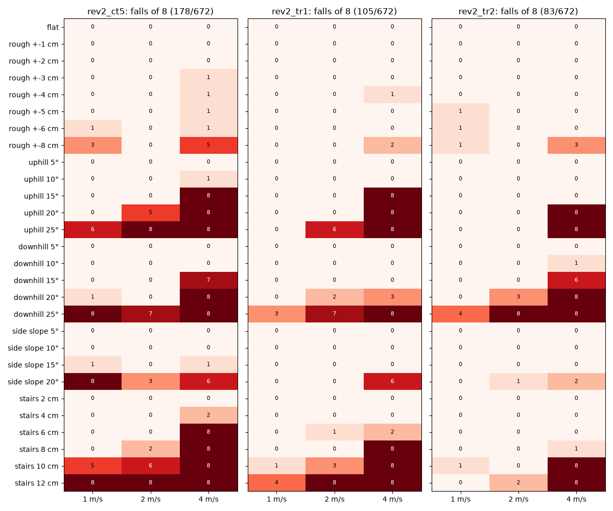
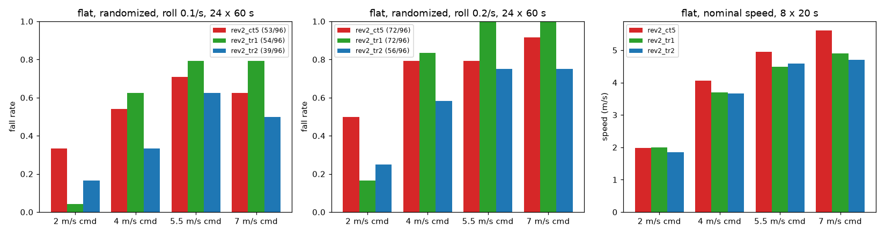
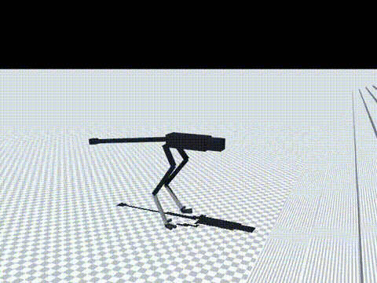
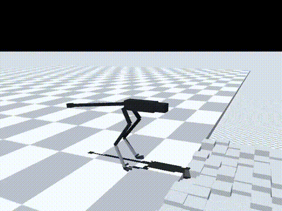

# 176 지형 학습 2단계 rev2_tr2: 험지·충격 넘어짐 최소, 기본 정책으로 채택 (고속은 ct5 보존)

2026-10-30, 사용자 지시 "진행"(단계식 지형 학습). 증거 175의 `rev2_tr1`에서 이어 학습했다. 이번에는 두 가지를 바꿨다. 지형 난이도 상한을 0.6에서 1.0으로 올렸고, 평지 비율을 1/3에서 1/2로 올렸다. 모두 MuJoCo 시뮬레이션 결과(단단한 바닥, 접촉 0.005)이며, 능동축 수는 바뀌지 않았다.

## 결론

- **험지 넘어짐이 가장 적다.**
  - 넘어짐은 83/672회다. `tr1`은 105/672(p = 0.10), `ct5`는 178/672였다.
  - 명령 속도별로는 2 m/s에서 27 → 14, 4 m/s에서 70 → 61로 줄었다(`tr1` → `tr2`).
  - 1–2 m/s에서 넘어짐 0/8로 걷는 범위는 다음과 같다.
    - 오르막 25°
    - 내리막 15°
    - 옆 경사 15°
    - 울퉁불퉁 ±4 cm
    - 계단 8 cm
  - 넘어짐 1/8 이하까지 넣으면 울퉁불퉁 ±8 cm, 옆 경사 20°, 계단 10 cm가 더해진다.
  - 4 m/s에서는 오르막 15°(8/8 → 0/8)와 계단 8 cm(8/8 → 1/8)를 새로 걷는다.
- **산길 목표(1–2 m/s: 경사 20°, 계단 10 cm, 울퉁불퉁 ±8 cm)는 내리막만 남았다.**
  - 오르막 20°: 0/8, 0/8
  - 계단 10 cm: 1/8, 0/8
  - 울퉁불퉁 ±8 cm: 1/8, 0/8
  - 내리막 20°: 0/8, **3/8**
    - 2 m/s 명령에서 실제로는 2.5 m/s로 내려간다(시드 5000).
    - 내리막에서 속도를 억제하지 못하는 것이 남은 약점이다.
- **평지 충격 넘어짐도 가장 적다.** 두 충격 조건 합계는 95/192로, `ct5` 125/192보다 적다(p = 0.003).
  - 실물화를 끈 조건은 52/96으로, `ct5` 56/96과 차이가 없다(p = 0.66).
- **대가는 최고 속도다.**
  - 7 m/s 명령에서 4.70 m/s가 나온다. `ct5`는 5.61, `tr1`은 4.90 m/s였다.
  - 평지 비율을 올렸는데도 회복되지 않았다. 그래서 "평지 비율이 낮아서 느려졌다"는 증거 175의 추정은 맞지 않는다.
- **발열은 `tr1`보다 낫다.** 4 m/s 10분, 가장 나쁜 장착에서 115 °C, 감액 없음(`tr1` 137 °C, 0.41).
- **판단**
  - 넘어짐 0과 과열 없음이 우선 조건이므로 `rev2_tr2`를 **기본 정책으로 채택**한다.
  - 평지 5 m/s 이상이 필요할 때를 위해 `rev2_ct5`를 고속 후보로 보존한다.
  - 다음으로 지형 위 명령 상한을 3에서 5 m/s로 올린 `rev2_tr3`로 속도 회복을 시험한다(증거 177).

| 항목 | `ct5` | `tr1` | `tr2` |
|---|---|---|---|
| 험지 넘어짐(672회) | 178 | 105 | **83** |
| 평지 충격 넘어짐, 두 조건 합계(192회) | 125 | 126 | **95** |
| └ 2 m/s(48회) | 20 | **5** | 10 |
| └ 4–7 m/s(144회) | 105 | 121 | **85** |
| 실물화 끔, 좌우 충격 0.1/s(96회) | 56 | 67 | **52** |
| 7 m/s 명령 명목 속도 | **5.61 m/s** | 4.90 | 4.70 |
| 10분 4 m/s, 가장 나쁜 장착 | **84 °C, 감액 1.0** | 137 °C, 0.41 | 115 °C, 1.0 |
| 10분 7 m/s, 가장 나쁜 장착 | 138 °C, 0.36, 완주 | 367초 넘어짐 | 137 °C, 0.42, 완주 |

영상은 `media/*.mp4`에 있다. 모두 `tr2`, 2 m/s 명령, 시드 5000이며 넷 다 넘어지지 않았다.

| 영상 | 진행 거리 | 평균 속도 |
|---|---|---|
| 울퉁불퉁 ±8 cm | 14.6 m | 1.77 m/s |
| 오르막 20° | 14.2 m | 1.50 m/s |
| 내리막 20° | 18 m 지점 도달 | 2.52 m/s |
| 계단 10 cm | 15.1 m | 1.66 m/s |

## 학습

- 시작점: `rev2_tr1`. 10M 스텝을 학습해 누적 87.6M 스텝이 됐다.
- 지형 설정: `{"kinds": {"flat": 4, "rough": 1, "slope": 1, "side_slope": 1, "stairs": 1}, "max_level": 1.0, "vmax": 3.0, "size": 40}`
- 난이도 1.0일 때 각 지형의 최대값
  - 울퉁불퉁 ±5 cm
  - 경사 25°
  - 옆 경사 20°
  - 계단 12 cm
- 나머지 조건은 `tr1`과 같다. 코드 변경은 없다. 기록은 `policy/`에 있다.

## 결과

평지(지형 옵션을 뺀 같은 정책, 60초 판 × 명령 2/4/5.5/7 m/s × 시드 5000–5023, `eval/ablate.jsonl`):

| `tr2` 조건 | 2 | 4 | 5.5 | 7 | 합계 |
|---|---|---|---|---|---|
| 좌우 충격 0.1/s | 4 | 8 | 15 | 12 | 39/96 |
| 좌우 충격 0.2/s | 6 | 14 | 18 | 18 | 56/96 |
| 실물화 끔 | 2 | 13 | 18 | 19 | 52/96 |

명목 20초 × 8(`eval/probe_nominal.jsonl`):

| 명령 (m/s) | 2 | 4 | 5.5 | 7 |
|---|---|---|---|---|
| `tr2` 속도 | 1.84 | 3.66 | 4.59 | 4.70 |

- 넘어짐은 0이었다.

10분 연속 주행(`eval/long_run.jsonl`):

| 명령 | 장착 | 평균 속도 | 권선 최고 | 감액 | 넘어짐 |
|---|---|---|---|---|---|
| 4 m/s | 방열판 | 3.67 | 63 °C | 1.0 | 없음 |
| 4 m/s | 가장 나쁨 | 3.66 | 115 °C | 1.0 | 없음 |
| 7 m/s | 방열판 | 4.77 | 81 °C | 1.0 | 없음 |
| 7 m/s | 가장 나쁨 | 4.75 | 137 °C | 0.42 | 없음 |

험지(증거 173–175와 같은 방법, `eval/terrain.jsonl`):

| 명령 | `ct5` | `tr1` | `tr2` |
|---|---|---|---|
| 1 m/s | 41/224 | 8/224 | 8/224 |
| 2 m/s | 39/224 | 27/224 | **14/224** |
| 4 m/s | 98/224 | 70/224 | **61/224** |

## 구분

| 구분 | 내용 |
|---|---|
| 확인 | `tr2`가 험지(83/672)와 평지 충격(95/192) 넘어짐이 가장 적음. 1–2 m/s에서 오르막 25°, 계단 10 cm(1/8 이하), 울퉁불퉁 ±8 cm(1/8 이하) 통과. 4 m/s 10분 감액 없음 |
| 실패 | 최고 속도 4.70 m/s(`ct5` 5.61). 내리막 20° 2 m/s 3/8, 내리막 25°와 계단 12 cm 2 m/s는 못 걸음 |
| 미검증 | 속도가 떨어지는 원인(평지 비율은 아님). 내리막 과속의 원인. 지형과 충격을 함께 넣은 조건, 내리막 계단, 미끄러운 바닥 |
| 다음 한 단계 | `rev2_tr3`: 지형 위 명령 상한을 3에서 5 m/s로 올려 `tr2`에서 10M 스텝. 나머지는 같다(증거 177) |
