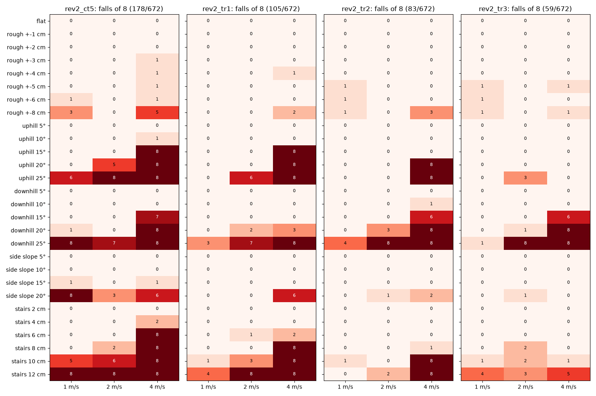
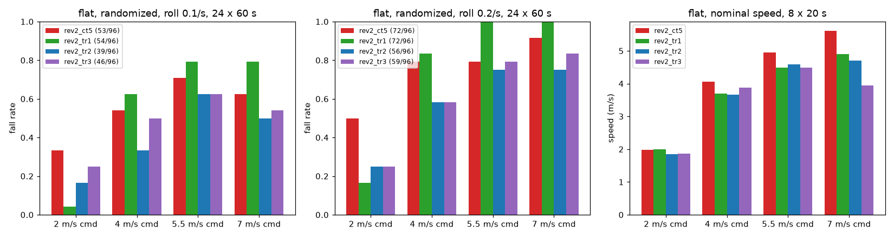
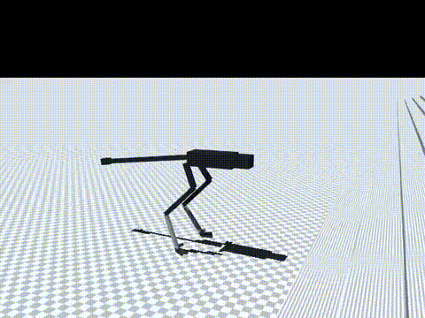

# 177 지형 명령 상한 5 m/s rev2_tr3: 4 m/s 험지는 크게 개선, 평지 고속은 더 느려짐 (미채택)

2026-10-30, 사용자 지시 "진행". 증거 176의 `rev2_tr2`는 평지 최고 속도가 4.70 m/s로 떨어졌다(`ct5` 5.61). 지형 위 속도 명령 상한이 3 m/s여서 고속을 덜 배웠을 수 있다고 보고, 상한만 5 m/s로 올려 `tr2`에서 이어 학습했다. 모두 MuJoCo 시뮬레이션 결과(단단한 바닥, 접촉 0.005)이며, 능동축 수는 바뀌지 않았다.

## 결론

- **평지 최고 속도는 돌아오지 않았다. 오히려 더 나빠졌다.**
  - 명령별 실제 속도(`tr3`, `tr2`는 괄호):
    - 4 m/s: 3.88(3.66)
    - 5.5 m/s: 4.49(4.59)
    - 7 m/s: **3.94**(4.70)
  - 7 m/s를 명령하면 5.5 m/s 명령보다 느리다. 명령을 따라가지 못하는 결함이다.
  - 따라서 지형 위 명령 상한도 속도 손실의 원인이 아니다. 증거 175(평지 비율)에 이어 두 번째로 기각된 가설이다.
- **4 m/s 험지는 크게 좋아졌다.**
  - 4 m/s 험지 넘어짐: 61 → 30/224
  - 오르막 20°, 25°: 8/8 → 0/8
  - 계단 10 cm: 8/8 → 1/8
  - 전체 험지 넘어짐: 83 → 59/672(p = 0.04)
- **산길 목표 속도(1–2 m/s)에서는 섞여 있다.** 1–2 m/s 넘어짐은 22 → 29/448이다.
  - 좋아진 것: 내리막 20°(2 m/s) 3/8 → 1/8, 내리막 25°(1 m/s) 4/8 → 1/8
  - 나빠진 것
    - 계단 10 cm(2 m/s) 0/8 → 2/8
    - 계단 12 cm(1 m/s) 0/8 → 4/8
    - 오르막 25°(2 m/s) 0/8 → 3/8
- **평지 충격 넘어짐은 차이가 없다.** 105/192로 `tr2`의 95/192와 비슷하다(p = 0.36).
- **판단: 미채택.** 기본 정책은 그대로 `rev2_tr2`다.
  - 목표 속도의 험지와 평지 고속에서 `tr2`보다 낫지 않다.
  - `tr3`는 4 m/s 험지 후보로 보존한다.

| 항목 | `ct5` | `tr2` (기본) | `tr3` |
|---|---|---|---|
| 험지 넘어짐(672회) | 178 | 83 | **59** |
| └ 1–2 m/s(448회) | 80 | **22** | 29 |
| └ 4 m/s(224회) | 98 | 61 | **30** |
| 평지 충격 넘어짐, 두 조건 합계(192회) | 125 | **95** | 105 |
| 실물화 끔, 좌우 충격 0.1/s(96회) | 56 | **52** | 53 |
| 7 m/s 명령 명목 속도 | **5.61 m/s** | 4.70 | 3.94 |
| 10분 4 m/s, 가장 나쁜 장착 | **84 °C** | 115 °C | 121 °C |
| 10분 7 m/s, 가장 나쁜 장착 | 138 °C, 감액 0.36 | 137 °C, 0.42 | 136 °C, 0.47 |

- 세 정책 모두 10분 주행 중 넘어지지 않았다.

영상은 `media/*.mp4`에 있다. 모두 `tr3`, 2 m/s 명령, 시드 5000이며 넷 다 넘어지지 않았다.

| 영상 | 진행 거리 | 평균 속도 |
|---|---|---|
| 울퉁불퉁 ±8 cm | 17.5 m | 1.83 m/s |
| 오르막 20° | 12.1 m | 1.23 m/s |
| 내리막 20° | 18 m 지점 도달 | 2.58 m/s |
| 계단 10 cm | 12.8 m | 1.57 m/s |

## 학습

- 시작점: `rev2_tr2`. 10M 스텝을 학습해 누적 97.7M 스텝이 됐다.
- 지형 설정: `{"kinds": {"flat": 4, "rough": 1, "slope": 1, "side_slope": 1, "stairs": 1}, "max_level": 1.0, "vmax": 5.0, "size": 40}`
- `tr2`와 달라진 것은 `vmax`(3 → 5)뿐이다. 코드 변경은 없다. 기록은 `policy/`에 있다.

## 결과

평지(지형 옵션을 뺀 같은 정책, 60초 판 × 명령 2/4/5.5/7 m/s × 시드 5000–5023, `eval/ablate.jsonl`):

| `tr3` 조건 | 2 | 4 | 5.5 | 7 | 합계 |
|---|---|---|---|---|---|
| 좌우 충격 0.1/s | 6 | 12 | 15 | 13 | 46/96 |
| 좌우 충격 0.2/s | 6 | 14 | 19 | 20 | 59/96 |
| 실물화 끔 | 6 | 15 | 17 | 15 | 53/96 |

명목 20초 × 8(`eval/probe_nominal.jsonl`):

| 명령 (m/s) | 2 | 4 | 5.5 | 7 |
|---|---|---|---|---|
| `tr3` 속도 | 1.87 | 3.88 | 4.49 | 3.94 |

10분 연속 주행(`eval/long_run.jsonl`):

| 명령 | 장착 | 평균 속도 | 권선 최고 | 감액 |
|---|---|---|---|---|
| 4 m/s | 방열판 | 3.85 | 65 °C | 1.0 |
| 4 m/s | 가장 나쁨 | 3.85 | 121 °C | 1.0 |
| 7 m/s | 방열판 | 3.85 | 74 °C | 1.0 |
| 7 m/s | 가장 나쁨 | 3.94 | 136 °C | 0.47 |

험지 방법은 증거 173–176과 같다(`eval/terrain.jsonl`).

## 구분

| 구분 | 내용 |
|---|---|
| 확인 | 지형 명령 상한 5 m/s로 4 m/s 험지 넘어짐 61 → 30/224. 평지 고속 손실은 평지 비율(증거 176)도, 지형 명령 상한도 원인이 아님 |
| 실패 | 7 m/s 명령 3.94 m/s(5.5 m/s 명령보다 느림). 1–2 m/s 계단 12 cm·오르막 25°에서 `tr2`보다 나쁨. 미채택 |
| 미검증 | 지형 학습 뒤 고속이 느려지는 진짜 원인. 가설은 눈 없는(지형 높이를 보지 않는) 정책이 발을 높이 들고 공중 시간을 줄이는 보수적 걸음을 익힌 것이며, 아직 측정하지 않았다 |
| 다음 한 단계 | 평지 고속용 `ct5`와 험지용 `tr2`를 주행 중에 바꿔도 넘어지지 않는지 시험(정책 전환, 학습 없음) |
