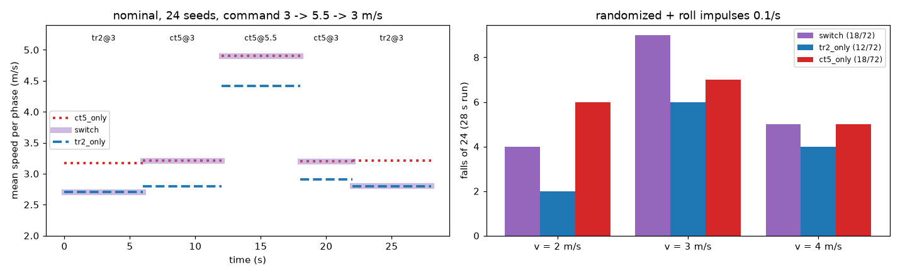

# 178 주행 중 정책 전환: 험지용 tr2 ↔ 고속용 ct5, 평지에서 전환해도 넘어짐이 늘지 않음

2026-10-30, 사용자 지시 "진행". 증거 175–177에서 한 정책으로 험지와 평지 고속을 함께 얻지 못했다. 험지는 `rev2_tr2`(기본)가 낫고, 평지 고속은 `rev2_ct5`가 낫다(5.61 m/s). 그래서 상위 계층이 두 정책 중 하나를 고르는 방식을 검토했다. 그 첫 조건은 달리는 중에 정책을 바꿔도 넘어지지 않는 것이다. 학습은 하지 않았다. 모두 MuJoCo 시뮬레이션 결과(평지, 단단한 바닥 0.005)이며, 능동축 수는 바뀌지 않았다.

## 결론

- **명목 조건(무작위화·충격 없음)에서는 전환 때문에 넘어진 적이 없다.**
  - 명령 2·3·4 m/s × 24시드에서 0/72였다.
  - 한 판에 전환을 두 번 했다(`tr2` → `ct5`, `ct5` → `tr2`). 모두 144번 전환했다.
  - 전환 직후 속도도 바로 새 정책의 수준으로 맞춰졌다(아래 그림 왼쪽).
- **무작위화와 좌우 충격(0.1/s)을 넣어도 넘어짐이 늘지 않았다.**
  - 전환하며 달린 경우: 18/72
  - `ct5`만 쓴 경우: 18/72
  - `tr2`만 쓴 경우: 12/72(전환과 비교해 p = 0.30)
  - 전환 직후 1초 안에 넘어진 경우는 144번 중 1번이다(4 m/s, `ct5` → `tr2` 0.84초 뒤). 같은 구간에서 `ct5`만 쓴 대조군은 4/24 넘어졌으므로, 충격 때문인지 전환 때문인지 구분되지 않는다.
- **판단**
  - 평지에서는 두 정책을 실행 중에 바꿔 써도 된다.
  - 쓰는 방식: 기본은 험지에 강한 `tr2`로 걷는다. 고르고 넓은 평지에서 4 m/s를 넘게 달릴 때만 `ct5`로 바꾼다.
  - 이것은 "AI는 허용 행동을 선택하고, 직접 모터 명령을 만들지 않는다"는 기존 구조와 맞는다. 상위 계층은 정책(행동)만 고른다.

## 시험 방법

스크립트는 `eval/switch_probe.py`, 결과는 `eval/switch.jsonl`이다.

- 환경: `rev2_tr2_st_r01`의 설정을 쓴다. 평지, 단단한 바닥, v2 실물화이며 충격은 좌우 0.1/s다.
- 각 정책은 자기 관측 정규화(VecNormalize)를 그대로 쓴다. 바뀌는 것은 정책뿐이고, 로봇 상태는 이어진다.
- 한 판(28초)의 명령 순서

| 단계 | 정책 | 명령 | 길이 |
|---|---|---|---|
| 0 | `tr2` | v | 6초 |
| 1 | `ct5` | v | 6초 |
| 2 | `ct5` | 5.5 m/s | 6초 |
| 3 | `ct5` | v | 4초 |
| 4 | `tr2` | v | 6초 |

- 대조군: 같은 명령 순서를 한 정책으로만 달린다(`tr2_only`, `ct5_only`).
- v는 2·3·4 m/s, 시드는 5000–5023이다. 명목 조건(`nodr`)과 무작위화 조건(`dr`)을 각각 시험했다.

## 결과 (무작위화, 넘어짐 /24, 단계별)

| v | 방식 | 넘어짐 | 단계 0–4 |
|---|---|---|---|
| 2 | 전환 | 4 | 0, 0, 2, 2, 0 |
| 2 | `tr2`만 | 2 | 0, 0, 2, 0, 0 |
| 2 | `ct5`만 | 6 | 2, 0, 2, 2, 0 |
| 3 | 전환 | 9 | 2, 3, 2, 2, 0 |
| 3 | `tr2`만 | 6 | 2, 1, 1, 2, 0 |
| 3 | `ct5`만 | 7 | 0, 3, 3, 1, 0 |
| 4 | 전환 | 5 | 1, 2, 1, 0, 1 |
| 4 | `tr2`만 | 4 | 1, 1, 1, 0, 1 |
| 4 | `ct5`만 | 5 | 0, 1, 0, 0, 4 |

명목 조건의 단계별 평균 속도(v = 3 m/s, 24시드):

| 방식 | 단계 0 | 1 | 2 (5.5) | 3 | 4 |
|---|---|---|---|---|---|
| 전환 | 2.71 | 3.21 | 4.90 | 3.20 | 2.81 |
| `tr2`만 | 2.71 | 2.80 | 4.42 | 2.91 | 2.80 |
| `ct5`만 | 3.17 | 3.22 | 4.90 | 3.20 | 3.21 |

- 단계 2는 6초짜리라 가속이 끝나지 않는다. 그래서 20초 명목 속도(`ct5` 4.95 m/s)보다 약간 낮다.

## 구분

| 구분 | 내용 |
|---|---|
| 확인 | 평지에서 `tr2` ↔ `ct5`를 달리는 중에 바꿔도, 명목 조건에서 0/72, 무작위화 조건에서 한 정책만 쓴 경우와 비슷한 넘어짐(18/72 대 12–18/72) |
| 실패 | 없음. 다만 무작위화 조건의 넘어짐 자체는 여전히 많다(25 % 안팎) |
| 미검증 | 험지 위에서의 전환. 4 m/s 넘는 속도에서의 전환. 언제 바꿀지 판단하는 방법(두 정책 모두 지형을 보지 않으므로, 지형 판단에는 카메라 같은 별도 센서가 필요하다) |
| 다음 한 단계 | 고속 손실의 원인 측정: `ct5`와 `tr2`의 7 m/s 걸음(공중 시간, 발 높이, 보폭)을 비교해, 눈 없는 정책이 보수적인 걸음을 익혔다는 가설을 확인 |
