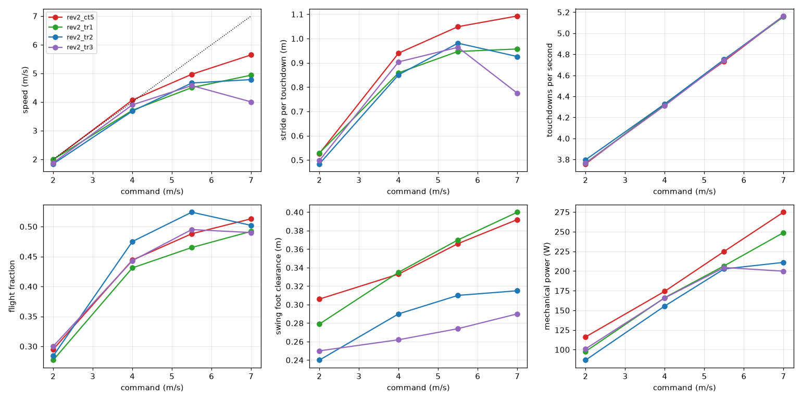

# 179 지형 학습 뒤 고속이 느려진 이유: 보폭이 짧아짐 (공중 시간·발 높이·발열 가설은 기각)

2026-10-30, 사용자 지시 "진행". 지형 학습 정책(`rev2_tr1`, `tr2`, `tr3`)은 모두 평지 최고 속도가 `rev2_ct5`보다 낮다. 7 m/s 명령에서 `ct5`는 5.61 m/s, 지형 학습 정책들은 3.9–4.9 m/s다. 증거 176과 177에서 평지 비율과 지형 위 명령 상한은 원인이 아닌 것으로 나왔다. 그래서 학습 없이 걸음 자체를 비교했다. 모두 MuJoCo 시뮬레이션 결과(평지, 단단한 바닥 0.005, 명목 조건)다.

## 결론

- **속도 차이는 모두 보폭에서 나온다.**
  - 발 딛는 빈도는 네 정책이 같다. 7 m/s 명령에서 모두 초당 5.16회다.
    - 이 빈도는 보상의 걸음 일정(`gait` 항)이 명령 속도에 맞춰 정하므로, 정책이 바꾸지 못한다.
  - 한 번 디딜 때 나아가는 거리(보폭)는 다르다.

    | 정책 | 7 m/s 명령 보폭 |
    |---|---|
    | `ct5` | 1.09 m |
    | `tr1` | 0.96 m |
    | `tr2` | 0.93 m |
    | `tr3` | 0.78 m |

  - 속도 = 빈도 × 보폭이므로, 보폭이 짧은 만큼 느리다.
- **기각된 가설**
  - **공중 시간을 줄였다**: 아니다. 7 m/s에서 공중 비율은 0.49–0.51로 네 정책이 같다.
  - **눈 없는 정책이 발을 높이 든다**: 아니다. 스윙 때 발 높이는 `tr2` 0.32 m, `tr3` 0.29 m로 `ct5` 0.39 m보다 오히려 낮다. `tr1`은 0.40 m로 같다.
  - **발열 벌점 때문에 힘을 아낀다**: 아니다. 7 m/s에서 발열 벌점 항은 `ct5` 1.18, `tr2` 1.00, `tr3` 0.96, `tr1` 1.84다. 속도 순서와 맞지 않는다.
- **함께 바뀐 것**
  - 기계 출력: `ct5` 275 W, `tr2` 211 W, `tr3` 200 W. 보폭이 짧으니 출력도 적다.
  - 무릎 래칫 스프링에 저장하는 에너지 항: 지형 학습 정책 모두 `ct5`의 1/5–1/2이다(`ct5` 7.2, `tr1` 2.8, `tr2` 3.0, `tr3` 1.5).
  - 들어 올릴 때 버리는 스프링 에너지는 `tr2`만 크다(2.4 W). 출력 차이(60 W)에 비하면 작아서 원인으로 보지 않는다.
- **남은 설명(미확인)**: 지형 위에서는 앞으로 멀리 뻗은 발이 턱이나 계단 모서리에 걸린다. 정책이 이를 피하려고 발을 가깝게 딛는 습관을 익혔고, 그 습관이 평지 고속에도 남았을 수 있다.
- **확인 방법**: `tr2`에서 평지만으로 5M 스텝 다시 학습한다(`rev2_tr2f`, 진행 중, 증거 180).
  - 보폭과 속도가 돌아오는지 본다.
  - 대신 험지 능력이 얼마나 사라지는지도 함께 잰다.

## 측정 방법

- `eval/gait_probe.py`: 20초 × 8시드로 재고, 앞의 4초는 뺐다(`eval/gait.jsonl`).
  - 발 딛는 빈도: 발이 하중을 받기 시작한 횟수 / 시간(두 발 합계)
  - 보폭: 평균 속도 / 발 딛는 빈도
  - 스윙 발 높이: 스윙 중 발 링크의 최고 높이에서 직전 접지 때 높이를 뺀 값(판마다 중앙값, 시드 평균)
  - 공중 비율: 두 발 모두 하중이 없는 시간의 비율
- `eval/terms_probe.py`: 7 m/s × 4시드 × 30초 동안 학습 보상 각 항과 모터 발열 상태의 평균이다(`eval/terms_7mps.jsonl`).

| 7 m/s 명령 | `ct5` | `tr1` | `tr2` | `tr3` |
|---|---|---|---|---|
| 속도 (m/s) | **5.64** | 4.94 | 4.78 | 4.00 |
| 초당 발 딛는 횟수 | 5.16 | 5.16 | 5.16 | 5.16 |
| 보폭 (m) | **1.09** | 0.96 | 0.93 | 0.78 |
| 공중 비율 | 0.51 | 0.49 | 0.50 | 0.49 |
| 스윙 발 높이 (m) | 0.39 | 0.40 | 0.32 | 0.29 |
| 기계 출력 (W) | 275 | 249 | 211 | 200 |
| 무릎 발열 상태(정격 = 1) | 1.38 | 1.73 | 1.28 | 1.29 |
| 스프링 저장 항 | 7.2 | 2.8 | 3.0 | 1.5 |

- 네 정책 모두 넘어짐은 0이었다.

## 구분

| 구분 | 내용 |
|---|---|
| 확인 | 고속 손실은 보폭 감소 때문(빈도는 걸음 일정으로 고정). 공중 시간·발 높이·발열 벌점 가설은 측정으로 기각 |
| 실패 | 보폭이 왜 줄었는지는 아직 측정하지 못함 |
| 미검증 | 발이 걸리는 것을 피하는 습관이라는 설명. 걸음 일정이 빈도를 고정하는 것이 고속의 한계인지(빈도를 정책이 고를 수 있으면 더 빠를 수 있음) |
| 다음 한 단계 | `rev2_tr2f`: `tr2`에서 평지만 5M 스텝. 보폭·속도가 돌아오는지, 험지 능력이 얼마나 남는지 측정(증거 180) |
