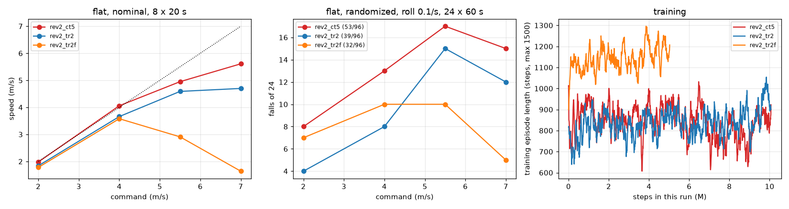
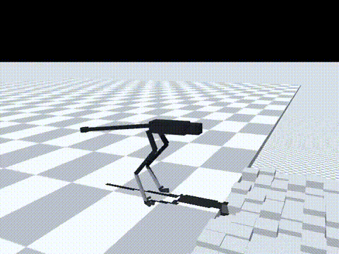

# 180 tr2 평지 재학습 rev2_tr2f: 속도는 돌아오지 않고, 높은 명령에서 스스로 느려짐 (미채택)

2026-10-30, 사용자 지시 "진행". 증거 179는 지형 학습 정책이 평지 고속에서 보폭이 짧다는 것을 보였다. 그것이 지형에서 익힌 습관이라면, 평지만으로 다시 학습하면 돌아와야 한다. 그래서 `rev2_tr2`에서 평지만으로 5M 스텝 학습했다(`rev2_tr2f`). 조건은 `rev2_ct5`를 학습할 때와 같고, 시작점만 다르다. 모두 MuJoCo 시뮬레이션 결과(단단한 바닥 0.005)이며, 능동축 수는 바뀌지 않았다.

## 결론

- **속도는 돌아오지 않았다. 높은 명령일수록 오히려 더 느려졌다.**
  - 7 m/s 명령: 1.64 m/s(`tr2` 4.70, `ct5` 5.61)
  - 5.5 m/s 명령: 2.91 m/s
  - 4 m/s 명령: 3.58 m/s
  - 7 m/s 명령에서 보폭이 0.32 m로 줄었다. 발 딛는 빈도는 걸음 일정 그대로(초당 5.16회)여서 거의 제자리걸음이다.
- **넘어짐이 적은 이유는 느리게 달리기 때문이다.**
  - 무작위화 넘어짐(두 충격 조건 합계): 81/192. `tr2`는 95/192(p = 0.18), `ct5`는 125/192였다.
  - 7 m/s 명령에서 좌우 충격 0.1/s일 때 넘어짐은 5/24다. 하지만 이때 실제 속도는 1.6 m/s다.
- **학습 중에도 같은 경향이 보인다.**
  - `ct5`와 같은 평지 학습인데 평균 판 길이가 다르다.
    - `ct5`: 600–1000스텝
    - `tr2f`: 1100–1250스텝(최대 1500)
  - 즉 덜 넘어지는 쪽으로 보상을 더 받았다.
- **해석**
  - 지금 보상에서는 높은 명령을 받았을 때 느리게 달려 넘어지지 않는 것이 보상을 더 받는 길이다.
    - 넘어지면 −10을 받고, 남은 시간의 생존 보상도 잃는다.
    - 속도 추종 보상은 명령의 30 % 폭 안에서만 크다. 그래서 고속에서 조금 못 따라가는 것과 아주 못 따라가는 것의 차이가 작다.
  - `ct5`는 빠른 걸음에서 출발해 그 상태에 머물렀다. 반면 지형 학습을 거친 정책은 느린 쪽으로 옮겨 갔다.
  - 평지만 학습한 `tr2f`는 느린 쪽으로 더 깊이 들어갔다.
  - 따라서 증거 179의 보폭 감소도 "지형 습관"보다는 이 보상 균형의 결과로 보는 것이 맞다(미확인).
- **험지 능력도 줄었다.**
  - 험지 넘어짐: 91/672(`tr2` 83)
  - 2 m/s만 보면 14 → 36/224
    - 계단 10 cm: 0 → 6/8
    - 내리막 20°: 3 → 7/8
- **판단: 미채택.** 기본 정책은 `tr2`, 평지 고속은 `ct5`(증거 178의 전환 방식)를 그대로 쓴다.

| 항목 | `ct5` | `tr2` (기본) | `tr2f` |
|---|---|---|---|
| 명목 속도, 명령 4 / 5.5 / 7 m/s | 4.06 / 4.95 / **5.61** | 3.66 / 4.59 / 4.70 | 3.58 / 2.91 / 1.64 |
| 무작위화 넘어짐, 두 조건 합계(192회) | 125 | 95 | 81 |
| 실물화 끔, 좌우 충격 0.1/s(96회) | 56 | 52 | 54 |
| 험지 넘어짐(672회) | 178 | **83** | 91 |
| └ 2 m/s(224회) | 39 | **14** | 36 |
| 10분 4 m/s, 가장 나쁜 장착 | 84 °C | 115 °C | **79 °C** |

## 학습

- 시작점: `rev2_tr2`. 평지만으로 5M 스텝을 학습해 누적 92.7M 스텝이 됐다.
- 조건은 `ct5`와 같다(`--terrain` 없음, 접촉 0.005, v2 실물화, 30초 판, 좌우 충격 0.2/s, 고관절 roll ±0.5).
- 기록은 `policy/`에 있다.

## 결과

평지(60초 판 × 명령 2/4/5.5/7 m/s × 시드 5000–5023, `eval/ablate.jsonl`):

| `tr2f` 조건 | 2 | 4 | 5.5 | 7 | 합계 |
|---|---|---|---|---|---|
| 좌우 충격 0.1/s | 7 | 10 | 10 | 5 | 32/96 |
| 좌우 충격 0.2/s | 8 | 15 | 12 | 14 | 49/96 |
| 실물화 끔 | 8 | 24 | 16 | 6 | 54/96 |

명목 20초 × 8(`eval/probe_nominal.jsonl`, 걸음 지표는 `eval/gait.jsonl`):

| 명령 (m/s) | 2 | 4 | 5.5 | 7 |
|---|---|---|---|---|
| 속도 | 1.78 | 3.58 | 2.91 | 1.64 |
| 보폭 (m) | 0.48 | 0.84 | 0.63 | 0.32 |

10분 연속 주행(`eval/long_run.jsonl`):

| 명령 | 장착 | 평균 속도 | 권선 최고 | 감액 |
|---|---|---|---|---|
| 4 m/s | 방열판 | 3.61 | 49 °C | 1.0 |
| 4 m/s | 가장 나쁨 | 3.61 | 79 °C | 1.0 |
| 7 m/s | 방열판 | 1.65 | 57 °C | 1.0 |
| 7 m/s | 가장 나쁨 | 1.65 | 99 °C | 1.0 |

- 넘어짐은 없었다.

험지는 증거 173–177과 같은 방법으로 쟀다(`eval/terrain.jsonl`). 영상은 `media/`에 있다(2 m/s, 시드 5000).

## 구분

| 구분 | 내용 |
|---|---|
| 확인 | 평지 재학습으로 속도가 돌아오지 않음. 높은 명령에서 스스로 느려짐(7 m/s 명령 1.64 m/s). 학습 판 길이가 `ct5`보다 길어 "느리게 달려 넘어지지 않기"를 학습한 것으로 보임 |
| 실패 | 속도 회복 실패, 험지 2 m/s 넘어짐 증가(14 → 36). 미채택 |
| 미검증 | 보상 균형이 원인이라는 해석(보상 가중치를 바꾼 학습으로만 확인 가능). `ct5`도 더 학습하면 같은 쪽으로 옮겨 갈지 |
| 다음 한 단계 | 한 정책으로 고속과 험지를 함께 얻으려면 보상 설계(넘어짐 대 속도 추종의 균형)를 바꿔야 한다. 그 전까지는 `tr2`(기본)와 `ct5`(평지 고속) 전환 방식을 쓴다 |
