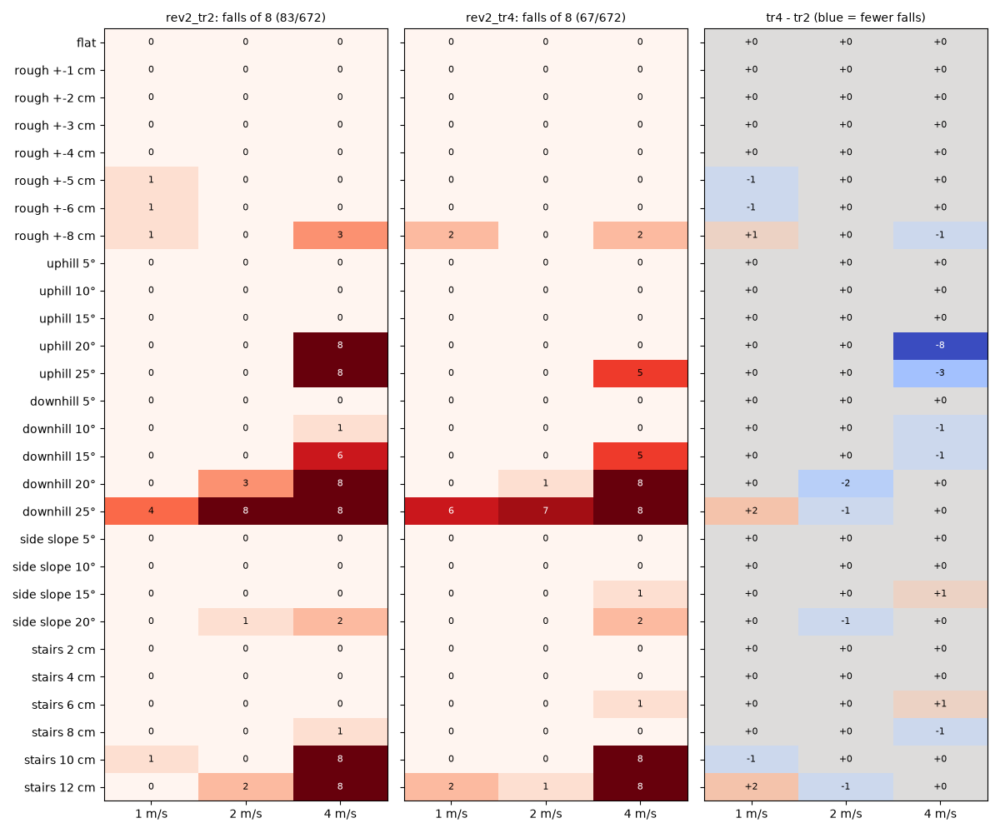
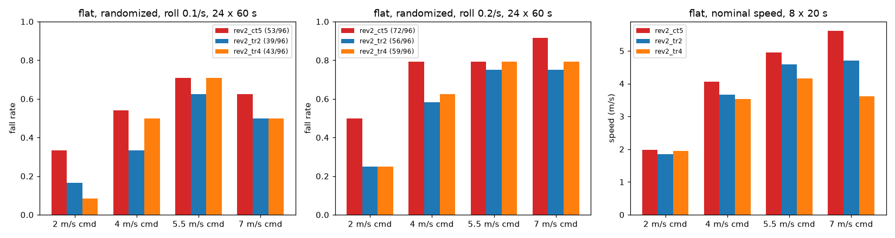
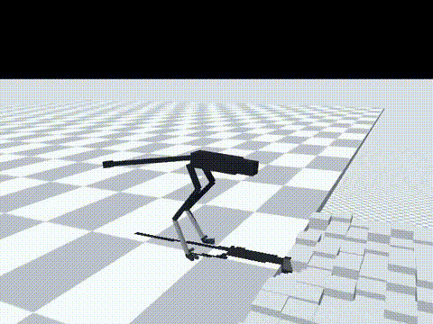
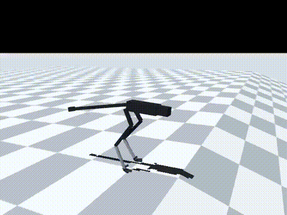

# 181 경사·계단 비중 2배 rev2_tr4: 험지 넘어짐 83 → 67, 발열 감소, 기본 정책으로 채택 (차이는 통계적으로 작음)

2026-10-30, 사용자 지시 "다음". 증거 176의 `rev2_tr2`는 산길 목표 중 2 m/s 내리막 20°(3/8 넘어짐)와 계단 12 cm가 약했다. 그래서 학습 지형 중 경사와 계단의 비중만 두 배로 올려 `tr2`에서 이어 학습했다(`rev2_tr4`). 모두 MuJoCo 시뮬레이션 결과(단단한 바닥 0.005, v2 실물화)이며, 능동축 수는 바뀌지 않았다.

## 결론

- **험지 넘어짐이 줄었다.** 83 → 67/672(p = 0.19)
  - 4 m/s: 61 → 48/224. 오르막 20°는 8/8 → 0/8, 오르막 25°는 8/8 → 5/8
  - 1–2 m/s: 22 → 19/448(p = 0.75)
- **산길 목표(1–2 m/s: 경사 20°, 계단 10 cm, 울퉁불퉁 ±8 cm)**: 넘어짐 5/64 → 3/64
  - 내리막 20°, 2 m/s: 3/8 → **1/8**
  - 계단 10 cm: 1/8, 0/8 → 0/8, 0/8
  - 오르막 20°: 0/8, 0/8 그대로
  - 울퉁불퉁 ±8 cm, 1 m/s: 1/8 → 2/8
- **나빠진 곳**: 1 m/s 계단 12 cm(0 → 2/8), 1 m/s 내리막 25°(4 → 6/8)
- **평지 충격 넘어짐은 차이가 없다.** 두 충격 조건 합계 95 → 102/192(p = 0.54)
- **발열이 줄었다.** 10분 연속 주행에서 가장 나쁜 장착 조건의 권선 최고 온도
  - 4 m/s: 115 → 92 °C
  - 7 m/s: 137 °C, 감액 0.42 → 115 °C, 감액 없음. 다만 느리게 달리기 때문이다(7 m/s 명령에 3.3 m/s).
- **평지 고속은 더 느려졌다.** 명령 4 / 5.5 / 7 m/s에서 3.53 / 4.15 / 3.61 m/s(`tr2` 3.66 / 4.59 / 4.70)
  - 증거 180에서 본, 높은 명령에서 스스로 느려지는 경향이 계속된다.
  - 4 m/s 넘는 평지는 `ct5`로 바꿔 달리므로 쓰는 방식에는 영향이 작다.
- **`ct5`와 주행 중 전환도 된다.** 명목 0/72. 무작위화 조건에서는 전환 17/72, `tr4`만 15/72, `ct5`만 18/72였다. 전환 직후 1초 안에 넘어진 것은 144번 중 1번이다(증거 178과 같은 방법).
- **판단: 기본 정책을 `rev2_tr4`로 바꾼다.**
  - 험지·발열·목표 속도 험지에서 수치가 모두 낫거나 같고, 평지 충격 넘어짐은 차이가 없다.
  - 다만 험지 차이는 통계적으로 확실하지 않다(p = 0.19).
  - 평지 4 m/s 초과는 지금처럼 `ct5`로 바꾼다.

| 울퉁불퉁 ±8 cm, 2 m/s(넘어짐 없음, 1.87 m/s) | 내리막 20°, 2 m/s(시드 5000은 5.1초에 넘어짐, 8번 중 1번) |
|---|---|
|  |  |

영상은 모두 `tr4`, 2 m/s 명령, 시드 5000이다. MP4는 `media/`에 있다.

| 영상 | 결과 |
|---|---|
| 울퉁불퉁 ±8 cm | 17.9 m, 1.87 m/s, 넘어짐 없음 |
| 오르막 20° | 16.1 m, 1.66 m/s, 넘어짐 없음 |
| 계단 10 cm | 16.7 m, 1.81 m/s, 넘어짐 없음 |
| 내리막 20° | 11.3 m 지점에서 넘어짐(기울기), 2.5 m/s로 과속 |

- 내리막에서 명령보다 빨라지는 문제(2 m/s 명령에 2.5 m/s)는 그대로다.
- 정책이 앞을 보지 못해 경사가 시작되는 것을 미리 알 수 없다. 다음 단계의 앞 지형 높이 입력이 이 문제에도 도움이 될 수 있다(미확인).

## 학습

- 시작점: `rev2_tr2`. 10M 스텝을 학습해 누적 97.7M 스텝이 됐다.
- 지형 설정: `{"kinds": {"flat": 4, "rough": 1, "slope": 2, "side_slope": 1, "stairs": 2}, "max_level": 1.0, "vmax": 3.0, "size": 40}`
- `tr2`와 달라진 것은 경사와 계단의 비중(1 → 2)뿐이다. 코드 변경은 없다. 기록은 `policy/`에 있다.

## 결과

평지(지형 옵션을 뺀 같은 정책, 60초 판 × 명령 2/4/5.5/7 m/s × 시드 5000–5023, `eval/ablate.jsonl`):

| `tr4` 조건 | 2 | 4 | 5.5 | 7 | 합계 (`tr2`) |
|---|---|---|---|---|---|
| 좌우 충격 0.1/s | 2 | 12 | 17 | 12 | 43/96 (39) |
| 좌우 충격 0.2/s | 6 | 15 | 19 | 19 | 59/96 (56) |
| 실물화 끔 | 4 | 19 | 17 | 12 | 52/96 (52) |

명목 20초 × 8(`eval/probe_nominal.jsonl`), 넘어짐 0:

| 명령 (m/s) | 2 | 4 | 5.5 | 7 |
|---|---|---|---|---|
| `tr4` 속도 | 1.95 | 3.53 | 4.15 | 3.61 |
| `tr2` 속도 | 1.84 | 3.66 | 4.59 | 4.70 |

10분 연속 주행(`eval/long_run.jsonl`), 넘어짐 없음:

| 명령 | 장착 | 평균 속도 | 권선 최고 | 감액 |
|---|---|---|---|---|
| 4 m/s | 방열판 | 3.49 | 54 °C | 1.0 |
| 4 m/s | 가장 나쁨 | 3.49 | 92 °C | 1.0 |
| 7 m/s | 방열판 | 3.31 | 63 °C | 1.0 |
| 7 m/s | 가장 나쁨 | 3.30 | 115 °C | 1.0 |

주행 중 전환(`eval/switch.jsonl`, `eval/switch_probe.py`는 증거 178의 스크립트에서 `tr2`를 `tr4`로 바꾼 것). `ct5_only`는 증거 178의 결과를 그대로 쓴다(같은 시드).

| 무작위화, 넘어짐/24 | 2 m/s | 3 m/s | 4 m/s | 합계 |
|---|---|---|---|---|
| 전환 `tr4` ↔ `ct5` | 4 | 10 | 3 | 17/72 |
| `tr4`만 | 4 | 8 | 3 | 15/72 |
| `ct5`만(증거 178) | 6 | 7 | 5 | 18/72 |

험지는 증거 173–177과 같은 방법으로 쟀다(`eval/terrain.jsonl`).

## 구분

| 구분 | 내용 |
|---|---|
| 확인 | 험지 넘어짐 83 → 67/672, 4 m/s 오르막 20° 8 → 0/8, 2 m/s 내리막 20° 3 → 1/8. 10분 발열 4 m/s 115 → 92 °C. 평지 충격 넘어짐 차이 없음. `ct5`와 주행 중 전환 가능 |
| 실패 | 내리막 과속(2 m/s 명령에 2.5 m/s)과 내리막 25°. 4 m/s 계단 10–12 cm 8/8. 평지 고속 더 느려짐(7 m/s 명령 3.61 m/s) |
| 미검증 | 험지 개선이 통계적으로 확실한지(p = 0.19). 험지 위에서의 정책 전환 |
| 다음 한 단계 | 앞 지형 높이 입력과 턱·낭떠러지 지형으로 점프 학습(`rev2_jp1`, 증거 182–183) |
