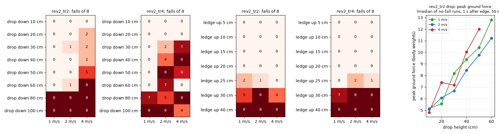
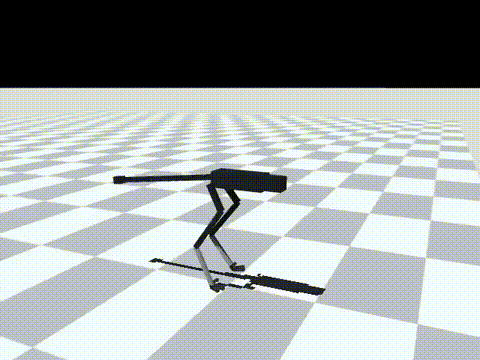
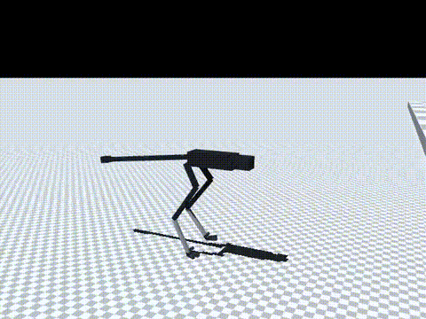

# 182 낭떠러지·턱 기준선: 앞을 보지 않는 지금 정책은 1–2 m/s로 0.6 m까지 걸어 내려가고 0.2 m 턱까지 걸어 올라감

2026-10-30, 사용자 요청 "절벽같은 높은데서 점프하거나 위로 점프해서 올라가는것도 가능하게". 점프를 학습하기 전에, 학습 없이 지금 정책이 어디까지 하는지 쟀다. 모두 MuJoCo 시뮬레이션 결과(단단한 바닥 0.005, v2 실물화, 충격·무작위화 없음)다. 능동축 수는 바뀌지 않았다.

## 결론

- **내려가기: 1–2 m/s로 걸어서 0.6 m 낭떠러지까지는 대부분 내려간다.**
  - `tr2`, 1 m/s: 0.1–0.6 m 모두 0/8
  - `tr2`, 2 m/s: 0.1–0.6 m에서 0–1/8
  - 0.8 m부터는 둘 다 8/8 넘어진다.
  - 4 m/s에서는 0.2 m부터 넘어지기 시작해 0.6 m에서 8/8이다.
- **올라가기: 턱 0.2 m까지는 넘어지지 않는다.**
  - 0.05–0.2 m: 모든 속도에서 0/8
  - 0.25 m: 0–2/8
  - 0.3 m: 4–8/8
  - 0.4 m: 8/8
  - 턱에서 넘어진 94번(두 정책 합계) 중 77번은 기울기, 15번은 몸통이 땅에 닿은 경우, 2번은 엉덩이 높이다. 영상(0.3 m)에서는 턱 앞에서 몸이 앞으로 기울며 넘어진다.
  - 더 높은 턱은 발을 더 높이 들거나 뛰어야 한다.
- **기본 정책 `tr4`는 내려가기에서 `tr2`보다 나쁘다.**
  - 1–2 m/s 낭떠러지 넘어짐: `tr4` 49/128, `tr2` 34/128
  - 2 m/s 0.4–0.6 m에서 특히 나쁘다(4–8/8).
  - 증거 181의 험지 시험에는 낭떠러지가 없었으므로, 그 시험만으로 고른 기본 정책의 약점이다.
- **착지 부담이 크다.** `tr2`가 넘어지지 않고 내려간 경우의 중앙값이다(50 Hz로 잰 값이라 실제 순간 최대는 더 클 수 있다).

  | 낭떠러지 | 지면 반력 최대 | 모터 전류 / 최대 전류 |
  |---|---|---|
  | 0.1 m | 5 배(체중 대비) | 0.87–1.0 |
  | 0.3 m | 7–8 배 | 1.0 |
  | 0.5 m | 10 배 | 1.0–1.12 |
  | 0.6 m | 11–13 배 | 1.23 |

  - 1을 넘는 전류는 착지 충격에 관절이 빠르게 밀려 생긴 회생 전류다. 드라이버가 막을 수 없는 전류이며, 실물에서는 과전류 보호가 걸리거나 기어에 충격이 갈 수 있다(미확인, 시뮬레이션에는 기어 파손 모델이 없다).
- **판단**
  - 0.6 m 이하 낭떠러지는 걸어서도 내려갈 수 있지만, 정책이 낭떠러지를 미리 알지 못한 채 떨어지는 것이다.
  - 그래서 다음 단계로, 앞 지형 높이를 입력으로 받아 낭떠러지와 턱을 보고 대비하도록 학습한다(`rev2_jp1`, 증거 183).

| 낭떠러지 0.5 m, 2 m/s(`tr2`, 넘어짐 없음) | 턱 0.3 m, 2 m/s(`tr2`, 1.96초에 넘어짐) |
|---|---|
|  |  |

영상은 `tr2`, 시드 5000이다. MP4는 `media/`에 있다(낭떠러지 0.5·0.8 m, 턱 0.2·0.3 m).

## 시험 방법

`eval/edge_probe.py`로 쟀고, 결과는 `eval/edge.jsonl`이다.

- 지형: 출발점에서 2 m 앞에 모서리가 하나 있다.
  - 낭떠러지: 그 뒤 바닥이 높이만큼 낮다.
  - 턱: 그 뒤 바닥이 높이만큼 높다.
- 조건: 명령 1·2·4 m/s × 시드 5000–5007 × 높이(낭떠러지 0.1–1.0 m 8단계, 턱 0.05–0.4 m 7단계)
- 성공: 10초 안에 6 m를 지남.
- 넘어짐
  - 기울기가 0.8 rad를 넘거나, 몸통이 땅에 닿거나, 엉덩이 높이가 출발 때의 절반 아래로 내려간 경우
  - 높이는 두 발 평균 위치 아래의 바닥을 기준으로 잰다. 턱 위로 엉덩이가 먼저 지나갈 때 넘어짐으로 잘못 세지 않기 위해서다.
- 모서리를 지난 뒤 1초 동안 함께 기록한 값
  - 두 발의 지면 반력 합의 최대(체중 대비)
  - 모터 전류를 최대 전류(RobStride 최대 토크에 해당)로 나눈 값의 최대
- 정책: `rev2_tr2`(증거 176), `rev2_tr4`(증거 181). 평지 평가용 사본(`_st_r01`)을 쓴다.

## 함께 넣은 코드 (학습용, 이 시험에는 쓰지 않음)

| 파일 | 내용 |
|---|---|
| `sim/rl/terrain.py` | `boxes` 지형: 1.5 m부터 2–4 m마다 턱(최대 0.45 m) 또는 낭떠러지(최대 0.8 m)가 반씩 섞여 이어짐. 블록 아래로 바닥면을 내려 음의 높이도 만든다. 기존 `stairs`·`platform`은 결과가 같다 |
| `sim/rl/run_env.py` | `obs_scan`: 진행 방향 앞뒤 점(기본 −0.3–1.5 m, 12점)의 바닥 높이를 몸 아래 바닥 기준으로 관측 끝에 붙임. 잡음·판별 편향·지연을 넣을 수 있고, 별도 난수열을 써서 다른 무작위 값은 바뀌지 않는다. `boxes`에서는 넘어짐·처짐 판정 바닥을 두 발 평균 위치 아래로 잰다. 끄면(기본) 이전과 같다 |
| `sim/rl/mirror_probe.py` | 좌우 대칭 정책: 앞 지형 높이는 진행선 위의 값이라 좌우 반전에서 그대로 둔다 |
| `sim/rl/train_run.py` | `--obs-scan`, `--scan-std`. 입력이 늘어난 환경에서 `--init`으로 이어 학습하면, 새 입력의 첫 층 가중치를 0으로 두어 처음에는 원래 정책과 똑같이 움직인다(행동·가치 출력 차이 0 확인) |
| `tests/test_obs_scan.py` | `boxes` 높이 범위, 관측 길이·평지 0, 턱 감지와 지연, 좌우 반전 |

기존 시험 58개와 새 시험 4개가 통과했다.

## 구분

| 구분 | 내용 |
|---|---|
| 확인 | 앞을 보지 않는 `tr2`가 1–2 m/s에서 낭떠러지 0.6 m까지 0–1/8, 턱 0.2 m까지 0/8. 0.8 m 낭떠러지, 0.3 m 이상 턱은 대부분 넘어짐. 0.5 m 이상 착지에서 지면 반력 10배 이상, 회생 전류가 최대 전류를 넘음 |
| 실패 | 기본 정책 `tr4`가 낭떠러지에서 `tr2`보다 나쁨(1–2 m/s 49 대 34/128) |
| 미검증 | 착지 충격에 대한 기어·구조 강도(모델 없음). 실물 드라이버의 과전류 동작. 정책 전환으로 `tr2`를 낭떠러지에 쓰는 방법 |
| 다음 한 단계 | `rev2_jp1`: `tr4`에서 이어서, 앞 지형 높이 입력을 더하고 `boxes` 지형을 섞어 10M 스텝 학습(증거 183) |
