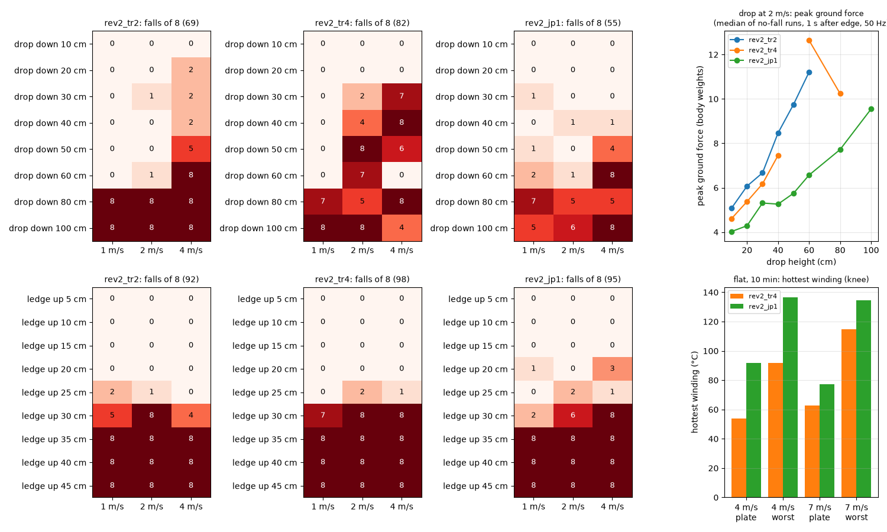
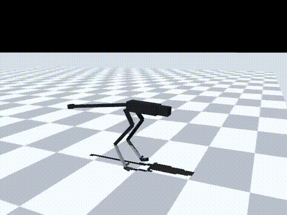
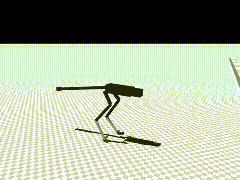
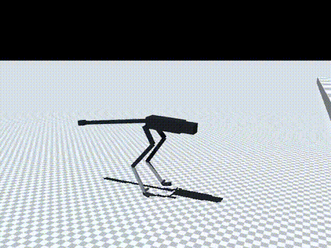

# 183 앞 지형 높이 입력 rev2_jp1: 낭떠러지·험지는 나아졌지만 뛰어오르기는 배우지 못함, 무릎 발열 증가로 미채택

2026-10-30, 사용자 요청 "절벽같은 높은데서 점프하거나 위로 점프해서 올라가는것도 가능하게". 증거 182에서 앞을 보지 않는 정책은 1–2 m/s로 0.6 m 낭떠러지까지 내려가고 0.2 m 턱까지 올라갔다. 여기서는 로봇 앞 바닥 높이를 입력으로 더하고 턱·낭떠러지 지형을 섞어 `rev2_tr4`에서 이어 학습했다(`rev2_jp1`). 모두 MuJoCo 시뮬레이션 결과(단단한 바닥 0.005, v2 실물화)다. 능동축 수는 바뀌지 않았다. 앞 깊이 카메라는 센서 가정이다.

## 결론

- **뛰어오르기는 배우지 못했다.** 턱 0.35 m 이상은 세 정책 모두 모든 속도에서 8/8 넘어진다.
  - 0.3 m: `jp1` 2 / 6 / 8(1 / 2 / 4 m/s), `tr4` 7 / 8 / 8, `tr2` 5 / 8 / 4
  - 영상(0.4 m, 2 m/s)에서는 발을 턱 위로 올리지 못하고, 몸통이 턱 앞면에 부딪혀 앞으로 넘어진다.
  - 넘어지는 시점은 모서리 바로 앞이다(2–4 m/s에서 1.6–1.8초, 모서리는 2 m 앞).
- **낭떠러지는 나아졌다.**
  - 1–2 m/s, 0.1–0.6 m: `jp1` 6/96, `tr4` 21/96(p = 0.003), `tr2` 2/96
  - 4 m/s, 0.3–0.5 m: `jp1` 5/24, `tr4` 21/24
  - 0.8 m 이상은 여전히 대부분 넘어진다(1–2 m/s에서 `jp1` 23/32).
- **착지 충격이 줄었다.** 2 m/s로 넘어지지 않고 내려간 경우의 지면 반력 최대 중앙값(50 Hz로 잼)
  - 0.5 m: 5.8배(`tr2` 9.8배)
  - 0.6 m: 6.6배(`tr2` 11.2배, `tr4` 12.6배)
  - 모터 전류 / 최대 전류는 0.1–0.8 m에서 1.0–1.01이다. `tr2`는 0.6 m에서 1.23이었다. 1.0 m에서는 `jp1`도 1.23이다.
- **기존 험지(증거 181과 같은 28종)는 나아졌다.** 넘어짐 `tr4` 67 → `jp1` 45/672(p = 0.04)
  - 4 m/s: 계단 10 cm 8 → 2/8, 오르막 25° 5 → 1/8
  - 1–2 m/s: 19 → 16/448
- **평지 고속과 발열은 나빠졌다.** 이 때문에 기본 정책으로 쓰지 않는다.
  - 명목 속도(명령 2 / 4 / 5.5 / 7 m/s): 1.87 / 3.16 / 2.44 / 1.80 m/s(`tr4` 1.95 / 3.53 / 4.15 / 3.61). 높은 명령일수록 더 느려진다.
  - 10분 연속 주행의 가장 뜨거운 권선(무릎, RS03)
    - 4 m/s, 방열판: 54 → 92 °C
    - 4 m/s, 가장 나쁜 장착: 92 → 137 °C, 감액 0.41
    - 7 m/s, 가장 나쁜 장착: 115 → 134 °C, 감액 0.52
  - 평지 충격 넘어짐은 줄었지만(0.1/s 43 → 16/96, 0.2/s 59 → 34/96), 느리게 달린 탓일 수 있다.
- **판단**
  - `jp1`은 채택하지 않는다. 기본은 `tr4`, 평지 4 m/s 초과는 `ct5`로 둔다.
  - 1–2 m/s 낭떠러지·험지 전용으로 쓸 수 있는지는 2 m/s 발열을 잰 뒤 정한다.
  - 뛰어오르기를 못 배운 원인 후보는 높은 턱이 학습에 드물게 나온 것이다. 턱 높이는 0.45 m × 판 수준 U(0, 1) × U(0.03, 1)이라 0.3 m를 넘는 턱이 약 6 %뿐이었다.
  - 다음 실험 `rev2_jp2`는 `boxes` 판의 수준만 U(0.6, 1)로 올린다. 0.3 m를 넘는 턱이 약 16 %로 2.5배가 된다.

| 낭떠러지 0.5 m, 2 m/s(넘어짐 없음) | 턱 0.3 m, 2 m/s(1.7초에 넘어짐) | 턱 0.4 m, 2 m/s(1.7초에 넘어짐) |
|---|---|---|
|  |  |  |

영상은 `jp1`, 시드 5000이다. MP4는 `media/`에 있다(낭떠러지 0.8 m 포함, 3.4 m 지점에서 넘어짐).

## 학습

- 시작점: `rev2_tr4`. 10M 스텝을 학습해 누적 107.8M 스텝이 됐다. 기록은 `policy/`에 있다.
- 앞 지형 높이 입력(`--obs-scan`)
  - 진행 방향 −0.3, −0.15, 0, 0.15, 0.3, 0.45, 0.6, 0.75, 0.9, 1.05, 1.2, 1.5 m 지점 12개의 바닥 높이
  - 기준은 몸 아래 바닥이며 ±1 m에서 자른다.
  - 잡음은 2 cm, 판마다 바뀌는 편향은 2 cm다. [Intel D435i](https://www.intel.com/content/www/us/en/products/sku/190004/intel-realsense-depth-camera-d435i/specifications.html)의 2 m 거리 오차 2 % 미만에 맞췄다.
  - 지연은 3 제어 주기(60 ms)에 측정 주기를 더한 값이다. 공식 수치가 없어 가정한 값이다.
  - 새 입력의 첫 층 가중치를 0으로 두어, 학습 시작점은 `tr4`와 출력이 같다(증거 182에서 확인).
- 지형 설정: `{"kinds": {"flat": 3, "rough": 1, "slope": 1, "side_slope": 1, "stairs": 1, "boxes": 3}, "max_level": 1.0, "vmax": 3.0, "size": 40}`
  - `boxes`: 1.5 m부터 2–4 m마다 턱(최대 0.45 m) 또는 낭떠러지(최대 0.8 m)가 반씩 나온다.
- 보상은 `tr4`와 같다. 발 접촉 일정(`gait`, −8)도 그대로라서, 공중에 오래 떠 있는 동작은 벌점을 받는다. 이것도 뛰어오르기를 막는 원인일 수 있다(미확인).
- 참고로 공개 연구에서 뛰어 올라간 높이는 [Cassie 0.44 m](https://arxiv.org/abs/2302.09450)(다리가 훨씬 긴 약 31 kg 로봇)와 [Unitree H1 0.42 m](https://arxiv.org/abs/2406.10759)(깊이 카메라 사용)다. Raptor(약 11 kg)도 같은 높이가 가능하다고 보지는 않는다.

## 시험 방법

`eval/run_eval.sh`가 모든 평가를 돌린다.

| 시험 | 방법 | 결과 파일 |
|---|---|---|
| 낭떠러지·턱 | 증거 182의 `edge_probe.py`. 낭떠러지 0.1–1.0 m, 턱 0.05–0.45 m × 1 / 2 / 4 m/s × 시드 5000–5007. `tr2`·`tr4`의 턱 0.35·0.45 m도 함께 쟀다 | `eval/edge.jsonl` |
| 험지 28종 | 증거 173–181과 같은 방법 | `eval/terrain.jsonl` |
| 평지 | 증거 181과 같은 명목·충격·실물화 끔 시험. 지형 옵션은 빼고 앞 높이 입력은 둔 사본(`_st_r01` 등)을 쓴다 | `eval/probe_nominal.jsonl`, `eval/ablate.jsonl` |
| 10분 발열 | 증거 167의 `long_run.py` | `eval/long_run.jsonl` |
| 영상 | 낭떠러지 0.5·0.8 m, 턱 0.3·0.4 m, 2 m/s | `eval/video_runs.jsonl` |

평지 결과(넘어짐, 60초 판 × 24):

| `jp1` 조건 | 2 | 4 | 5.5 | 7 m/s | 합계(`tr4`) |
|---|---|---|---|---|---|
| 좌우 충격 0.1/s | 4 | 6 | 4 | 2 | 16/96 (43) |
| 좌우 충격 0.2/s | 5 | 9 | 9 | 11 | 34/96 (59) |
| 실물화 끔 | 16 | 24 | 13 | 4 | 57/96 (52) |

## 함께 넣은 코드

- `sim/rl/run_env.py`: 지형 설정에 `"level_min": {kind: lo}`를 추가했다. 그 종류의 판 수준을 U(lo, L)로 뽑는다.
  - 쓰지 않으면 이전과 같다.
  - 다른 종류의 난수 순서는 바뀌지 않는다.
  - `rev2_jp2` 학습에 쓴다.

## 구분

| 구분 | 내용 |
|---|---|
| 확인 | 앞 높이 입력으로 1–2 m/s 낭떠러지 넘어짐 21 → 6/96(`tr4` 대비), 착지 반력 약 절반, 기존 험지 67 → 45/672(p = 0.04) |
| 실패 | 턱 0.35 m 이상 뛰어오르기 0/72 성공. 평지 고속 속도 감소(7 m/s 명령에 1.8 m/s). 무릎 발열 증가(4 m/s 가장 나쁜 장착 137 °C, 감액 0.41) |
| 미검증 | 무릎 발열이 늘어난 원인. 뛰어오르기 실패가 드문 높은 턱 때문인지, 발 접촉 일정 벌점 때문인지, 모터 힘의 한계 때문인지. 실물 깊이 카메라의 지연. 2 m/s 발열 |
| 다음 한 단계 | `rev2_jp2`: `jp1`에서 이어서, `boxes` 판 수준만 U(0.6, 1)로 올려 10M 스텝 학습 |
