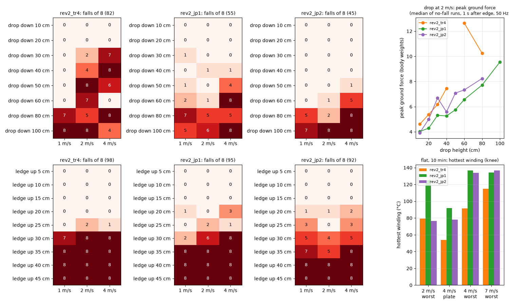
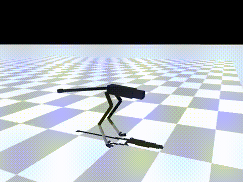
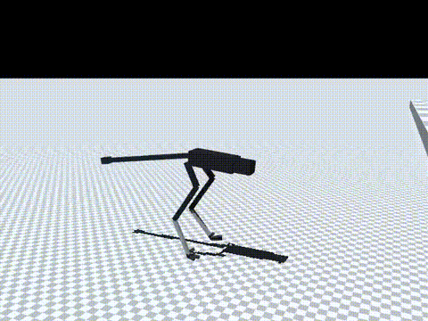

# 184 높은 턱을 자주 학습한 rev2_jp2: 험지 넘어짐 67 → 25, 턱 0.35 m를 처음 일부 통과, 2 m/s 이하 지형 모드로 채택

2026-10-30, 사용자 요청 "절벽같은 높은데서 점프하거나 위로 점프해서 올라가는것도 가능하게". 증거 183의 `rev2_jp1`은 턱 0.35 m 이상에서 72번 모두 넘어졌다. 학습 지형에 높은 턱이 드물게 나온 것(0.3 m 초과 약 6 %)을 첫 원인 후보로 보았다. 그래서 `boxes` 판의 수준만 U(0, 1)에서 U(0.6, 1)로 올려 `jp1`에서 이어 학습했다(`rev2_jp2`, 0.3 m 초과 약 16 %). 모두 MuJoCo 시뮬레이션 결과(단단한 바닥 0.005, v2 실물화)다. 능동축 수는 바뀌지 않았다. 앞 깊이 카메라는 센서 가정이다.

## 결론

- **턱: 0.35 m를 처음으로 일부 통과했지만, 아직 "뛰어오른다"고 할 수준은 아니다.**
  - 0.35 m 넘어짐(1 / 2 / 4 m/s, 8번 중): `jp2` 7 / 5 / 8, `jp1`·`tr4` 모두 8 / 8 / 8. 합계 20/24 대 24/24(p = 0.11, 통계적으로 확실하지 않음)
  - 0.3 m: `jp2` 5 / 4 / 5, `jp1` 2 / 6 / 8, `tr4` 7 / 8 / 8
  - 0.4 m 이상은 모두 넘어진다.
  - 0.2–0.25 m에서는 오히려 몇 번 넘어진다(`jp2` 10/48, `tr4` 3/48).
  - 0.3 m 영상(2 m/s)에서는 넘어지지 않고 올라갔다. 다만 발이 모두 떠서 뛰어올랐는지는 영상과 기록으로 확인하지 못했다.
- **낭떠러지는 더 나아졌다.**
  - 1–2 m/s, 0.1–0.6 m: `jp2` 1/96, `jp1` 6/96, `tr4` 21/96
  - 0.8 m, 2 m/s: 2/8(`jp1` 5/8). 1.0 m는 여전히 대부분 넘어진다.
  - 착지 반력은 `jp1`과 비슷하다(2 m/s 0.6 m에서 체중의 7.3배, `tr4` 12.6배).
- **기존 험지(증거 181과 같은 28종)가 크게 나아졌다.** 넘어짐 `tr4` 67 → `jp2` 25/672(p < 0.0001, `jp1` 45 대비 p = 0.02)
  - 1–2 m/s: 19 → 5/448. 내리막 25°는 13/16 → 0/16
  - 산길 목표(1–2 m/s: 오르막·내리막 20°, 계단 10 cm, 울퉁불퉁 ±8 cm): 3/64 → 2/64. 남은 2번은 울퉁불퉁 ±8 cm다.
  - 4 m/s: 48 → 20/224
- **2 m/s에서는 발열·속도 문제가 없다.**
  - 10분, 가장 나쁜 장착: `jp2` 76 °C, `tr4` 79 °C, `jp1` 125 °C
  - 2 m/s 명령에 1.92 m/s
- **4 m/s 이상에서는 쓸 수 없다.**
  - 명목 속도(명령 4 / 5.5 / 7 m/s): 2.66 / 1.94 / 1.27 m/s(`tr4` 3.53 / 4.15 / 3.61)
  - 4 m/s, 가장 나쁜 장착: 무릎 134 °C, 감액 0.54. 7 m/s: 137 °C, 감액 0.40
- **판단: `jp2`를 2 m/s 이하 지형·낭떠러지 모드로 채택한다.**
  - 기본 정책은 `tr4` 그대로이고, 평지 4 m/s 초과는 `ct5`로 둔다.
  - `jp2`와 `tr4` 사이의 주행 중 전환은 아직 시험하지 않았다.
  - 턱 오르기는 아직 목표에 못 미친다. 다음 실험 `rev2_jp3`는 턱·낭떠러지 근처에서 발 접촉 일정 벌점(`gait`, −8)만 끈다.

| 낭떠러지 0.5 m, 2 m/s(넘어짐 없음) | 턱 0.3 m, 2 m/s(넘어짐 없음) | 턱 0.4 m, 2 m/s(넘어짐) |
|---|---|---|
|  |  |  |

낭떠러지 0.8 m(넘어짐 없음)는 MP4(`media/jp2_drop80cm_2mps.mp4`)로 남겼다. 영상은 모두 `jp2`, 시드 5000이다.

## 학습

- 시작점: `rev2_jp1`. 10M 스텝을 학습해 누적 117.9M 스텝이 됐다. 기록은 `policy/`에 있다.
- 지형 설정: `{"kinds": {"flat": 3, "rough": 1, "slope": 1, "side_slope": 1, "stairs": 1, "boxes": 3}, "max_level": 1.0, "level_min": {"boxes": 0.6}, "vmax": 3.0, "size": 40}`
- `jp1`과 달라진 것은 `level_min`(증거 183에서 추가)뿐이다. 보상, 앞 높이 입력과 그 잡음·지연은 같다.

## 결과

평지(넘어짐, 60초 판 × 24, `eval/ablate.jsonl`):

| `jp2` 조건 | 2 | 4 | 5.5 | 7 m/s | 합계(`jp1`, `tr4`) |
|---|---|---|---|---|---|
| 좌우 충격 0.1/s | 5 | 9 | 9 | 3 | 26/96 (16, 43) |
| 좌우 충격 0.2/s | 3 | 14 | 8 | 12 | 37/96 (34, 59) |
| 실물화 끔 | 9 | 19 | 11 | 3 | 42/96 (57, 52) |

10분 연속 주행의 가장 뜨거운 권선(무릎). 2 m/s 세 정책은 이 증거에서 같은 조건으로 쟀다(`eval/long_run_2mps.jsonl`). 나머지는 `eval/long_run.jsonl`과 증거 181·183이다.

| 명령 · 장착 | `tr4` | `jp1` | `jp2` |
|---|---|---|---|
| 2 m/s · 가장 나쁨 | 79 °C | 125 °C | 76 °C |
| 4 m/s · 방열판 | 54 °C | 92 °C | 78 °C |
| 4 m/s · 가장 나쁨 | 92 °C | 137 °C(감액 0.41) | 134 °C(감액 0.54) |
| 7 m/s · 가장 나쁨 | 115 °C | 134 °C(감액 0.52) | 137 °C(감액 0.40) |

평가는 `eval/run_eval.sh`로 돌렸다(증거 183과 같은 시험).

## 함께 넣은 코드

- `sim/rl/run_env.py`: 지형 설정 `"gait_free": [앞 거리, 높이]`와 `near_edge()`를 추가했다.
  - 실제 바닥(앞 높이 입력의 잡음 없는 값) 기준으로 판정한다. 몸 뒤 0.3 m에서 앞 거리까지 9점의 높이 차가 그 높이를 넘으면 `gait` 항을 0으로 둔다.
  - 쓰지 않으면 이전과 같다. `rev2_jp3` 학습에 쓴다.

## 구분

| 구분 | 내용 |
|---|---|
| 확인 | 험지 67 → 25/672, 1–2 m/s 낭떠러지 0.6 m 이하 1/96, 2 m/s 10분 발열 76 °C. 턱 0.35 m 4/24 통과(이전 0/24) |
| 실패 | 턱 0.4 m 이상 0/48 통과. 4 m/s 이상 속도 감소와 무릎 발열·감액 |
| 미검증 | 턱을 오를 때 실제로 뛰었는지(공중 시간 미기록). `jp2` ↔ `tr4` 주행 중 전환. 4 m/s 이상에서 무릎이 뜨거워진 원인. 착지 충격에 대한 기어 강도 |
| 다음 한 단계 | `rev2_jp3`: `jp2`에서 이어서, 지형 설정 `"gait_free": [0.8, 0.1]`(몸 뒤 0.3 m – 앞 0.8 m 바닥 높이 차가 0.1 m를 넘으면 `gait` 벌점을 끔)만 바꿔 10M 스텝 학습(증거 185) |
