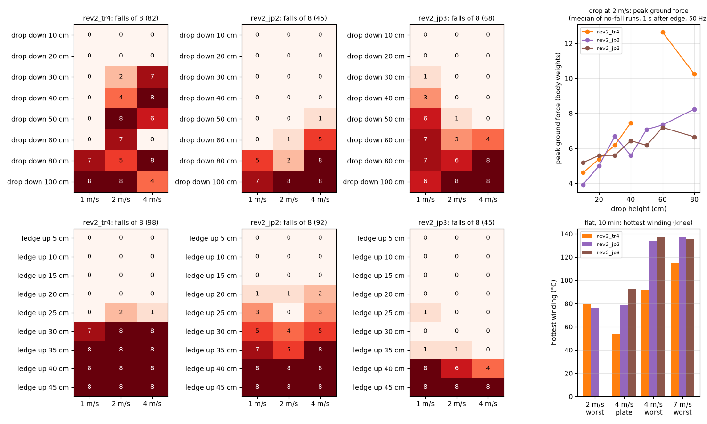
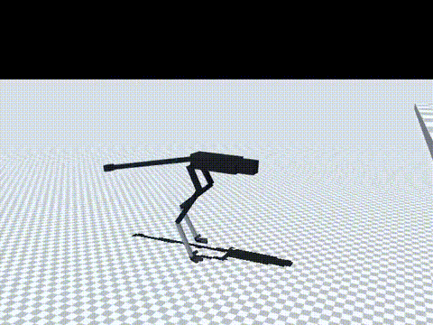
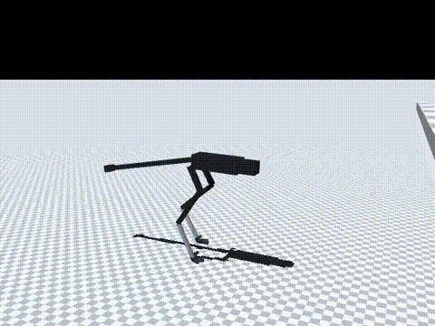
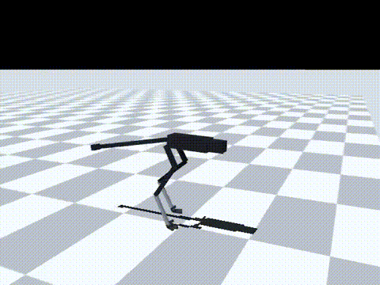

# 185 턱 근처 발 접촉 일정 벌점 해제 rev2_jp3: 턱 0.35 m까지 거의 넘어지지 않지만 뛰지 않고 "높이 디뎌" 오름, 미채택

2026-10-30–31. 증거 184의 `rev2_jp2`에서 이어서, 턱·낭떠러지 근처에서만 발 접촉 일정 벌점(`gait`, −8)을 끄고 10M 스텝 학습했다(`rev2_jp3`, 지형 설정 `"gait_free": [0.8, 0.1]`, 그 밖은 `jp2`와 같음). 모두 MuJoCo 시뮬레이션 결과(단단한 바닥 0.005, v2 실물화)다.

이 실험 뒤 사용자 결정(2026-10-31)으로 작업 방식을 **서기 → 걷기 → 달리기 → 점프 → 험지 순차 학습**으로 바꿨다. 이 기록은 그 전 방식의 마지막 결과이며, 점프 단계에서 참고한다.

## 결론

- **턱 오르기는 크게 나아졌다.** 넘어짐(1 / 2 / 4 m/s, 8번 중)
  - 0.3 m: `jp3` 0 / 0 / 0, `jp2` 5 / 4 / 5
  - 0.35 m: `jp3` 1 / 1 / 0, `jp2` 7 / 5 / 8
  - 0.4 m: `jp3` 8 / 6 / 4(처음으로 6번 통과), `jp2` 8 / 8 / 8
  - 발 접촉 일정 벌점이 턱 오르기를 막고 있었다는 가설(증거 183)과 맞는다.
- **그러나 점프는 아니다.** 턱을 지난 1초 안에 두 발이 모두 뜬 가장 긴 시간(`eval/flight.jsonl`, 넘어지지 않은 판)
  - 0.3–0.35 m: 0.04–0.18초. 평지 달리기의 공중 시간 0.10–0.14초와 비슷하다.
  - 발을 높이 들어 디뎌 오르는 것이지, 웅크렸다가 박차고 뛰어오르는 동작이 아니다.
  - `jp2`도 같은 방법으로 쟀다(`eval/flight_jp2.jsonl`). 턱에서 0–0.2초, 낭떠러지 0.5 m에서 0.16–0.26초로 걸어 떨어지는 시간이었다.
- **낭떠러지는 나빠졌다.** 1–2 m/s, 0.1–0.6 m 넘어짐 `jp3` 21/96, `jp2` 1/96. 1 m/s에서 특히 나쁘다(0.5 m 6/8, 0.6 m 7/8).
- **험지와 평지도 나빠졌다.**
  - 기존 험지 28종: 38/672(`jp2` 25)
  - 명목 속도(명령 2 / 4 / 5.5 / 7 m/s): 1.97 / 3.25 / 2.89 / 1.97 m/s
  - 10분 4 m/s 가장 나쁜 장착: 137 °C, 감액 0.37
- **판단: 채택하지 않는다.** 2 m/s 이하 지형 모드는 `jp2` 그대로다.

| 턱 0.3 m, 2 m/s | 턱 0.4 m, 2 m/s | 낭떠러지 0.5 m, 2 m/s |
|---|---|---|
|  |  |  |

영상은 `jp3`, 시드 5000이다. 2 m/s 10분 발열은 `jp3`에서 재지 않았다(그림의 빈 칸).

## 방법

- 학습: `jp2`에서 이어서 10M 스텝(누적 약 128M). 지형 설정에 `"gait_free": [0.8, 0.1]`만 더했다(몸 뒤 0.3 m – 앞 0.8 m의 실제 바닥 높이 차가 0.1 m를 넘으면 `gait` 항을 0으로 둠, 증거 184에서 추가한 코드). 기록은 `policy/`.
- 평가: `eval/run_eval.sh`(증거 183·184와 같은 시험).
- 공중 시간: `eval/flight_probe.py`(증거 182의 `edge_probe.py`에 두 발 지면 반력 합이 체중의 2 % 미만인 연속 시간을 더한 것, 50 Hz). 모서리를 지난 1초 안의 최댓값(`flight_edge_s`)과 모서리 전 평지 달리기의 최댓값(`flight_before_s`)을 함께 기록한다.

## 구분

| 구분 | 내용 |
|---|---|
| 확인 | 발 접촉 일정 벌점을 턱 근처에서 끄면 턱 0.3–0.35 m 넘어짐 `jp2` 34/48 → 2/48. 공중 시간은 평지 달리기와 비슷해 뛰어오른 것이 아님 |
| 실패 | 진짜 점프 없음. 낭떠러지·험지·평지 고속·발열이 `jp2`보다 나쁨 |
| 미검증 | 50 Hz 접촉 판정이 짧은 이륙을 놓쳤는지(1 ms 기록 없음). `jp3` 2 m/s 발열 |
| 다음 한 단계 | 사용자 결정에 따라 순차 학습 0단계(설계 확정: 모터 B안, 고관절 yaw 축) |
