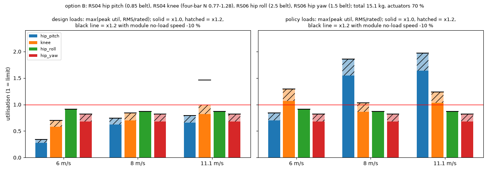

# 186 0단계 설계 확정 ①: 구동기 B안은 "조건부 통과" — 이상적 보폭이면 RS04로 11.1 m/s가 들어가지만, 지금 정책 수준의 하중이면 고관절이 넘침

2026-10-31, 사용자 결정 "B로 가고 yaw 축도 추가해서 0단계부터 진행해. B 시도하고 도저히 안 된다 판단되면 A로 진행"([순차 학습 계획](../../STAGED_PLAN.ko.md)). **계산 결과이며 주행 결과가 아니다.** 시뮬레이션 학습은 하지 않았다.

## 결론

- **B안 판정: 조건부 통과. B안으로 계속 간다.**
  - 계획서의 0단계 전환 기준(설계 보폭 하중 × 1.0에서 축 하나라도 조합이 없거나, 구동기가 총질량의 75 % 초과)에 걸리지 않는다.
  - 다만 아래 두 조건이 모두 맞아야 11.1 m/s가 계산상 가능하므로 **위험이 크다.** 최종 판단은 3단계(달리기)에서 한다.
- **조건 1: 학습된 걸음이 이상적인 설계 보폭만큼 효율적이어야 한다.**
  - 설계 보폭(SLIP) 하중이면 11.1 m/s, 하중 여유 1.2배에서도 모든 축이 한계 안이다(제조사 매뉴얼의 48 V 토크-속도 곡선 기준). 가장 빠듯한 축은 무릎으로 0.99(발열)다.
  - 지금까지 학습된 정책은 5.7 m/s에서 고관절 RMS 토크를 설계 보폭의 약 2.5배 썼다(증거 164, 모터 선정 문서 §1).
  - 그 비율을 적용하면 8–11.1 m/s에서 고관절 pitch가 한계의 1.3–2.0배로 넘친다.
- **조건 2: 모터 실제 속도가 공칭값에 가까워야 한다.**
  - RS04 무부하 속도는 200 rpm ± 10 %다. 11.1 m/s에서 무릎은 속도 한계에 붙어 있다.
  - 무부하 속도가 10 % 낮으면(곡선의 속도축을 0.9배) 무릎이 한계의 1.2–1.5배가 된다(그림의 검은 선).
- **고른 구성(B안)**

  | 축 | 구동기 | 감속 | 고른 이유 |
  |---|---|---|---|
  | 고관절 pitch | RS04 | 0.85 증속 벨트 | 직결이면 11.1 m/s 고관절 속도 20.6 rad/s가 무부하 속도 −10 %에서 나오지 않는다 |
  | 무릎(발목 1:1 연동) | RS04 | 허벅지 장착 4절 링크(전달비 0.77–1.28) | 지금 4절 링크(1.0–2.05)는 RS04 속도로는 느리다. **증거 187에서 무릎 굽힘 범위를 지키는 링크(전달비 0.62–2.15)로 바꿨다** |
  | 고관절 roll | RS06 | 2.5 벨트 | 1.5 벨트면 RMS가 정격의 1.43배 |
  | **고관절 yaw(신규)** | RS06 | 1.5 벨트 | 회전 하중은 추정값이라 여유를 둔다(4단계에서 실측) |
  | 꼬리 pitch · yaw | RS03 · RS06 | 직결 | 지금과 같다 |

- **총질량이 늘어난다.** 11.3 → **15.1 kg**(고정점 계산)
  - 구동기와 구동 부품이 10.6 kg으로 총질량의 70 %다.
  - 40 km/h 사양서의 65 % 기준을 넘으므로 **경고**한다.
  - 구조·배터리·전장은 지금 질량(4.5 kg)으로 두었다. 더 무거운 모터와 더 큰 출력에 맞게 구조와 배터리를 키워야 할 가능성이 크다(미계산).
- **같이 찾은 모델 불일치**(다음 단계에서 고친다)
  - 고관절 pitch 감속: 학습 설정은 1.5 벨트, 실물 모터 조건은 직결이다.
  - 질량 모델(`real_mass`)이 실제 고른 모터가 아니라 등급 질량을 쓴다.
    - 고관절 roll: A급 0.5 kg으로 들어가 있다. 고른 것은 RS06 0.62 kg에 벨트를 더한 것이다.
    - 꼬리 yaw: B급 0.96 kg으로 들어가 있다. 고른 것은 RS06 0.62 kg이다.
  - 4절 링크·래칫·클러치 질량이 모델에 없다.

이용률은 순간 최대 토크 ÷ 그 속도에서 낼 수 있는 토크(매뉴얼 곡선), RMS 토크 ÷ 정격 토크 중 큰 값이다. 1을 넘으면 그 축이 한계를 넘는다.
- 막대: 하중 × 1.0
- 빗금: 하중 × 1.2
- 검은 선: 하중 × 1.2에 무부하 속도 −10 %를 함께 넣은 값

## 방법

`modeling/stage0_b_study.py`, 결과는 `b_study_11p1.json`(축마다 가장 가벼운 조합 탐색)과 `chosen.json`(고른 구성 평가)이다.

- **하중**
  - 40 km/h 사양서의 설계 보폭을 쓴다(`modeling/spec_40kmh.py`).
    - SLIP 접지, 스프링 (c), 발목 스프링은 접지 중에만 걸림
    - 무릎-발목 1:1 연동, 다리 끝 경량 다리
  - 11.36 kg에서 계산해 총질량에 비례로 키웠다.
  - **정책 보정 하중**은 학습 정책 / 설계 보폭 비율이다(5.7–6 m/s 측정, 증거 164).
    - 고관절: 최대·RMS 모두 2.5배. 최대값은 측정이 없어 같다고 가정
    - 무릎: 최대 2.2배, RMS 1.0배
    - 이 비율이 11.1 m/s까지 같다고 가정했다.
- **구동기**
  - `docs/design/motor_candidates.json`의 값을 쓴다. RobStride는 제조사 매뉴얼로 확인한 값이고, 다른 제조사는 검색 요약이다(판정에는 RobStride만 씀).
  - 외부 감속은 일정 비 벨트(0.4–2.5배, 1이 아니면 효율 0.9)이고, 무릎은 4절 링크 6000개를 무작위로 탐색했다.
- **토크-속도 곡선**
  - 판정용(manual): 제조사 사용설명서의 48 V T-N 곡선을 눈으로 읽어 숫자로 옮긴 것(±3 % 정도). `motor_candidates.json`의 `tn_curve`에 출처 쪽수와 함께 넣었다.
    - RS03: 120 rpm까지 60 N·m, 약 188 rpm에서 0 ([RS03 매뉴얼 p.10](https://github.com/RobStride/Product_Information/tree/384cc56/Product%20Literature/CAN2.0/RS03))
    - RS04: 95 rpm까지 120 N·m, 150 rpm 79 N·m, 170 rpm 52 N·m, 약 191 rpm에서 0 ([RS04 매뉴얼 p.10](https://github.com/RobStride/Product_Information/tree/384cc56/Product%20Literature/CAN2.0/RS04))
    - RS06: 280 rpm까지 36 N·m, 약 431 rpm에서 0 ([RS06 매뉴얼 p.9](https://github.com/RobStride/Product_Information/tree/384cc56/Product%20Literature/CAN2.0/RS06))
    - 곡선 끝(188–431 rpm)이 표기 무부하 속도(200·480 rpm)보다 낮다.
  - 민감도 0(published): 무부하 속도의 60 %까지 최대 토크, 이후 0까지 직선. 처음 판정에 쓴 근사이며 매뉴얼 곡선과 ±10–15 N·m 안에서 맞았다.
    - 근거는 RS04 판매처 설명 "120 rpm까지 안정 토크"(무부하 200 rpm)다.
    - 정격점 40 N·m@167 rpm은 이 곡선 아래에 있다.
    - 출처: [AIFitLab RS04 사양](https://aifitlab.com/collections/servo-motor/products/robstride-04-motor), [rcdrone RS04 사양](https://rcdrone.top/products/robstride-04-qdd-120n-m-integrated-actuator-module-48v-9-1-ratio-dual-magnetic-encoder-ip52-700w-output)
  - 민감도 1(assumed): 50 %까지 최대 토크. `run_env`의 기존 가정이다.
  - 민감도 2(dc): 48 V에서 역기전력과 저항으로 계산. `realism.py` 방식이며 낙관적이다.
- **발열**: RMS 토크 ÷ 제조사 정격 토크. 정격은 제조사 방열판 기준이라, 다리에 달면 더 낮을 수 있다(증거 167).
- **고관절 roll 하중**: 최대 지면 반력 × 0.10 m, 5 rad/s(사양서 §6-1).
- **고관절 yaw 하중(추정)**
  - 꼬리를 잡은 몸 yaw 관성 약 0.75 kg·m²(11.36 kg 기준)로 0.5초에 90° 방향을 바꾸면 약 19 N·m가 필요하다.
  - 발 마찰과 흔드는 다리 몫을 더해 25 N·m@8 rad/s, RMS는 최대의 0.3으로 두었다.
  - 4단계(방향 전환)에서 시뮬레이션 측정값으로 바꾼다.
- **질량**: 고른 모터와 구동 부품(벨트 0.10 kg, 4절 링크 0.10 kg, yaw 브래킷 0.05 kg, 모두 가정)으로 등급 모터를 바꾸고, 총질량과 하중이 맞을 때까지 반복했다.

## 축별 가장 가벼운 조합 (11.1 m/s, RobStride만; published·assumed·dc 행은 `b_study_11p1.json`)

| 하중 · 곡선 · 여유 | 가능 | 총질량 | 비고 |
|---|---|---|---|
| 설계 · **manual** · 1.0 / 1.2 | 예 | 14.9 kg | 고관절 RS04 직결, 무릎 RS04 + 4절 링크(0.5–1.76), roll RS06 2.5 벨트. 매뉴얼 곡선에서는 RS03 고관절이 속도 부족으로 빠진다 |
| 설계 · published · 1.0 | 예 | 13.3 kg | 고관절 RS03 직결, 이용률 0.96 · RMS 1.00(한계에 붙음) |
| 설계 · published · 1.2 | 예 | 14.4 kg | 고관절·무릎 RS04 |
| 설계 · assumed · 1.2 | 아니오 | – | 무릎 1.02 |
| 정책 보정 · 모든 곡선·여유 | **아니오** | – | 고관절 pitch 1.06–1.35 |

다른 제조사(검색 요약 값)를 넣어도 정책 보정 하중에서는 고관절 pitch 조합이 없다.

## 구분

| 구분 | 내용 |
|---|---|
| 확인(계산) | 설계 보폭 하중이면 RobStride RS04 조합으로 11.1 m/s 하중이 여유 1.2에서도 들어감. 총질량 15.1 kg, 구동기 70 % |
| 실패(계산) | 지금 정책 수준의 고관절 하중이면 8–11.1 m/s에서 상용 조합 없음. RS04 속도 −10 %면 11.1 m/s 무릎 초과 |
| 미검증 | 정책 보정 비율(5.7 m/s 한 정책 기준). RS04 실제 토크-속도 곡선. 고관절 yaw 하중. 구조·배터리를 15 kg에 맞춘 질량. 4절 링크 실제 설계 |
| 다음 한 단계 | 0단계 ②: 이 구성으로 모델(`rev3`)을 만든다. 고관절 yaw 축, 모터·감속·질량을 한 설정 파일로 통일하고 학습 환경·실물 모터 조건·질량 모델 불일치를 없앤다 |
