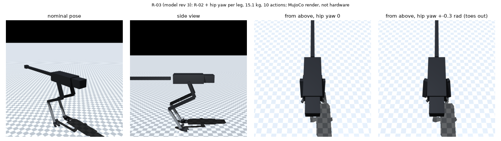
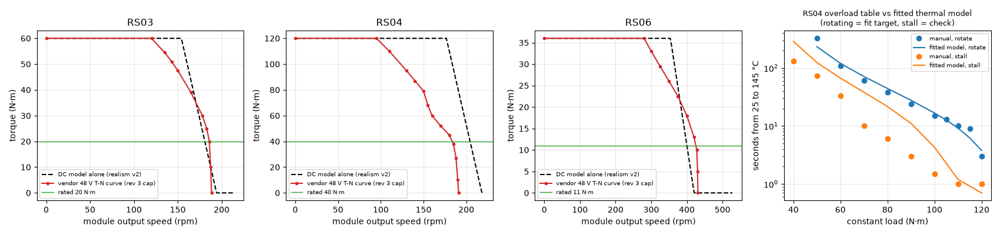

# 187 0단계 설계 확정 ②: 고관절 yaw 축을 넣은 R-03 모델(rev 3)과 모터 설정 통일, RobStride 공식 토크-속도 곡선 반영

2026-10-31, 사용자 결정 "B로 가고 yaw 축도 추가해서 0단계부터 진행해"([순차 학습 계획](../../STAGED_PLAN.ko.md)). 학습은 하지 않았다. 모델과 설정을 만들고 시험·회귀 확인만 했다. 모두 MuJoCo 모델이며 실물이 아니다.

## 결론

- **R-03 모델(`model_rev=3`)을 만들었다.**
  - R-02에 다리마다 고관절 yaw 축을 더했다. 관절 순서는 roll → yaw → pitch(Cassie와 같음)이고, 범위는 ±0.5 rad다(가정, 4단계에서 다리 간섭 확인).
  - 정책이 움직이는 축은 다리마다 yaw·roll·pitch·무릎 4개, 꼬리 2개로 **모두 10개**다.
    - 발목 pitch는 무릎과 1:1로 연동한다.
    - 발목 roll은 잠근다.
  - 총질량은 **15.1 kg**이다(증거 186의 고정점 계산과 같음).
- **모터·감속·질량을 한 설정 파일(`sim/rl/rev3_b.json`)로 통일했다.**
  - 학습 환경의 구동 한계·PD 이득·로터 관성·4절 링크·질량이 모두 이 파일에서 나온다.
  - 실물 모터 조건(`realism_robstride_rev3.json`)은 이 파일에서 생성하고, 시험이 둘이 같은지 확인한다.
  - 증거 186에서 찾은 불일치를 rev 3에서 없앴다.
    - 고관절 pitch가 학습 설정은 1.5 벨트, 실물 모터 조건은 직결이던 문제
    - 질량 모델이 등급 질량을 쓰던 문제
  - 4절 링크·벨트·yaw 브래킷 질량도 넣었다(가정값).
- **RobStride 공식 매뉴얼의 48 V 토크-속도(T-N) 곡선을 찾아 반영했다.**
  - 지금까지의 실물 모터 조건은 전압·저항 계산만 썼다. 그 결과 RS04가 약 175 rpm까지 120 N·m를 낸다고 계산했다.
  - 매뉴얼 곡선은 95 rpm부터 떨어져 150 rpm에서 79 N·m다(아래 그림).
  - rev 3에서는 이 곡선을 구동 토크 상한으로 더 건다. rev 2(기존) 경로는 바꾸지 않았다.
- **RS04 발열 모델을 매뉴얼 과부하 표에 맞췄다.**
  - 회전 시험(120–50 N·m → 3–324초)을 −31 % – +27 % 안에서 재현한다.
  - 정지 시험은 모델이 2–4배 느리게 뜨거워진다. RS03(증거 167)과 같은 한계이며, 정지 상태가 길면 발열을 낮게 볼 수 있다.
- **무릎 4절 링크를 다시 골랐다.**
  - 증거 186의 링크는 무릎을 2.08 rad까지만 굽힐 수 있었다(rev 2는 2.25 rad).
  - rev 2 범위(0.72–2.25 rad)를 지키는 링크 중에서 다시 찾았다. 결과는 a 0.127, b 0.176, c 0.139 m, β 67.7°, 전달비 0.62–2.15, 사용 범위 0.64–2.26 rad다.
  - 11.1 m/s 설계 하중 × 1.2에서 이용률 0.75, 발열 0.91이다(증거 186 링크는 0.77, 0.99).
  - 모터 속도 −10 %에서 1.04로, 증거 186 링크의 1.46보다 낫지만 여전히 한계에 붙어 있다.
- **기존 결과는 바뀌지 않는다.** rev 2 경로가 비트 단위로 같은지 확인했다.
  - 실물 모터 조건이 꺼진 6가지 시험 rollout(`realism_regression.py`)
  - 실물 모터 조건 v2를 켠 rollout 3개(해시 `cce3a9b451621f83`, main과 같음)

## R-03 축 설정 (`sim/rl/rev3_b.json`)

| 축 | 모듈 | 외부 감속 | 효율 | 장착 위치 | 구동 부품(가정) |
|---|---|---|---|---|---|
| 고관절 yaw | RS06 | 1.5 벨트 | 0.9 | 고관절 roll 링크 | 0.15 kg(벨트+브래킷) |
| 고관절 roll | RS06 | 2.5 벨트 | 0.9 | 고관절 roll 링크 | 0.10 kg |
| 고관절 pitch | RS04 | 0.85 증속 벨트 | 0.9 | 고관절 roll 링크 | 0.10 kg |
| 무릎 | RS04 | 4절 링크(0.62–2.15) | 0.9 | 허벅지 위쪽 | 0.10 kg |
| 꼬리 pitch | RS03 | 직결 | 1.0 | 꼬리 yaw 링크 | – |
| 꼬리 yaw | RS06 | 직결 | 1.0 | 꼬리 yaw 링크 | – |

- 마찰은 증거 167과 같은 방법이다. 모듈 출력의 쿨롱 마찰 0.3 N·m(가정)과 매뉴얼 무부하 전류에서 낸 점성 마찰을 외부 감속비로 키웠다.
- RS04 점성 마찰은 무부하 전류 2 A rms에서 계산해 0.187 N·m·s/rad로 RS03(0.053)보다 크다.

## 방법과 파일

| 파일 | 내용 |
|---|---|
| `sim/build_r03.py` → `sim/raptor_r03.xml` | R-02 MJCF에 hip yaw 관절과 구동기를 더해 생성한다. 다른 줄은 같다(차이 12줄) |
| `sim/rl/rev3_b.json` | 축별 모듈·감속·효율·장착 위치·구동 부품 질량, 4절 링크 |
| `sim/rl/run_env.py` | `model_rev=3`: R-03 모델, `rev3_b.json`의 모듈 등록(T-N 곡선·정격·로터 관성), 4절 링크 사용 범위 자동 계산(양쪽 전달각 30° 이상), 질량. rev 2 이하는 같다 |
| `sim/rl/realism.py` | 선택 옵션 `motor.tn_curve`: 구동 토크를 모듈 출력 속도에서의 매뉴얼 곡선으로 제한한다. 끄면(기본) 같다 |
| `sim/rl/realism_robstride_rev3.json` | `eval/make_realism_rev3.py`로 생성한 rev 3 실물 모터 조건 |
| `docs/design/motor_candidates.json` | RS03·RS04·RS06 `tn_curve`(매뉴얼 쪽수 포함), RS04 `overload_table` |
| `eval/thermal_fit_rs04.py`, `eval/thermal_fit_rs04.json` | RS04 발열 맞춤(증거 167 방법) |
| `tests/test_rev3_model.py` | 모델 생성 재현, 축 10개·질량, 설정 일치, T-N 곡선 상한, 좌우 반전(yaw 부호), rev 2 불변 |

매뉴얼 출처: [RobStride/Product_Information@384cc56](https://github.com/RobStride/Product_Information/tree/384cc56/Product%20Literature/CAN2.0)
- RS03 User Manual 261013 p.10
- RS04 User Manual 260713 p.10–11
- RS06 User Manual 260713 p.9

T-N 곡선은 그림을 눈으로 읽어 숫자로 옮긴 것이라 최대 토크의 ±3 % 정도 오차가 있다.

## 구분

| 구분 | 내용 |
|---|---|
| 확인 | R-03 모델이 만들어지고 실물 모터 조건과 함께 돈다(축 14개 중 정책 10개, 15.1 kg). 시험 192개 통과(새 시험 6개 포함). rev 2 경로 비트 단위 동일 |
| 실패 | 없음(학습 전) |
| 미검증 | 이 모델로 서기·걷기·달리기가 되는지(1단계부터 학습). hip yaw 범위 ±0.5 rad와 다리 간섭. 구동 부품 질량(가정). ROS URDF/xacro와 Gazebo 모델은 아직 바꾸지 않았다(MuJoCo 전용). 정지 상태 발열(모델이 낮게 봄) |
| 다음 한 단계 | 1단계 서기: R-03을 처음부터 학습한다. 합격 기준은 30초 제자리 유지, 앞뒤·좌우로 밀어도 버팀, 넘어진 자세에서 일어나기다 |
