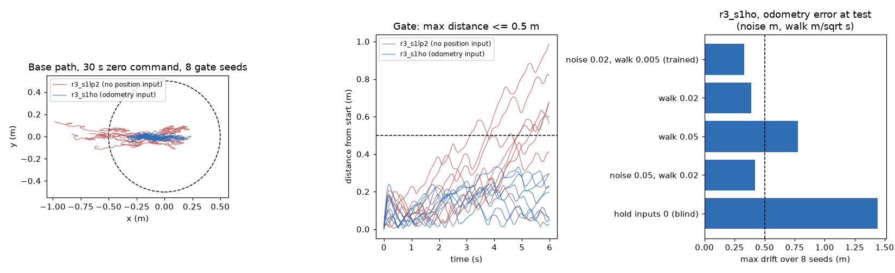
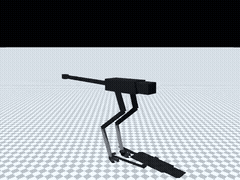
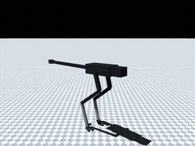

# 188 1단계 1a 서기 합격: R-03 `r3_s1ho` (위치 추정 입력 + 동작 저역 필터)

2026-10-31, [순차 학습 계획](../../STAGED_PLAN.ko.md) 1단계(사용자 지시 "지금 서는것 부터 … 순차적으로", "계속 진행해").
모두 MuJoCo 시뮬레이션이며 실물이 아니다. 실물 모터 조건(`realism_robstride_rev3.json`)을 켜고 시험했다.

## 결론

- **`r3_s1ho`가 1a 기준을 모두 통과했다**(`sim/rl/stage_gates.py stand`, 기준은 학습 전에 계획 문서에 적은 값 그대로).
- 서 있는 정책은 실물에서 쓸 수 있는 정보만으로 위치를 지켜야 했다. 위치 입력이 없는 정책은 30초 동안 걸음을 고치며 0.6–1.0 m 흘러갔다. 다리·시각 주행 거리계를 가정한 **위치 오차 입력(3개)** 을 붙이자 0.18–0.33 m 안에서 머물렀다.
- 이 정책은 그 입력에 기대므로 **입력을 0으로 막으면 1.44 m 흘러간다**(아래 그래프 오른쪽). 실물에서는 위치 추정기(다리 주행 거리계·시각 주행 거리계)가 필요하다. 추정기 누적 오차가 30초에 약 0.1 m(walk 0.02)까지는 기준 안이고, 약 0.27 m(walk 0.05)면 0.78 m로 기준 밖이다.
- 아직 걷기 명령을 받지 않는 정책이다. 걷기·회전 성능으로 해석하지 않는다.

| 시험(시드 고정) | 기준 | `r3_s1lp2`(위치 입력 없음) | **`r3_s1ho`** |
|---|---|---|---|
| 30초 명령 0, 명목 8판 넘어짐 | 0 | 0 | **0** |
| 같은 시험, 최대 수평 이동 | 0.5 m 이내 | 0.99 m ✗ | **0.33 m** |
| 같은 시험, 최대 방향 변화 | 기록 | 0.27 rad | 0.14 rad |
| 무작위화 30초 24판 넘어짐 | 1 이하 | 0 | **0** (이동 최대 0.66 m) |
| 0.3 m/s 충격 앞·뒤·좌·우 각 8판 넘어짐 | 각 1 이하 | 0·0·0·0 | **0·0·0·0** |
| 0.5 m/s 충격 넘어짐(기록) | – | 0·0·0·0 | 0·0·0·0 |
| 0.8 m/s 충격 넘어짐(기록) | – | 0·0·0·0 | 0·0·0·0 (이동 최대 0.70 m) |
| 가장 뜨거운 권선 | 기록 | 50.5 °C | 52.2 °C |

| 30초 명령 0(3배속) | 5초에 뒤로 0.8 m/s 충격 |
|---|---|
|  |  |

영상은 MuJoCo 물리 모델(충돌 형상) 렌더다. 원본 mp4는 `media/`.

## 원인 조사와 학습 경과

모든 학습은 R-03(`model_rev=3`), 실물 모터 조건 rev3, 접촉 시간 상수 0.005, 명령 0, 20초 에피소드, 밀기·pitch·yaw 외란을 쓴다. 보상 가중치는 rev2 계열 그대로이고 아래 열의 선택 항만 더했다. 30초 이동은 명목 8판의 최댓값이다.

| 정책 | 바꾼 것(한 번에 하나) | 30초 이동 | 비고 |
|---|---|---|---|
| `r3_s1` | 처음부터 5M | 3.77 m | yaw 3.14 rad, 무작위화 2/24 넘어짐 |
| `r3_s1h` | `hold` −3(앵커에서 거리+방향) | 3.96 m | 제자리 걸음 |
| `r3_s1hs` | `stand_support` −2(두 발 지지) | 2.93 m | 넘어짐 0, 두 발 지지 91 % |
| `r3_s1hs5` | `stand_support` −5 | 2.55 m | |
| `r3_s1sl` | `slip_lin` −5(지지발 선속도) | 2.14 m | 원인: 지지발이 마찰 한계에서 미끄러짐 |
| `r3_s1ar` | `action_rate` −2 | 1.16 m | |
| `r3_s1ar6` / `r3_s1le` / `r3_s1sym` | −6 / `lin_err` / 대칭 정책 | 2.18 / 2.75 / 2.54 m | 미채택(대칭 정책은 이후 유지) |
| `r3_s1kp` | `--kp-err 0.2`(PD 이득 절반) | 2.04 m | 0.8 m/s 밀기 0/8 |
| `r3_s1lp` | `--action-lpf 6`(동작 1차 저역 6 Hz) | 1.48 m | 지지발 미끄럼 1 m → 0.14 m |
| `r3_s1lp2` | 같은 설정 6M 더 | 0.99 m | 남은 이동은 발을 다시 딛는 걸음 |
| **`r3_s1ho`** | `--obs-hold`(위치 오차 입력) 6M | **0.33 m** | 합격 |

- **좌우 13 Hz 흔들림**: 정책 출력을 고정하면 사라졌다. 발가락 공진·센서 잡음·MuJoCo 접촉 크리프(2초 0.5 mm)는 원인이 아니었다. 정책과 몸이 만드는 폐루프 진동이었다.
- **사후 필터는 실패**: 학습된 정책에 5 Hz 필터를 뒤에 붙이면 넘어졌다. 필터를 켜고 학습해야 했다(`r3_s1lp`).
- **필터는 이후 달리기에서 다시 확인한다**: 6 Hz 저역은 빠른 동작을 늦춘다. 2–3단계에서 끄거나 주파수를 올릴지 다시 시험한다.

## 위치 오차 입력(`obs_hold`)

- 명령이 0이 된 순간의 몸통 위치·방향을 앵커로 두고, 현재 방향 기준 앞뒤·좌우 거리(±1 m 제한)와 방향 변화(±1 rad)를 입력에 붙인다. 명령이 0이 아니면 0이다.
- 오차: 매 읽기 가우스 잡음 0.02 m, 에피소드마다 랜덤 워크 0.005 m/√s(30초에 약 0.03 m). **둘 다 가정값**이다. 측정한 추정기가 없다.
- 시험은 추정값이 아닌 실제 위치로 잰다.
- `--init`으로 이어 학습할 때 새 입력의 첫 층 가중치는 0에서 시작한다(기존 `expand_inputs`). 대칭 정책에서 좌우 거울상은 좌우 거리와 방향 변화의 부호를 바꾼다.

| 시험 시 주행 거리계 오차(`r3_s1ho`, 명목 8판) | 넘어짐 | 최대 이동 |
|---|---|---|
| 학습과 같음(잡음 0.02, walk 0.005) | 0 | 0.33 m |
| walk 0.02 | 0 | 0.39 m |
| 잡음 0.05, walk 0.02 | 0 | 0.42 m |
| walk 0.05 | 0 | 0.78 m |
| 입력 0(추정기 없음) | 0 | 1.44 m |

## 방법과 파일

| 파일 | 내용 |
|---|---|
| `sim/rl/stage_gates.py` | 단계 합격 시험. `stand`: 30초 명목 8판, 무작위화 24판, 몸통 속도 충격 0.3/0.5/0.8 m/s × 4방향 × 8판 |
| `sim/rl/run_env.py` | 선택 옵션(기본 꺼짐, 기존 결과 불변): 보상 `hold`·`slip_lin`, `kp_err`, `action_lpf`, `obs_hold` |
| `sim/rl/train_run.py` | `--kp-err`, `--action-lpf`, `--obs-hold` |
| `sim/rl/mirror_probe.py` | 대칭 정책 거울상에 `obs_hold` 추가 |
| `tests/test_obs_hold.py` | 위치 입력 크기·방향 기준·명령 중 0·거울상 |
| `stand_probe.py`, `plot.py` | 경로·주행 거리계 민감도·영상, 그림 |
| `eval/` | 두 정책의 합격 시험 원본(jsonl), 경로, 민감도 |

학습 명령(`r3_s1ho`, `sim/rl/runs/r3_s1ho/args.json`에 전체 기록): `r3_s1lp2`에서 `--symmetric --kp-err 0.2 --action-lpf 6 --obs-hold '{"noise":0.02,"walk":0.005}' --scan-std 0.3`, 보상 추가 `hold −3, stand_support −5, slip_lin −5, action_rate −2`, 6M 스텝(누적 41.3M).

확인: `python -m unittest discover -s tests` 195개 통과.

## 미검증·다음

- 1b 일어나기는 아직이다. 다음 단계다(실물 모터 조건 켠 R-03에서).
- 위치 추정기 오차는 가정값이다. 공개 자료의 다리 주행 거리계 누적 오차를 찾아 맞춰야 한다.
- 발가락 스프링 감쇠 0.05는 출처가 없다.
- ROS URDF는 아직 R-03(yaw 축)을 반영하지 않았다.
