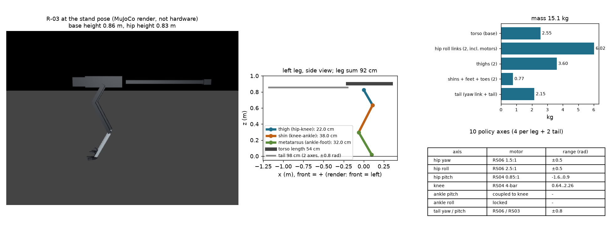
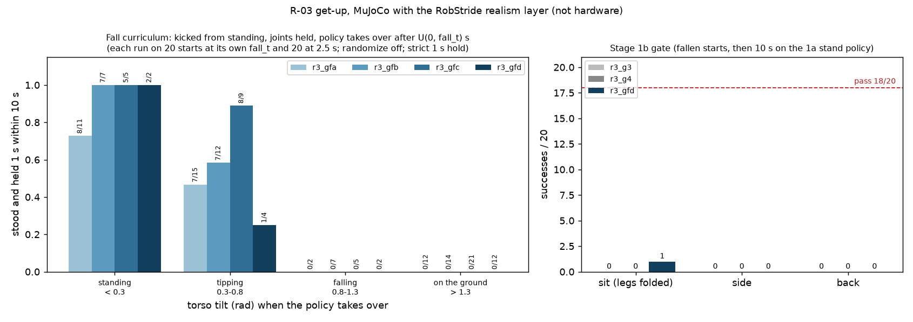
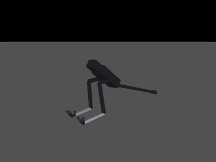
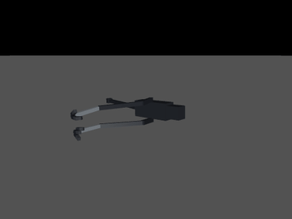

# 189 1단계 1b 일어서기: 시작 자세 버그 3개 수정, 넘어짐 역방향 커리큘럼, 바닥에서 일어서기는 아직 0 (진행 중)

2026-10-31 – 11-02. 순차 학습 계획([STAGED_PLAN](../../STAGED_PLAN.ko.md))의 1b(넘어진 뒤 일어서기). 모두 MuJoCo + RobStride 실물 모터 조건(`realism_robstride_rev3.json`)이며 실물이 아니다. **1b는 불합격(미완)이다.** 이 증거는 중간 기록이다.

## 결론

- **1b 합격 시험 결과는 앉은 자세 1/20, 옆으로 누운 자세 0/20, 뒤집힌 자세 0/20이다.** 기준은 각 18/20 이상이다.
  - 가장 좋은 정책은 `r3_gfd`다(넘어짐 역방향 커리큘럼 4단계).
  - 성공 1판(앉은 자세, 시드 7005)도 몸통이 거의 선 채로 다리만 접힌 시작이었다.
  - 4.1초 만에 일어섰고, 1a 서기 정책으로 넘긴 뒤 10초 동안 넘어지지 않았다.
- **이미 바닥에 있거나 크게 기운 상태(기울기 0.8 rad 이상)에서 일어선 적은 한 번도 없다.**
  - 커리큘럼 4단계를 합쳐 0/80이다.
  - 넘어지는 중(0.3–0.8 rad)의 회복만 늘었다. 7/15 → 8/9이다.
  - 마지막 단계 `r3_gfd`는 이 회복을 일부 잊었다(1/4).
- **앞의 학습 `r3_g1`·`r3_g2`는 시작 자세 버그 위에서 학습해 무효다.** 같은 버그 위에서 낸 키프레임 탐색 결과(`*_midair`, `search_sit_ratchet`)도 무효다.
- **버그를 고친 뒤 학습한 `r3_g3`·`r3_g4`도 0/60이다.** 뒤집힌 자세에서 옆으로 구른 뒤 멈추는 데에 머물렀다.
- **모델 점검:** 다리는 22 + 38 + 32 = 92 cm이고, 꼬리는 98 cm로 다리보다 길다.
  - 질량 15.1 kg의 40 %(6.0 kg)가 고관절 roll 링크(모터 포함)에 몰려 있다.
  - 실패 영상에서는 옆으로 누운 몸 위로 꼬리가 비스듬히 들려 있고, 다리를 몸 아래로 되돌리지 못했다.
  - 원인 후보(미검증): 고관절 roll ±0.5 rad, 발목 roll 잠금, 팔 없음.

| `r3_gfd` 1b 시험 성공: 앉은 자세 시드 7005, 4.1초에 일어서서 1a 정책으로 10초 | `r3_gfd` 1b 시험 실패: 옆으로 누운 자세 시드 7000 |
|---|---|
|  |  |
| [MP4](media/gfd_gate_sit7005.mp4) | [MP4](media/gfd_gate_side7000.mp4) |

## 찾아서 고친 버그 (모두 `sim/rl/run_env.py`, 시험 `tests/test_getup.py`)

| 버그 | 결과 | 수정 |
|---|---|---|
| 넘어진 시작 자세를 만들 때 이전 에피소드의 무릎 래칫 스프링(500 N·m/rad)이 걸린 채로 다리를 접음 | 스프링이 접힌 다리를 펴며 로봇을 공중으로 던짐 | 정착하는 동안 래칫을 풂(설계상 래칫은 변형 0에서만 걸림) |
| `mj_resetData`가 수동 발가락 관절을 0으로 만들고, 발목을 무릎 연동과 0.15 rad 다르게 둠 | 첫 스텝에 관절이 튀어 바닥을 참 | 리셋 자세의 발가락·연동값을 씀 |
| 정해진 시간(0.3–1 s) 정착 뒤 속도를 0으로 만듦 | 공중(최고 1.2 m)에서 멈춘 상태로 시작. `r3_g1`·`r3_g2`는 이것을 학습함 | 바닥에 닿아 멈출 때까지(최대 3 s) 기다림. `easy`만 0.3 s에 넘김 |
| 위치 유지 입력(`obs_hold`)의 기준점이 넘어지는 도중에 고정됨 | 1a 정책을 이어받은 정책이 일어선 뒤 그 지점으로 1.4–1.8 m/s로 걸어감. 1초 정지 조건을 못 채움 | 선 상태가 아니면 기준점이 로봇을 따라감 |
| 1초 연속 조건이 탐색 잡음에서는 거의 불가능 | 60 %의 스텝이 선 상태였는데 학습 성공 0 | 학습에만 `leak`(선 상태가 아니면 3스텝씩 깎음)을 둠. 1b 시험은 `leak`을 끄고 선언한 엄격 조건 그대로 잼 |

## 방법

| 실험 | 내용 |
|---|---|
| 정해진 동작 탐색 (`getup_search.py`) | 정책 없이 키프레임 4개를 교차 엔트로피 방법으로 찾음. 수정한 시작 자세에서 뒤집힌 자세는 기울기 0.58 rad·높이 0.67–0.8 m까지 올라왔음(몸을 뒤집어 일으킴). 옆 자세는 1.06 rad까지. 처음 보는 시작 자세에서 넘길 수 있는 상태에 닿은 것은 앉은 자세 1/20뿐 |
| 힘 확인 | 몸통이 수평인 웅크린 자세(무릎 1.2–2.2 rad)에서 명목 자세 명령만으로 몸통이 0.85–1.09 m까지 올라옴. 힘은 부족하지 않음 |
| `r3_g3` | 1a `r3_s1ho`를 이어받고 좌우 대칭. 시작 자세 섞음(웅크림·앉음·옆·뒤). 상태 함수 차이 보상(ΔΦ, 가만히 있으면 0). 1,650만 스텝, 학습 중 성공 0 |
| `r3_g4` | `r3_g3`에서 탐색 잡음 0.5, 동작·토크 벌점 끔. 3,000만 스텝, 0/60. 권선 최고 136 °C |
| 넘어짐 역방향 커리큘럼 `r3_gfa`→`gfd` | 선 자세에서 몸통을 0.5–2.0 m/s로 밀고 관절을 붙든 채 넘어뜨림. U(0, `fall_t`)초 뒤 정책이 받음(속도 유지). `fall_t` 0.6 → 1.0 → 1.6 → 2.5 s, 400–800만 스텝씩 이어 학습. 탐색 잡음 0.1, 학습 `leak` 3 |

`getup_probe.py`가 그림·성공률·영상을 만든다(`model`, `rates`, `render`). 그래프는 `plot.py`가 그린다. 원자료는 `eval/`에 있다.

## 구분

| 구분 | 내용 |
|---|---|
| 확인 | 시작 자세 버그 3개와 학습 신호 버그 2개를 수정했고 시험으로 고정했다. 넘어지는 중 회복(기울기 0.8 rad 미만)은 커리큘럼으로 늘었다(`r3_gfc` 시작 기울기 0.3–0.8 rad에서 8/9). 1b 시험에서 처음으로 성공 1판이 나왔다 |
| 실패 | 1b 불합격: 앉은 자세 1/20, 옆 0/20, 뒤 0/20. 바닥(0.8 rad 이상)에서 일어서기 0/80 |
| 미검증 | 이 기구(팔 없음, 고관절 roll ±0.5 rad, 발목 roll 잠금, 98 cm 꼬리)로 옆·뒤에서 일어설 수 있는지. 원인이 학습 방법인지 기구인지 아직 가르지 못했다 |
| 다음 | 바닥 자세만 따로 학습한다. 처음에는 정해진 동작 탐색이 찾은 뒤집기 동작을 시연으로 쓴다. 그래도 0이면 기구 변경 선택지(고관절 roll 범위, 꼬리 사용, 1b 기준 범위)를 사용자에게 보고하고 결정을 받는다(능동축·기구 변경은 사용자 결정) |
