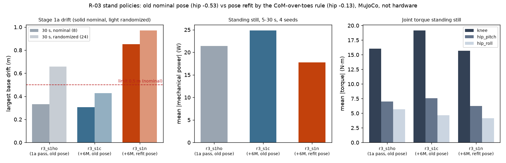
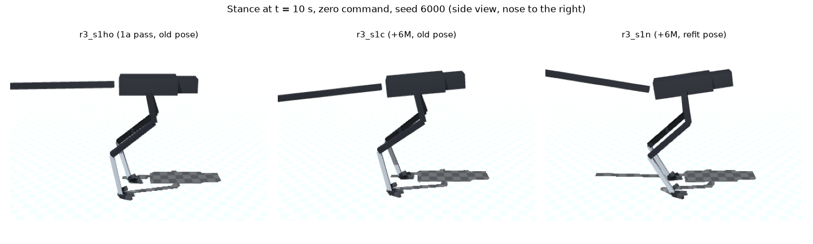

# 190 R-03 기본 서기 자세 재계산: 규칙대로 다시 맞춘 자세는 미채택 (서기 이동 0.85 m로 1a 기준 초과)

2026-11-02. 사용자 질문("무릎이 엉덩이쪽보다 가운데로 가는게 나아서 그렇게 한거야??")을 점검하다 시작했다. 모두 MuJoCo + RobStride 실물 모터 조건(`realism_robstride_rev3.json`)이며 실물이 아니다.

## 결론

- **무릎이 고관절보다 앞에 오는 배치는 R-03에서 새로 고른 것이 아니다.** R-02의 새(타조) 다리 구조와 기본 자세(고관절 −0.53, 무릎 1.0, 발목 −1.0 rad)를 그대로 물려받았다.
- **R-03에서 이 기본 자세를 다시 맞추지 않았다.** 고관절 yaw 축, 더 무거운 모터, 2.15 kg 꼬리가 더해졌는데도 그대로였다.
  - 그 자세에서 무게중심은 발가락 지지점보다 18.7 cm 뒤에 있다.
  - 증거 86의 규칙은 무릎 1.0을 고정하고, 고관절 각을 바꿔 무게중심을 발가락 지지 중심 위에 두는 것이다. 이 규칙으로 다시 맞추면 **고관절 −0.13, 무릎 1.0, 발목 −1.40 rad**가 나온다(오차 0.2 mm, 몸통 높이 0.79 m).
- **학습된 서기 정책은 이미 스스로 무게중심을 발 위에 둔다.** `r3_s1ho`의 실제 자세는 고관절 −0.24, 무릎 1.18 rad이다. 무게중심과 발 접지 중심의 차이는 −0.2 cm다.
  - 따라서 기본 자세가 틀렸어도 서기는 정책이 메우고 있었다.
- **같은 조건 비교에서 새 자세는 1a 기준을 못 넘었다. 미채택.**
  - 비교 방법: 두 정책 모두 `r3_s1ho`에서 시작해 600만 스텝을 더 학습했다. 다른 설정은 모두 같다.
  - `r3_s1n`(새 자세)은 30초 이동이 0.85 m로 기준 0.5 m를 넘었다.
  - 대조군 `r3_s1c`(기존 자세)는 0.31 m로 기준 안이다.
  - 새 자세에서 줄어든 것: 정지 기계 출력 25 → 17 W, 무릎 토크 19 → 16 N·m.
- 새 자세를 받은 정책은 고관절을 다시 +0.05 rad로 옮기고 몸통을 0.19 rad 들었다. 정적 규칙(무게중심을 발가락 위에)이 정책이 고르는 실제 서기 자세와 맞지 않는다.

| | `r3_s1ho` (1a 합격, 기존 자세) | `r3_s1c` (+600만, 기존 자세) | `r3_s1n` (+600만, 새 자세) |
|---|---|---|---|
| 기본 자세 고관절 / 무릎 (rad) | −0.53 / 1.0 | −0.53 / 1.0 | −0.13 / 1.0 |
| 실제 서기 고관절 / 무릎 (rad) | −0.24 / 1.18 | −0.20 / 1.21 | +0.05 / 0.95 |
| 몸통 기울기 (rad) | −0.05 | −0.10 | −0.19 |
| 무게중심 − 발 접지 중심 (cm) | −0.2 | −0.2 | +0.1 |
| 30초 이동, 명목 8판 (기준 0.5 m) | **0.33 m** | **0.31 m** | **0.85 m (불합격)** |
| 30초 이동, 무작위화 24판 | 0.66 m | 0.43 m | 0.97 m |
| 넘어짐: 0.3 m/s 충격 / 0.8 m/s 충격 | 0 / 0 | 0 / 1 (뒤) | 0 / 0 |
| 정지 기계 출력 / 무릎 토크 | 21 W / 16 N·m | 25 W / 19 N·m | 17 W / 16 N·m |
| 권선 최고 (무작위화) | 52 °C | 54 °C | 46 °C |

## 방법

- `sim/rl/nominal_scan.py`에 무릎 각 인자를 더했다. 기본값 1.50은 이전과 같다.
  - 무릎 1.0(R-02·R-03 계보 값)으로 같은 규칙을 적용했다: `nominal_scan.py '<R-03 설정>' 1.0`.
  - 결과는 `eval/nominal_scan.json`, 기존 자세 값은 `eval/old_nominal_static.json`에 있다.
- 학습 명령은 `r3_s1ho`와 같고, `--nominal`과 `--init sim/rl/runs/r3_s1ho/model.zip`만 지정했다.
  - 좌우 대칭 정책은 입력 정규화를 고정한다. 새 자세에서는 관절 입력이 0.4 rad 옮겨지므로 이것이 불리하게 작용했을 수 있다(미검증).
- 합격 시험: `sim/rl/stage_gates.py RUN stand`. 원자료는 `eval/gate_*.jsonl`이다.
- 자세 측정: `stance_probe.py`. 0 명령 30초, 명목, 시드 6000–6003, 5–30초 평균. 원자료는 `eval/stance.jsonl`이다.
- 그림: `plot.py`.

## 구분

| 구분 | 내용 |
|---|---|
| 확인 | 기존 기본 자세는 R-03에서 무게중심이 발가락보다 18.7 cm 뒤에 있다. 규칙대로 다시 맞춘 자세는 고관절 −0.13 rad이다. 학습된 서기 정책들은 기본 자세와 관계없이 무게중심을 발 접지 중심 ±0.3 cm 안에 둔다. 같은 조건 600만 스텝 비교에서 새 자세는 이동 0.85 m(불합격), 기존 자세는 0.31 m(합격)였다 |
| 실패 | 새 기본 자세는 1a 이동 기준을 넘지 못했다 |
| 미검증 | 입력 정규화를 다시 잡고 처음부터 학습하면 결과가 달라지는지. 새 자세가 일어서기(1b)나 걷기에 유리한지. 무릎을 몸 가운데 아래로 두는 다른 다리 배치가 더 나은지(같은 조건 비교 없음) |
| 다음 | 1a 기준 정책은 `r3_s1ho` 그대로 둔다. 1b(바닥 자세에서 일어서기)로 돌아간다 |
