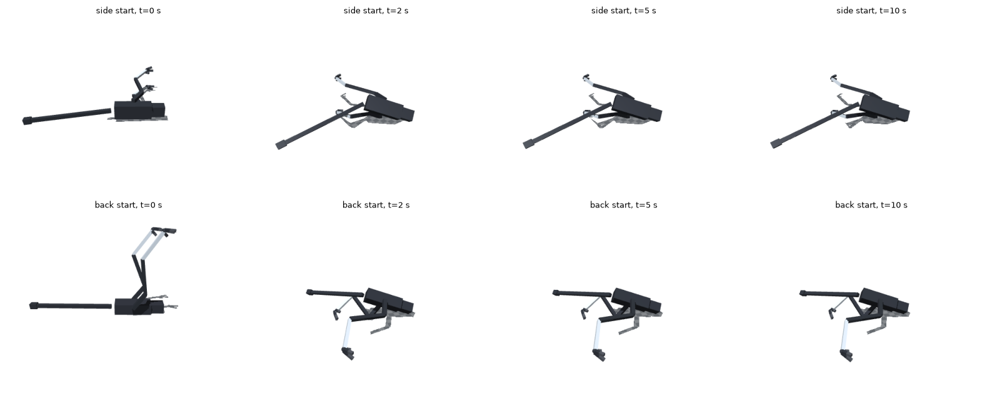
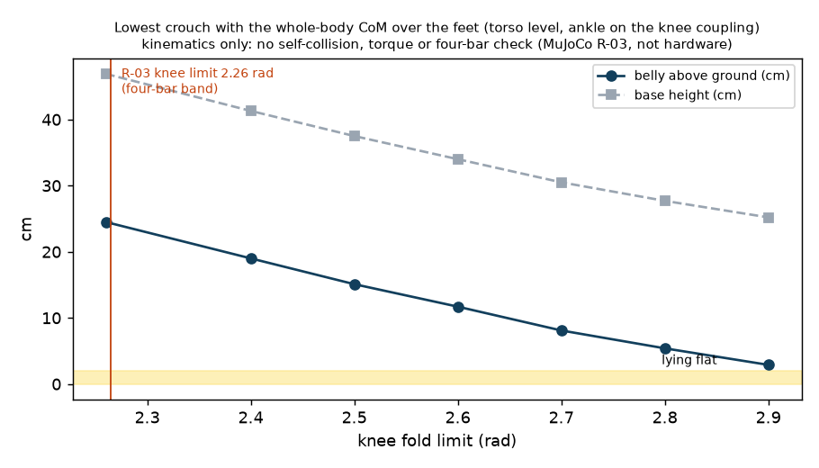

# 191 1b 바닥에서 일어서기: 엎드린 자세에서 다리를 몸 아래로 넣을 수 없다 (무릎 접힘 한계)

2026-11-02 – 11-03. 증거 189의 다음 단계다. 일어서기 실패의 원인이 학습 방법인지 기구인지 가르려 했다. 모두 MuJoCo + RobStride 실물 모터 조건이며 실물이 아니다.

## 결론

- **시작 자세를 하나로 고정해도 바닥에서 일어서지 못했다.** 옆으로 누운 자세 0/11, 뒤집힌 자세 0/11이다.
  - 방법: `r3_gfd`에서 이어 800만 스텝씩 학습했다(`r3_gx_side`, `r3_gx_back`, 탐색 잡음 0.3).
  - 두 정책 모두 엎드린 자세(배·발가락 하나·꼬리로 지지, 기울기 0.83–0.90 rad, 몸통 높이 0.19 m)까지만 갔다. 거기서 10초 동안 멈췄다.
- **기하 계산상 R-03의 다리는 엎드린 몸 아래로 들어가 무게를 받칠 수 없다.**
  - 무게중심이 발 위에 오는 가장 낮은 웅크림에서도 배가 바닥에서 **24.5 cm** 떠 있다(몸통 높이 0.47 m). 무릎은 4절 링크 한계 2.26 rad까지 접은 상태다.
  - 엎드리면 배가 바닥에 닿아 있으므로, 몸을 25 cm 들어 올릴 다른 수단이 필요하다. 다리를 무게중심 밖에서 밀어 올리거나, 팔·꼬리로 받쳐야 한다.
- **무릎을 더 접을 수 있으면 이 간격이 줄어든다.**
  - 무릎 2.6 rad이면 12 cm, 2.9 rad이면 3 cm다. 새가 정강이를 땅에 대고 앉았다 일어서는 자세에 가깝다.
  - 단, 자기충돌·토크·4절 링크는 따지지 않은 운동학 계산이다.
- **같은 결론을 가리키는 다른 결과**(원인을 확정하지는 않음):
  - 고관절 roll을 ±1.0 rad로 넓혀 정해진 동작을 탐색해도 0/20이었다.
  - 엎드린 상태에서 다리를 웅크림 자세로 접는 정해진 동작 24가지는 모두 다시 옆으로 굴렀다.

| 시험 | 결과 |
|---|---|
| 고정 시작 RL, 옆 (`r3_gx_side`) | 명목 0/1, 무작위화 0/10. 최소 기울기 0.85–0.90 rad |
| 고정 시작 RL, 뒤 (`r3_gx_back`) | 명목 0/1, 무작위화 0/10. 최소 기울기 0.82–0.85 rad |
| 정해진 동작 탐색, 고관절 roll ±1.0 rad (`search_*_roll10`, 증거 189 폴더) | 옆 0/20, 뒤 0/20. 기존 ±0.5 rad도 0/20 |
| 엎드린 자세에서 정해진 접기 동작 24가지 (`prone_tuck.py`) | 모두 기울기 1.6–2.1 rad로 다시 옆으로 넘어짐 |
| 가장 낮은 균형 웅크림 (`fold_geom.py`) | 무릎 2.26 rad: 배 높이 24.5 cm, 2.6 rad: 11.7 cm, 2.9 rad: 2.9 cm |

## 방법

- `RunEnv(getup={'start_seed': N})`: 넘어진 시작 자세를 하나로 고정한다. 타당성 시험 전용이며 1b 합격 시험은 쓰지 않는다. 시험은 `tests/test_getup.py`에 있다.
- 고정 시작 학습은 증거 189의 `r3_gfd` 설정과 같다. 다른 점은 `modes`(`side` 또는 `back`), `start_seed` 7000, 탐색 잡음 0.3뿐이다.
- 평가는 `fixed_rate.py`(엄격 성공, 학습용 `leak` 끔), 그림은 `stuck_render.py`, `plot.py`가 만든다.

## 구분

| 구분 | 내용 |
|---|---|
| 확인 | 고정 시작에서도 바닥 일어서기 0. 두 정책 모두 같은 엎드린 자세에서 멈춤. 무릎 2.26 rad에서 균형 웅크림의 배 높이 24.5 cm(운동학 계산) |
| 실패 | 1b 바닥 자세(옆·뒤) 일어서기 |
| 미검증 | 다리를 무게중심 밖에서 동적으로 밀어 올리는 방법(차고 뒤집기 등)이 가능한지. 무릎 접힘 확대, 꼬리 받침, 팔의 실제 효과(동역학·토크·자기충돌 미확인) |
| 다음 | 기구·범위 결정은 사용자 몫이다(능동축·기구 변경은 사용자 결정). 선택지: ① 무릎 접힘 확대(4절 링크 재설계), ② 1b 범위를 앉은 자세·넘어지는 중 회복으로 줄이고 바닥 일어서기는 보류, ③ 꼬리·팔 등 받침 추가 |
