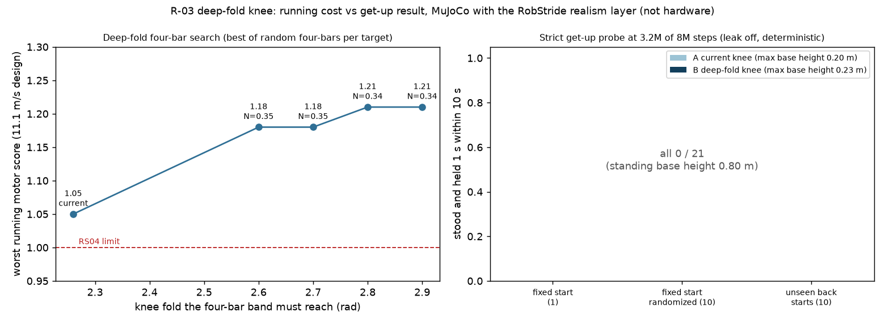
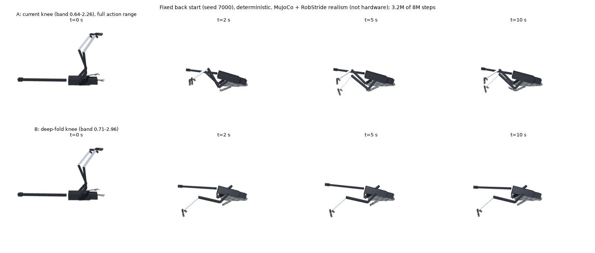

# 192 1b 무릎 깊은 접힘 4절 링크 A/B: 둘 다 일어서지 못함, 강화학습 A/B로는 기구 원인을 가를 수 없음 (일시정지)

2026-11-03. 증거 191의 다음 단계다. 사용자 결정 "1"(무릎 접힘 확대 검토)에 따라 진행했다. 모두 MuJoCo + RobStride 실물 모터 조건(`realism_robstride_rev3.json`)이며 실물이 아니다. **1b는 불합격(미완)이다. 깊은 접힘 무릎은 채택하지 않았다.** 사용자 요청으로 이 지점에서 일시정지했다.

## 결론

- **앞의 일어서기 시험은 전부 무릎 2.0 rad에서 막혀 있었다.**
  - 원인은 행동 배율이다. 명목 무릎 1.0, 배율 1.0이라 명령이 2.0을 넘지 못했다.
  - 4절 링크 한계는 2.26 rad인데, 앞의 강화학습과 정해진 동작 탐색은 그보다 앞에서 멈춘 셈이다.
- **2.9 rad까지 접히는 4절 링크는 찾았다.** 그 대신 달리기 모터 여유가 줄어든다.
  - 찾은 기구: a .193, b .321, c .129, β 105.2°, 접힘 범위 0.71–2.96 rad (`sim/rl/rev3_fold.json`).
  - 11.1 m/s 설계 하중에서 최악 모터 점수가 1.05(현재)에서 1.21로 오른다. 1을 넘으면 RS04 한계 초과다.
  - 완전히 접힌 자리의 감속비는 0.34다. 연결봉이 32 cm라 들어갈 자리는 확인하지 않았다.
  - 일정 감속비 무릎(벨트)은 어느 비율에서도 달리기와 접힘을 함께 만족하지 못했다.
- **같은 조건 A/B 학습에서 둘 다 일어서지 못했다.** 엄격 평가 21판씩 모두 0이다.
  - A: 현재 무릎, 행동 범위만 전체로 넓힘.
  - B: 깊은 접힘 무릎.
  - 몸통은 수평까지 돌렸지만 배를 바닥에 댄 채(높이 0.16–0.23 m) 멈췄다. 서면 0.80 m다.
  - 두 정책 모두 행동 출력이 한계값에 붙어 움직이지 않는다(한계 고정 비율 86–100 %).
  - B는 무릎을 2.93까지 다 접었지만 다리를 몸 뒤로 뻗은 채였다(고관절 pitch 한계 +0.9). 정적 계산상 그 무릎에서 몸을 받치려면 +0.35가 필요하다.
- **Codex 검토와 제 판단이 같다.** 이 A/B 강화학습 결과로는 기구가 원인인지 학습 탐색이 원인인지 가를 수 없다.
  - 다음은 강화학습이 아닌 경로 탐색이다. 실제 엎드린 자세에서 "발 넣기 → 체중 싣기 → 몸 들기" 경로가 있는지 먼저 확인한다.
- **Codex가 찾은 모델 버그 1개를 고쳤다.** `run_env.py`가 무릎 감속비를 0.5 아래로 자르고 있었다.
  - 그 결과 B의 깊은 접힘 구간에서 저속 토크가 약 43 % 과대평가됐다.
  - 현재 무릎은 감속비 최소가 0.625라 영향이 없다.
  - B는 유리한 쪽으로 틀린 조건에서도 실패했으므로 결론은 같다.

## A/B 조건

학습 조건은 두 쪽이 같다.

- 시작: 뒤집힌 자세 하나로 고정(`getup.start_seed` 7000).
- 이어받은 정책: `r3_gx_back`(증거 191).
- 탐색 잡음 0.3. 보상은 증거 191과 같다(퍼텐셜 차이 보상, 관절 한계 벌점 −0.5, 학습 `leak` 3).

| | A `r3_gxa_back` | B `r3_gxb_back` |
|---|---|---|
| 무릎 4절 링크 | 현재(`rev3_b.json`), 0.64–2.26 rad | `rev3_fold.json`, 0.71–2.96 rad (발목 −3.1까지) |
| 행동 배율 | 무릎 1.3, 고관절 pitch 1.45, 고관절 roll 0.5 | 무릎 2.0, 고관절 pitch 1.45, 고관절 roll 0.5 |
| 학습 | 약 390만 스텝에서 중지 (평가는 320만 스텝 저장분) | 같음 |
| 학습 보상 | −0.12 → 1.05 | −0.08 → 0.47 |
| 엄격 평가: 고정 시작 / 무작위화 / 처음 보는 뒤 자세 | 0/1, 0/10, 0/10 | 0/1, 0/10, 0/10 |
| 최소 기울기, 최고 몸통 높이 | 0.31–0.36 rad, 0.20 m | 0.43–0.61 rad, 0.23 m |

엄격 평가 조건은 학습용 `leak`을 끄고, 10초 안에 1초 연속으로 서는 것이다(결정적 행동).

한계가 있다.
- 8M 스텝 학습을 40 %에서 멈췄다. 끝까지 학습한 결과는 없다.
- A와 B는 행동 배율이 달라 탐색 폭이 무릎 0.39 rad 대 0.60 rad다. Codex 지적대로 같은 조건의 비교가 아니다.
- B의 학습과 엄격 평가는 감속비 버그(하한 0.5)가 있는 상태에서 했다. 장면 그림은 수정 뒤에 다시 돌렸고 결과가 같았다.

## Codex 검토 (gpt-6-astra, `eval/codex_review.json`)

| 우선 | 지적 | 처리 |
|---|---|---|
| 높음 | 깊은 접힘 무릎의 감속비 하한(0.5)으로 토크 과대평가 | 수정함(하한 0.2). 현재 무릎 영향 없음, 시험 통과 |
| 높음 | 강화학습을 더 돌리기 전에, 실제 엎드린 자세에서 강화학습 없이 경로를 검증할 것(키프레임 CEM 또는 궤적 최적화, 자기충돌 포함) | 다음 단계로 채택 |
| 중간 | 후속 비교는 목표각과 탐색 폭을 rad 기준으로 맞출 것. B 기구를 쓰면 1a 서기를 다시 검증할 것 | 다음 비교에 적용 |
| 중간 | 팔 없는 로봇이 옆·뒤에서 일어서는 것은 검증된 기능이 아닌 연구 목표 | 범위 보류·축소·기구 변경은 경로 탐색 뒤 사용자 결정 |

Codex는 범위 판단의 근거로 Cassie, KAIST Raptor, Disney BDX에서 바닥 기상 사례를 찾지 못했고, Microduck은 등에서 일어서는 기능을 공개했다고 했다. 이 출처는 따로 확인하지 않았다.

## 코드 변경

| 파일 | 변경 |
|---|---|
| `sim/rl/run_env.py` | rev 3 설정에 `band_search_hi`(무릎 범위 탐색 상한)와 `joint_range`(관절 한계 덮어쓰기)를 더함. 무릎 감속비 표 범위를 범위 끝까지 넓힘. 감속비 하한 0.5→0.2. 기존 설정 rollout은 변경 전과 같음 |
| `sim/rl/train_run.py` | `--rev3-config` |
| `sim/rl/rev3_fold.json` | 깊은 접힘 시험 설정(미채택) |
| `modeling/knee_fold_study.py` | 깊은 접힘 4절 링크 무작위 탐색(증거 187과 같은 규칙) |

`strict_rate.py`는 엄격 평가를 한다. `end_render.py`는 장면 그림과 끝 상태(`eval/end_state.txt`)를 만든다. 그래프는 `plot.py`가 그린다.

## 구분

| 구분 | 내용 |
|---|---|
| 확인 | 앞의 시험이 무릎 2.0 rad에서 막혀 있었음. 2.96 rad까지 접히는 4절 링크가 있음(달리기 점수 1.21). A/B 320만 스텝 엄격 평가 0/21·0/21. 감속비 버그 수정 |
| 실패 | 1b 불합격 유지. 행동 범위를 넓혀도, 무릎을 깊게 접어도 강화학습으로는 일어서지 못함 |
| 미검증 | 엎드린 자세에서 일어서는 경로가 기구상 존재하는지(A·B 모두). 8M 스텝 끝까지 학습한 결과. 깊은 접힘 기구의 포장(32 cm 연결봉)과 1a 서기 재검증 |
| 다음 | 강화학습 없이 경로를 탐색한다. 실제 엎드린 자세에서 출발하고, 전체 관절 범위와 자기충돌을 넣고, 키프레임 CEM을 쓴다. A와 B 무릎에 같은 탐색 예산을 준다. 경로가 나오면 시연으로 학습하고, 없으면 1b 범위와 기구 선택지를 사용자에게 보고한다 |
