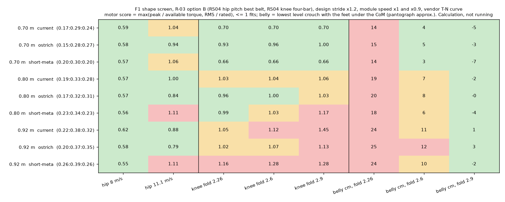

# 193 형상 해석 선별(F1): 다리를 0.70–0.80 m로 줄이면 깊게 접히는 무릎과 11.1 m/s 모터 여유를 함께 얻는다 (계산)

2026-11-03. [형상 동결 계획](../../DESIGN_FREEZE_PLAN.ko.md)의 F1 단계다. **계산 결과이며 주행 결과가 아니다.** 학습은 하지 않았다.

## 결론

- **지금 다리(합 0.92 m, 0.22 : 0.38 : 0.32)는 여유 1.2배 기준에서 무릎이 어느 접힘 목표로도 맞지 않는다.**
  - 무릎 점수는 접힘 목표 2.26 rad 1.05, 2.6 rad 1.12, 2.9 rad 1.45다. 1을 넘으면 모터 한계 초과다.
  - 엎드린 자세의 배 간격은 접힘 2.26에서 24 cm, 2.6에서 11 cm다.
  - 달리기와 일어서기가 같은 무릎을 두고 부딪치는 이유가 다리 길이에 있다.
- **다리를 줄이면 무릎이 쉬워진다.** 무릎 하중의 지렛대(정강이·발등뼈)가 짧아지기 때문이다.
  - **0.70 m 타조 비율**: 고관절 11.1 m/s 0.94, 무릎 접힘 2.9 rad 1.00, 배 간격 −3 cm. 9개 후보 가운데 유일하게 모든 항목이 1 이하이고, 배가 바닥에 닿을 만큼 다리를 몸 아래로 넣을 수 있다.
  - **0.80 m 타조 비율**: 고관절 0.84, 무릎 접힘 2.6 rad 1.00, 배 간격 8 cm.
  - 짧은 다리의 대가는 보폭 빈도다. 11.1 m/s 설계 보폭에서 0.92 m는 3.1 Hz, 0.70 m는 4.1 Hz다. 고관절 속도는 벨트비(0.6–0.85)로 맞췄다.
- **"고관절 2.5배"의 물리적 부분은 작다.** 지지 중 다리 힘이 엉덩이 대신 무게중심(엉덩이 뒤 5.7 cm, 아래 5 cm)을 지나게 하면 고관절 점수가 0.1–0.3 오른다(지금 다리 11.1 m/s: 0.74 → 0.88). 정책이 쓴 2.5배는 이것으로 설명되지 않는다.
  - 남은 부분이 정책의 비효율인지 설계 보폭 모델의 다른 공백인지는 F2(제어기 달리기 탐색)로 확인한다.
- **F2로 넘길 후보 3개:** 현재형(0.92 m), 0.80 m 타조 비율(접힘 2.6 rad), 0.70 m 타조 비율(접힘 2.9 rad).

## 방법 (`modeling/shape_scan_r03.py`)

| 항목 | 내용 |
|---|---|
| 후보(사전 고정) | 다리 합 0.70 / 0.80 / 0.92 m × 비율 현재 1 : 1.73 : 1.45, 타조 1 : 1.89 : 1.82, 짧은 발등뼈 1 : 1.5 : 1.0 × 무릎 접힘 목표 2.26 / 2.6 / 2.9 rad, 모두 27개 |
| 하중 | `spec_40kmh` 설계 보폭(SLIP, 스프링 (c)), 8·11.1 m/s, 하중 ×1.2, 모듈 무부하 속도 ×1·×0.9 중 나쁜 값 |
| 질량 | B안 고른 구성(15.1 kg)에 다리 관 길이 변화만 반영(14.94–15.10 kg). 구조·배터리는 그대로라는 가정 |
| 고관절 | RS04, 후보마다 벨트비 0.4–2.5 중 가장 좋은 값. 설계 보폭(지지 중 고관절 토크 0)과 "지지 중 다리 힘이 무게중심을 지남"의 두 경우 중 뒤의 것을 표에 씀 |
| 무릎 | RS04, 허벅지 위 4절 링크 무작위 20,000개(허벅지 길이는 후보값). 범위(전달각 30° 이상)가 달리기 무릎 범위 ±0.05와 접힘 목표를 덮는 것 중 가장 좋은 점수. 지금 형상에는 증거 187의 링크도 넣었다(1.05로 재현) |
| 배 간격 | 몸통 수평, 무게중심 아래 발가락 접지, 무릎 = 접힘 목표일 때 가장 낮은 엉덩이 높이(2링크 근사)에서 배 아래면까지의 높이. 배 아래면 위치는 지금 형상의 증거 191 값(2.26 rad에서 24.5 cm)에 맞췄다. 검증: 2.6 rad 11.2 cm(증거 191 11.7), 2.9 rad 0.7 cm(2.9) |

원자료는 `eval/scan.json`, 출력은 `eval/scan.log`, 그림은 `plot.py`로 그린다.

## 한계

- 설계 보폭은 이상적인 걸음이다. 실제 정책은 하중을 더 쓴다. 이 표는 필요조건이며 충분조건이 아니다.
- 꼬리 변형은 이 계산에 없다. SLIP 모델에는 몸통 pitch가 없어서 F2에서 다룬다.
- 짧은 다리의 몸통 높이·발 크기·자기충돌·4절 링크 배치는 계산하지 않았다.
- 배 간격은 2링크 근사다. 자기충돌과 발목 범위는 따지지 않았다.

## 구분

| 구분 | 내용 |
|---|---|
| 확인 | 같은 계산 규칙에서 다리를 0.70–0.80 m로 줄이면 무릎 점수가 1 이하로 내려가고 깊은 접힘(2.6–2.9 rad)이 가능하다. 지금 형상의 무릎 1.05와 증거 191의 배 간격을 재현했다 |
| 실패 | 지금 형상은 여유 1.2배에서 무릎이 맞지 않는다(1.05–1.45) |
| 미검증 | 짧은 다리로 실제 MuJoCo 달리기·일어서기가 되는지(F2·F3). 꼬리 변형의 효과 |
| 다음 | F2: 현재형부터 제어기 달리기 탐색. 후보 형상의 MuJoCo 모델 변형 추가 |
