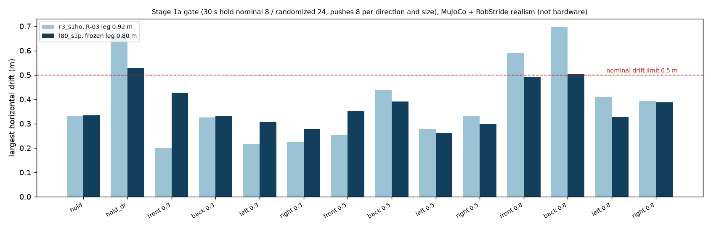
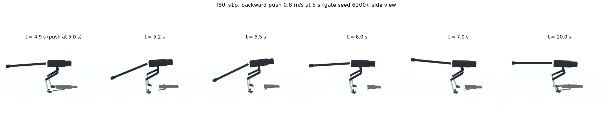

# 195 동결 형상(0.80 m 다리) 1a 서기 재통과: 105만 스텝에 기준 통과 (`l80_s1p`)

2026-11-03. [형상 동결](../../DESIGN_FREEZE.ko.md) 뒤 첫 학습이다([계획](../../DESIGN_FREEZE_PLAN.ko.md) F5). MuJoCo + RobStride 실물 모터 조건이며 실물이 아니다.

## 시작 전 선언 (계획 §2 규칙 4)

| 항목 | 내용 |
|---|---|
| 모델 | `sim/rl/rev3_l80.json` (다리 0.17 : 0.321 : 0.309 m, 무릎 4절 링크 범위 0.616–2.807, 고관절 pitch 벨트 0.70) + `realism_robstride_l80.json` |
| 시작점 | 1a 통과 정책 `r3_s1ho`. 같은 행동·관측 정의. 탐색 잡음을 0.15로 다시 엶 |
| 그대로 넣었을 때 | 30초 서기 4판 중 1판 넘어짐(1.5초), 나머지 3판은 3.7 m 이동. 다시 학습해야 한다 |
| 설정 | `r3_s1ho`와 같다(보상, 대칭 정책, 동작 저역 필터 6 Hz, kp_err 0.2, 위치 추정 입력, 외란). 바뀐 것은 축 설정, 실물 모터 조건 파일, 탐색 잡음뿐이다 |
| 예산 | 600만 스텝(약 3.5시간), 연장은 1회 400만 스텝까지 |
| 점검 | 100만 스텝마다 명목 4판 30초(넘어짐, 이동) |
| 중단 | 400만 스텝에서 명목 넘어짐이 있거나, 이동이 1.5 m를 넘고 200만 스텝 동안 줄지 않으면 중단하고 원인을 비RL로 가른다 |
| 채택 | `stage_gates.py stand` 1a 기준 통과: 명목 8판 넘어짐 0·이동 0.5 m 이내, 무작위화 24판 넘어짐 1 이하, 0.3 m/s 밀기 각 방향 넘어짐 1 이하 |

학습 명령: `train_l80_s1.sh`.

## 결과

- **1a 기준 통과.** `r3_s1ho`에서 이어 105만 스텝(예산 600만 중) 학습한 시점의 정책이다. 저장 위치는 `sim/rl/runs/l80_s1p`이고, 시험 출력의 run 이름은 복사 전 이름 `l80_s1_1M`이다.
  - 채택 기준을 채워 학습을 멈췄다(약 4,200만 스텝 지점).
  - 명목 30초 8판: 넘어짐 0, 최대 이동 0.33 m.
  - 무작위화 24판: 넘어짐 0, 최대 이동 0.53 m.
  - 밀기 0.3·0.5·0.8 m/s 각 방향 8판: 모두 넘어짐 0, 최대 이동 0.50 m, 권선 최고 53 °C.
- `r3_s1ho`(0.92 m 다리)와 비교: 무작위화와 0.8 m/s 밀기에서 이동이 더 작다(0.66→0.53, 0.70→0.50 m). 작은 밀기에서는 조금 더 밀린다.
- 형상을 바꾼 비용은 학습 약 30분이었다. 계획 §1에서 예상한 하루보다 작다.

원자료: `eval/gate_l80_s1p.jsonl`, `eval/progress_l80_s1.csv`. 그림: `plot.py`.

| 구분 | 내용 |
|---|---|
| 확인 | 0.80 m 다리 R-03에서 1a 서기 기준 통과(넘어짐 0/128) |
| 미검증 | 실물. 이 시험은 모두 시뮬레이션이다 |
| 다음 | 2단계 걷기([증거 196](../196-l80-walk/README.md)) |
