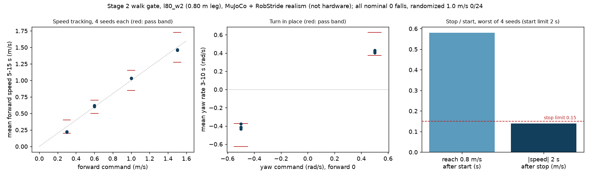
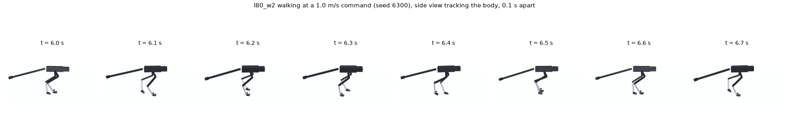

# 196 동결 형상(0.80 m 다리) 2단계 걷기 통과: `l80_w2`, 800만 스텝, 1a 회귀 포함 전 항목 통과

2026-11-03. [형상 동결](../../DESIGN_FREEZE.ko.md) 뒤 두 번째 학습이다. MuJoCo + RobStride 실물 모터 조건이며 실물이 아니다.

## 결론

- **2단계 걷기 기준을 모두 통과했다.** 1a 서기 회귀 시험도 통과했다. 판정은 `sim/rl/gate_judge.py`가 했다(`eval/judge_l80_w2.txt`).

| 시험 | 결과 | 기준 |
|---|---|---|
| 추종 0.3 / 0.6 / 1.0 / 1.5 m/s(4판씩) | 0.21–0.22 / 0.60–0.62 / 1.03–1.04 / 1.46–1.47 m/s, 넘어짐 0 | 오차 max(0.1, 15 %) |
| 제자리 회전 ±0.5 rad/s | 0.40–0.43 / −0.38 – −0.43 rad/s, 이동 최대 0.45 m | 오차 25 %, 이동 0.5 m |
| 정지·출발 | 출발 0.58초 안에 0.8 m/s, 정지 2초 뒤 최대 0.14 m/s | 2초, 0.15 m/s |
| 무작위화 1.0 m/s 24판 | 넘어짐 0 | 1 이하 |
| 1a 회귀 | 명목 이동 0.40 m, 무작위화 0/24, 밀기 0.3–0.8 m/s 넘어짐 0 | 1a 기준 |

- **경계에 가까운 항목:** 0.3 m/s 추종(하한 0.20), 회전 −0.38(하한 −0.375), 정지 뒤 속도 0.14(한계 0.15). 실물 여유로 보기는 어렵다.
- 학습 명령에 제자리 회전이 없었는데(아래 기록), 회전 시험을 통과했다.
- 걷기 학습 시간은 800만 스텝, 약 3.5시간이었다.

## 시작 전 선언 (계획 §2 규칙 4)

| 항목 | 내용 |
|---|---|
| 시작점 | 증거 195의 1a 통과 정책 `l80_s1p`. 탐색 잡음 0.2로 다시 엶. 2026-11-03 학습 `l80_w1` 시작 |
| 명령 | 전진 0–1.5 m/s, 옆 ±0.2 m/s, 회전 ±0.5 rad/s. 25 %는 0 명령(정지). 5초마다 다시 뽑음(정지 ↔ 출발). 추종 폭은 명령의 30 % |
| 그 밖의 설정 | 1a와 같다(보상, 외란, 대칭 정책, 저역 필터, 위치 추정 입력) |
| 예산 | 800만 스텝(약 3.5시간), 연장은 1회 400만 스텝까지 |
| 점검 | 200만 스텝마다 `stage_gates.py walk --quick` |
| 중단 | 400만 스텝에서 1.0 m/s 추종의 평균 속도가 0.5 m/s 미만이거나 4판 중 2판 이상 넘어지면 중단하고 원인을 가른다 |
| 채택 | `stage_gates.py walk` 기준([STAGED_PLAN](../../STAGED_PLAN.ko.md) 2단계, 2026-11-03 학습 전 확정)과 1a 서기 시험 회귀 통과 |

1a 정책 `r3_s1ho`로 걷기 시험을 미리 돌려 보았다(`--quick`). 서기 정책이라 걷지 못하는 것이 정상이다. 시험 장치가 동작하는지만 확인했다: 1.0 m/s 명령에서 −0.3 m/s, 회전 명령에서 넘어짐.

학습 명령: `INIT=<1a 통과 model.zip> train_l80_w1.sh`.

## 진행 기록

| 날짜 | 내용 |
|---|---|
| 2026-11-03 | **`l80_w1` 무효(버그).** 200만 스텝 점검에서 모든 조건이 0.3초에 넘어짐. 서기(0 명령)도 마찬가지였다. 에피소드 길이는 학습 첫 18번의 갱신 안에 776에서 약 100스텝으로 무너졌다(`eval/progress_l80_w1_collapsed.csv`, `eval/check_l80_w1_2M.txt`) |
| | **원인:** 1a 정책은 0 명령만 보고 학습해, 관측 정규화에서 명령 입력 3개(6–8번)의 분산이 5e-12다. 대칭 정책(`--symmetric`)은 이 정규화를 고정하므로, 0이 아닌 명령은 모두 ±10(잘림 한계)으로 들어갔다 |
| | **수정:** `train_run.widen_command_inputs`. 분산이 1e-6 미만인 명령 입력에 명령 범위 절반을 표준편차로 주고(0.075, 0.2, 0.125), 그 입력의 첫 층 가중치를 0으로 둔다. 대칭 정책은 새 정규화로 다시 만든다. 시험 `tests/test_widen_command.py`: 0 명령에서 행동이 그대로이고, 1.5 m/s 명령이 2 이하로 들어온다 |
| 2026-11-03 | 같은 설정·예산으로 `l80_w2` 시작. 첫 갱신들에서 에피소드 길이 약 980(최대 1000)을 유지 |
| 2026-11-03 | `l80_w2` 점검: 200만 스텝에서 걷기 넘어짐 0이나 저속·회전·정지 미달. 400만 스텝에서 0.6–1.5 m/s 통과. 600만 스텝에서 회전 통과(`eval/check_l80_w2_*.txt`) |
| | 학습 없이 원인 확인. (1) 명령 샘플러는 전진 0이면 회전도 0으로 만들어 제자리 회전을 학습에 한 번도 주지 않는다. (2) 위치 유지 기준점이 0 명령 첫 순간에 잡혀, 1 m/s에서 멈추면 지나친 뒤 되돌아 걷는다. 선택 옵션 `cmd_turn`, `hold_settle`을 추가했다(기본값은 기존과 같음, `tests/test_walk_commands.py`). 이번 학습에는 쓰지 않았다 |
| 2026-11-03 | 800만 스텝 전체 시험 통과(`eval/gate_walk_l80_w2.jsonl`, `eval/gate_stand_l80_w2.jsonl`) |
