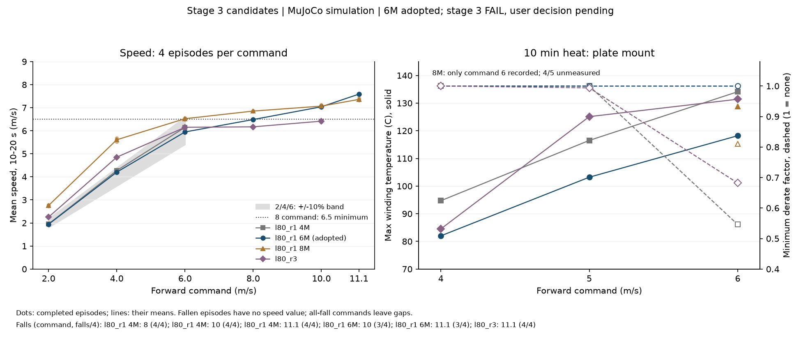
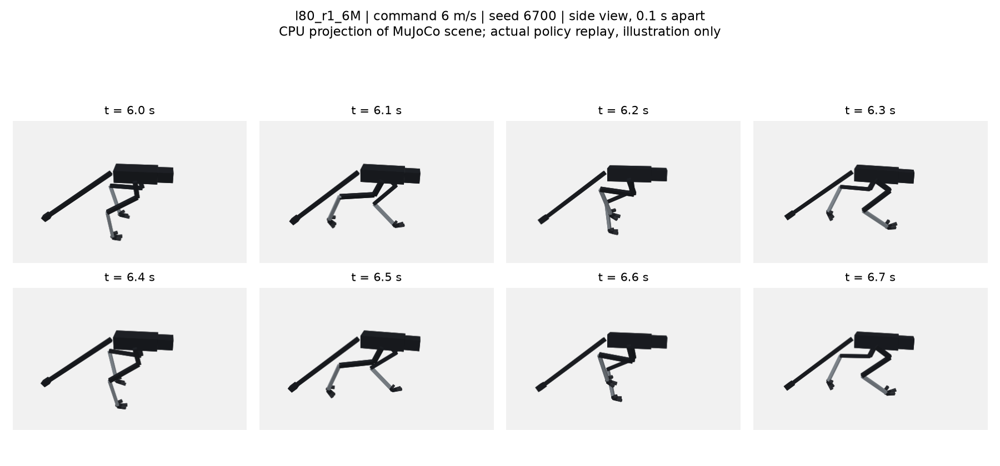

# 197 동결 형상(0.80 m 다리) 3단계 달리기 — 6M 정책 채택, 8 m/s 미달 1건을 기록하고 종료

2026-11-03. [형상 동결](../../DESIGN_FREEZE.ko.md) 뒤 세 번째 학습이다. 구동기 B안의 최종 판정이 이 단계에서 나온다. MuJoCo + RobStride 실물 모터 조건이며 실물이 아니다.

## 결론

달리기는 **`l80_r1_6M`을 채택**한다(`sim/rl/runs/l80_r1_6M`, 1회차 600만 스텝 저장본). **3단계 전체는 FAIL**이다. 8 m/s 명령에서 평균 속도가 6.46–6.51 m/s다. 4판 중 2판이 기준 6.5 m/s보다 0.03–0.04 m/s 부족하다. 2026-11-04 사용자는 이 미달 1건을 기록하고 4단계로 진행하기로 했다. **3단계는 미달 1건을 남기고 종료이며 통과가 아니다.** 기준과 FAIL 판정은 유지한다.

| 후보 정책 | 2 / 4 / 6 m/s 추종 | 8 m/s 명령 | 10분 방열판 장착 | 결정 |
|---|---|---|---|---|
| `l80_r1_4M` | 모두 통과 | 넘어짐 4/4, FAIL | 지속 명령 5 m/s, 권선 116.5 °C, 감액 계수 1.0 | 미채택 |
| **`l80_r1_6M`** | **모두 통과** | **6.46–6.51 m/s, FAIL** | **지속 명령 6 m/s**, 실제 평균 5.835 m/s, 권선 118.2 °C, 감액 계수 1.0 | **달리기 정책 채택·전체 통과 아님** |
| `l80_r1`(800만) | 2·4 과속 실패, 6 통과 | 6.84–6.87 m/s, 조정 기준 충족 | 6 m/s에서 권선 128.8 °C, 감액 계수 0.810; 4·5 m/s 미측정 | 미채택 |
| `l80_r3`(600만에서 200만 추가) | 2→2.24–2.27, 4→4.82–4.88 과속 실패; 6 통과 | 6.13–6.21 m/s, FAIL | 지속 명령 4 m/s, 권선 84.5 °C, 감액 계수 1.0 | 미채택 |

수치는 `eval/judge_l80_r1_4M.txt`, `judge_l80_r1_6M.txt`, `judge_l80_r1.txt`, `judge_l80_r3.txt`와 대응 `gate_run_*.jsonl`에서 대조했다. 800만 판정 파일은 **조정 전 기준**이다. 위 표의 8 m/s 판정만 조정 기준(6.5 이상)에 맞춰 구분했다. 기존 아래 기록의 “800만 지속 5 m/s 이하”는 측정값이 아니다. 저장된 발열 시험은 6 m/s뿐이므로 4·5 m/s 지속 여부는 미검증이다. 다른 후보의 “지속 속도”도 판정기가 고르는 최고 **명령**이다.

| `l80_w2` + `l80_r1_6M` 정책 구성 | 결과 | 판정·근거 |
|---|---|---|
| 전환 ramp(명령 변화율 2 m/s²) | 넘어짐 0/4 | 통과, `eval/judge_switch_l80_r1_6M.txt` |
| 전환 ramp 무작위화 | 넘어짐 0/8 | 통과, 같은 파일 |
| 전환 계단 명령 | 넘어짐 0/4 | 기록 항목, 같은 파일 |
| 달리기 옆 밀기 좌 / 우 | 넘어짐 0/8 · 0/8 | 통과, `eval/judge_l80_r1_6M.txt` |
| 1a·2 회귀 | 걷기 정책 `l80_w2`의 기존 통과 | [증거 196](../196-l80-walk/README.md), 이번에 재실행하지 않음 |

B/A 판단 근거는 무릎 부하다. 1회차 800만 정책의 6 m/s 명령에서 무릎 RMS는 30.0 N·m, 고관절 pitch는 14.7 N·m였다(`eval/limit_l80_r1.jsonl`). 고관절 pitch에는 여유가 있다. 사용자는 A안 전환 대신 목표를 조정했다. 11.1 m/s는 보류다. 아래 시작 전 선언과 진행 기록은 당시 기록으로 보존한다.

`plot.py`는 저장된 게이트로 그래프를 만든다. 점은 전도 없이 끝난 각 판의 평균, 선은 그 판들의 평균이다. 전도 판은 속도 없음으로 표시하며 성공으로 계산하지 않는다. 발열은 방열판 장착만 표시한다. 장면은 저장 정책의 6.0–6.7초 재생이다. 이 환경에서는 OpenGL 연결과 Blender 실행이 실패해 `render_cpu.py`로 실제 MuJoCo 지오메트리·자세·카메라를 CPU 투영했다. 증거 196과 같은 행(75:330)을 잘랐다. 재질·그림자는 기본 MuJoCo 렌더와 다르다. MuJoCo 시뮬레이션 시각자료이며 별도 합격 근거나 현장 성능이 아니다. 재생성: `.venv-sim/bin/python docs/evidence/197-l80-run/plot.py`.

## 시작 전 선언 (계획 §2 규칙 4)

### 시험 (`stage_gates.py run`, 2026-11-03 학습 전 정의)

| 조건 | 내용 |
|---|---|
| speed | 전진 명령 2 / 4 / 6 / 8 / 10 / 11.1 m/s를 선 자세에서 20초 유지, 4판씩. 넘어짐, 10–20초 평균 전진 속도, 가장 낮은 모터 감액 계수 |
| heat | 지정 속도로 600초. 제조사 방열판 장착과 가장 나쁜 장착(열저항 ×2, 열용량 ×0.2). 넘어짐, 최저 감액, 최고 권선 온도 |
| lateral | 4 m/s에서 8초에 몸통을 옆으로 0.5 m/s 밀기, 좌우 각 8판 |

### 합격 기준 ([STAGED_PLAN](../../STAGED_PLAN.ko.md) 3단계를 수치화)

- speed: 모든 명령에서 넘어짐 0, 평균 속도가 명령의 ±10 % 안.
- heat: 11.1 m/s 600초, 방열판 장착에서 감액 없음(최저 감액 계수 1.0), 넘어짐 0. 가장 나쁜 장착은 기록만 한다.
- lateral: 좌우 각 8판 중 넘어짐 1 이하.
- 회귀: 1a 서기, 2단계 걷기.

### B/A 판정 규칙

- **유지 속도** v_s: speed 조건에서 그 명령과 그보다 낮은 모든 명령이 넘어짐 0이고 ±10 % 안인 가장 높은 명령.
- 3단계 예산은 학습 3회 × 800만 스텝이다. 각 회는 시작 전에 이 문서에 설정을 적는다.
- 예산을 다 써도 v_s가 8 m/s 미만이면 사용자에게 보고하고 결정을 받는다(A안 또는 목표 하향). 함께 낼 근거: 관절별 T-N 한계에 붙은 시간 비율, 감액, 속도 포화.
- v_s가 8 m/s 이상이면 B안을 유지하고 11.1 m/s를 향해 계속한다.

### 1회차 `l80_r1`

| 항목 | 내용 |
|---|---|
| 시작점 | 2단계 통과 정책 `l80_w2`. 탐색 잡음 0.2 |
| 명령 | 평가 커리큘럼(`--eval-curriculum`): 현재 최고 속도에서 결정적 평가 4판 중 넘어짐 1 이하·속도 80 % 이상이면 ×1.15. 3 → 11.1 m/s. 0 명령 10 %, 제자리 회전 10 %(`cmd_turn`), 정지 뒤 기준점(`hold_settle` 0.1) |
| 명령 입력 정규화 | 걷기 정책의 전진 명령 정규화 폭(1.5 m/s 기준)을 11.1 m/s 기준으로 넓히고 첫 층 가중치를 같은 비율로 바꿈(기존 명령에서 행동 동일, 시험 `tests/test_widen_command.py`) |
| 예산 | 800만 스텝 |
| 점검 | 200만 스텝마다 `stage_gates.py run --quick` |
| 중단 | 400만 스텝에서 커리큘럼 최고 속도가 4 m/s 미만이면 중단하고 원인을 가른다 |

`l80_w2`를 달리기 시험에 그대로 넣어 보았다(`--quick`). 걷기 정책이라 2 m/s 이상은 모두 넘어진다. 6 m/s 이상은 명령 정규화가 포화해서 0.3초에 넘어진다(위 정규화 수정의 이유).

학습 명령: `train_l80_r1.sh`.

## 진행 기록

| 날짜 | 내용 |
|---|---|
| 2026-11-03 | `l80_r1` 시작. 명령 입력 정규화를 11.1 m/s 기준으로 넓힘(std 0.555, 0.3, 0.25) |
| 2026-11-03 | 사용자 요청으로 74.5만 스텝에서 중지. 평가 커리큘럼은 3 m/s에서 두 번 실패(평가 속도 0, 2.41 m/s) 뒤 통과(2.88 m/s)해 3.45 m/s로 올라간 상태였다. 첫 저장(100만 스텝) 전이라 모델은 남지 않았다. 재개는 `l80_w2`에서 다시 시작한다 |
| 2026-11-03 | 사용자 지시로 재개. `l80_w2`에서 `l80_r1`을 처음부터 다시 시작 |
| 2026-11-04 | 빠른 점검: 200만 스텝 유지 속도 4.0, 400만 6.0, 600만 6.0 m/s(8 m/s 명령에서 6.5 m/s). `eval/check_l80_r1_*M.txt` |
| 2026-11-04 | **1회차 800만 스텝 전체 시험**(`eval/gate_run_l80_r1.jsonl`, `eval/judge_l80_r1.txt`). 모든 속도에서 넘어짐 0. 최고 속도가 6.9–7.4 m/s에서 막힘(명령 8 / 10 / 11.1 m/s에 6.85 / 7.07 / 7.36 m/s). 낮은 명령은 지나치게 빠름(2 m/s → 2.75, 4 m/s → 5.6). 그래서 판정상 유지 속도는 0. 6 m/s 10분: 방열판 장착에서 권선 129 °C·감액 0.81, 가장 나쁜 장착에서 넘어짐·감액 0.32. 옆 밀기 0/8·0/8 |
| | **한계 관절은 무릎**(`limit_probe.py`, `eval/limit_l80_r1.jsonl`, 20초): 무릎 RMS 토크 6 m/s 30.0 N·m, 7.46 m/s 34.4 N·m, 토크 한계에 붙은 시간 2.2 % → 6.2 %. 고관절 pitch는 14.7–20.4 N·m, 한계 0.1 %로 여유. 증거 186의 "고관절 2.5배"는 0.80 m 다리에서 나타나지 않음 |
| | 커리큘럼은 7.98 m/s에서 멈춤(평가 속도 4.3–5.6 m/s, 80 % 기준 미달) |
| 2026-11-04 | **3회차 종료·6M 채택.** `l80_r3`는 8 m/s 고정 명령으로 200만 스텝 추가 후 2·4 m/s 과속, 8 m/s 6.13–6.21, 지속 명령 4 m/s로 미채택(`eval/judge_l80_r3.txt`). `l80_r1_6M`을 달리기 정책으로 채택하고 `l80_w2`와 전환 ramp 0/4·무작위화 0/8·계단 명령 0/4를 기록했다. 8 m/s 기준 0.03–0.04 m/s 미달은 FAIL 그대로 두고 사용자 결정 대기. 학습·장시간 게이트 재실행 없이 문서와 미디어를 정리 |
| 2026-11-04 | **사용자 결정: 8 m/s 미달(0.03–0.04 m/s) 1건을 기록하고 3단계 종료, 4단계 방향 전환으로 진행. 통과로 변경하지 않는다.** `l80_w2` + `l80_r1_6M` 구성 유지. [증거 198](../198-l80-turn/README.md)에서 무학습 기준선과 선회 기준을 먼저 정함 |

### 2회차 `l80_r2` (시작 전 선언)

| 항목 | 내용 |
|---|---|
| 시작점 | `l80_r1` 800만 스텝 |
| 바꾼 것 | 속도 오차 선형 벌점 `lin_err` −1(낮은 명령 과속 대응), 발열 벌점 `heat` −2 → −6(무릎 발열 대응), 커리큘럼 시작 7.98 m/s(1회차 도달값) |
| 그대로 | 나머지 설정 전부 |
| 예산 | 800만 스텝, 200만 스텝마다 빠른 점검 |
| 중단 | 400만 스텝에서 빠른 점검 유지 속도가 4 m/s 미만이면 중단 |
| 이 회차 뒤 | 유지 속도와 무릎 발열을 다시 측정한다. 무릎 발열 때문에 6 m/s 10분도 감액되는 상태가 그대로면, 3회차 전에 B/A 판정 근거(무릎 RMS 토크, 정격 대비)를 사용자에게 먼저 보고한다 |

### 2회차 결과와 원인 분리 (2026-11-04)

| 실험(모두 `l80_r1`에서 이어 학습) | 보상 | 50만 스텝 시점 에피소드 길이(시작 749) |
|---|---|---|
| `l80_r2`(2회차) | `lin_err` −1, `heat` −6 | 130, 200만 스텝 점검에서 4 m/s 이상 넘어짐 |
| `l80_r2c`(대조) | 1회차 그대로 | 649 |
| `l80_r2h` | `heat` −6만 | 196 |
| `l80_r2l` | `lin_err` −1만 | 263 |

- 2회차는 시작 직후 무너져 200만 스텝에서 멈췄다. 선언한 중단 시점(400만)보다 일렀지만 대조 실험으로 원인이 분명했다.
- 원인은 보상 변경이다. 매 스텝 음수 벌점을 더하면, 둘 중 어느 것을 단독으로 넣어도 학습이 무너졌다(`eval/progress_l80_r2*.csv`).
- 보상 벌점을 더하는 방식은 여기서 멈춘다(루프 방지).

### 무릎 부하 분석 (`knee_probe.py`, `eval/knee_l80_r1.jsonl`, 10초)

| 속도 | 무릎 모터 RMS | 지지 중 모터 평균 | 지지 중 스프링 평균 | 모터·스프링 반대 방향 | 스프링 강성 ×1.5 / ×2 / ×3 때 모터 RMS(같은 동작 가정) |
|---|---|---|---|---|---|
| 6 m/s | 30.0 N·m | −49.6 N·m | −19.4 N·m | 지지 시간의 49 % | 27.7 / 28.3 / 36.7 |
| 7.5 m/s | 32.0 | −55.4 | −11.6 | 58 % | 30.0 / 29.1 / 31.1 |

- 래칫 스프링은 걸리지만(전체 시간의 43 %) 지지 하중의 약 28 %만 받는다.
- 지지 시간의 절반은 모터가 스프링을 거스른다.
- 스프링 강성만 바꿔서는 무릎 모터 부하가 최대 8 %밖에 줄지 않는다(동작이 같다고 가정한 계산).
- 무릎 발열은 걸음 자체가 무릎을 쓰는 방식에서 나온다. 스프링 파라미터로는 풀리지 않는다.

### 목표 조정 뒤 (2026-11-04 사용자 결정)

조정한 기준은 [STAGED_PLAN](../../STAGED_PLAN.ko.md) 3단계에 있다(11.1 m/s 보류, 2/4/6 m/s 추종, 8 m/s 명령 6.5 m/s 이상, 4 m/s 이상 10분 감액 없음, 걷기·달리기 정책 구성). 1회차 400만 스텝의 빠른 점검을 본 뒤에 정한 기준이다.

| 정책 | 2/4/6 m/s | 8 m/s | 10분 지속 속도 | 옆 밀기 | 걷기·서기 회귀(단독) |
|---|---|---|---|---|---|
| `l80_r1` 400만(`l80_r1_4M`) | 통과 | 넘어짐 4/4 | 5 m/s(권선 117 °C) | 통과 | 실패(0.3 m/s 뒤로 걷기, 서기 이동 1.07 m) |
| `l80_r1` 600만(`l80_r1_6M`) | 통과 | 6.46–6.51 m/s, **0.03–0.04 미달** | **6 m/s**(118 °C) | 통과 | — |
| `l80_r1` 800만 | 과속 실패 | 6.84–6.87 | 5 m/s 이하(6 m/s 감액 0.81) | 통과 | — |

- 달리기 정책 하나는 걷기·서기를 잊는다. 그래서 걷기 정책 `l80_w2`와 달리기 정책을 바꿔 쓰는 구성으로 평가한다(`stage_gates.py switch`).
- 명령 변화율을 2 m/s²로 제한하면 전환이 된다(400만 정책 빠른 시험 0/2·0/2). 6 → 1 m/s 계단식 급감속에서는 넘어진다(기록).

### 3회차 `l80_r3` (시작 전 선언)

| 항목 | 내용 |
|---|---|
| 시작점 | `l80_r1_6M` |
| 바꾼 것 | 명령 범위를 8 m/s로 고정(`--fixed-curriculum`). 보상은 1회차 그대로 |
| 예산 | 200만 스텝(3단계 남은 예산 안) |
| 채택 | 조정 기준 `stage_gates.py run` 전체 통과, 그리고 `switch` 통과 |
| 아니면 | 600만 정책을 달리기 정책으로 두고 8 m/s 미달(0.04 m/s)을 그대로 기록해 사용자에게 보고한다 |

## 정리 검증 (2026-11-04)

- `.venv-sim/bin/python -m unittest discover -s tests`: 204개 통과.
- 저장된 JSONL만 판정기에 넣어 4M·6M·3회차·6M 전환 판정 파일 4개와 출력이 정확히 일치함을 확인했다. 800만 파일은 과거 기준 그대로 두고 각 행의 수치만 대조했다.
- 6M의 8 m/s 원값은 6.462 / 6.506 / 6.505 / 6.472 m/s다. 부족한 두 판은 0.038 / 0.028 m/s로, 본문은 소수 둘째 자리로 요약했다.
- 두 이미지를 열어 확인했다. 프레임은 seed 6700, 6 m/s 명령의 6.0–6.7초 실제 재생 8장이다. 재생 중 조기 종료는 없었다. 학습과 장시간 게이트는 실행하지 않았다.
