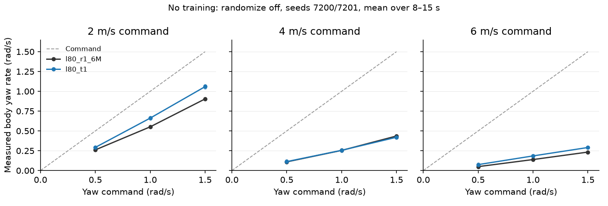

# 198 동결 형상(0.80 m 다리) 4단계 방향 전환

2026-11-04. MuJoCo만 사용한다. 형상·능동축 10개·모터 조건은 동결 그대로다.
사용자 결정으로 3단계는 8 m/s 미달 1건을 기록하고 종료했다(통과 아님).

최신: t3 추가 3,997,696 steps 종료·전체 평가 완료. 선회 23/32로 미채택, 사전 선언에 연장 없음 → 사용자에게 B/C 보고. 아래 「t3 최종 평가·결정」을 따른다. 기존 r1_6M+w2 유지.

## 기준선 측정 전 선언

학습 없이 `turn_probe.py`로 전진 1 m/s(`l80_w2`), 2/4/6 m/s(`l80_r1_6M`) ×
yaw ±0.5/±1.0/±1.5 rad/s × 고정 개발 시드 7200–7203 = 96판을 측정한다.
선 자세에서 5초 직진한 뒤 같은 전진 명령으로 10초 선회한다. randomize off,
훈련 외란 off, 저장 정책의 실물 모터 조건 on, 정책은 결정적으로 실행한다.
전진 속도와 몸 좌표 yaw rate는 8–15초 평균, 반경은 |평균 v / 평균 w|다.
반경은 옆 미끄러짐을 제외한 운동학 추정치이며 궤적 원 맞춤값이 아니다.
heading은 몸통 회전행렬의 yaw를 unwrap해 5초 이후 누적한다. 90° 도달 시간은 선회 명령부터다.
넘어지면 평균·반경을 null로 남기고, 생존 판만 평균을 낸다. 넘어짐은 별도 판정한다.
양쪽 고관절 yaw의 실제 구동 토크 RMS·절댓값 최대·관절 속도 절댓값 최대·방향별
순간 토크 한계의 98% 이상인 시간 비율을 5초부터 종료까지 1 ms마다 읽는다.
후크는 기존 `realism.after_substep`을 호출한 뒤 값을 복사하며 제어·물리에는 쓰지 않는다.
증거 186의 25 N·m @ 8 rad/s, RMS 7.5 N·m는 설계 추정이며 합격선이나 동물 실측값이 아니다.

재현:

```bash
.venv-sim/bin/python docs/evidence/198-l80-turn/turn_probe.py > docs/evidence/198-l80-turn/eval/turn_baseline.jsonl
```

측정 예산은 위 96판 1회다. 오류 수정에 따른 재측정은 이유와 무효 범위를 기록한다.
학습 예산·점검·중단·채택 기준과 수치 게이트는 기준선 완료 후, 학습 시작 전에 아래에 확정한다.

## 기준선 결과 (96판, 넘어짐 0/96)

각 행은 4시드 평균이다. 속도·yaw rate·반경은 판별 평균의 평균이며, 서로 다른 판을 합친 v/w가 아니다.
아래 하중은 해당 행의 양쪽 관절·4판 중 최대 RMS / 최대 토크 / 최대 속도다. 한계 비율은 모두 0%다.

| 전진 명령 m/s | yaw 명령 rad/s | 넘어짐 | 전진 평균 m/s | yaw 평균 rad/s | 반경 m | yaw RMS / peak N·m / peak rad/s |
|---|---|---|---|---|---|---|
| 1 | +0.5 | 0/4 | 1.026 | +0.422 | 2.43 | 2.01 / 5.53 / 2.78 |
| 1 | -0.5 | 0/4 | 1.026 | -0.422 | 2.43 | 1.94 / 6.94 / 2.89 |
| 1 | +1 | 0/4 | 1.034 | +0.761 | 1.36 | 2.37 / 8.55 / 2.76 |
| 1 | -1 | 0/4 | 1.035 | -0.762 | 1.36 | 2.41 / 9.56 / 3.08 |
| 1 | +1.5 | 0/4 | 1.002 | +1.046 | 0.96 | 2.98 / 9.00 / 2.90 |
| 1 | -1.5 | 0/4 | 1.012 | -1.033 | 0.98 | 2.98 / 9.00 / 3.35 |
| 2 | +0.5 | 0/4 | 1.868 | +0.259 | 7.21 | 3.52 / 10.22 / 4.57 |
| 2 | -0.5 | 0/4 | 1.892 | -0.199 | 9.50 | 3.50 / 9.56 / 4.71 |
| 2 | +1 | 0/4 | 1.778 | +0.547 | 3.25 | 3.66 / 11.91 / 4.69 |
| 2 | -1 | 0/4 | 1.842 | -0.463 | 3.97 | 3.65 / 11.37 / 4.83 |
| 2 | +1.5 | 0/4 | 1.621 | +0.898 | 1.81 | 3.31 / 11.48 / 4.86 |
| 2 | -1.5 | 0/4 | 1.683 | -0.773 | 2.18 | 3.53 / 10.55 / 4.77 |
| 4 | +0.5 | 0/4 | 4.191 | +0.108 | 38.82 | 4.53 / 12.81 / 5.28 |
| 4 | -0.5 | 0/4 | 4.144 | -0.124 | 33.43 | 4.41 / 11.65 / 5.04 |
| 4 | +1 | 0/4 | 4.116 | +0.250 | 16.47 | 4.82 / 14.39 / 5.70 |
| 4 | -1 | 0/4 | 4.002 | -0.274 | 14.59 | 4.30 / 11.82 / 5.33 |
| 4 | +1.5 | 0/4 | 3.856 | +0.430 | 8.98 | 4.82 / 14.69 / 5.97 |
| 4 | -1.5 | 0/4 | 3.737 | -0.460 | 8.12 | 4.28 / 13.38 / 5.66 |
| 6 | +0.5 | 0/4 | 5.906 | +0.052 | 115.53 | 5.55 / 14.80 / 6.20 |
| 6 | -0.5 | 0/4 | 5.905 | -0.108 | 54.59 | 5.62 / 15.13 / 6.32 |
| 6 | +1 | 0/4 | 5.862 | +0.141 | 41.61 | 5.64 / 16.09 / 6.74 |
| 6 | -1 | 0/4 | 5.840 | -0.194 | 30.07 | 5.69 / 15.59 / 6.61 |
| 6 | +1.5 | 0/4 | 5.745 | +0.237 | 24.26 | 5.56 / 16.19 / 7.04 |
| 6 | -1.5 | 0/4 | 5.650 | -0.278 | 20.34 | 5.62 / 16.93 / 6.94 |

전체 최대는 RMS 5.69 N·m, 피크 16.93 N·m,
피크 속도 7.04 rad/s다. 좌우·시드별 원값은 `eval/turn_baseline.jsonl`에 있다.
측정점은 96 × 10,000 = 960,000개(점당 양쪽 관절)다.
[증거 186](../186-stage0-design-b/README.md)의 설계 추정 25 N·m @ 8 rad/s·RMS 7.5 N·m보다 작다.
그러나 고속 선회를 못 하는 정책의 하중이므로, 이 값으로 구동기를 줄이거나 성공 선회 하중을 보장하지 않는다.
피크 토크와 피크 속도는 서로 다른 시점의 값이다. 토크 한계 0%는 측정된 구동 포화가 없다는 뜻이다.

걷기는 회전하지만 달리기는 속도가 높을수록 yaw 추종이 약해진다. 6 m/s, +0.5 명령에서는
yaw 0.052 rad/s·반경 115.53 m이며, ±1.5 명령조차 +0.237/−0.278 rad/s다.
기구 포화만으로 설명할 근거가 없어, 첫 시도는 명령 분포만 집중하고 보상 벌점은 유지한다.

## 4단계 합격 기준 — 2026-11-04 학습 전 확정

공개 동물·로봇의 급선회 수치를 새로 인용하지 않는다. 저장소에서 확인한 증거 186의 수치는
설계 가정이고 실측 선례가 아니다. 아래는 기준선과 v/w·90° 기하로 정한 이번 시뮬레이션의 공학적 목표다.
도달을 보장하지 않으며, 6 m/s에서 0.5 rad/s일 때 구심 가속도 약 3 m/s²가 필요한 목표다.

| 전진 / yaw 명령 | 전진 오차 | yaw 오차 | 명령 방향 90° 도달 | 반경 상한 | 이유 |
|---|---|---|---|---|---|
| 1 m/s / ±0.5 rad/s | ±15% | ±25% | 4.8초 | 3.2 m | 현재 걷기의 4.02–4.28초 전환을 보존한다 |
| 2 m/s / ±1.0 rad/s | ±20% | ±35% | 3.5초 | 3.7 m | 현재 yaw 0.46–0.55를 최소 0.65로 개선하며 저속에서 더 좁게 돈다 |
| 4 m/s / ±0.5 rad/s | ±15% | ±35% | 6초 | 14 m | 현재 반경 33–39 m를 절반 이하로 줄이고 전진을 유지한다 |
| 6 m/s / ±0.5 rad/s | ±15% | ±35% | 6초 | 21 m | 검증된 고속 구간에서 현재 55–116 m의 큰 원을 줄인다 |

- 선 자세에서 5초 직진 후 yaw를 계단 명령으로 넣고 10초 유지한다. 속도·yaw는 8–15초 평균이다.
  각 조건·부호마다 4판, **넘어짐 0/32**, 각 판이 모든 수치를 만족해야 한다.
  종료까지 명령 방향 순 heading 변화도 90° 이상이어야 한다. 단순 순간 흔들림을 성공으로 세지 않는다.
- 개발 시드 7200–7201(`--quick`), 최종 판정 시드 7300–7303. 후자는 기준선·학습에 쓰지 않았다.
  1 m/s는 고정 걷기 정책, 2/4/6 m/s는 후보 달리기 정책이다.
- 양쪽 고관절 yaw의 1 ms 하중 원값 요약이 모두 있어야 최종 판정한다. 25 N·m @ 8 rad/s는 합격 상한이 아니다.
- 회귀: `l80_w2`로 `stand`·`walk` 전체, 후보 달리기로 2/4/6 m/s 각 4판 20초 전도 0·10–20초 평균 ±10%,
  `switch` 기존 1.75 m/s 전환·2 m/s² ramp 명목 0/4·무작위화 1/8 이하. 이유: 선회를 얻고 앞 단계 기능을 잃는 후보는 채택하지 않는다.
- 3단계 8 m/s 알려진 미달은 유지하며 재합격으로 표시하지 않는다. 10분 발열 재시험은 이 단계 채택 조건에 넣지 않는다.
  후보의 10분 지속 성능은 재측정 전까지 기존 달리기 정책의 기록을 승계하지 않는다.
- `stage_gates.py turn`은 전체 회귀도 출력한다. `--quick`은 16판 선회만 출력한다.
  `gate_judge.py`는 전체 결과의 조건·판 수·시드·하중 자료·회귀 누락과 중복을 검사한다. quick은 채택 근거가 아니다.

```bash
.venv-sim/bin/python sim/rl/stage_gates.py sim/rl/runs/l80_t1 turn --walk sim/rl/runs/l80_w2 --quick > docs/evidence/198-l80-turn/eval/check_t1.jsonl
.venv-sim/bin/python sim/rl/gate_judge.py docs/evidence/198-l80-turn/eval/check_t1.jsonl
# 채택 후보가 나오면 --quick을 빼서 전체 회귀까지 실행하고 판정한다.
```

## 첫 학습 `l80_t1` 시작 전 선언

| 항목 | 내용 |
|---|---|
| 학습 대상·시작점 | 달리기 정책만 `sim/rl/runs/l80_r1_6M/model.zip`에서 이어 학습. 걷기 `l80_w2` 고정 |
| 명령 분포 | `commands.json`의 24행. 이동 중 선회 60%: 2/4/6 m/s × ±0.5/±1.0/±1.5 rad/s 균등. 직진 30%: 2/4/6 균등. 정지 5%, 제자리 ±0.5 각각 2.5%. 옆 명령 0, 기존 5초 재추출 유지 |
| 옵션 | 새 선택 옵션 `--cmd-mix`, `--fixed-curriculum`, 범위 6/0/1.5, 명령 정규화는 기존 `widen_command_inputs`로 보존 변환. 탐색 표준편차 0.15. 명령 혼합 미사용 시 기존 난수 순서·동작 보존 |
| 보상·물리 | 197의 r1 보상 가중치와 정확히 같음. 음수 항 추가·벌점 증가 없음. 형상·모터·스프링·저역 필터·외란·20초 episode·level 0.5 유지 |
| 예산 | 새 학습 최대 8,000,000 steps, 8환경 × 1024 rollout 단위로 **7,995,392 steps**까지. 초기 정책 누적 steps와 별도. 자동 연장 없음 |
| 점검 | 약 1M(999,424)마다 저장·고정 개발 시드 평가. 홀수 블록은 4/6 m/s·±0.5·seed 7200 4판. 짝수 블록(약 2M마다)은 `stage_gates.py turn --quick`과 같은 16판. 스냅샷 `l80_t1_1M`…`_8M` |
| 초기 붕괴 | 실행자가 첫 약 50 updates의 progress.csv를 확인한다. 첫 10행 평균 대비 최근 10행 에피소드 길이가 절반 미만이면 즉시 중단. 체크 스크립트도 1M마다 같은 조건으로 중단 |
| 정체 중단 | 같은 점검 구성의 2블록 전(약 2M)과 비교해 달리기 선회 성공 판 수 증가도 없고 평균 절대 yaw 오차 0.02 rad/s 감소도 없으면 중단 |
| 4M 중단 | 4번째 블록 이후 달리기 선회 기준 통과 판이 0이면 중단. 걷기 1 m/s 성공으로 가리지 않음 |
| 채택 | quick 전체 통과 때만 최종 시드 4판씩 + 회귀 전체 수행, `gate_judge.turn_suite_status` 통과한 저장본만 채택 후보. 통과하면 조기 종료. 기존 정책 파일은 덮어쓰지 않음 |
| 실패·종료 | 측정·체크 오류는 fail closed로 학습 중단. 예산 끝·중단이면 기존 `l80_r1_6M` 유지, 비RL 하중·추종 원인 검토. 새 실행·연장은 별도 선언 |

훈련 스크립트: `train_l80_t1.sh`. 체크 스크립트: `check_training.py`.
`--checkpoint-check`는 정책·정규화를 저장한 뒤 Python 체크 스크립트를 동기 실행한다.
exit 0 계속, 10 정상 중단, 그 밖은 오류 중단이다. 평가 동안 학습은 진행하지 않는다.
이 옵션을 쓰는 실행에서만 rollout 단위 예산 상한을 엄격히 적용하며 기존 실행 기본 동작은 유지한다.

## 1회차 진행 기록과 체크 감사 (2026-11-04)

감독자가 실행한 `l80_t1`은 **새 학습 2,998,272 steps(약 3M)에서 자체 정체 규칙으로 중단**됐다.
`sim/rl/runs_l80_t1.log`, 각 저장본 `progress.csv`, `turn_checks.json`과
`eval/l80_t1/turn_{1,2,3}M.jsonl`을 대조했다. 이번 세션은 학습하지 않았다.
현재 `l80_t1/model.zip`·`vecnorm.pkl`은 `_3M` 저장본과 SHA-256이 같다. 미채택이며 기존 정책을 유지한다.

| 블록 | 실제 추가 steps | 달리기 선회 통과/total | yaw MAE rad/s | 정체 비교 대상 | 결정 |
|---|---:|---:|---:|---|---|
| 1 | 999,424 | 0/4 | 0.405909 | 없음 | 계속 |
| 2 | 1,998,848 | 4/12 | 0.322272 | 없음 | 계속 |
| 3 | 2,998,272 | 0/4 | 0.393330 | **블록 1** | 중단 |

**3M 중단은 유효하다. 집계 버그는 없다.** 홀수 블록은 4/6 m/s × ±0.5 × seed 7200의 4판이다.
짝수 블록은 quick 16판 중 고정 걷기 4판을 제외한 달리기 12판
(2 m/s·±1, 4/6 m/s·±0.5 × seeds 7200/7201)이다.
`stop_reason`은 `block - 2`를 찾으므로 4판과 12판을 섞어 비교하지 않는다.
블록 1→3의 조건·시드 목록은 정확히 같고 성공 0→0, MAE 감소 **0.012578 < 0.02**다.
2M의 4/12를 3M의 0/4와 직접 비교하여 퇴행이라고 해석하면 안 된다.

`audit_check.py`가 세 판정을 원자료에서 다시 계산했고 기록과 모두 일치했다(`eval/check_audit.json`).
에피소드 길이 첫 10 updates 평균 727.415, 3M 마지막 10 평균 859.614로 길이 붕괴 규칙은 해당하지 않는다.
이는 저장 로그의 사후 감사이며 당시 실행자가 첫 50 updates를 실시간 관찰했다는 증거는 아니다.
코드는 비교 의도를 설명하는 주석만 추가했다. `tests/test_turn_commands.py`에 4/12/4 및 짝수 블록의
회귀시험을 추가해, 인접 블록이 더 좋아 보여도 동일 구성 대비 개선하면 계속하도록 검증했다.
**합격 기준·중단 기준·평가 구성은 바꾸지 않았다.**

## 무학습 원인 진단

`diagnose_turn.py`: `l80_r1_6M`와 `l80_t1` 각각 2/4/6 m/s × yaw +0.5/−0.5/+1/+1.5 ×
seeds 7200/7201 = **48판**, 판당 5초 직진+10초 선회. randomize off, 외란 off,
저장 실물화 모터·센서 조건 on, 결정적 정책. +1/+1.5의 음수 방향은 이번 진단에 추가하지 않았다.
새 학습·정책 수정·물리 범위 변경 없음. **전도 0/48**. 개발 진단이며 최종 시드 채택 시험이 아니다.

- 속도·보상·몸통 roll은 8–15초. 관절 각도·실제 구동 토크·그 시점의 방향별 토크 한계는
  5–15초 동안 1 ms마다(각 판 10,000점, 양쪽 yaw/roll 네 축) 읽었다.
- 기계적 끝단 비율: 각도 ≤ 하한+0.01 또는 ≥ 상한−0.01 rad. 토크 한계 비율: 순간 방향별 한계의 ≥98%.
  행동 클리핑 비율: 50 Hz 정책 출력 절댓값 ≥0.98. 행동은 이후 기존 6 Hz 필터를 통과한다.
- 같은 캐시 관측에서 입력 8만 0과 0.5(실제 yaw 명령 0과 1)로 바꾼 반사실 예측을 5–14초 매초 수행했다.
  환경을 한 스텝 더 진행하거나 센서 난수를 새로 뽑지 않는다. 목표각 차이는 필터 전 `scale × action 차이`다.
- 바닥 접촉 마찰은 `data.contact.friction`에서 읽고, 접촉력은 20 ms마다 읽었다. 접선 활용도는
  `norm(F_t)/(mu*F_n)`, F_n>1 N인 접촉점만 집계한다. 시간 비율·전체 횡력 잔여량과는 다르다.
- 원자료 `eval/diagnosis.jsonl`, 50 Hz trace 48개 `eval/diagnosis/*.npz`(열 이름 포함),
  집계·물리 계산 `eval/diagnosis_summary.json`, 실행 로그 `eval/diagnosis.log`.
  `eval/diagnosis.manifest.json`의 모델·정규화·args·형상·실물화 설정 해시는 전후 동일하다.
- 기존 기준선/3M 체크와 겹치는 **28판의 v/yaw 최대 차이 5.33e-15**.
  이 범위에서 계측·반사실 예측의 궤적 비간섭을 확인했다.

아래 화살표는 같은 2시드의 r1_6M → t1 평균이다.

| 진단 항목 | 관측 | 해석과 한계 |
|---|---|---|
| 저속 vs 고속 | 2 m/s·+1: yaw 0.552→0.662. 4 m/s·+0.5: 0.110→0.113. 6 m/s·+0.5: 0.0495→0.0749 | t1의 저속 개선은 있지만 고속 게이트 실패는 지속 |
| 전진 속도 | t1의 4 m/s·±0.5에서 4.737/4.748 m/s | ±15% 상한 4.6도 넘음. yaw만 올라도 합격이 아님 |
| 마찰·lean | 실제 접촉 mu=0.8/1.2, 달리기 게이트의 v*w=2–3 m/s², 필요한 lean 약 11.5–17.0° | 평균 마찰 한도만으로 게이트 실패를 설명하지 못함. 아래 표는 필요조건이며 동적 실현 증명 아님 |
| 고관절 yaw | 전체 각도 −0.318…+0.319 rad, 기계 범위 ±0.5, 끝단 0%; 최대 RMS/peak 6.484/18.082 N·m, 순간 한계 48.6–60 N·m, 한계 시간 0% | **±0.5 yaw 기계 끝단이나 구동 토크 한계에 막힌 실패는 관측되지 않음** |
| 고관절 roll | 전체 각도 −0.419…+0.451 rad, 범위 ±0.5, 끝단 0%; 최대 RMS/peak 17.972/73.960 N·m, 순간 한계 81–100 N·m, 한계 시간 0% | 현재 궤적에 기계적/토크 포화 없음. 성공 선회 시 부하 여유를 보장하지 않음 |
| 행동 범위 | yaw 목표 배율은 ±0.3 rad(기계 범위와 다름). t1 조건별 좌우·2시드 평균 출력 클리핑 42.0–57.7%, roll 0% | 기존 달리기 yaw 동작이 행동 범위를 많이 사용함. 추가 명령이 항상 더 큰 yaw 목표로 이어지지 않음. 범위 확대 효과는 미검증 |
| 관측·명령 | 입력 8 std: r1=0.25, t1=0.375, mean=0. yaw ±1.5 → 정규화 ±3/±2, clip ±10 | 명령 소실·정규화 포화 가설 배제. widening 로그와 일치 |
| 같은 상태 반사실 | 240상태/정책, 명령 0→1 행동 L2 차이 r1=0.117–0.449, t1=0.125–0.434 | 명령은 정책 출력을 바꿈. 이 차이가 성공 선회를 만든다는 증거는 아님 |
| 보상 | t1 6 m/s·+1.5에서 가중 track_yaw 0.048, track_lin 4.692, progress 약 3, yaw_err −1.209 | 큰 yaw 오차에서는 양의 선회 보상이 거의 사라짐. 기존 yaw_err의 선형 유인은 남으므로 “회전 보상 0”은 아님 |
| 접촉 활용 | t1 판별 접촉점 샘플의 12.0–34.0%가 접선 활용도 ≥98% | 일부 발 접촉은 이미 마찰을 사용한다. mu*g 상한과 실제 남은 횡력 여유를 동일시하지 않음 |

t1의 6 m/s·+0.5 상태들에서 반사실 명령 0→1의 필터 전 목표각 절댓값 변화 평균은
왼쪽/오른쪽 yaw **0.00444/0.00703 rad**, roll **0.03125/0.02952 rad**다.
명령이 주로 roll 등의 출력도 바꾸므로 yaw 출력 클리핑 하나를 확정 원인으로 단정하지 않는다.

### 물리 필요조건과 도달 가능성의 경계

평지·일정 속도·미끄럼 없는 원운동의 평균 필요 가속도는 `a=v*w`, 지지 기울기는 `atan(a/g)`다.
중력은 모델의 9.81 m/s²를 사용했다. 평균 수직 지지력이 mg일 때, mu=0.8 접촉만 사용하면
평균 수평력 상한은 **7.848 m/s²**, mu=1.2만 사용한다면 **11.772 m/s²**다.
가감속·수직 진동·발의 순간 미끄럼·접촉별 하중 배분을 무시한 낙관적 전체 힘 상한이다.
실제 접촉의 mu=0.8/1.2는 priority=1인 발 패드가 priority=0인 바닥(mu=1)보다 우선한 결과다.
[MuJoCo 공식 접촉 파라미터 규칙](https://mujoco.readthedocs.io/en/stable/modeling.html#contact-parameters)과
원자료의 접촉쌍·priority·계수 기록이 일치한다. 마찰을 바꾸지 않았다.

| v m/s | yaw 절댓값 rad/s | v*w m/s² | 필요 mu (heading 가정) | lean (heading 가정) | body-z 명령의 이상적 bank lean / 필요 mu |
|---:|---:|---:|---:|---:|---:|
| 2 | 0.5 | 1 | 0.102 | 5.8° | 5.9° / 0.102 |
| 2 | 1.0 | 2 | 0.204 | 11.5° | 11.8° / 0.208 |
| 2 | 1.5 | 3 | 0.306 | 17.0° | 17.8° / 0.321 |
| 4 | 0.5 | 2 | 0.204 | 11.5° | 11.8° / 0.208 |
| 4 | 1.0 | 4 | 0.408 | 22.2° | 24.1° / 0.447 |
| 4 | 1.5 | 6 | 0.612 | 31.5° | 37.7° / 0.773 |
| 6 | 0.5 | 3 | 0.306 | 17.0° | 17.8° / 0.321 |
| 6 | 1.0 | 6 | 0.612 | 31.5° | 37.7° / 0.773 |
| 6 | 1.5 | 9 | 0.917 | 42.5° | 66.6° / 2.306 |

마지막 열은 좌표 차이를 드러내는 별도 근사다. 현재 게이트/보상은 **몸 좌표 gyro-z**이며 heading rate가 아니다.
pitch=0인 일정 bank에서 `w_body=w_heading*cos(lean)`이므로 `lean=asin(v*w_body/g)`다.
이 가정의 6·1.5 조건은 최대 접촉 mu=1.2와 몸통 tilt 종료값 0.8 rad(45.8°)를 모두 넘는다.
하지만 이족의 COM–지지점 기울기가 몸통 roll과 같다고 보장할 수 없고, 보행은 정적 bank가 아니다.
따라서 이를 모든 동적 전략에 대한 불가능 증명이나 기계 범위 변경의 근거로 쓰지 않는다.

**판단:** 2/4 m/s의 0.5–1.5와 6 m/s의 0.5–1.0은 이 평균 힘 계산으로 배제되지 않는다.
6·1.5는 낮은 mu 패드 한도를 넘고 body-z 해석에서는 훨씬 어려워, 전체 명령 격자가 실현 가능하다고
보장할 수 없다. 특히 고속·큰 yaw의 성공 궤적은 아직 없다. 선언된 게이트(2·1, 4·0.5, 6·0.5)는
이 경계보다 충분히 안쪽에 있으므로 현 단계에서 기계적 범위를 바꿀 근거는 부족하다.
몸통 roll 측정은 t1 6·+0.5에서 평균 −0.0225 rad(−1.29°), +1.5에서 −0.1211 rad(−6.94°)다.
이는 필요한 균형 잡힌 선회 형태를 아직 만들지 못한 현재 동작의 관측이며, roll 관절 자체의 최대 능력이 아니다.

### 보상 크기와 다음 실험의 근거

`track_yaw=4*exp(-(cmd_w-w_body)^2/0.2)`, `track_lin=5*exp(-||cmd_xy-v_xy||²/sigma²)`,
`sigma=max(0.3,0.3*cmd_v)`다. progress 최대 3, 기존 `yaw_err=-abs(cmd_w-w_body)`도 있다.
아래 값은 매초 보상률이고 실제 20 ms 스텝 기여는 ×0.02다. 순간 항을 평균했으며 평균 오차에 지수를 적용하지 않았다.

| t1 실제 명령 | 가중 track_lin | 가중 track_yaw | 가중 yaw_err |
|---|---:|---:|---:|
| 2 / +1 | 4.587 | 2.425 | −0.338 |
| 4 / +0.5 | 3.328 | 2.015 | −0.387 |
| 6 / +0.5 | 4.765 | 1.917 | −0.427 |
| 6 / +1 | 4.774 | 0.451 | −0.815 |
| 6 / +1.5 | 4.692 | 0.048 | −1.209 |

직진 상태(w=0)에서 명령 0.5/1/1.5의 가중 track_yaw는 1.146/0.02695/0.000052다.
완전 추종 시에는 모두 4이므로 최적 선회의 가치가 없는 것은 아니다. 그러나 1.5 명령의 양의 yaw 항은
직진 근처에서 거의 평평하고, 속도 추종+progress는 최대 8이다. t1의 이동 선회 60% 중
**40%p가 |yaw|≥1**(고속까지 동일하게 배정)이어서 고속의 가까운 성공 행동에 대한 표본이 분산됐다.
이는 명령 분포·기존 달리기 동작의 국소해를 다음 가설로 삼을 근거이며, PPO 실패 원인을 단독으로 증명한 것은 아니다.
입력 누락, ±0.5 기계적 stop, 현재 토크 포화는 관측으로 배제했다. 행동 yaw 클리핑과 접촉 활용도는 후속 확인 대상이다.



그림은 +yaw 세 명령의 2시드 점과 평균이다. −0.5는 원자료·집계에 포함했다.

## 감독자 결정 `l80_t2` — yaw 행동 반범위 확대, 학습 미시작

감독자는 명령 분포 전용 t2 제안을 아래 실행으로 교체했다. t1에서 선회 명령 분포는 이미 시험했고,
yaw 행동 반범위는 0.3 rad인데 출력 클리핑은 42.0–57.7%였다. **한 가지 실험 변수는 yaw 행동
반범위 0.3→0.5 rad**다. 기계 stop ±0.5, 능동축 10개, 보상·명령 분포는 그대로다.
이전 명령 분포 전용 계획은 아래 t4fallback 예비안으로 이름을 바꿔 보존했다.

**시작 동작 보존 검증은 실패했다.** 아래 스크립트는 요청한 선형 변환을 구현한 검토용이며,
동작 보존을 충족한 실행 준비 완료로 선언하지 않는다. 학습 전 감독자가 이 불일치를 해결해야 한다.

| 항목 | 시작 전 선언 |
|---|---|
| 시작점 | `sim/rl/runs/l80_t1/model.zip`·동일 `vecnorm.pkl`(3M 저장본), seed 0. 걷기 `l80_w2` 고정 |
| 한 가지 변경 | `--scale-override '{"hip_roll": 0.5, "hip_yaw": 0.5}'`. yaw만 0.3→0.5; roll은 기존 0.5. 기계 범위 변경 없음 |
| 초기 정책 변환 | load → `widen_command_inputs` → 출력 보정 → 대칭 정책 재구성 순서. 좌우 yaw action indices **1, 5**, action_net weight/bias 행 ×**0.6**. 기본 log_std는 **−0.510825624** 추가. t2는 t1과 같은 `--resume-action-std 0.15`를 사용하므로 최종 전체 std=0.15 |
| 명령·보상 | t1의 `commands.json` 24행·보상 전체 유지. 범위 6/0/1.5, 입력8 std=0.375 유지(추가 widening 없음). 20초 episode·8환경·level 0.5·외란·모터·필터 동일 |
| 예산 | 추가 학습 최대 **4,000,000 steps**, 8×1024 rollout 상한으로 실제 **3,997,696**(999,424×4). 자동 연장 없음 |
| 점검 | t1의 `check_training.py` 동일: 약 1M마다 저장, 홀수 4판·짝수 quick 16판(달리기 12). 스냅샷 `l80_t2_1M`…`_4M` |
| 초기 중단 | 감독자가 첫 약 50 updates 확인. 최근 10행 ep_len 평균이 첫 10행의 절반 미만이면 즉시 중단. 자동 체크도 약 1M마다 같은 규칙 |
| 정체·예산 중단 | 동일 구성 2블록 전 대비 성공 판 수 증가도 없고 yaw MAE 0.02 rad/s 감소도 없으면 중단. 4M 뒤 달리기 통과 0이면 중단. 체크 오류는 fail closed. 예산 종료 시 추가 실행 없음 |
| 채택 | 기존 수치 기준 유지. quick 전체 통과 때만 최종 seeds 7300–7303·yaw 1 ms 하중·stand/walk/run/switch 전체 회귀. `turn_suite_status` 통과 저장본만 후보, 자동 기존 정책 교체 없음 |
| 실패 뒤 | 기존 `l80_r1_6M`+`l80_w2` 유지. t4fallback은 not started, fallback이며 자동 실행하지 않음 |

### 시작 동작 비교 — 선형 보정의 한계 확인

`check_start_behavior.py --scale-override '{"hip_roll": 0.5, "hip_yaw": 0.5}'`로 실제 RunEnv에서
seeds 7200/7201, 명령 4 m/s, 5초 직진+10초 yaw +0.5를 비교했다. randomize/외란 off,
실물화·6 Hz 필터 on, 결정적 정책, 8–15초 평균. 학습과 모델 저장은 없다.
검사 전에 허용 오차를 yaw 0.01 rad/s·전진 0.05 m/s와 양쪽 완주로 정했다(4단계 합격선과 별개).

| seed | yaw t1→보정 rad/s | 전진 t1→보정 m/s | 결과 |
|---|---|---|---|
| 7200 | 0.104438→0.125655 (차이 0.021217) | 4.714640→3.915079 (차이 0.799561) | 동작 보존 실패 |
| 7201 | 0.121674→0.137659 (차이 0.015985) | 4.759941→3.933585 (차이 0.826356) | 동작 보존 실패 |

총 4 rollout은 모두 15초 완주·전도 0이지만 동작이 같지는 않다.
`eval/t2_start_behavior.json`과 `eval/t2_start_s720{0,1}.npz`에 원값·허용 오차·t1 입력 해시를 저장했다.
t1 model/vecnorm/args SHA-256 전후 동일. 보정하지 않은 두 t1 rollout의 속도·yaw는 기존 진단 기록과 최대 차이 **0.0**으로 같았다. 동일 관측에서 양쪽 정책의 필터 전 yaw 목표각 차이는
최대 **0.200000 rad**였다. 보정 궤적의 동일 관측에서 기존 정책 yaw 출력은 57% 포화했다.

수학적으로 `.3*clip(a,-1,1)`과 `.5*clip(.6*a,-1,1)`은 **|a|≤1일 때만** 일반적으로 같다.
예를 들어 a=1.2이면 0.3→0.36 rad다. 선형 행 보정만으로 기존 포화 행동까지 보존할 수 없다.
또한 RunEnv 관측에 `last_action`이 포함되어 새 좌표에서는 이 값도 바뀐다. 따라서 비포화
한 관측에서 목표각 일치가 폐루프 궤적 보존을 뜻하지 않는다. 이 두 요인의 궤적 기여도는 분리하지 않았다.
이 불일치를 숨기는 새 clamp·관측 변환·보상 변경은 추가하지 않았다. 동작 보존을 요구하려면
클리핑 및 이전 액션 관측을 포함하는 정책 변환 설계를 먼저 확정해야 한다.

감독자 재현 명령(현재 **exit 1**, 실패를 재현):

```bash
.venv-sim/bin/python docs/evidence/198-l80-turn/check_start_behavior.py --scale-override '{"hip_roll": 0.5, "hip_yaw": 0.5}' --out /tmp/raptor-t2-start-review.json
```

학습 명령은 아래와 같이 준비했다. **현재 시작 동작 보존 요구 미충족으로 실행 보류**다.
불일치 해결 후 감독자가 로컬 터미널에서 실행하고 첫 50 updates를 확인한다.

```bash
/bin/bash docs/evidence/198-l80-turn/train_l80_t2.sh > sim/rl/runs_l80_t2.log 2>&1
```

## 예비안 `l80_t4fallback` — not started, fallback (미시작·예비안)

**이전 명령 분포 전용 제안을 보존한 fallback이며 시작하지 않았다.** 감독자가 선택할 때만 게이트에 집중한 명령 분포를 한 번 시험한다. t1은 4 m/s 과속도 생겼으므로
검증된 `l80_r1_6M`에서 다시 시작해 t1과 명령 분포 차이를 비교한다.
형상·관절 범위·행동 배율·관측·보상은 변경하지 않는다. yaw 행동 배율 확대도 이번 실행에 섞지 않는다.
새 음수 항·벌점 가중치 증가는 금지하며 증거 197의 실패 방식을 반복하지 않는다.

| 항목 | 시작 전 확정 내용 |
|---|---|
| 시작점 | `l80_r1_6M/model.zip`·동일 정규화, seed 0, 걷기 `l80_w2` 고정. t1 파일 보존 |
| 명령 분포 | `commands_t4fallback.json`: 게이트 60%(2·±1, 4·±0.5, 6·±0.5 각 10%), 완만한 고속 선회 20%(4/6·±0.25 각 5%), 직진 15%(2/4/6 각 5%), 정지 2.5%, 제자리 ±0.5 각 1.25%. 5초 재추출 유지 |
| 명령 범위·정규화 | `--cmd/--cmd-final 6 0 1.5`를 유지해 t1과 동일한 std8=0.375 widening. 혼합의 실제 최대 yaw는 1.0. 입력 증폭 없음 |
| 나머지 설정 | t1과 동일: 보상 전체·20초 episode·8환경·level 0.5·외란·모터·10 active DOF·탐색 std 0.15. 변경은 혼합과 예산/이름뿐 |
| 예산 | 새 학습 최대 4,000,000 steps, rollout 상한 적용 실제 **3,997,696**. 단 한 번, 자동 재시도·연장 없음 |
| 점검 | 기존 `check_training.py` 그대로: 약 1M마다 저장. 홀수 4판, 짝수 quick 16판(달리기 12). 비교는 동일 구성 2블록 전. 스냅샷 `_1M`…`_4M` |
| 초기 중단 | 감독자가 첫 약 50 updates를 확인. 최근 10행 ep_len 평균이 첫 10행의 절반 미만이면 즉시 중단. 자동 체크도 약 1M마다 같은 규칙 |
| 정체·예산 중단 | 동일 구성 2블록 전보다 성공 판 수 증가도 없고 MAE 0.02 감소도 없으면 중단. 4M 이후 달리기 통과 0이면 중단. 체크 오류는 fail closed. 4M 예산 끝이면 결과와 무관하게 종료 |
| 채택 | 기존 수치 기준 불변. quick 16/16 때만 최종 seeds 7300–7303, yaw 1 ms 하중, stand/walk/run/switch 회귀 전체. `turn_suite_status` 통과 저장본만 채택 후보로 보고하고 조기 종료. 자동 정책 교체 없음 |
| 실패 뒤 | r1_6M 유지. 후속 실행 자동 시작 금지. 고속 개선이 없으면 동일 상태·동일 시드에서 yaw 행동 범위/접촉력 방향의 제한된 비RL 개입을 먼저 설계·검증. ±0.5 기계 범위 변경은 별도 근거와 사용자 결정 필요 |

예비 스크립트는 `train_l80_t4fallback.sh`다. **이번 세션에서 실행하지 않았다.**
이 실행 환경에서는 배경 프로세스가 세션 이후 유지되지 않으므로 감독자가 커밋·실행을 담당한다.
로컬 터미널에서 저장소 루트를 열고 `/bin/bash docs/evidence/198-l80-turn/train_l80_t4fallback.sh`로 실행한다.
학습 로그는 `sim/rl/runs_l80_t4fallback.log`로 수집한다. 이미 있는 run 디렉터리는 스크립트가 거부한다.
이 제안은 채택이나 4단계 통과 선언이 아니다.

## 재현·검증·남은 일

```bash
.venv-sim/bin/python docs/evidence/198-l80-turn/audit_check.py
.venv-sim/bin/python docs/evidence/198-l80-turn/check_t2_config.py
.venv-sim/bin/python docs/evidence/198-l80-turn/check_t4fallback_config.py
# diagnose_turn.py는 기존 결과를 덮어쓰지 않는다. 재측정은 새 --out 경로 지정.
.venv-sim/bin/python docs/evidence/198-l80-turn/diagnose_turn.py --out /tmp/raptor-turn-repeat.jsonl
MPLCONFIGDIR=/tmp/raptor-mpl .venv-sim/bin/python docs/evidence/198-l80-turn/summarize_diagnosis.py
.venv-sim/bin/python -m unittest discover -s tests
/bin/bash -n docs/evidence/198-l80-turn/train_l80_t2.sh
```

- 최신 전체 단위시험 **217개 통과, 0 실패·생략**(`eval/unittest_scale_resume.txt`). t1 무작위 관측 8192개 중 모든 |action|<1인 관측의 목표각, 대칭 재구성, 좌우 동일 비율, std/override·미변경 행·no-op·포화 반례를 검사했다. 이전 215개 기록은 `eval/unittest_diagnosis.txt`에 보존했다.
- 저장된 3블록 판정 재현·28판 계측 비간섭·정책/설정 해시 보존 확인.
- t2 설정 검사: t1 대비 이름·시작점·yaw 배율·예산만 변경, 명령·보상 동일·10 active DOF·좌우 ×0.6·std 0.15·3,997,696 예산 확인(`eval/t2_config_check.json`). t4fallback 설정 검사도 통과했으며 이전 명령 계획 증거는 `eval/t4fallback_config_check.json`에 보존했다.
- 실제 환경 시작 동작 비교 **실패 2/2**(`eval/t2_start_behavior.json`, exit 1). 단위시험 통과와 구분한다. RunEnv 기본값·코드는 수정하지 않았으며 학습은 하지 않았다.
- `bash -n`, 스크립트 `--help`, `git diff --check` 확인. 차트를 열어 축·점·범례를 확인했다.
- 미검증: 전체 행동 보존 변환(현재 선형식으로 불가능), t2/t4fallback 학습 효과, 고속 성공 선회의 기계적 실현·부하, t1/t2 최종 시드 전체 회귀·10분 지속 성능.
  짧은 프로브의 생존을 선회 성공·장시간 성능·실물 성능으로 보고하지 않는다.
- 처음의 준비 검증(214 tests·기준선 quick 4/16·구형 판정 출력 일치)은 이전 기록이다.
  당시 배경 유지 실패와 미실행 상태는 `eval/background_check.json`에 남아 있고, 위 t1 실행 결과가 최신 상태다.

기존 미추적 `eval/l80_t1/` 자료를 보존했다. 모든 변경은 **미커밋**, 학습·git 쓰기 없음.
당시 변경 목록 안내는 이전 작업 기록이며 이번 작업에서 별도 커밋 목록 파일은 만들지 않는다.

> **감독자 판단 (Claude, 2026-11-04):** 시작 동작 보존 점검(`eval/t2_start_behavior.json`)은 정확 일치 기준으로는 2/2 실패다. 그러나 차이는 기존 yaw 출력이 범위 밖으로 포화되어 있던 부분(같은 관측에서 목표각 차이 최대 0.2 rad, 포화 비율 0.57)에서만 생긴다. 이것은 범위 확대가 의도한 효과다. 넘어짐은 0/2였다. 4 m/s·yaw 0.5 명령에서 전진 속도는 4.71–4.76 → 3.92–3.93 m/s로 명령에 더 가까워졌다. 회전 속도는 0.104–0.122 → 0.126–0.138 rad/s로 늘었다. 그래서 시작이 안정적이라고 보고 `l80_t2`를 시작한다. 선언한 예산·점검·중단·채택 규칙은 그대로다.


## t2 종료 감사·비RL 비교 — 실행 전 범위 (2026-11-04)

감독자가 t2 종료를 통보했다. 새 학습은 하지 않는다. 짧은 진단 예산은
`t1_3M`·`t2_3M` 각각 2 m/s·yaw ±1, 4/6 m/s·yaw ±0.5,
개발 seeds 7200/7201의 **12판씩 총 24판**, 판당 5초 직진+10초 선회다.
randomize/외란 off, 저장 실물화 설정·필터 on, 결정적 정책이며 기준·보상은 바꾸지 않는다.
기존 `diagnose_turn.rollout`으로 속도·보상(8–15초), yaw/roll 관절·토크(5–15초, 1 ms),
행동 |a|≥0.98 비율(50 Hz), 기계 끝단 0.01 rad 이내 비율을 수집한다.
반경은 게이트와 같은 판별 |평균 전진/평균 body-z yaw|이며 실제 COM 궤적 반경과 구분한다.
이는 개발 진단으로 최종 합격 판정이 아니다. 이전 자동 체크와 겹치는 8판의 속도·yaw를 대조한다.
모델·정규화·설정 해시를 전후 비교하고 runs에는 쓰지 않는다. 자동 재시도·추가 탐색 없음.

## t2 결과와 판단 — 2026-11-04 종료 후

**t2는 2,998,272 steps에서 정체 규칙으로 정상 중단, 미채택이다.** 감독자가 시작했고
이번 작업에서는 학습·모델 교체·실험 기준 변경을 하지 않았다. t4fallback도 시작하지 않았다.
기존 `l80_r1_6M` + `l80_w2`를 유지한다. 앞의 t2 미실행·보류 문장은 시작 전 기록이며,
그 뒤 감독자 결정과 이번 종료 결과가 최신 상태다.

### 중단·예산 감사

`audit_check.py --run l80_t2`는 원시 판별 결과를 `gate_judge.judge`로 다시 판정하고,
`turn_checks.json`, 훈련 로그, 각 `progress.csv`, 모델 ZIP의 누적 steps를 대조했다.

| 블록 | 실제 추가 steps | 달리기 통과 | yaw MAE rad/s | 비교·판정 |
|---|---|---|---|---|
| 1 | 999,424 | 0/4 | 0.326915274 | 계속 |
| 2 | 1,998,848 | 0/12 | 0.337737565 | 계속 |
| 3 | 2,998,272 | 0/4 | 0.316104896 | 1M 동일 4판과 비교 → 중단 |

1M/3M은 4/6 m/s × yaw ±0.5 × seed 7200의 **같은 4판**이다.
MAE 감소 **0.010810377 < 0.02**, 성공 수 0→0으로 중단은 유효하다.
2M은 달리기 12판이며 1M/3M과 직접 성공 수를 비교하지 않는다.
에피소드 길이 첫 10 updates 평균 828.326 → 마지막 10 평균 894.010으로 초기 붕괴 규칙은 해당하지 않는다.
첫 50 updates 실시간 관찰 여부는 이 사후 로그만으로 증명하지 않는다.

- 시작 누적 **59,424,768** → 종료 **62,423,040**, 차이 **2,998,272**.
- 선언 상한 4,000,000, rollout 8×1024=8192로 실제 가능 상한 **3,997,696**.
  남은 **999,424**를 사용하지 않고 중단했으며 연장하지 않았다.
- 현재 `model.zip`·`vecnorm.pkl`은 `_3M`과 SHA-256이 같다.
- t1도 같은 감사기로 재검산해 기존 결론을 재확인했다.
  원자료: `eval/t2_check_audit.json`, `eval/t2_comparison_summary.json`.

### 같은 추가 학습량에서의 비교

각 실행의 추가 학습 **2,998,272 steps** 저장본 12판씩을 비교했다.
**누적 학습량을 맞춘 대조실험은 아니다.** t2가 t1의 3M을 이어받으므로,
r1_6M 이후 학습량은 t1 2,998,272 / t2 5,996,544다.
시작 정책·추가 학습 효과와 행동 범위 효과를 분리할 수 없다.
아래 각 수치는 2시드 평균이며 화살표는 t1→t2다. 반경은 판별 반경의 평균이다.
각 행 두 정책 모두 **전도 0/2**, 총 **0/24**다.

| 전진 / yaw 명령 | yaw rad/s | 전진 m/s | 반경 m | yaw 출력 절댓값≥0.98 % |
|---|---|---|---|---|
| 2 / +1 | +0.662 → +0.701 | 1.947 → 2.023 | 2.94 → 2.89 | 42.35 → 3.85 |
| 2 / -1 | -0.627 → -0.713 | 2.039 → 2.101 | 3.25 → 2.95 | 40.45 → 3.85 |
| 4 / +0.5 | +0.113 → +0.187 | 4.737 → 5.057 | 42.13 → 27.10 | 56.95 → 0.55 |
| 4 / -0.5 | -0.141 → -0.213 | 4.748 → 4.970 | 33.83 → 23.28 | 57.65 → 0.25 |
| 6 / +0.5 | +0.075 → +0.154 | 6.320 → 6.426 | 84.85 → 41.74 | 55.55 → 0.00 |
| 6 / -0.5 | -0.103 → -0.174 | 6.194 → 6.313 | 60.57 → 36.34 | 57.60 → 0.15 |

2 m/s의 yaw 평균은 양방향 모두 0.65 하한을 넘지만, 새 진단은 heading·90° 도달을
추가 판정하지 않았으므로 저속 게이트 통과로 보고하지 않는다.
4 m/s는 t2 속도 4.970–5.057로 상한 4.6보다 높고, yaw 0.187–0.213은 하한 0.325보다 낮다.
6 m/s는 속도 평균이 범위 안이지만 yaw 0.154–0.174는 하한의 47–54%이며,
반경 36.34–41.74 m가 상한 21 m를 넘는다. 고속 8판은 각 판의 yaw 필요조건부터 실패한다.
선회가 개선됐다는 것과 4단계 합격은 다르다.

[실제 두 시드 비교 차트](media/t1_vs_t2.png). 검은 표시는 yaw 하한 하나이며 전체 게이트가 아니다.

저장 자동 체크도 같은 블록끼리 비교했다. 아래는 2M의 동일 12판 집합(각 행 2시드)이며
모든 원값·개별 판정 사유는 요약 JSON의 `saved_check_episodes`에 있다.

| 전진 / yaw 명령 | t1 2M: v / yaw / 반경 | t2 2M: v / yaw / 반경 |
|---|---|---|
| 2 / +1 | 1.782 / +0.773 / 2.30 | 2.299 / +0.604 / 3.81 |
| 2 / -1 | 1.830 / -0.683 / 2.68 | 2.231 / -0.639 / 3.49 |
| 4 / +0.5 | 4.008 / +0.176 / 22.84 | 4.643 / +0.176 / 26.44 |
| 4 / -0.5 | 3.916 / -0.194 / 20.19 | 4.514 / -0.207 / 21.81 |
| 6 / +0.5 | 5.778 / +0.106 / 54.69 | 6.537 / +0.151 / 43.35 |
| 6 / -0.5 | 5.681 / -0.135 / 42.13 | 6.412 / -0.197 / 32.56 |

2M 판정은 t1 **4/12**, t2 **0/12**(전도는 각각 0/12)다. t2는 저속에서 후퇴했고
4 m/s 양의 방향 yaw는 거의 같았다. 최종 3M의 개선만으로 단조로운 학습 진전을 주장하지 않는다.
1M/3M의 같은 4판 MAE는 t1 0.405909→0.393330, t2 0.326915→0.316105다.

### 범위 확대가 클리핑을 없앴는가

**크게 줄였지만 완전히 없애지는 않았다.** 위 비율은 양쪽 관절·두 시드의 평균이다.
정확히 |a|=1인 출력도 t1 **39.75–57.20%**에서 t2 **0–3.25%**로 줄었다.
t2 고속 4/6 m/s는 |a|≥0.98 **0–0.55%**, 정확한 clip **0–0.30%**다.
행동은 정책 출력이며 이후 6 Hz 필터·서보를 거친다. 행동 포화와 물리 끝단은 다르다.

| t2 전진 / yaw | yaw 관절 min…max rad | roll 관절 min…max rad | roll 행동 절댓값 평균 / p95 | 몸통 roll 평균 rad |
|---|---|---|---|---|
| 2 / +1 | -0.464…0.394 | -0.349…0.297 | 0.347 / 0.662 | -0.067 |
| 2 / -1 | -0.417…0.464 | -0.302…0.346 | 0.342 / 0.659 | 0.086 |
| 4 / +0.5 | -0.443…0.397 | -0.323…0.317 | 0.367 / 0.644 | -0.058 |
| 4 / -0.5 | -0.394…0.436 | -0.318…0.318 | 0.366 / 0.643 | 0.071 |
| 6 / +0.5 | -0.387…0.371 | -0.334…0.321 | 0.381 / 0.645 | -0.060 |
| 6 / -0.5 | -0.377…0.421 | -0.321…0.336 | 0.379 / 0.654 | 0.071 |

- t2 yaw 최대 절댓값 **0.4644 rad**, 끝단 ±0.5까지 최소 약 **0.0356 rad**.
  끝단 0.01 rad 이내 시간 **0%**. 고속 yaw 절댓값 최대는 **0.4427 rad**다.
- roll은 t1 절댓값 최대 0.3945 → t2 **0.3488 rad**, 행동 clip·기계 끝단 비율 모두 **0%**.
  t2의 roll 행동 p95 0.643–0.662는 행동 배율 0.5보다 작은 관절 목표 증분을 쓴다는 뜻이며,
  가용 동적 선회 능력 전체를 측정한 것은 아니다.
- yaw RMS/피크 최대는 t1 **6.126/14.695 → t2 8.306/35.762 N·m**.
  yaw·roll 모두 방향별 순간 토크 한계의 98% 이상인 시간 **0%**다.
  roll RMS/피크는 16.883/69.649 → 15.687/55.062 N·m.
  yaw 하중은 커졌으며 설계 추정 RMS 7.5·피크 25를 넘지만 이것들은 게이트 상한이 아니다.
  성공 선회 하중·10분 발열은 별도 검증이 필요하다.
- t2 고속 접촉점 표본의 **27.3–30.6%**가 접선 활용도 98% 이상이다.
  일부 발 접촉은 마찰을 다 쓴다. 이 값은 전신 횡력 포화 시간이나 남은 횡력 여유가 아니다.
- 몸통 roll 평균은 고속 약 0.058–0.071 rad(3.3–4.1°)다. 명령 v×yaw=2/3 m/s²에
  필요한 이상적 지지 기울기 11.5/17.0°보다 작지만 몸통 roll과 COM–지지점 기울기는 같지 않다.
  접지 타이밍·횡력 방향을 포함한 보행 전략 제약은 가설로 남는다. 관절 stop을 원인으로 단정할 수 없다.

### 보상 균형과 도달 가능성

**같은 설정의 단순 연장은 권하지 않는다. 그렇다고 현재 기구에서 목표가 불가능하다는 증거도 없다.**
두 실행은 선언한 정체 규칙에 걸렸고 t2는 출력 clip을 대부분 해소한 뒤에도 고속 게이트와 거리가 크다.
현재 궤적에서는 기계 stop·구동 토크 한계가 원인이라는 가설을 지지하지 않는다.
학습된 보행 전략과 보상 균형을 다음 후보로 보되, 둘을 인과적으로 분리한 실험은 하지 않았다.

실제 궤적에서 매 스텝 보상 항을 계산한 뒤 평균한 값이다(보상률, 스텝 기여는 ×0.02).
`track_yaw=4*exp(-error²/0.2)`, `track_lin=5*exp(-||v_cmd-v||²/sigma²)`, progress 최대 3이다.

| t2 전진 / yaw | track_lin | progress | track_yaw | yaw_err | track_yaw 오차 감소 민감도 |
|---|---|---|---|---|---|
| 2 / +1 | 4.703 | 2.976 | 2.571 | -0.307 | 5.058 |
| 2 / -1 | 4.589 | 2.997 | 2.630 | -0.291 | 4.985 |
| 4 / +0.5 | 2.249 | 3.000 | 2.360 | -0.329 | 5.275 |
| 4 / -0.5 | 2.545 | 3.000 | 2.458 | -0.314 | 5.130 |
| 6 / +0.5 | 4.610 | 3.000 | 2.041 | -0.392 | 4.568 |
| 6 / -0.5 | 4.735 | 3.000 | 1.982 | -0.398 | 4.612 |

마지막 열은 기록 상태에서 `40*|error|*exp(-error²/0.2)`의 평균이다.
정책 파라미터의 학습 기울기가 아니며, 현재 게이트 오차에서 yaw 보상 자체가 평평하거나 0은 아님을 보여준다.
6 m/s는 전진 항 합 **7.610–7.735**, yaw 항 **1.982–2.041**이다.
4 m/s는 track_yaw **2.360–2.458**가 track_lin **2.249–2.545**와 이미 비슷하다.
따라서 모든 실패를 "전진 보상만 너무 커서"라고 설명할 수 없다.
progress는 명령 이상에서 3으로 포화하므로 추가 과속에 더 큰 보상을 주지는 않는다.
6 m/s 열 벌점은 −1.79…−1.88, slip_lin −1.04…−1.06이지만 벌점 추가·증가는 제안하지 않는다.

**제안만:** 목표·기구를 유지하는 경우 우선 후보는 양의 `track_yaw` 가중치 **4→8**의
상대 비중 조정이다. `track_lin=5`, `progress=3`, `yaw_err=-1`과 모든 벌점·명령 분포·물리는 유지한다.
4 m/s 속도도 이미 초과하므로 전진 추종 가중치를 줄이는 것은 우선하지 않는다.
동일 궤적 재채점에서는 6 m/s yaw 항이 **3.965–4.082**로 두 배가 될 뿐이며,
새 정책이 더 잘 돈다는 예측이나 실험 결과가 아니다. 여러 항을 동시에 바꾸지 않는다.
보행 타이밍 문제가 남으면 이 변경도 실패할 수 있다.

### 사용자 결정용 선택지 — 실행 스크립트 없음

| 선택 | 근거·비용 | 다음 한 단계 |
|---|---|---|
| **A. 기존 목표·기구 유지, 양의 yaw 보상 재조정 검토(권고)** | 현재 yaw/roll stop 0%, 고속 출력 clip 거의 해소. 보상 균형은 수정 가능한 가설이나 효과 미검증 | 위 4→8 한 변수 실험의 시작점·최대 예산·점검·중단·채택 계약을 별도 확정하고 감독자에게 스크립트 제공. 현재 t2 연장·t4fallback 자동 실행 없음 |
| B. 고속 선회 목표를 보류하고 저속 기능부터 검증 | t2 2 m/s·±1 평균 yaw 0.701/−0.713, 반경 2.89/2.95 m지만 90°·전체 회귀 미검증 | 기존 4단계는 미통과로 남기고 별도 범위의 기준을 새 데이터 전에 선언. 현재 결과를 보고 기존 합격선을 낮추지 않음 |
| C. yaw 기계 범위 확대 검토 | 현재 최대 0.4644<0.5, 고속 최대 0.4427; stop에 막혔다는 증거 없음. 형상 동결을 다시 열 근거 부족 | 즉시 확대는 권하지 않음. 먼저 목표 운동에서 실제 제약 위반을 보이는 비RL 접지·횡력 진단 설계. 기구 변경은 사용자 결정 |

권고는 **A를 검토할지 사용자 결정**이다. 동일 방식으로 더 오래 학습하면 도달한다고 보장하지 않는다.
현재 t2 채택·합격 선언·새 훈련 실행·보상 변경은 없다.

### 산출물과 검증

- `compare_t2.py probe`: 선언한 24판만 실행. `eval/t2_comparison.jsonl`, 50 Hz trace 24개
  (`eval/t2_comparison/`), 실행 로그·전후 manifest. 정책·정규화·args·검사한 환경 파일 해시 전후 동일.
  wrapper의 후속 수정은 오프라인 집계용이며 probe 종료 이후다.
- `compare_t2.py summary`: 판별 원자료·두 실행의 1/2/3M 자동 판정·중단 감사 집계,
  `eval/t2_comparison_summary.json`, `media/t1_vs_t2.png`.
- 자동 체크와 겹치는 8판의 속도·yaw 최대 차이 **7.99e-15**. 해당 범위의 계측 비간섭 확인.
- 전체 단위시험 **217개 통과, 실패·생략 0**. `eval/unittest_t2_analysis.txt`.
  `git diff --check`, 24조건·240,000개 1 ms 표본(점당 4축)·해시·판정 대조 확인.
  별도 계약 점검은 `eval/t2_verification.json`에 보존했다(50 Hz trace 재계산, 보상·배율, 현재 입력 해시, 표 열 수).
- 미검증: 최종 seeds 7300–7303 전체 선회, 90°/순 heading의 새 24판 판정,
  stand/walk/run/switch 전체 회귀, 무작위화·외란, 10분 발열, 보상 재조정 효과, 기구의 전역 도달 가능성.

재집계(학습·시뮬레이션 없음):

```bash
.venv-sim/bin/python docs/evidence/198-l80-turn/audit_check.py --run l80_t2
MPLCONFIGDIR=/tmp/raptor-mpl .venv-sim/bin/python docs/evidence/198-l80-turn/compare_t2.py summary
.venv-sim/bin/python -m unittest discover -s tests
```

`probe`는 결과가 이미 있으면 거부한다. 재측정은 새 예산·출력 경로를 선언한 뒤 별도 작업으로 한다.
변경은 미커밋이며 runs와 기존 미추적 `eval/l80_t2/` 원자료를 보존했다.


## t3 준비 검증 — 실행 전 범위 (2026-11-04)

감독자가 A를 승인했다. 아래 새 t3는 양의 yaw 보상 재조정이며 기존 명령 분포 예비안은
파일·문서에서 `t4fallback`으로 이름을 옮겼다. 예비안은 자동 실행하지 않는다.
학습 전에 저장 정규화·PPO 설정을 읽고, 같은 t2 정책으로 기존 보상/새 보상의 짧은
결정적 비교만 한다. 예산은 seed 7200, 4 m/s·yaw ±0.5, 각각 5초 직진+1초 선회,
두 보상 설정 **총 4 rollout(24초 시뮬레이션)**이다. randomize·외란 off, 저장 물리·필터 on.
상태·관측·정책 출력이 같고 보상 차이가 `0.02*4*track_yaw`인지를 확인한다.
성능 판정·학습·critic 업데이트는 하지 않는다. runs 및 원본 모델/정규화에 쓰지 않는다.

첫 비교는 하네스의 reset 시드 불일치로 관측 동일성 검사에서 실패해 무효다.
`PPO.load(env=첫 wrapper)`가 저장 seed 0을 다음 reset에 예약했지만 두 번째는 7200을 유지했다.
양쪽 wrapper를 reset 전에 7200으로 명시하고 반환된 지연·잡음 관측을 그대로 잇도록 수정했다.
물리·보상·판정 허용 오차는 바꾸지 않는다. 동일 4 rollout 예산으로 수정 후 1회 재검사한다.
실패 기록은 `eval/t3_probe_first_attempt.json`이며 학습은 없었다.

## t3 학습 전 선언 — 감독자 A 승인 (2026-11-04)

`t2`는 yaw 출력 clip을 대부분 해소하고도 고속 yaw 0.154–0.213 rad/s로 하한 0.325에 못 미쳤다.
4 m/s 명령에서 4.970–5.057 m/s로 달려, 선회 정확도보다 전진 동작을 유지한 결과다.
이는 정책의 관측된 행동이며 보상 원인의 증명은 아니다. 6 m/s의 전진 보상 합은 7.610–7.735,
yaw 보상은 1.982–2.041이다. 양의 yaw 보상 비중만 늘려 이 가설을 시험한다.
4 m/s에서도 과속하므로 track_lin은 줄이지 않는다. 목표·기구 변경이 아닌 학습 방법 변경이다.

| 항목 | 시작 전 확정 내용 |
|---|---|
| 실행·시작점 | `l80_t3`, `sim/rl/runs/l80_t2/model.zip`·같은 폴더의 `vecnorm.pkl`(t2 3M 상태, 누적 62,423,040 steps). seed 0, 고정 걷기 `l80_w2` |
| 유일한 실험 변경 | 양의 `track_yaw` 가중치 **4→8**. track_lin=5, progress=3, yaw_err=−1 등 다른 모든 가중치 동일. 새 벌점·벌점 증가 없음 |
| 명령·행동·기타 | t2와 같은 `commands.json` 24행, 범위 6/0/1.5, `--scale-override '{"hip_roll": 0.5, "hip_yaw": 0.5}'`. 10 active DOF, 기계 stop ±0.5, std reset 0.15, 20초 episode, 8환경, level 0.5, 외란·물리·모터·6 Hz 필터·학습 옵션 모두 t2와 동일 |
| 재개·정규화 | 저장 관측·return 통계·actor·critic·optimizer를 그대로 로드. widening·action rescale은 no-op, 대칭 정책 재생성 없음. 기존 옵션대로 탐색 std만 0.15로 재설정. critic-only warm-up·통계 reset 없음 |
| 예산 | 추가 최대 **4,000,000 steps**, 8×1024 rollout 상한으로 **3,997,696 = 999,424×4**. 1회만, 자동 재시도·연장 없음 |
| 점검 | 동일 `check_training.py`로 약 1M마다 저장·동기 평가. 홀수 블록 4/6 m/s·±0.5·seed 7200의 4판, 짝수 quick 16판(달리기 12). 비교는 동일 구성 2블록 전. 저장본 `l80_t3_1M`…`_4M` |
| 초기 중단 | 감독자가 첫 약 50 updates의 progress.csv를 확인. 최근 10행 ep_len 평균이 첫 10행의 절반 미만이면 즉시 중단. 자동 체크도 약 1M마다 같은 조건 적용 |
| 정체·오류·예산 중단 | 동일 구성 2블록 전보다 성공 수 증가도 없고 yaw MAE 0.02 rad/s 감소도 없으면 중단. 4M 이후 달리기 통과 0이면 중단. 평가/체크 오류는 fail closed. 4번째 블록 후 체크가 continue여도 train_run의 예산 상한으로 종료 |
| 채택 | 기존 게이트 수치 불변. quick **16/16** 때만 최종 seeds 7300–7303, 양쪽 yaw 1 ms 하중, stand/walk/run/switch 전체 회귀 수행. `gate_judge.turn_suite_status` 통과 저장본만 채택 후보로 보고하고 조기 종료. 자동 기존 정책 교체 없음 |
| 실패 뒤 | **t3가 실패하면 B(고속 목표 보류/저속 범위)·C(기구 범위 검토)를 사용자에게 근거와 함께 보고한다.** r1_6M+w2 유지. t4fallback 자동 실행·추가 학습 없음. 목표·기구 변경은 사용자 결정 |

3단계 8 m/s 알려진 미달은 유지하며 t3로 소급 합격 처리하지 않는다.
10분 지속 성능은 이번 채택 조건에 추가하지 않으며, 재측정 전 기존 정책의 기록을 승계하지 않는다.
첫 50 updates에서 value_loss·explained_variance·approx_kl도 기록해 critic 적응을 살핀다.
이 값들에 새 중단/합격선을 사후 적용하지 않고 기존 선언 규칙을 그대로 쓴다.

### 보상 정규화와 critic 재개 점검

**별도 critic warm-up은 넣지 않는다. 저장 return 스케일을 유지한 보상 증분이 유계이고,
critic clipping 없이 새 rollout의 return target으로 PPO가 가치함수를 함께 갱신하기 때문이다.**

- 실제 t2 `vecnorm.pkl`: `training=True`, `norm_reward=True`, `gamma=0.99`, `clip_reward=10`.
  할인 return 통계 mean **7.388461**, variance **36.357479**, count **62,423,040.0001**,
  표준편차 **6.029716**. `normalize_reward`는 평균을 빼지 않고 이 표준편차로 나눈다.
- `train_run.py`는 저장 VecNormalize를 그대로 로드한다. `freeze_obs`는 관측 RMS만 고정하고
  return RMS는 계속 갱신한다. 평가용 `evaluate.load`의 `training=False/norm_reward=False`를
  학습 경로와 혼동하지 않았다. 이번 검사도 학습처럼 `VecNormalize.load`를 사용했다.
- 누적 표본이 많아 정규화가 곧바로 새 보상에 맞춰지는 것은 아니다. 최대 예산을 다 써도
  새 표본 비중은 약 **6.02%**다. 이번 변경을 정규화가 없애거나 즉시 상쇄한다고 가정하지 않는다.
- 추가 원보상은 매 20 ms에 `4*track_yaw*0.02`, 범위 **0…0.08**.
  시작 스케일에서 정규화 증분 상한 **0.013268/step**, 같은 스케일·무한 할인합 상한 **1.326762**다.
  마지막 값은 스케일 고정 계산이며 실제 GAE 오차·업데이트 안정성의 보장은 아니다.
- 로드된 PPO는 `clip_range_vf=None`, `normalize_advantage=True`, `vf_coef=0.5`, 5 epochs.
  기존 critic은 새 return에 편향될 수 있다. 매번 새 rollout으로 가치 손실을 학습하며 actor도 동시에
  갱신되므로 초기 과도응답은 남는다. 짧은 무학습 검사가 critic 수렴을 검증한 것은 아니다.
  warm-up 옵션 추가·가치함수 초기화·보상 통계 reset은 하지 않아 실험 변수를 늘리지 않았다.

### 준비 검증 결과

`check_t3_config.py`는 shell을 실행하지 않고 t2 스크립트와 비교한다. 이름·init·track_yaw 외
문자열 차이 없음, 저장된 t2의 나머지 보상·명령·배율 일치, 예산 **3,997,696**을 확인했다.
재개 시 관측 확대 없음·모든 action rescale factor=1, actor/critic 파라미터 동일,
기존 std override만 0.15로 적용되는 것을 확인했다.

수정한 비교 하네스의 4 rollout에서는 기존/새 보상의 상태(qpos/qvel)·관측·결정적 행동이
**정확히 동일**, 전도 **0/4**다. 보상 차이 공식 최대 오차 **2.10e-8**은 VecEnv float32 반올림 범위다.
정규화 보상 절댓값 최대 **0.062301 < clip 10**, return 통계는 각 300 표본 증가,
관측 통계는 그대로였다. 기본 런타임 파일을 변경하지 않았으며 새 가중치는 새 스크립트에서만 지정한다.
짧은 비교는 보상 변경이 시작 동작을 바꾸지 않는다는 확인이며 선회 합격 증거가 아니다.
원본 모델·정규화·args·점검한 런타임 파일의 해시 전후 동일이다.

- 결과: `eval/t3_config_check.json`; 무효 첫 시도: `eval/t3_probe_first_attempt.json`.
- 전체 단위시험 **217개 통과**, 실패·생략 0: `eval/unittest_t3_prepare.txt`.
- 두 학습 스크립트 `bash -n`, `git diff --check`, 예비안 `check_t4fallback_config.py` 검사 통과.
- 예비안은 `train_l80_t4fallback.sh`, `check_t4fallback_config.py`, `commands_t4fallback.json`으로
  옮겼고, 이전 검사 JSON은 `eval/t4fallback_config_check.json`으로 내용 그대로 보존했다.
- 학습 미시작·runs 쓰기 없음·미커밋. critic 실제 적응·t3 성능·전체 회귀·10분 발열은 미검증이다.

감독자 실행 명령(저장소 루트, 기존 run이 있으면 거부):

```bash
/bin/bash docs/evidence/198-l80-turn/train_l80_t3.sh > sim/rl/runs_l80_t3.log 2>&1
```


## t3 종료 평가 — 실행 전 범위 (2026-11-04)

감독자는 t3 4M 예산 종료 후 전체 평가를 요청했다. quick 통과 때만 자동 전체 평가하던
학습 체크와 별개로 이번 요청에 따라 평가하며, 합격선·연장 규칙은 바꾸지 않는다.
`stage_gates.py l80_t3 turn --walk l80_w2`의 non-quick 전체를 1회 실행한다:
최종 선회 32판, w2 서기 128판(0.5/0.8 밀기는 기록), 걷기 52판, 정책 전환 16판,
t3 직진 2/4/6 m/s 12판. 추가로 t3 8 m/s 4판, 좌우 밀기 8판씩,
4/5/6 m/s × plate/worst 각 600초 6판을 실행한다. 추가 10/11.1 m/s는 실행하지 않는다.
전체 합계 최대 266 rollout, 학습 0. 오류 시 원자료를 보존하고 원인 확인 전 재시도하지 않는다.
추가 평가도 기존 stage_gates.run_rollout을 호출한다. 결과는 gate_judge로 판정한다.
8 m/s의 알려진 미달은 유지하며 새 결과를 기록하고, 발열·옆 밀기는 요청한 추가 평가로서
4단계 사전 채택 조건에 사후 추가하지 않는다. 정규화·모델·물리·게이트 코드 해시를 전후 대조한다.

## t3 최종 평가·결정 (2026-11-04)

**미채택, 연장 없음, 사용자에게 B/C를 보고한다.** 양의 yaw 보상 조정으로 선회는 개선됐지만
전체 선언 게이트를 통과하지 못했다. 기존 `l80_r1_6M` + `l80_w2`를 유지한다.
이번 작업은 평가만 했으며 학습·보상/물리/게이트 변경·정책 교체·커밋은 없다.

### 학습 종료 감사

| 블록 | 추가 steps | 달리기 통과 | yaw MAE | 체크 |
|---|---|---|---|---|
| 1 | 999,424 | 0/4 | 0.254361666 | continue |
| 2 | 1,998,848 | 4/12 | 0.161998176 | continue |
| 3 | 2,998,272 | 2/4 | 0.172875821 | continue |
| 4 | 3,997,696 | 6/12 | 0.145705582 | continue |

`audit_check.py --run l80_t3`로 원자료를 `gate_judge`에 다시 넣어 체크 기록·로그·progress·모델 steps를 대조했다.
시작 **62,423,040** → 종료 **66,420,736**, 추가 **3,997,696**으로 전체 rollout 예산을 사용했다.
현재 model/vecnorm은 `_4M`과 해시가 같다. 1→3M 같은 4판은 성공 0→2,
MAE 0.254362→0.172876; 2→4M 같은 12판은 성공 4→6,
MAE 0.161998→0.145706이다. 2→4M의 MAE 감소는 0.016293<0.02지만 성공 수가 늘어
정체 중단 대상이 아니었다. 마지막 continue는 다음 예산을 허용하는 뜻이 아니며,
`train_run`이 4M 상한으로 정상 종료했다. 초기 ep_len 첫 10 평균 835.323,
마지막 10 평균 768.232로 절반 미만 붕괴도 아니다.

사전 선언은 「예산: 1회만, 자동 재시도·연장 없음」과 「t3가 실패하면 B/C를 사용자에게 보고」다.
일반 형상 계획의 단계별 연장 가능 문구로 이 실행의 구체적 계약을 바꾸지 않는다.
허용된 연장 예산은 선언되어 있지 않으므로 `t3x` 학습 스크립트·명령을 만들지 않았다.

### 최종 선회 — seed 7300–7303, 각 방향 4판

| 명령 v / yaw | 통과 | 실제 v m/s 범위 | 실제 yaw rad/s 범위 | 반경 m 범위 | 90° 시간 s 범위 |
|---|---|---|---|---|---|
| 1 / +0.5 | 4/4 | 1.028…1.044 | 0.411…0.428 | 2.432…2.530 | 4.060…4.200 |
| 1 / -0.5 | 4/4 | 1.023…1.044 | -0.423…-0.419 | 2.443…2.478 | 4.120…4.240 |
| 2 / +1 | 4/4 | 1.964…1.976 | 0.921…0.934 | 2.109…2.142 | 1.800…1.920 |
| 2 / -1 | 4/4 | 1.995…2.025 | -0.924…-0.908 | 2.159…2.229 | 1.800…1.940 |
| 4 / +0.5 | 3/4 | 4.482…4.529 | 0.323…0.331 | 13.559…14.042 | 5.160…5.440 |
| 4 / -0.5 | 4/4 | 4.488…4.541 | -0.345…-0.337 | 13.045…13.333 | 4.940…5.120 |
| 6 / +0.5 | 0/4 | 5.323…5.349 | 0.298…0.309 | 17.221…17.899 | 5.880…6.220 |
| 6 / -0.5 | 0/4 | 5.323…5.362 | -0.322…-0.309 | 16.544…17.243 | 5.560…5.640 |

전도 **0/32**, 전체 선회 통과는 **23/32**(w2 1 m/s 8/8, t3 달리기 선회 15/24)다.
1·2 m/s 양방향은 통과한다. 4 m/s 양의 방향 seed 7303은 yaw **0.322552<0.325**와
반경 **14.0424>14 m**로 실패한다. 작은 미달도 기준을 완화하지 않는다.
6 m/s 양방향은 yaw 절댓값 **0.2981–0.3221<0.325**로 0/8이고,
양의 방향 3판은 90° 도달도 **6.12–6.22>6초**다. 6 m/s 선회 중 속도 약 5.32–5.36은
4단계 ±15% 범위 안이지만, 직진 회귀의 ±10% 기준과 섞지 않는다.
양쪽 yaw 하중은 모든 선회 판에서 1 ms ×10,000 표본을 확보했다.
t3 24판의 최대 RMS **5.884 N·m**, 피크 **17.328 N·m**, 피크 속도 **8.503 rad/s**,
순간 토크 한계 98% 이상 시간 **0%**다. 이번에는 관절 stop 도달 비율을 추가 측정하지 않았다.

### 선언 회귀와 요청한 추가 평가

| 검사 | 결과 | 수치/설명 | 판정 |
|---|---|---|---|
| 서기: w2 | 6/6 조건 | 판정 대상 전도 0, 전체 128판 | PASS |
| 걷기: w2 | 8/8 조건 | 판정 대상 전도 0, 전체 52판 | PASS |
| 정책 전환: w2+t3 | 2/2 조건 | 판정 대상 전도 1, 전체 16판 | PASS |
| 직진 2 m/s: t3 | 전도 0/4 | 속도 1.951…2.015 | PASS |
| 직진 4 m/s: t3 | 전도 0/4 | 속도 4.762…4.840 | FAIL |
| 직진 6 m/s: t3 | 전도 0/4 | 속도 5.607…5.642 | PASS |
| 4단계 전체 | 선회 23/32 | 최초 실패: 4 m/s·yaw +0.5; 직진 4 m/s도 실패 | FAIL |

서기는 명목 8·무작위화 24·0.3 m/s 밀기 각 8판을 판정하고, 0.5/0.8 밀기 64판은 기록만 한다.
걷기는 전체 52판이다. 전환은 계단 4판 기록, 2 m/s² ramp 명목 4·무작위화 8판 판정이다.
각 조건의 원시 수치와 실패 사유는 `t3_full_turn.judge.txt`에 보존했다.

**전환 하네스의 해석 한계:** 기존 `switch_rollout`은 w2의 `args.json`으로 공유 환경을 만든다.
w2는 hip_yaw 행동 배율 기본 0.3, t3 단독은 override 0.5다. 정책 교체 때 배율 변환은 없다.
따라서 위 전환 수치는 선언된 기존 하네스의 결과이며, t3의 0.5 배율을 보존하는 전환의
검증은 아니다. 이번에는 판정 조건·런타임을 사후 변경하지 않았다. 저속 정책 구성을 새로
채택하려면 이 좌표 차이를 먼저 명시하고 전환을 검증해야 한다. 선회 자체의 실패 판정과는 별개다.

| 10분 명령 m/s | 장착 | 전도 | 종료/전도 s | 최저 감액 | 최고 권선 °C | 실제 평균 m/s |
|---|---|---|---|---|---|---|
| 4 | plate | 0/1 | 600초 완주 | 1.0 | 94.4 | 4.793 |
| 4 | worst | 1/1 | 170.64 | 0.354 | 137.9 | 4.527 |
| 5 | plate | 0/1 | 600초 완주 | 1.0 | 121.4 | 5.372 |
| 5 | worst | 1/1 | 124.3 | 0.34 | 138.2 | 4.839 |
| 6 | plate | 0/1 | 600초 완주 | 0.598 | 133.0 | 5.595 |
| 6 | worst | 1/1 | 83.38 | 0.37 | 137.6 | 5.401 |

방열판 조건에서 감액·전도 없는 최고 시험 **명령은 5 m/s**(실제 평균 **5.372 m/s**),
판정기의 지속 조건 ≥4 m/s는 통과한다. 6 m/s는 전도 없이 600초 완주했지만
감액 **0.598**, 권선 **133.0 °C**로 감액 없는 지속 조건을 만족하지 못한다.
worst 장착은 세 속도 모두 전도했으며 기록 대상이다. 전도한 판의 평균은 전도 전까지다.
기존 r1_6M의 6 m/s 지속 기록을 t3에 승계하지 않는다.

8 m/s 기록은 **2/4 전도**(0.90/1.24초), 생존 두 판 속도 **5.801/5.772 m/s**로 기존 6.5 기준도 실패한다.
이것은 기존 정책의 알려진 0.03–0.04 m/s 미달과 같은 결과가 아니며 t3의 별도 퇴행이다.
4 m/s 좌우 0.5 m/s 밀기는 각각 **0/8 전도**, 양쪽 통과다.
8 m/s·10분 발열·옆 밀기는 이번 요청으로 추가 실행했으며 4단계 채택 기준에 사후 추가하지 않았다.
추가 판정은 `t3_extra.judge.txt`의 **NOT PASSED**다(8 m/s 실패, 지속·옆 밀기 통과).
`gate_judge`는 run-only 파일에서 FAIL이 있어도 exit 0이므로 종료 코드만으로 통과 처리하지 않았다.

### 비교 차트와 사용자 선택지

[선회 조건별 t1/t2/t3 비교](media/t1_t2_t3_turn.png)는 모두 개발 seeds 7200/7201의 원자료다.
t1/t2/t3 각 추가 2M을 같은 집합으로 비교하고, t3 최종 추가 4M을 별도 선으로 표시했다.
1 m/s는 모두 같은 w2다. 누적 학습량·시작 정책은 다르므로 순수한 가중치 인과 비교는 아니다.
최종 7300–7303 판정 수치와 개발 평균을 혼용하지 않는다. yaw 비율만 좋아도
전진·반경·heading 조건을 함께 통과해야 한다.

| 선택지 | 근거 | 사용자 결정 후 할 일 |
|---|---|---|
| **B. 고속 선회를 보류하고 저속 범위를 별도 검증(권고)** | t3 2 m/s·±1은 최종 8/8, 4 m/s는 7/8, 6 m/s는 0/8. 전체 4단계는 실패로 유지 | 기존 r1_6M+w2를 보존하고 저속 선회 사용 범위·전환 회귀 계약을 새로 선언. 현재 결과에 맞춰 기존 합격선을 소급 변경하지 않음 |
| C. 기구 범위 변경 검토 | t3 yaw 토크 한계 시간 0%, 현재 stop 계측 없음. t2의 최대 yaw 0.4644<0.5 기록만으로 t3의 제약을 확정할 수 없음 | 먼저 t3 접지·yaw/roll 각도·횡력의 비RL 제약 진단 범위를 선언. 구체적 제약 위반이 확인되기 전 형상 동결·관절 범위를 변경하지 않음 |

t3의 개선은 확인했지만 기존 계약에 따라 추가 학습 대신 B/C를 보고한다.
t4fallback도 자동 실행하지 않는다. 저속 선회 8/8만으로 t3 전체 정책을 채택하지 않는다.

### 검증과 재현

전체 266 rollout 완료(서기·걷기·전환·직진 포함 전체 turn 240 + 추가 26).
모델·정규화·설정·평가 코드 14개 입력의 전후 SHA-256 일치.
전체 단위시험 **217개 통과**, 실패·생략 0(`eval/unittest_t3_final.txt`), `git diff --check` 통과.
추가 평가 스크립트는 기존 `stage_gates.run_rollout`을 그대로 호출하며 3개 프로세스가 서로 다른 판을 실행했다.
런타임·판정 코드·사전 기준·훈련 정책 파일은 수정하지 않았다. 계측 평균·판 수·시드를 재집계하고 차트의 축·범례를 확인했다.

```bash
# 이번에 완료한 전체 평가(재실행 필요 없음)
OMP_NUM_THREADS=1 OPENBLAS_NUM_THREADS=1 MKL_NUM_THREADS=1 .venv-sim/bin/python -u sim/rl/stage_gates.py sim/rl/runs/l80_t3 turn --walk sim/rl/runs/l80_w2
# 기존 결과 재판정·집계(학습 없음)
.venv-sim/bin/python sim/rl/gate_judge.py docs/evidence/198-l80-turn/eval/t3_full_turn.jsonl
.venv-sim/bin/python sim/rl/gate_judge.py docs/evidence/198-l80-turn/eval/t3_extra.jsonl
MPLCONFIGDIR=/tmp/raptor-mpl .venv-sim/bin/python docs/evidence/198-l80-turn/summarize_t3.py
```

원자료 `eval/t3_full_turn.jsonl`, `eval/t3_extra.jsonl`, 판정 txt 2개,
`eval/t3_final_summary.json`, `eval/t3_check_audit.json`, 입력 manifest, 차트 원값을 함께 보존한다.
미검증은 형상 변경의 효과·고속 선회 전역 도달 가능성·t3 배율을 보존하는 새 저속 정책 전환 구성이다.
이번에 측정한 10분 조건 밖의 장기 지속·현장 성능을 주장하지 않는다. 변경은 미커밋이다.
