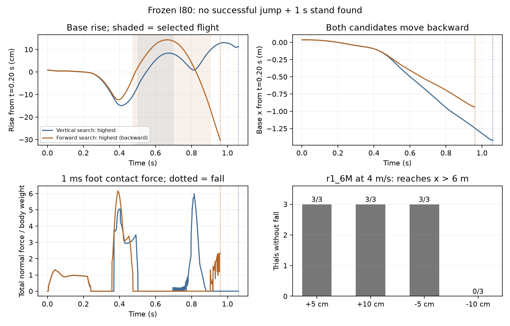
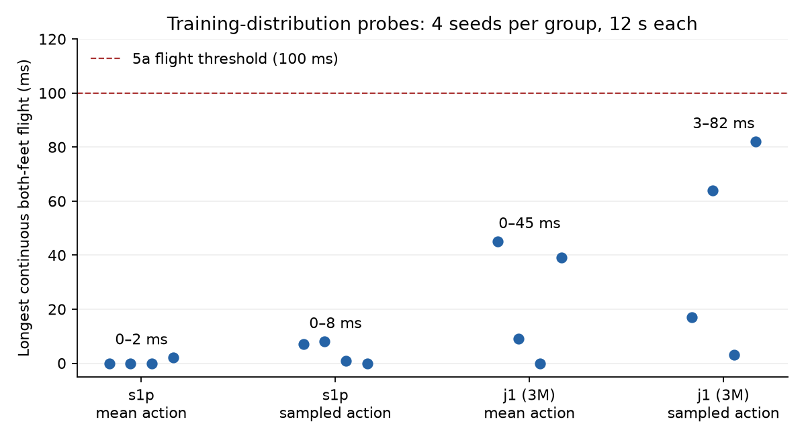

# 199 동결 l80 모델의 점프 가능성 검사

2026-11-04. MuJoCo만 사용한다. 4단계는 달리면서 선회 미달을 기록하고 종료했다(통과 아님).
유지 정책은 l80_w2+l80_r1_6M이다. 이 문서는 5단계 시작의 **비RL 검사**이며 학습하지 않는다.
최신: 감독자가 5a 제자리 +5 cm·100 ms·착지 반경 30 cm·1초 서기, 5b ±15 cm를 학습 전에 확정했다.
아래 과거 제안은 대체됐다. l80_s1p에서 점프 요청 1입력을 추가하는 l80_j1의 최대 8M 계약·스크립트를 준비했고 학습은 시작하지 않았다.
앞의 비RL 1,280후보 미발견 기록과 원자료는 보존한다.

## 실행 전 계약

- 형상 `rev3_l80.json`, 실물화 `realism_robstride_l80.json`, 10 active DOF 동결.
  r1_6M의 환경 옵션(스프링·행동 배율·6 Hz 필터·목표 램프·접촉·모터)을 사용한다.
  평지·무작위화 off·외란 off·초기 몸통 속도 0. 모든 후보를 `RunEnv.step`으로 실행한다.
  내부 `_clamp`와 전류/전압/T-N/열 한계, 지연·래칫·센서 계층을 우회하지 않는다.
- CEM: 좌우 대칭 hip pitch·knee·tail pitch의 웅크림→추진→착지 목표와 구간 시간을 탐색한다.
  좌우 roll/yaw와 tail yaw는 명목값, 목표는 기존 행동 범위·관절 범위로 제한한다.
  정지 초기 자세를 0.20초 유지하고 이후 키프레임을 실행, 마지막 착지 자세를 고정한다.
  최종 성공을 위해 기존 정책의 착지 피드백을 몰래 붙이지 않는다.
- **예산:** 제자리·전진 각각 CEM 최대 2회 초기화 ×10세대×32개 =640후보,
  초기 수동 후보 각 최대 16개, 합계 최대 1,312후보. 각 후보 최대 3.6초 시뮬레이션.
  탐색 CPU 시간 합계 최대 **6,000초**, 명목/별도 시드 재생·계측·단차·검증용 **1,200초**를 남겨
  CPU 총 7,200초 이하로 제한한다. 단일 프로세스 CPU 시간을 누적하며 매 후보 사이 확인한다.
  예산 도달·비유한 상태·계측 오류 시 중단, 자동 연장 없음. 유한 후보 실패는 ‘예산 안에서 못 찾음’이다.
- 탐색 출발은 명목 seed 0. 최선의 착지 포함 후보와 가장 높은/먼 후보를 구분해 저장한다.
  선별된 후보는 명목 동일 재생과 별도 초기 관절 잡음 seeds 9100–9102로 확인한다.
  모든 후보의 점수·결과·CPU 시간과 최선의 1 ms 원자료를 저장한다. 입력 해시 전후 확인.

## 계측과 탐색 목적(5단계 합격 기준 아님)

- 1 ms마다 양발-지면 contact 개수와 접촉 법선력, base 위치/속도/기울기,
  관절 토크·동일 시점 방향별 허용 토크·전류/전류 한계·관절각을 기록한다.
  양발 모두 contact 0인 연속 구간만 비행이다. 시작 틈/접촉 진동을 피하기 위해
  양발 지지를 먼저 확인하고 비행 20 ms 이상·이륙 상승 속도 >0.05 m/s를 별도 표시한다.
- 높이: 출발 base 높이 대비 비행 중 apex 상승과 이륙점 대비 상승을 구분한다.
  거리: 최초 유효 이륙부터 첫 착지까지 base의 전진 변위이며, 출발부터 착지 변위도 함께 기록한다.
  최대 높이/거리만 크고 넘어지는 후보는 착지 가능한 점프로 보고하지 않는다.
- 착지 후 환경 fall 없이 1초 이상 유지 여부와 별도로, 기울기 <0.3 rad·높이 >0.8 h_nom·
  속도 <0.5 m/s·양발 하중 각각 >0.05 체중을 연속 1초 만족하는지를 측정한다.
  이 관측 규칙은 탐색 중 고정한다. 목표 위치 허용치는 결과를 본 뒤 제안하되 사전 합격으로 취급하지 않는다.
- CEM 목적은 비행 높이/시간(제자리) 또는 거리(전진)와 착지 후 생존·정지 유지다.
  환경 보상·벌점은 수정하지 않는다. 성공 후보를 우선 순위로 두되 실패 후보의 apex도 분리 기록한다.
  토크 한계 점유는 같은 부호의 동적 한계 98% 이상 비율, 전류는 DC 등가 A와 i_peak/i_lim 대비다.
  특정 축 포화는 관측된 제한이며 높이의 유일한 원인이나 기구적 최대 높이라고 단정하지 않는다.

## 기존 정책 단차 검사

증거 182의 단일 모서리 형상을 l80 환경에 재사용한다. 2 m 앞에 +0.05/+0.10 m 턱,
−0.05/−0.10 m 낙차, 각 seeds 9200–9202, r1_6M 명령 4 m/s, 최대 10초(총 12판).
6 m 지점 도달·전도·막힘을 구분하고 1 ms 접촉/충격/전류를 기록한다.
이는 기존 달리기의 단차 반응이며 의도한 점프·목표 착지·1초 정지 성공으로 세지 않는다.
증거 182의 과거 rev2 숫자를 l80에 승계하지 않는다.

## 다음

결과를 바탕으로 제자리→전진→턱→낙차 수치 기준을 **제안**한다.
감독자 확인 전 `STAGED_PLAN`의 5단계 수치 기준을 바꾸지 않고 학습 스크립트도 만들지 않는다.

탐색 시작 전 고정한 CEM 세부값: RNG 19901(제자리)/19902(전진), 상위 8/32를 사용,
평균/표준편차 갱신율 0.75, 정규화 표준편차 하한 0.10. 제자리 탐색은 착지 전후 x 변위
±0.25 m를 선호한다(최종 과제 허용치 아님). 목적값은 `10×max(apex 상승,0)+2×비행초`에
전진은 `5×max(비행 전진거리,0)`를 더하고, 제자리는 `exp(-(착지 x 변위/0.25)^2)`를 곱한다.
이어 착지 생존초(최대 1)×5, 정지초(최대 1)×10, 목표 방향/위치와 1초 정지를 함께 만족하면 50을 더한다.
최고 목적값과 최고 높이/거리, 1초 정지 포함 최고 높이/거리를 따로 저장한다.

계측 구현 점검에서 19번째 후보의 NumPy bool JSON 직렬화 오류로 중단했다.
`search_partial.jsonl`의 완료 18개는 그대로 재사용하고 같은 RNG 순서의 19번째부터 재개한다.
오류 로그를 보존했다. 탐색 범위·목적·후보 수는 바꾸지 않았으며 실패한 1회 실행도 총 CPU/후보 예산에 포함한다.

별도 시드 검사 준비 중 `RunEnv.init_seed`가 관절 잡음뿐 아니라 초기 전진 속도 0–0.5 m/s도
추가함을 확인했다. 정지 출발 계약에 맞춰 **증거 전용** reset에서 root 속도를 0으로 지우고
센서/지연 버퍼를 다시 초기화한다. 명목 CEM(seed 잡음 없음)은 영향 없다.
단차의 첫 12판은 이 속도가 섞였으므로 `initial_speed_terrain.jsonl`로 격리하고 판정에서 제외한다.
정지 출발 12판을 다시 실행한다. 범위·기준 변경은 없고 재검사 CPU도 예산에 포함한다.
`eval/search_jump_probe_snapshot.py`는 CEM 당시 소스이며 현재 소스와의 차이는 별도 시드 정지 출발 보정이다.

## 결과: 완성 점프는 찾지 못함

**5단계 통과가 아니다.** 동결 모델에서 제자리 착지·앞으로 착지·착지 후 1초 정지를
만족하는 키프레임은 이번 예산에서 찾지 못했다. 불가능하다는 증거는 아니다.
모든 후보는 실제 `RunEnv.step()`과 `_clamp()`를 거쳤다. 설정에 켜진 motor/friction/thermal/
delay/IMU/encoder를 유지했고, 저장 설정에서 꺼진 battery/backlash를 따로 켜거나 다른 계층을 끄지 않았다.

| 탐색 | 후보 | 유효 양발 비행 관측 | 첫 유효 비행 뒤 발 접촉 | 완주 / 착지 후 1초 정지 | 비행 중 양의 전진 거리 |
|---|---:|---:|---:|---:|---:|
| 제자리 목적 | 640 | 20 | 4 | 0 / 0 | 0 |
| 전진 목적 | 640 | 33 | 9 | 0 / 0 | 0 |

‘발 접촉’은 안전한 착지가 아니다. 유효 비행은 사전 정의한 상승 이륙·20 ms 조건이며,
웅크리는 동안 먼저 발생한 무하중/하강 구간과 착지 뒤 재도약은 구분했다.
제자리의 ±0.25 m 착지 선호 범위 안에서 첫 착지한 후보도 0개다.
전진 탐색에서 가장 덜 뒤로 간 첫 비행조차 −0.0261 m이고, 20 ms 만에 전도로 잘린 구간이라
전진 점프 거리로 보고할 수 없다.

아래는 **새 환경에서 명목 재생**한 값이다. 탐색 중 최고값과 차이는 높이 0.000010 m 미만,
비행 시간은 동일했다. 가장 높은 후보는 전진 목적 탐색의 13번이지만 실제 이동은 뒤쪽이다.

| 후보 | apex 상승: 0.20초 자세 대비 / 시작 1 ms 대비 | 이륙점 대비 apex | 양발 비행 | 비행 x 변위 / 출발 자세→착지 x 변위 | 첫 착지 / 전도 시각 | 착지 이후 발 법선력 피크 |
|---|---|---:|---:|---|---|---|
| 제자리 탐색 최고 높이, 22번 | 0.08366 / 0.07511 m | 0.14496 m | 194 ms | −0.4493 / −0.7104 m | 0.697 / 1.060 s | 877.7 N, 5.997 체중 |
| 전체 최고 높이, 전진 13번 | 0.14279 / 0.13424 m | 0.16575 m | 430 ms | −0.6750 / −0.8640 m | 0.905 / 0.960 s | 344.9 N, 2.357 체중 |

착지 힘은 **첫 발 접촉부터 종료까지** 1 ms 샘플의 양발 법선력 합 최대이며, 몸체 충돌력은 포함하지 않는다.
높은 후보의 작은 착지 힘은 안전하다는 뜻이 아니다. 55 ms 뒤 기울기 조건으로 종료됐다.
0.20초의 base 높이는 약 0.74134 m, 시작 첫 샘플은 0.74989 m, 전체 최고 apex는 0.88414 m다.
명목 자세만 고정한 진단도 0.56초에 몸체 접촉으로 끝났다. 따라서 그 자세를 유지하는 것만으로
착지 후 서 있을 수 있다고 가정하면 안 된다.

선별 4후보(각 목적 최고 점수·최고 높이/거리)의 명목 및 초기 관절 잡음 3시드 재생 **16/16 전도**,
1초 정지 0/16이다. 잡음 재생 중 apex 상승 0.17472 m도 관측했지만 뒤로 이동하며 착지 전에
넘어져 성능으로 채택하지 않는다. 명목 CEM의 0.14280 m는 시험한 범위의 관측 최대이지 기구 상한이 아니다.

### 높이를 제한한 것

최고 높이 후보의 이륙 속도는 `(vx, vz)=(-1.561, +1.891) m/s`, 이륙 기울기 0.321 rad,
첫 착지 기울기 0.692 rad다. 수직 추진 일부를 만들었으나 수평 운동과 몸통 자세를 제어하지 못했다.
제자리 탐색의 최고 **점수** 후보는 비행 없이 상승 속도 항만 커져 0.50초에 실패했다.
사전 목적값을 결과에 맞춰 수정하지 않았으며 이 탐색 목적·낮은 차원의 키프레임·정적 착지 자세가
탐색을 제한했다는 점도 남긴다. 이번 결과를 모터만의 한계로 해석할 수 없다.

아래 토크는 **관절측 모터 출력 토크**다. 스프링·접촉을 합친 총 관절 반력은 아니다.
분모는 피크 토크 샘플의 같은 부호 동적 한계이며, 전류 피크는 별도 시점일 수 있다.
좌우 대칭 명목 재생이라 왼쪽을 대표로 표시한다. 모든 축은 `replay.jsonl`에 있다.
포화 비율은 0.20초부터 첫 유효 이륙 직전까지다.

| 후보 / 축 | 토크 피크 / 그 시점 한계 (N·m) | 전류 피크 / i_peak (A) | 이륙 전 토크 포화 비율 |
|---|---:|---:|---:|
| 전체 최고 / hip pitch | 48.46 / 93.33 | 29.67 / 57.14 | 0 % |
| 전체 최고 / knee pitch | 81.54 / 81.54 | 58.39 / 57.14 | 22.18 % |
| 전체 최고 / tail pitch | 60.00 / 60.00 | 25.42 / 25.42 | 15.64 % |
| 제자리 목적 최고 / hip pitch | 41.76 / 93.33 | 25.57 / 57.14 | 0 % |
| 제자리 목적 최고 / knee pitch | 89.95 / 89.95 | 70.54 / 57.14 | 34.65 % |
| 제자리 목적 최고 / tail pitch | 57.23 / 60.00 | 24.25 / 25.42 | 0 % |

관측된 추진 제약은 우선 **무릎 토크**, 일부 후보의 꼬리 pitch다. hip pitch 포화는 없었다.
전체 최고 후보의 무릎각 범위는 0.63572–1.58615 rad(관절 하한 0.61627), hip pitch는
−0.65610…−0.04339 rad(범위 −1.6…0.9), tail pitch는 −0.73305…0.50611 rad(범위 ±0.8)다.
관절 정지각에 닿아서 더 못 뛰었다고 결론 낼 근거는 없다. 방향·착지 안정성이 먼저 미달이다.

**전류 한계 초과를 숨기지 않는다.** 제자리 최고 후보에서 70.54/57.14=1.23450배가 기록됐다.
`current_audit.json`의 별도 1 ms 재생으로 원인을 확인했다. 0.405초 무릎 속도가 스텝 전
+0.02426에서 스텝 후 −0.13895 rad/s로 바뀌었다. 같은 −89.1326 N·m를 제한 계산 시점의
역구동 상태로 환산하면 57.1429 A지만, 스텝 뒤 구동 효율 분기로 환산하면 70.5428 A다.
기구비 변화도 함께 기록했다. 두 후보 모두 **스텝 전 상태로 환산한 최대 전류는 한계의 1.000000배**,
전압 강제 과전류 플래그는 0이다. 즉 `_clamp` 우회가 아니라 스텝 경계의 속도 부호/효율 분기 차이다.
이번 범위에서는 런타임을 수정하지 않는다. 따라서 ‘실제 전류도 항상 한계 이내’라고 주장하지 않으며,
정확한 전류 합격선을 확정하기 전에 이 불일치를 별도 검증해야 한다.

### 기존 달리기 정책의 단차 반응

정지 출발·관절 잡음 seeds 9200–9202·명령 4 m/s. 증거 182의 단일 모서리 형상은 l80에서도
구동했고, `kind=boxes`로 지정하여 발 아래 지형 높이를 전도 검사에 사용했다.
아래 피크는 첫 발의 x=2 m 경계 통과부터 1초 동안(전도하면 그 시점까지)의 1 ms 측정이다.

| 단차 | 6 m 지점 도달 | 전도 | 발 법선력 피크 범위 (체중 배수) | 최대 전류 / i_peak |
|---|---:|---:|---:|---:|
| +0.05 m | 3/3 | 0/3 | 2.960–4.724 | 1.1332 |
| +0.10 m | 3/3 | 0/3 | 3.588–4.407 | 1.2345 |
| −0.05 m | 3/3 | 0/3 | 3.509–3.777 | 0.9587 |
| −0.10 m | 0/3 | 3/3 | 3.868–4.187 | 1.1433 |

−0.10 m는 1.84–1.98초에 몸체 접촉으로 종료됐다. 높은 턱도 통과했지만 준비된 점프·목표 지점
착지·착지 후 정지를 시험한 것이 아니다. 작은 표본의 평지 접근 결과를 험지 신뢰성으로 확대하지 않는다.



## 과거 5단계 수치 제안 — 아래 감독자 확정안으로 대체됨

**아래 수치는 데이터를 본 뒤 만든 제안이다. STAGED_PLAN에는 반영하지 않았다.**
도달 가능성이 확인된 것은 공중 부양 성분과 주행 중 작은 단차 통과다. 제자리/전진 방향 제어와
1초 정지가 합쳐진 완성 동작의 도달 가능성은 아직 확인되지 않았다. 이를 ‘가능성이 입증된 기준’으로
감독자에게 넘기지 않는다. 다음은 낮은 시작 목표 후보이며, 특히 전진 수치는 승인 전에 비RL 확인이 필요하다.

| 순서 | 수치 제안 | 근거와 남은 간격 |
|---|---|---|
| 5a 제자리 | 정지 자세 대비 base apex +0.05 m 이상, 양발 연속 비행 100 ms 이상, 착지 base xy가 출발에서 반경 0.15 m 이내 | 관측된 첫 비행 상승 0.084/0.143 m·194/430 ms보다 낮아 높이/시간에는 여유가 있다. 그러나 뒤로 0.71/0.86 m 밀린 착지를 제자리로 바꾸는 것은 미해결 |
| 5b 전진 | 정지 출발, 목표 base x=+0.20 m(허용 ±0.10 m), y 허용 ±0.10 m, 양발 비행 중 전진 ≥0.10 m·비행 ≥100 ms | 발을 잠깐 드는 것과 구분되는 작은 이동이다. 양의 비행 전진이 0개여서 **0.20 m는 도달 입증값이 아니며 잠정값**. 비RL 전진 착지 확인 전 확정 보류 권고 |
| 5c 턱 | 높이 +0.05 m, 위 지면에 양발 착지, 지정 목표 base xy에서 반경 0.15 m 이내 | +0.10 m 주행 통과 3/3보다 낮춰 위치·정지 여유를 둔다. 달려 넘는 것과 정지 착지는 다르므로 통과 승계 불가 |
| 5d 낙차 | 높이 −0.05 m, 아래 지면에 양발 착지, 지정 목표 base xy에서 반경 0.15 m 이내 | −0.05 m 주행은 3/3, −0.10 m는 0/3이므로 시작부터 10 cm를 목표로 삼을 근거가 없다. 5 cm도 정지 착지는 미검증 |

공통 제안: 목표 지면 기준 높이 >0.8 h_nom·기울기 <0.3 rad·몸통 속도 <0.5 m/s·
양발 하중 각각 >0.05 체중을 **연속 1초** 유지하고, 그동안 몸체 접촉/전도 0.
위치 허용 범위도 착지부터 이 1초 종료까지 유지한다. 양발/몸체 접촉·힘·전류는 1 ms 원자료를 필수로 한다.
향후 명목 초기 자세 8시드 8/8, 무작위화 20시드 18/20 이상을 후보 기준으로 제안한다.
시드·지형 시작/목표 위치·완료 시간·충격/전류 상한은 새 검증/학습 전에 따로 확정해야 한다.
이번에 관측한 과전류를 허용하도록 상한을 높이지 않는다. 아직 숫자 기준이나 예산이 확정된 학습은 없다.

권고는 **5a의 낮은 높이/비행시간을 출발안으로 검토하되, 착지/서기와 전류 계측 문제를 먼저 해결하고
5b는 비RL 전진 착지를 확인한 뒤 확정**하는 것이다. 이번 결과만으로 점프 학습의 성공 가능성을
보장하거나 모터·관절 범위 변경을 권하지 않는다. 감독자 확인 전 새 탐색·학습을 시작하지 않는다.

## 예산·검증·재현

- CEM 1,280개(각 640), 초기 수동 1개, 오류로 중단된 후보 1회. 최초 완료 18개는 재사용했다.
  추가 탐색·자동 연장은 없다. 후보 수 상한으로 끝냈으며 CPU 한도를 다 쓴 것이 아니다.
- 완료 CEM CPU 120.12초, 오류 전 완료 18개 CPU 1.75초, 초기 probe 약 0.11초.
  별도 재생/명목 고정 2.21초, 단차 첫 검사+정정 검사 8.43+8.96초, 전류 진단 0.39초.
  계측된 실행 합계 약 **142초**. import·최초 오류 후보의 끝부분은 이 합계에 미포함이다.
  유한 검사와 전체 시험(벽시계 약 6초)을 포함해 선언한 2시간 CPU 범위 내에서 종료했다.
- `search.jsonl` 1,280행, `replay.jsonl` 16행, 최종 `terrain.jsonl` 12행.
  `*.npz`는 각 필드 길이가 같은 1 ms 기록이며 `joint_names`, `weight_n`을 포함한다.
  최초 속도 혼입 단차 결과는 `initial_speed_terrain.jsonl`로 분리했고 최종 집계에서 제외했다.
- `search_summary.json`, `terrain_audit.json`, `summary.json`: 동결 설정·정책·args·vecnorm 해시 보존 확인.
  탐색 코드 스냅샷과 재생의 정지 출발 보정도 구분했다. 모델·정책·환경 보상·판정 코드 변경 없음.
- 전체 **234 tests 통과**, 실패/생략 0(`eval/unittest.txt`). 1 ms 비행/충격, 접촉 존재와 무하중 구분,
  초기 공중 구간 제외, 연속 1초, 정지 출발, 계측 hook 복원, l80 단차 높이 검증을 추가했다.
  계측 유무의 25 control steps에서 관측·보상·종료·qpos·qvel·RNG 상태 정확 일치.
  새 시험이 지형 전역 SIZE를 남기던 첫 실행 실패는 test teardown에서 복원해 해결했으며 기존 검사를 약화하지 않았다.
- 5단계 수치 기준이 미확정이므로 `gate_judge.py`에 임의 점프 통과 판정을 추가하지 않았다.
  4단계의 기존 FAIL 판정도 바꾸지 않았다. 여기 수치는 가능성 검사이며 채택 판정이 아니다.

```bash
# 결과를 읽어 표/차트와 입력 해시를 재검증(시뮬레이션·학습 없음)
MPLCONFIGDIR=/tmp/raptor-mpl .venv-sim/bin/python docs/evidence/199-l80-jump/summarize_jump.py
OMP_NUM_THREADS=1 OPENBLAS_NUM_THREADS=1 MKL_NUM_THREADS=1 .venv-sim/bin/python -m unittest discover -s tests
```

실행 도구: `search_jump.py`(선언한 CEM), `replay_jump.py`(선별 후보 재생), `terrain_probe.py`(정지 출발 단차),
`audit_current.py`(스텝 전후 전류 환산 진단), 공통 `jump_probe.py`.
산출물을 덮어쓰지 않도록 탐색·재생·단차 도구는 기존 결과가 있으면 종료한다. 학습 스크립트는 만들지 않았다.

> 1 ms 원시 궤적(`eval/*.npz`, 약 20 MB)은 저장소에 넣지 않았다. 같은 스크립트(`search_jump.py`, `replay_jump.py`, `terrain_probe.py`, `audit_current.py`)로 다시 만들 수 있고, 요약 수치는 `eval/*.json·jsonl`에 있다(감독자, 2026-11-04).

## 2026-11-04 감독자 확정: 5a 학습 전 계약 l80_j1

앞의 5 cm 턱/낙차 제안은 채택하지 않았다. 기존 r1_6M이 +10/−5 cm를 주행으로 통과하므로
그 수치를 점프 기준으로 쓸 수 없다는 감독자 결정이다. 비RL 데이터를 이미 본 뒤 정한 목표이며,
**아직 점프 학습을 시작하지 않은 시점에** 다음을 확정했다. 이전 탐색 실패 기록은 유지한다.

| 단계 | 확정 기준 |
|---|---|
| 5a 제자리 | 정지 출발, 양발 연속 비행 ≥0.10 s, 서 있던 높이보다 base apex ≥0.05 m, 이륙점에서 수평 반경 0.30 m 안에 착지, 이후 연속 1초 서기. 명목 8/8 성공·전도 0, 무작위화 24판 중 전도 ≤2. 가만히 서 있기만 한 판은 성공이 아니며 22/24 이상 완성 동작을 요구한다 |
| 5b 턱/낙차 | +0.15/−0.15 m 각 4/4, 전환 중 양발 공중 구간, 전도 없이 착지 뒤 1초 안정 주행. 접근 명령은 기존 단차 검사와 같은 **4 m/s**로 고정한다. 안정 주행은 1초 동안 전도 없고 평균 전진 속도 3.6–4.4 m/s로 계획한다 |
| 전진 점프 | 5a 통과 후 기준 확정. 이전 +0.20 m 제안은 확정 기준이 아니다 |
| 회귀 | 구성의 서기·걷기·달리기 2/4/6 m/s·switch. 서기/걷기는 l80_w2, 달리기는 l80_r1_6M으로 판정한다. 알려진 3·4단계 미달을 통과로 바꾸지 않는다 |

5a/5b의 착지 충격과 전류는 **1 ms 기록만 하며 수치 상한으로 판정하지 않는다**.
전류 환산의 스텝 경계 불일치는 앞의 진단대로 남아 있다. 이를 해결한 것으로 보고하지 않는다.

### 점프 명령과 정책 구성

- **l80_s1p → 새 l80_j1**을 학습한다. 제자리 점프의 출발/착지는 서기이며, 검증된 서기 정책에서
  시작하면 달리기/선회 습관을 새 과제에 가져오지 않아도 된다. l80_w2+l80_r1_6M은 유지한다.
- 선택 옵션 `RunEnv(jump=...)` / `train_run.py --jump`만 새 과제를 켠다. 기존 관측 55개 뒤에
  `jump request` 1개를 붙인다(총 56). 0은 대기/완료, 1은 요청된 점프와 착지 유지 중이다.
  외부 요청은 `auto_request_s: null`로 자동 요청을 끄고 `env.jump_task.request()`를 한 번 호출한다.
  초기화 때마다 다시 요청할 수 있으며 한 에피소드의 성공 보상은 한 번만 지급한다.
- 학습/시험에서는 2초 이후 서 있는 상태를 0.10초 연속 확인한 뒤 요청한다. 높이 기준은
  그 직전 0.10초 base 높이 평균이다. 요청 **후** 웅크림으로 기준 높이를 낮출 수 없다.
  이는 ‘서서 출발’ 확인이며, 확정한 **착지 후 1초** 기준과 다르다.
- 서기 상태는 기존 기상 gate의 서기 상태와 같은 정의다: 기울기 <0.3 rad,
  목표 지면 위 base 높이 >명목 서기 높이의 80%, 몸통 속도 <0.5 m/s,
  양발 각각 하중 >0.15 체중, 몸체 접촉 없음. 1초의 길이는 1 ms 연속 1,000샘플로 센다.
- gate의 실제 구성은 **w2 대기 → j1 요청/비행/착지/1초 서기 → w2 복귀 1초**다.
  두 정책은 각자의 VecNormalize를 쓴다. 관절 순서·명목 자세·행동 배율이 다르면 조용히 변환하지 않고
  이 gate를 거부한다. 현재 s1p/w2/j1은 같은 배율(hip roll 0.5, hip yaw 0.3)이다.
  시작 root 속도는 0으로 명시하며 `init_seed`가 주는 전진 속도는 제거한다.
- 새 입력은 기존 `expand_inputs` 경로로 actor와 critic 첫 층에 **0 가중치**를 추가한다.
  기존 관측 통계/return 통계는 보존, 새 입력 mean=0·std=1 고정. 좌우 반사에서도 요청 값은 그대로다.
  hold 관측 y/heading의 부호 반전 위치를 명시해 새 요청 입력을 잘못 반전하지 않게 했다.
  대칭 정책을 비대칭으로 읽거나 기존 관측 배열을 함께 바꾸는 점프 재개는 거부한다.
  `getup`이나 온도 관측 `obs_temp`와 점프 옵션의 동시 사용은 이번 최소 구현에서 지원하지 않는다.

### 한 과제 변경과 보상

`j1_inputs.json`에 시작 모델/vecnorm/args, 동결 형상/실물화, 유지 w2/r1_6M의 해시를 고정했다.
런처와 매 체크에서 이를 확인한다. 실제 실행 인수는 `launch_j1.py`가 s1p의 args를 읽어 만들므로
모터·접촉·스프링·지연·필터·관절 범위·행동 배율·기존 보상 가중치가 누락되지 않는다.

바뀌는 과제는 **명령 0의 서기에 점프 요청과 양의 성공 신호를 추가하는 것 하나**다.
에피소드는 이 과제의 완료 기한에 맞춰 20→12초로 한다. s1p의 명령 0, 무작위화 수준 0.5,
외란/초기 관절 잡음/열 옵션은 그대로다. 새 rollout을 위해 `name/init/steps/checkpoint_check`만 지정한다.
기존 학습 때 사용한 `resume_action_std=0.15`를 다시 적용하지 않고 현재 저장된 std 0.0813–0.1361을 유지한다.
**기존 벌점 항 신설·증액·제거는 없다.**

추가 양의 보상은 `jump_task.py`에서 별도로 계산한다.

- 한 공중 구간의 `q = min(비행초/0.10,1) × clip(apex 상승/0.05,0,1)`.
  에피소드 중 이전 최대 q를 넘은 양에만 `10 × 증가량` 지급(합계 최대 10).
  짧은 여러 비행의 시간을 더하거나 한 비행의 높이와 다른 비행의 시간을 섞지 않는다.
- 높이·비행·착지 반경을 같은 사건에서 충족하고 연속 1초 서기를 완료하면 **+30 한 번**.
  반복 뜀/서기로 보상을 무한히 모을 수 없다. 총 추가 양의 보상 상한은 에피소드당 40이다.
- 기존 `norm_reward=True`, 저장 return std **5.336755**를 이어받는다. 입력 확장 전후 critic 예측은
  같고, 새 희소 보상의 가치는 PPO와 return 통계가 적응한다. 별도 critic warm-up은 추가하지 않는다.
- CEM 시연은 사용하지 않는다. 최고 후보조차 뒤로 0.675 m 이동 후 넘어져 성공 시연이 아니다.

### 예산·체크·중단·채택 — 학습 전 고정

- **추가 8,000,000 steps 이하**, 8 envs×1,024-step PPO rollout. 체크 블록은 999,424 steps이며
  최대 8블록 = **7,995,392** 추가 steps. 시작 누적 42,319,872에서 최대 누적 50,315,264.
  남는 4,608 steps는 온전한 rollout이 아니므로 쓰지 않는다. **이번 j1은 자동 연장 없음.**
- 매 블록 뒤 모델/vecnorm/args/progress/initial-policy를 `l80_j1_1M` … `l80_j1_8M`에 보존한다.
  `stage_gates.py jump --quick`으로 명목 seeds **9300–9301**, 무작위화 **9310–9313**를 항상 같은 조건으로
  측정한다(6판, 점프 완료 12초 기한, 성공하면 걷기 복귀 1초 추가). 높이/시간/거리/유지/성공/전도/
  충격/전류를 원시 숫자로 저장하고 `gate_judge.py` 함수로 판정한다. quick은 채택 불가다.
- **kill:** 손실/보상/길이의 비유한 통계, 누락/오류/변경된 입력이면 중단한다.
  50 updates 이상일 때 최근 10개 평균 episode length가 처음 10개의 50% 미만이면 중단한다.
  3블록부터 현재와 2블록 전의 동일 6판을 비교해 성공 수 증가가 없고 평균 q 증가도 **0.05 미만**이면
  2M 정체로 중단한다. 4블록부터 성공 수 0이면 q와 관계없이 중단한다. 8블록 예산 소진도 중단이다.
  첫 비교는 1→3블록이며 학습 전 smoke 결과를 중간 채택선으로 사용하지 않는다.
- quick 6/6 성공이면 전체 5a+회귀를 실행한다. 조기 kill 없이 8블록 예산 종료에 도달한 경우도 전체를 실행한다.
  전체는 5a 명목 **9400–9407(8)**, 무작위화 **9500–9523(24)**로 개발 시드와 분리한다.
  서기/걷기/달리기 2/4/6/switch를 포함해 총 **240 rollout**(상위 외란 기록 조건 포함).
  실패·중복·누락·quick 혼입·1 ms 기록 누락은 `jump_suite_status`가 거부한다.
- 전체 5a+회귀가 통과하면 **5a 후보**로 중단하고 감독자가 채택한다. 반환 메시지에도
  ‘5b 미평가, 5단계 전체 통과 아님’을 표시한다. 실패/예산 종료에서는 미채택·진단 보고, 새 학습 자동 실행 없음.
  체크 스크립트 exit 10은 중단, 그 밖의 비zero는 검사 오류로 학습 중단이다.
- 5b는 고정 기준과 접근 속도만 반영했다. 4 m/s 접근 중 점프 호출/지형 경계/착지 뒤 주행까지의 시험은
  5a의 정지 점프 정책과 다른 전환이라 이번 최소 gate에 섞지 않았다. 5a를 먼저 확인한 뒤 별도 구현한다.

### 준비 검증과 실행

입력 확장 후 실제 s1p 체크포인트의 요청 0/1 포함 **8,192 관측에서 actor 평균·critic 값 최대 오차 0**,
탐색 std 동일(`eval/j1_init_compat.json`). 학습 전 초기 정책의 quick 6판은 **요청 6/6 전달, 성공 0/6**이다.
모델을 학습한 것이 아니라 0 가중치 확장본을 임시 디렉터리에 저장해 gate 경로를 점검했다.
초기 정책이 아직 점프하지 않는 결과를 학습 실패나 기준 완화 근거로 쓰지 않는다.

준비 중 최초 구현은 요청 전에도 1초 연속 서기를 요구해 명목 2판 모두 요청이 막혔다.
이는 감독자가 확정한 착지 후 유지 조건을 출발 확인에도 잘못 덧붙인 것이어서 출발 확인을 0.10초로
고쳤다. 최초 결과는 `eval/j1_prepare/`와 `j1_init_compat_prehold1s.json`에 보존했다.
**착지 후 1초와 감독자 확정 합격선은 바꾸지 않았다.**

기존 s1p/w2/r1_6M 각 명목/무작위화 150 control steps, 합계 **6 rollout·900 steps**에서
수정 전후 관측·행동·보상·종료·qpos·qvel이 정확히 같았다(`eval/jump_default_compat.json`).
전체 **249 tests 통과, 실패/생략 0**(`eval/unittest_j1.txt`), 새 기능 15개 focused 시험은 `eval/j1_unit_final.txt`에 저장한다.
실제 초기 정책의 최종 smoke 원자료/판정은 `eval/j1_prepare_ready/`에 있다.
1 ms npz는 `.gitignore`의 기존 직접 경로와 새 하위 디렉터리 패턴으로 **로컬에만** 남긴다.
JSON/JSONL 판정·집계와 스크립트만 추적한다. `sim/rl/runs`에는 이번 준비 작업에서 쓰지 않았다.

```bash
# 감독자 실행. 이 작업에서는 실행하지 않았다.
bash docs/evidence/199-l80-jump/train_l80_j1.sh > sim/rl/runs_l80_j1.log 2>&1

# 실행 인수/초기화 해시만 확인: 학습 없음
bash docs/evidence/199-l80-jump/train_l80_j1.sh --print-command

# 최종 5a + 정책 구성 회귀(학습 종료 후)
.venv-sim/bin/python sim/rl/stage_gates.py sim/rl/runs/l80_j1 jump \
  --walk sim/rl/runs/l80_w2 --run sim/rl/runs/l80_r1_6M \
  --jump-traces docs/evidence/199-l80-jump/eval/j1_final_raw \
  > docs/evidence/199-l80-jump/eval/j1_final.jsonl
.venv-sim/bin/python sim/rl/gate_judge.py docs/evidence/199-l80-jump/eval/j1_final.jsonl
```

학습 스크립트는 기존 `l80_j1` 디렉터리가 있으면 덮어쓰지 않고 종료한다.
gate도 같은 이름의 raw trace를 덮어쓰지 않는다. 자동 체크의 block별 폴더와 최종 평가 폴더는 분리했다.

> **감독자 메모 (Claude, 2026-11-04):** `l80_j1` 시작 로그에 `widened command inputs [6, 7, 8] std [0.001, 0.001, 0.001]`가 찍혔다. j1은 이동 명령이 늘 0이라 이 입력은 학습 내내 0이고 첫 층 가중치도 0이므로 동작에는 영향이 없다. 이 점프 정책에 나중에 이동 명령을 주려면 `widen_command_inputs`로 정규화를 다시 넓혀야 한다.

## j1 중단 뒤 비학습 진단 — 실행 전 범위 (2026-11-04)

저장된 1/2/3M quick 원자료를 같은 6개 시드로 재판정하고 계약·추가 steps·마지막 모델 해시를 확인한다.
진단은 s1p와 j1 각각 명목 정책 출력/저장 Gaussian 탐색 출력, seeds 9600–9603의 12초씩
총 16판이다. 무작위화·외란·명령 0은 j1 학습 분포를 유지하고 정책/정규화는 동결한다.
s1p에는 요청 입력이 없으므로 동일한 점프 계측기를 붙이고 정책에는 기존 관측만 준다.
각 j1 상태에서 다른 관측을 고정한 요청 0/1 출력 차이, 1 ms 비행·높이, 요청 시각과 항별 보상을 기록한다.
추가로 기존 CEM 최고 높이 후보를 명목 조건에서 6 Hz/필터 해제 각 1회 재생한다(재탐색 아님).
총 CPU 30분 이내, 새 학습·gate 합격선 변경 없음. 실패/미발견을 불가능으로 해석하지 않는다.
요약은 `eval/j1_diagnosis/`, 1 ms npz는 그 아래 로컬에만 저장한다. 이 개발 시드는 채택 판정에 쓰지 않는다.


## j1 결과와 진단 (2026-11-04)

**j1 미채택. 선언대로 3블록에서 중단했다.** 저장 quick JSONL을 `gate_judge`로 다시 판정한
결과는 `eval/j1_diagnosis/quick_*_judge.txt`, 수치·계약·해시 확인은 `summary.json`에 있다.

| 블록 | 실제 추가 steps | 같은 6판 성공 | 평균 q | 전도 | 선언에 따른 결정 |
|---|---:|---:|---:|---:|---|
| 1 | 999,424 | 0/6 | 0 | 0 | 계속 |
| 2 | 1,998,848 | 0/6 | 0 | 0 | 계속 |
| 3 | 2,998,272 | 0/6 | 0.026777 | 0 | 1→3 성공 수 증가 없음, q 증가 <0.05로 중단 |

세 블록 모두 명목 9300/9301, DR 9310–9313이다. 최종 누적 **45,318,144**이고,
model/vecnorm/args는 `l80_j1_3M` 스냅샷과 해시가 같다. 8블록 상한 7,995,392 중
**4,997,120 steps를 쓰지 않았다**. 학습 손실·보상 통계는 유한하며 episode length는
585.79–600 steps, 첫/마지막 10 updates 평균 597.747/594.235여서 길이 붕괴 중단이 아니다.
조기 kill이므로 전체 5a+회귀 평가를 실행하는 조건에 이르지 않았다. 실패한 기준을 바꾸지 않았다.

### 요청 입력과 실제 탐색

`diagnose_j1.py`는 정책/정규화를 갱신하지 않았다. 학습과 같은 무작위화 수준 0.5·외란·초기화에서
각 4개 seed(9600, 9601, 9602, 9603 순서), 12초를 재생했다. 아래 각 칸은 그 순서의 에피소드별 값이다.
이는 실제 학습 trajectory 전체를 복원한 성공률이 아니라, 저장 정책으로 그 분포를 짧게 다시 뽑은 결과다.
s1p의 계측용 요청은 정책 입력에 넣지 않았다. j1은 요청 전부터 자기 정책을 쓴 학습 조건이며,
w2에서 넘겨받는 quick gate와 시작 상태가 다르다.

| 정책·출력 | 최장 양발 비접촉 ms (1 ms 접촉 로그) | 비행 중 최대 상승 cm | 요청 수락 시각 s |
|---|---|---|---|
| s1p 평균 출력 | 0 / 0 / 0 / 2 | — / — / — / 2.810 | 2.001 / 2.001 / 2.001 / 2.037 |
| s1p Gaussian 탐색 | 7 / 8 / 1 / 0 | 0.005 / 1.912 / 0.692 / — | 9.010 / 4.059 / 4.292 / 2.116 |
| j1 평균 출력 | 45 / 9 / 0 / 39 | 3.688 / 1.228 / — / 3.576 | 2.282 / 2.005 / 2.001 / 2.001 |
| j1 Gaussian 탐색 | 17 / 64 / 3 / 82 | 0.509 / 6.460 / 1.686 / 7.063 | 2.139 / 2.469 / 2.841 / 2.915 |

높이 최대와 시간 최대는 여러 비행 중 각각의 최대일 수 있으므로 이 표로 합격 판정하지 않는다.
원자료 요약은 각 비행의 높이·시간을 함께 담고, gate는 같은 사건에 대해서만 판단한다.
**16/16판 12초 생존, 전도 0, 100 ms 비행 0, 완성 점프 0.** j1 탐색 중 64 ms·6.46 cm와
82 ms·7.06 cm가 나왔다. ‘전혀 뜨지 않는다’가 아니라 짧은 비행에서 멈춘 상태다.

- j1 저장 요청 입력은 **FrozenRMS mean 0, std 1.000000005**. 요청 0/1은 정규화 뒤에도 0/1이고
  ±10 clipping에 닿지 않는다. actor/critic 첫 층 요청 열 L2 norm은 **0.2723/0.5938**로 학습됐다.
- 같은 관측에서 요청만 0↔1로 바꾼 4,800 상태의 clipped action 차이 RMS는 에피소드별
  **0.00967–0.01112**, 배율을 적용한 목표각 차이(관절 stop 전) 절대 최대 **0.03587 rad**. 입력을 무시하지 않지만 반응은 작다.
  s1p에는 요청 입력 자체가 없다(0 가중치 확장 전후 동일성은 앞 절의 8,192 관측 검사).
- 저장 Gaussian std는 s1p **0.0813–0.1361 → j1 0.0414–0.1169**. 새 실행에서 임의로 키우지 않는다.
- 이동 명령의 정규화 값과 첫 층 해당 열은 실제 j1 파일에서도 **0**이다. 감독자 메모의
  `[6,7,8] std=0.001` 출력은 현재 명령 0 과제의 원인이 아니다.
- `auto_request_s=2`는 즉시 강제 호출이 아니라 0.10초 연속 서기가 확인된 뒤의 요청이다.
  s1p 탐색에서는 9.010초까지 지연돼 초기 학습 기회가 짧아질 수 있다. 최종 j1 탐색 4판은
  2.139–2.915초에 요청되어 9.085초 이상 남았다. 모든 판이 시간 제한까지 생존했으므로
  현재 결과를 조기 종료나 12초 자체의 부족만으로 설명할 수 없다. 초기 학습 전 기간의 요청 분포는 미계측이다.



### 보상 크기와 필터

보상은 기존 항에 `CONTROL_DT=0.02`를 곱하고 점프 bonus를 별도로 더한다.
아래는 j1 Gaussian 탐색 4판의 **요청 활성 시간으로 가중한 보상/초**다.

| 항 | 가중치 | 실제 보상/초 | 해석 |
|---|---:|---:|---|
| track_lin / track_yaw | +5 / +4 | +4.537 / +3.552 | 가만히 서도 큰 양의 보상을 받음 |
| stand / stand_support | −5 / −5 | −0.066 / −0.390 | 양발 하중이 없으면 각각 −5/초, 합계 −10/초 |
| hold | −3 | −0.567 | 위치/heading 이탈 비용, 착지 반경 유지와 관련 |
| slip_lin | −5 | −0.772 | 지지 중 발 미끄럼 비용, 비행 때는 0 |
| action_rate | −2 | −0.159 | 필터 뒤 action 변화 비용 |
| gait | −8 | **0** | 명령 0에서는 schedule이 꺼짐. 이번 원인으로 볼 수 없음 |
| lin_vel_z / height | −0.5 / −20 | −0.015 / 0 | 상승 속도 비용은 남아 있지만 이 표본에서는 작음 |

j1 탐색 각 판의 비행 bonus 합은 **0.0108 / 6.4 / 0.0903 / 8.2**, 완료 +30은 모두 0이다.
요청 이후 평균 총 보상 61.790 중 비행 bonus는 3.675, 기존 항은 58.115이다(할인 전).
완전한 비행 진행 +10, 완료 +30은 충분히 크지만, 접촉 중 웅크리기/밀어내기에는 양의 점프 신호가 없고
양발 이탈 후에야 진행 bonus가 생긴다. 큰 상한이 곧 잦은 학습 신호를 뜻하지 않는다.
`norm_reward=True`, 저장 return std는 **5.3368→5.2365**다. 최대 +10/+30은 현재 std 기준
약 +1.91/+5.73이며 정규화로 사라진 신호가 아니다. 단순 비교상 100 ms 양발 무하중 비용은 −1,
비행 bonus 상한은 +10이므로 두 벌점만이 실패의 유일한 원인이라고 확정하지 않는다.

기존 CEM의 **forward score 후보 13**을 다시 재생했다. 첫 선택 코드가 `extreme` 후보 422를
읽은 오류는 `eval/j1_diagnosis/cem_selector_error.json`에 남기고 제외했다. 후보 13을 확인하는
assert를 넣어 2회 추가 재생했다. 총 실제 진단은 정책 16판+CEM 4회, CPU **56.42초**(30분 이내)다.

| 같은 CEM 키프레임 | base 상승 | 첫 양발 비행 | 결과 |
|---|---:|---:|---|
| 기존 6 Hz | +14.279 cm | 430 ms | 뒤로 0.675 m, 0.960초 전도 |
| 필터 해제만 | +23.283 cm | 전도 전까지 287 ms | 착지 관측 전 0.800초 전도 |

crouch 126.3 ms, push 116.0 ms, extension 160.9 ms이다. 6 Hz 필터의 control-step alpha는
0.5295이고 고정 계단 입력의 100 ms 응답은 97.69%(90%까지 80 ms)다. 실제 키프레임의 변화에는
지연이 있지만 6 Hz로 14 cm 비행이 재현되므로 이것을 점프 불가의 원인으로 단정할 수 없다.
필터 해제는 더 높은 apex와 더 이른 전도를 함께 냈으므로 다음 변경으로 고르지 않았다.

같은 6 Hz CEM 물리 궤적을 j1 가중치로 계산하면 stand/stand_support **−2.8/−2.8**,
hold −1.017, slip_lin −1.678, action_rate −0.031, gait 0이었다. 두 무하중 벌점의 합 −5.6이
가장 큰 제거 가능한 과제 충돌이다. 이 보상 계산의 `flight`는 발 하중 0.15 BW 문턱을 쓰는
20 ms 판정(합계 0.56초)이며, gate의 1 ms 접촉 없음 430 ms와 구분한다.
CEM은 요청 2초 전의 원래 키프레임 재생이고 실제 j1 점프 bonus를 받은 성공 시연이 아니다.
후진·착지 실패까지 감안하면 시연 그대로를 정답으로 가르칠 근거도 없다.

## 다음 한 단계 제안: l80_j2 — 학습 전 계약

**제안은 하나: 요청 후 유효 착지 전까지 `stand`와 `stand_support` 음의 비용만 제거한다.**
`jump.suspend_stand_penalties=true`로 두 항을 0으로 만들고, 유효 착지 순간부터 원래 비용으로
돌려 1초 서기를 학습한다. 요청 전/완료/전도 뒤에도 원래 비용이다. hold·slip_lin·action_rate·gait와
다른 항, +10/+30 bonus, 요청 2초/서기 guard, 12초 길이, 탐색 std, 6 Hz 필터, 물리/명령/배율은 그대로다.
일반 환경과 기존 jump 설정에서 이 옵션은 **기본 false**다. 새 벌점이나 벌점 증액은 없다.
게이트 조건·계측·5a 성공선은 바뀌지 않는다. 이것이 충분한지 아직 검증하지 않았으며
작은 요청 반응·희소 보상·착지 제어가 계속 한계일 수 있다.

- 시작: **`sim/rl/runs/l80_j1/model.zip` (추가 3블록, 누적 45,318,144)**와 같은 vecnorm/args.
  `launch_j2.py`가 args 전체를 상속하고 위 flag와 실행 이름/경로/예산만 바꾼다.
  `j2_inputs.json`에 시작/유지 정책, 동결 파일과 관련 실행·gate 코드의 해시를 고정한다.
  이 실험은 중단된 j1의 연장이 아니라 보상에서 충돌을 제거하는 새 방법 비교다.
- 예산: **추가 4,000,000 이하**, 실제 **999,424×4=3,997,696**, 최종 누적 상한 **49,315,840**.
  남은 2,304 steps는 쓰지 않는다. **자동 연장 없음.**
- 체크: 매 999,424 steps 같은 명목 **9300–9301**, DR **9310–9313**, quick 6판.
  원자료/판정/시드/steps/결정을 `eval/l80_j2/` 및 run의 `jump_checks.json`에 보존한다.
  j1과 같은 `gate_judge` 및 `jump_episode_ok`를 쓴다. 새 높은 학습 보상은 채택 지표가 아니다.
- kill: 비유한 loss/보상/길이, 입력·설정·해시·체크 오류면 중단. 50 updates부터 최근 10개
  episode length 평균이 최초 10개의 50% 미만이면 중단. **3블록부터 2블록 전과 비교해 성공 수 증가가
  없고 q 증가 <0.05면 중단**, 4블록 성공 0이면 중단, 4블록 예산 소진 중단.
  j1의 과거 3M을 이 새 실험의 1M처럼 섞지 않는다. 첫 정체 비교는 j2 1→3블록이다.
- 채택: quick 6/6 또는 조기 kill 없이 4블록 예산 끝까지 간 경우 전체 **240 rollout** 5a+회귀.
  명목 **9400–9407 8/8**, DR **9500–9523 ≥22/24·전도 ≤2**, w2 서기/걷기,
  r1_6M 속도 2/4/6, 기존 정책 구성 switch와 점프의 w2 복귀를 모두 판정한다.
  `jump_suite_status` 전체 PASS만 5a 후보로 중단하고 감독자가 채택한다. **5b/전진/5단계 전체 통과 아님.**
  실패·정체·예산 종료 시 미채택과 원인 보고, 다음 학습 자동 실행 없음.
- 변경은 비용의 제거이므로 critic 목표 값은 달라질 수 있다. 기존 norm_reward/return 통계를
  이어받아 PPO에서 적응시키고, critic warm-up이나 표준편차 재설정은 추가하지 않는다.

```bash
# 감독자 실행. 이번 작업에서 학습은 시작하지 않았다.
bash docs/evidence/199-l80-jump/train_l80_j2.sh > sim/rl/runs_l80_j2.log 2>&1

# 계약/해시/인수만 검사(학습 없음)
bash docs/evidence/199-l80-jump/train_l80_j2.sh --print-command
```

검증: 전체 **254 tests 통과, 실패/생략 0**(`eval/unittest_j2.txt`), focused 19개 통과
(`eval/j2_focused_tests.txt`). 꺼진 기본 경로의 s1p/w2/r1_6M 명목/DR **6판·900 control steps**는
기존 baseline과 관측·행동·보상·종료·qpos·qvel이 정확히 같았다(`eval/j2_default_compat.json`).
켜진 옵션의 동일 공중 상태에서도 물리/관측/점프 결과는 같고 보상 차이는 제거한 두 비용과 일치했다.
기존 j1 보너스·성공 판정과 요청/착지/완료/전도 경계, 4M 예산/정체 규칙을 시험했다.
1 ms raw npz는 기존 ignore 아래 로컬 전용이며, 새 모델 생성이나 `sim/rl/runs` 쓰기·학습은 하지 않았다. 실행 전 검사에서 25개 입력/코드 해시와
계약의 인수 차이를 확인했다(`eval/j2_contract_check.json`, `eval/j2_launch_command.txt`).
