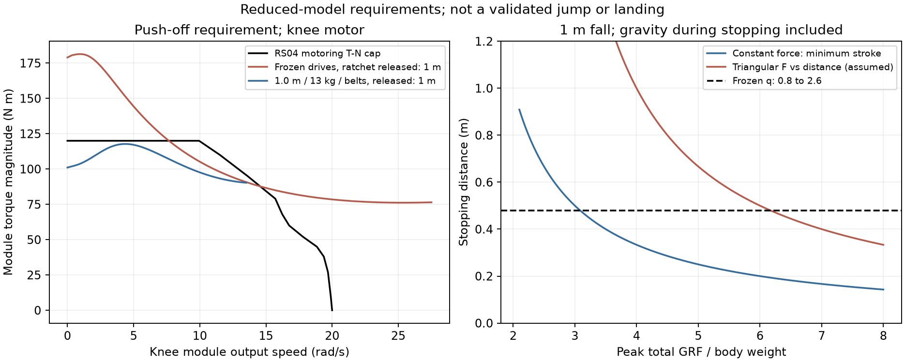
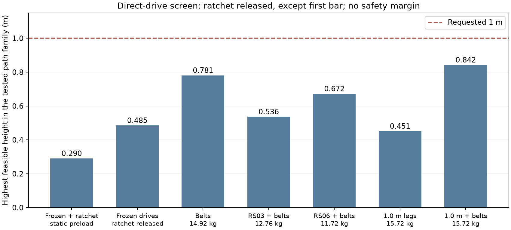

# 1 m 수직 점프 비RL 가능성 검사

**후속 사용자 결정(2026-11-05): 형상 동결 유지, 현재 기구로 0.20 m → 0.30 m. 아래 설계 변경/접지 중 래칫 해제 제안은 미채택이다. [j4 계약](../199-l80-jump/README.md)을 따른다.**

2026-11-05 사용자 요구: 서 있는 base/CoM 높이에서 apex +1 m. 이는 기존 5a의 사후 기준 변경/통과가 아니라 새 요구다. DESIGN_FREEZE_PLAN §2 원칙 3에 따른 설계 재검토 자료이며, 동결 형상 변경 결정이나 학습 승인은 아니다.

## 실행 전 계약

- 저장소 자료만 사용한다. 외부 조회 없음. 모터 수치의 원천은 `docs/design/motor_candidates.json`, 기구는 `sim/rl/rev3_l80.json`, 모터 적용 방식은 `sim/rl/realism.py`다. 그 밖의 설계 수치는 가정으로 표시한다.
- 계산: 좌우 대칭 평면, 발목=-무릎, 두 유효 링크(허벅지+발등뼈, 정강이), 점질량 수직 운동. 고관절과 지면 반력선의 수평 거리 5 cm 가정(0/10 cm 민감도). 서기 무릎 1 rad, 출발 무릎 1.4/1.8/2.0/2.2/2.6, 이륙 0.65/0.8/1.0/1.2/1.4 rad. 일정 수직 가속도. 관성은 저장소의 모터 출력 반사 관성을 포함하되 다리 분포 관성/몸통 회전/접촉 제어는 생략한다. 이 계산의 한계는 전신 운동의 불가능 증명이 아니다.
- 변형: 벨트/4절 대체 상수비 0.3–1.6, 저장소의 곡선 있는 모터 RS02/03/04/06 중 RS02는 곡선 없어 별도 참고만, 질량 4–15 kg, 길이 1/1.25/1.5배, 저장 스프링 효율 0.8 가정. 모든 후보는 동일 계산식으로 평가한다.
- 계산/짧은 MuJoCo 검사 총 CPU 30분 이하, wall 60분 이하. MuJoCo는 동결/고관절·무릎 증속/긴 다리의 최대 3구성, 각 16후보×4세대(CEM) + 기존 최고 후보 재생 1회, 최대 195판. RNG 20001, 같은 원래 키프레임 범위·목적 사용. 1 ms raw npz는 로컬 전용, 요약 JSON/JSONL 저장.
- 중단: 예산 도달·비유한 상태·동결 입력 해시 변경 시 즉시 중단. 연장 없음. 탐색 실패는 ‘미발견’이다.
- 후보 선별: 계산의 전 구간 T-N/전류·전압 범위 안에서 높이 요구를 만족해야 계산상 가능. 전신 채택은 하지 않는다. 짧은 재생은 상승/비행/착지/전도를 분리하고, 기존 `gate_judge.py`의 5a PASS나 1 m gate PASS로 표시하지 않는다. 1 m gate는 아직 없다.
- 학습·보상·sim 런타임·동결 파일은 수정하지 않는다. 변형 JSON은 이 폴더의 `configs/`에만 둔다. 기존 단계의 성능은 변형에 승계하지 않는다.

모델 구현 검증 중 보완(변형 CEM 실행 전): 4절은 RunEnv의 실제 300점 표와 같은 band 평균 N²를 그대로 사용한다. 빠른 RS06을 기존 RS04 벨트에 끼운 결과만으로 배제하지 않도록 RS03/RS06의 고유 벨트도 0.3–1.6 및 2/2.5/3으로 별도 선별한다. 긴 다리와 감량의 조합도 같은 1 m 전 구간 한계로 계산한다. 이는 탐색 범위 추가이며 1 m 요구·통과/중단 조건은 바꾸지 않는다. 전체 CPU 30분 상한은 유지한다.

## 결론

**1 m 상승에 필요한 에너지 자체는 계산상 만들 수 있다. 그러나 동결 l80의 완성 1 m 수직 점프·착지는 미발견이며, 어떤 변형도 전신 MuJoCo에서 1 m를 검증하지 못했다.**

**기존 래칫 스프링을 해제하는 추가 변경을 전제한** 축약 모델에서 직접 구동의 1 m 이륙과 1 m 낙하 흡수를 모두 만족한 조합은
**다리 1.0 m, 총질량 13.0 kg, hip pitch 벨트 0.4, 무릎 상수비 벨트 0.7, 기존 RS04**다.
추진 전류 여유 1.9%, 착지 전류 여유 1.5%뿐이고, 몸통 회전·다리 분포 관성·접촉 제어를 생략한
계산이다. 기존 래칫을 그대로 두면 이 조합도 실패한다. 즉 설계 승인 후보가 아니라 전신 역동역학으로 기각 여부를 먼저 확인할 후보다.
모터 구매비를 늘리지 않는 직접 구동 후보 중 이번 표에서 선별된 조합이지, 제작비 최저를 입증한 것은 아니다.

스프링도 약 **270 J 선충전**과 별도 구동 분리·래치·착지 흡수장치를 가정하면 에너지 모델에서 1 m다.
단순히 기존 무릎 스프링 상수를 올리는 안이 아니다. 준비 시간을 써서 에너지를 저장하고, 모터 속도 한계와
분리해서 방출하는 새로운 기구다. 실제 배치·래치 강도·발 하중·재착지 제어는 미검증이다.

반대로 **14.3 cm를 동결 설계의 물리적 상한으로 볼 근거도 없다.** 이번 짧은 탐색에서는
동결형의 종료 전 base 상승 40.68 cm, CoM 상승 47.15 cm가 관측됐다. 기울기 전도로 조기에
종료돼 **apex도 착지도 관측하지 못한 실패 궤적**이다. 이 수치를 완성 점프 높이로 쓰지 않는다.
따라서 현 단계의 결론은 ‘1 m가 불가능’이 아니라 ‘특정 1 m 추진 경로는 구동 한계를 위반하고,
완성 점프의 근거는 아직 없으며, 새 요구에 맞춘 기구 검토가 필요’다.

## 자료와 계산 범위

인용은 아래 저장소 파일만 사용했다. 표의 제조사 수치는 해당 저장소의 전사본이며 이번에 새로 검증한 사양이 아니다.

| 원천 | 이 검사에서 사용한 내용 |
|---|---|
| [동결 기구](../../../sim/rl/rev3_l80.json), [동결 결정](../../DESIGN_FREEZE.ko.md) | 다리 0.170/0.321/0.309 m, 4절 a/b/c=0.154/0.261/0.093 m, β=115.7°, branch −1, hip 벨트 0.7 |
| [모터 후보](../../design/motor_candidates.json) | RS03/04/06 48 V T-N 곡선, 모듈 질량·전류·저항·관성. 곡선은 원본 그림의 약 ±3% 눈금 전사라는 기존 한계 |
| [실물화 코드](../../../sim/rl/realism.py), [l80 설정](../../../sim/rl/realism_robstride_l80.json) | 전압/전류 교집합, 구동/역구동 효율, DC 등가전류, band 평균 N² 관성, 마찰. battery/backlash OFF 유지 |
| [RunEnv](../../../sim/rl/run_env.py), [기존 평면 모델](../../../modeling/design_r02.py) | 4절 실제 300점 표·관절 범위, 발목=-무릎의 두 링크 근사와 가상일 |
| [증거 199](../199-l80-jump/README.md), `../199-l80-jump/eval/search.jsonl` | 원래 키프레임 CEM, 관측 높이와 착지 실패. 이번 검사도 `RunEnv.step()`·`_clamp()` 재사용 |
| [증거 197](../197-l80-run/README.md) | r1_6M 6 m/s 10분 주행, 권선 118.2°C·감액 없음은 **동결형만의** 결과 |

실제 MuJoCo 질량은 **14.9193 kg**이다. 요구의 대략 계산은 15 kg, g=9.81 m/s²다.
모듈만 합해 **9.665 kg**, 저장소 drive_kg 합은 **0.90 kg**다. 프레임·전자장치·배터리·꼬리·발 등은
별도로 남아야 한다. ‘질량을 8 kg으로 낮추면 된다’는 계산은 기존 부품 구성으로 실현 가능한 안이 아니다.

평면 모델은 몸통/CoM와 hip의 높이 차이가 일정하다고 가정한다. 두 링크 유효 길이는
A=허벅지+발등뼈=0.479 m, B=정강이=0.321 m이다. toe/COP의 세부 형상은 생략한다.
반력선과 hip의 수평 거리 e=0.05 m는 **가정**이며 e=0/0.10도 별도로 계산했다.
몸통 자세를 정적으로 유지할 수 있다고 가정하지만, hip 토크를 0으로 지우지는 않았다.
꼬리 제어와 hip roll/yaw 동역학, 다리 분포 관성, 몸통 각운동량, 충돌, 관절 유격, 구동 지연은
이 계산에 없다. 발 양쪽에 수직 힘이 절반씩 걸리고 수평 힘은 0이다. 깊은 웅크림의 균형·충돌도 보장하지 않는다.

모터 반사 관성과 마찰은 포함한다. 실제 `RunEnv`와 같은 4절 N(q) 및 **band 평균 N²**를 사용했다.
실제 기구의 자세별 J·N²와 J·N·N′·q̇²로 바꾼 결과가 아니다. 이 근사는 저장소 실물화 계층의 기존 한계다.
가속도는 시작부터 일정하며 끝에서 접촉을 끊는다. 가속도 완화나 최적 힘 분포를 찾은 것이 아니다.
그러므로 아래 ‘최고 높이’는 **시험한 경로 집합에서 한계를 만족한 최고 계산값**이고 물리적 상한/실제 도달 보장이 아니다.

## 기존 래칫 스프링을 별도로 반영한 검사

**아래 직접 구동 표·높이 선별은 래칫을 해제한 비교 기준이다. 동결형의 완전한 모델이 아니다.**
마지막 검토에서 직접 구동 식의 수동 스프링 누락을 발견해 `ratchet_check.py`로 별도 보완했다.
MuJoCo 195판은 처음부터 원래 래칫을 유지했으며 이 누락의 영향을 받지 않는다. 수치 기준을 바꾼 것이 아니다.

r1_6M 인수는 `knee_pitch: [500, 0.956, uni+, ratchet]`다. 실제 `RunEnv`는 질량으로 스케일해
다리당 **656.659 N·m/rad**를 쓴다. 래칫은 현재 각도를 다음 0.02 rad 이빨로 올림해 무변형으로
연결하고, 발이 무부하가 되면 남은 저장 에너지를 버리며 풀린다. 0.956 rad를 고정 휴지각으로 보고
마음대로 충전 에너지를 주면 안 된다. 자동 연결은 선충전 캐터펄트의 래치와 다르다.

휴지각 q=1.00 rad에 연결됐다고 가정하고 정적으로 천천히 웅크리면,
첫 무릎 모터 한계는 **q=1.1566 rad**, 요구 **86.632 N·m > 허용 86.558 N·m**다.
직전 q=1.1564의 저장량은 **전체 16.06 J / 다리 8.03 J**이며 중력 하강 도움은 4.50 J다.
이 준비 과정에서 먼저 닿는 것은 역시 **무릎 토크/전류**다. 동적 반동·발 무부하·재연결은 다른 결과를 낼 수 있어
이 정적 충전량을 모든 동작의 에너지 상한으로 쓰지 않는다.

이 충전 가능한 웅크림에서 출발하고 수동 스프링 토크를 실제로 빼 준 동일한 일정 가속도 식의 선별 최고값은
**0.290 m**다(0.005 m 높이 간격). 반면 1 m 경로는 무릎 모듈 요구 최대 **338.84 N·m,
161.35 A DC**, 즉 전류 한계 **2.824배**로 미달이다. 준비를 무시하고 q=2.6까지 휴지각 1.0의 스프링을
이미 압축했다고 놓으면 **1681 J**를 몰래 선충전한 셈이다. 그 에너지를 제공할 준비 경로가 없으므로 그런 해는 채택하지 않는다.

13 kg·긴 다리·벨트 조합도 **기존 래칫을 유지한 채 같은 경로를 강제하면 실패**한다.
계산상 1 m라고 표시한 조합에는 추진/착지 시 래칫 해제 또는 수동 탄성 재설계가 추가로 필요하다.
기존 래칫을 연결한 3 BW·0.5 m 착지 경로는 약 **1211 J**의 스프링 저장을 요구해,
낙하에서 얻는 에너지보다 훨씬 큰 에너지를 모터가 더 넣어야 한다. 자연스러운 착지는 그 경로대로
진행하지 않고 더 일찍 반동하거나 다른 힘/자세를 쓸 것이다. 동결형의 충돌/착지 성공은 전신 재생으로만 판정한다.

## 1 m 추진 요구와 먼저 닿는 한계 (래칫 해제 비교 기준)

서기 높이 z_s, 이륙 높이 z_t, 목표 상승 H라 하면 비행 상승은 h_f=H−(z_t−z_s),
이륙 속도 v=√(2gh_f)다. **이륙 높이가 서기 높이와 같을 때** 1 m에는 4.429 m/s,
15 kg의 이륙 운동에너지에는 147.15 J가 필요하다. 서기 높이와 이륙 높이를 섞으면 안 된다.
원래 최고 CEM 후보의 실제 이륙 v_z는 **1.891 m/s**, base 상승은 서기 대비 0.1428 m,
이륙점 대비 0.1658 m였다. ‘1.7 m/s’는 14.3 cm를 그대로 탄도 높이에 넣은 근사다.

기하와 힘 계산식은 다음과 같다. q는 무릎, θ는 hip 각이다.

```
z(q) = sqrt(A² + B² + 2AB cos(q) − e²)
θ(q) = atan2(e,z) − atan2(B sin(q), A + B cos(q))
s = z(q_이륙) − z(q_웅크림)
a = v²/(2s),  t_push = v/a
F_total = M(g+a), F_leg = F_total/2
W_point = F_total*s = Mgs + Mv²/2
τ_hip,force = −F_leg*e
τ_knee,force = −F_leg*B*sin(θ+q)  # 무릎−발목 연동 좌표
q̇ = (dq/dz)*v_z, q̈ = (d²q/dz²)*v_z² + (dq/dz)*a
τ_joint = τ_force + J_module*mean(N²)*q̈ + b*q̇ + τ_c*sign(q̇)
ω_module = N*q̇
τ_module = τ_joint/(0.9*N) [구동], 0.9*τ_joint/N [역구동]
```

hip은 N=0.7, 무릎은 N(q)다. 모듈 내부 9:1은 사양에 이미 반영됐으며 다시 곱해 토크를 부풀리지 않는다.
회전자 속도가 필요하면 모듈 출력 속도에 9를 곱한다. 각 다리의 전력은 Στ_joint q̇,
양다리 합은 그 2배다. `test_study.py`는 힘 항의 가상일 Στ_j dq_j/dz=F_leg를 별도로 검사한다.

| 1 m 요구 경로 | 깊은 웅크림 q 2.6→0.8 | 기존 CEM 무릎 범위 q 2.0→0.8 |
|---|---:|---:|
| 스트로크 | 0.4799 m | 0.2883 m |
| 이륙 높이−서기 높이 | +0.03335 m | +0.03335 m |
| 요구 v_z / 추진 시간 | 4.355 m/s / 0.2204 s | 4.355 m/s / 0.1324 s |
| 총 GRF / 한 다리 | 441.2 / 220.6 N (3.014 BW) | 637.1 / 318.6 N (4.353 BW) |
| 점질량 기계 일, 전체 / 다리 | 211.7 / 105.9 J | 183.7 / 91.8 J |
| 관성·마찰 포함 관절 일, 전체 / 다리 | 242.3 / 121.1 J | 210.9 / 105.5 J |
| 점질량 순간 최대 전력, 전체 / 다리 | 1.921 / 0.961 kW | 2.775 / 1.387 kW |
| 관절 순간 최대 전력, 전체 / 다리 | 3.786 / 1.893 kW | 4.748 / 2.374 kW |

동결 기하의 q 2.6→하한 0.61627 사이 이상적 스트로크는 약 0.504 m다. 기구 총장 0.8 m 전부를
추진 스트로크로 쓸 수 없다. 깊게 웅크리면 가속 시간이 길어지지만 4절의 토크 전달비도 낮아진다.

깊은 웅크림 경로의 축별 요구는 아래와 같다. 최대값들은 같은 시각이 아닐 수 있다.

| 한 다리 축 | hip pitch | knee pitch |
|---|---:|---:|
| 외부 전달비 | 0.7 | 0.3846–0.9444 |
| 관절 각속도 최대 | 10.798 rad/s | 29.127 rad/s |
| 모듈 각속도 최대 | 7.559 rad/s | **27.508 rad/s** |
| 관절 토크 최대 | 12.098 N·m | **74.125 N·m** |
| 모듈 토크 최대 | 19.203 N·m | **181.384 N·m** |
| DC 등가전류 최대 / 제한 | 9.144 / 57.143 A | **86.373 / 57.143 A (1.511배)** |
| 모듈 기계전력 최대 | 38.6 W | **2103 W** |

**첫 위반은 t=0, q=2.6의 무릎 토크·DC 전류다.** 요구 관절 61.962 N·m에 비해
그 자세의 정지 구동 한계는 약 41.54 N·m로 **1.492배**다. 모듈 178.993 N·m 요구가
120 N·m와 대응 전류 제한을 동시에 넘는다. 이때 속도와 전력은 0이라 첫 원인을 속도/전력으로 부를 수 없다.
기존 CEM 범위의 q=2.0 출발도 모듈 200.959/120=1.675배로 처음부터 미달이다.

후반에는 무릎 모듈 27.508 rad/s가 RS04 T-N 곡선의 영토크 속도 **20.002 rad/s**를 1.375배 넘는다.
무릎 모듈 요구 전력 2103 W는 곡선 꼭짓점 최대 1293 W의 1.626배다.
별도의 임의 W 제한을 덧댄 것이 아니라 토크×속도와 T-N 곡선의 비교다.
동일 경로에서 질량만 줄여도 필요한 관절/모터 속도는 그대로여서 이 신전 끝 속도 위반은 없어지지 않는다.
감량 표의 1 m 해는 다른 이륙 무릎각을 선택한 경우다.

대칭 평면에서 roll/yaw와 꼬리의 요구는 0으로 가정했다. 저장소의 roll 지레 0.10 m 가정을 추가하면
한 다리 roll 요구는 22.1 N·m이며 RS06×2.5의 정지 구동 한계 81 N·m 이내다.
이는 균형 제어 전력이 남는다는 증명이 아니다. 증거 199에서는 꼬리 pitch 포화도 관측됐다.

전류 단위에 주의한다. RS04의 제조사 `i_peak=90 A`와 `kt_out=2.1 N·m/Arms`를 직접 나누지 않았다.
`realism.survey_module_spec()`는 피크 토크를 재현하도록 **120/2.1=57.143 A DC 등가**를 쓴다.
RS06도 제조사 57 A와 시뮬레이션 36/1.09=33.028 A를 구분한다.
전압은 |kt·ω+R·i|≤48 V, 전류는 |i|≤I_DC이며 구동 방향에는 T-N도 적용한다.
이 표는 래칫 무변형/해제 상태에서 출발하는 비교 기준이다. 실제 서기부터 준비 가능한 상태인지는 앞 절의 충전 검사와 구분한다.
위 경로는 이미 위반 상태이므로, 적분한 구동 일/동손은 ‘요구량’이지 실제 모터가 공급한 에너지가 아니다.



## 1 m 착지

아래는 **접촉점 위 1 m에서 떨어진다**는 정의다. 착지 높이가 달라지면 에너지도 달라진다.
15 kg의 접촉 직전 에너지는 147.15 J, 실제 동결 질량에서는 146.36 J다.
정지 중 중력이 더한 일까지 흡수해야 하므로 흡수 에너지는 Mg(1+d)다.

최대 반력 n·Mg를 정지 내내 일정하게 낼 수 있으면 최소 d=1/(n−1) m다.
힘이 **정지 거리 좌표에서** 0→peak→0의 삼각형이라고 가정하면 평균이 peak/2이므로 d=1/(n/2−1)이다.
실제 펄스 모양은 미검증이며 단일 peak 숫자만으로 안전한 착지를 주장하지 않는다.

| 선택 peak | 총 peak (동결 질량) | 일정 힘 최소 d | 삼각형 힘 가정 d | 일정 힘 흡수 에너지 |
|---|---:|---:|---:|---:|
| 3 BW | 439.1 N | 0.500 m | 2.000 m | 219.5 J |
| **4 BW** | **585.4 N** | **0.333 m** | **1.000 m** | **195.1 J** |
| 5 BW | 731.8 N | 0.250 m | 0.667 m | 182.9 J |

다음 관절/전류 계산도 **래칫 해제 비교 기준**이다. 첫 접촉에서 무변형으로 연결되는 래칫은
초기 과속 역기전력을 없애지 않으며, 그 뒤 힘/경로는 바꿀 수 있다.
동결 기하 q=0.8에서 시작하는 3 BW 착지는 허용한 q≤2.6 스트로크 0.4799 m보다 2.01 cm 부족하다.
4 BW로 0.333 m를 쓰는 경로는 기하적으로는 들어가지만 무릎 요구 **95.64 N·m, 29.63 rad/s**,
모듈 전류 최대 **95.90 A DC / 57.14 A**로 미달이다. 한 다리 무릎 흡수 기계전력 최대는 약 **1.925 kW**다.
5 BW에서는 무릎 토크 약 **115.67 N·m**, 전류 **101.35 A DC**, 흡수 전력 **2.325 kW/다리**로 더 나쁘다.

착지 첫 순간의 무릎 모듈 속도는 약 27.98 rad/s, 역기전력은 약 58.76 V다.
48 V+R·I_lim≈57.14 V도 넘어서 `current_window`는 선택 가능한 전류 구간이 아니라
강제 회생 약 **−67.2 A DC**를 반환한다. 요구 제동 토크를 정밀하게 선택할 수 없는 상태다.
이것은 추정 BMS 정격과 비교한 결과가 아니라 저장소의 전압/전류 모델 자체의 위반이다.

4/5 BW 경로에서 구리 손실을 무시한 양다리 DC 버스 회생 peak 상계는 **69.1/82.5 A @48 V**,
저장소 동손식 1.5 I²R까지 빼면 순간 peak는 **60.1/69.3 A**다. 경로 전체의 순회생 에너지는
동손 때문에 이보다 훨씬 작고, 일부 구간은 오히려 전력을 소비한다. 이 값도 위반 궤적의 요구량이다.
**배터리 충전 전류 한계·BMS·버스 과전압 보호·브레이크 저항 정격은 저장소에서 확정되지 않았다.**
l80 설정은 battery OFF이므로 시뮬레이션이 이 전류를 받아 준다고 착지 전원계가 통과한 것이 아니다.

## 같은 모델의 설계 변경 비교

아래 값은 **래칫 해제**를 공통 전제한 경로 집합(웅크림/이륙 각·일정 가속도) 안에서 얻은 최고 계산 상승이다.
기존 래칫의 정적 충전부터 포함한 별도 값은 0.290 m다. 두 값은 같은 조건의 성능이 아니다.
1 m에 못 미친 값도 달성된 성능이나 안전한 목표값으로 채택하지 않는다.
가정한 마찰은 동결 값 그대로, 전압은 48 V, 차가운 모터 명목 한계, 설계 여유 0%다.

| 변경 | 계산 높이 | 1 m 여부 | 질량/복잡도와 기존 단계 비용 |
|---|---:|---|---|
| 동결 모터/4절·벨트, 래칫 해제, 14.919 kg | **0.485 m** | 미달 | e=0/0.10 민감도 0.475/0.533 m. 기존 CEM q≤2.0만 쓰면 0.441 m. 기존 래칫 유지 시 가중치는 보존 가능하지만, 해제하면 기존 열/보행 성능도 재검증 |
| (a) hip 0.4, 무릎 **상수비 0.7로 4절 대체** | **0.781 m** | 미달 | 전달부 질량 동일 가정. 4절 치수 조금 변경으로 입증한 결과가 아니다. hip 정지 토크 75.6→43.2 N·m, 무릎 정지 75.6 N·m. 래칫 해제까지 포함해 걷기/6 m/s 열·전환 모두 재검증·재학습 후보 |
| (b) sagittal 4개 RS03 + 고유 벨트 0.4/0.9 | **0.536 m** | 미달 | 모터 교체 −2.16 kg, 총 12.759 kg. 더 약해짐. 4개 가격은 저장소 표기 CNY 3996, 전달부/제작비 별도 |
| (b) sagittal 4개 RS06 + 고유 벨트 0.4/1.6 | **0.672 m** | 미달 | 모터 교체 −3.196 kg, 총 11.723 kg. 속도는 높고 토크는 작음. 4개 CNY 3396, 제작비 별도. 두 교체안 모두 기존 열/속도 성능 승계 불가 |
| (c) 동결 전달부 감량 | 총 **7.946 kg 이하**에서 1 m 경로 | 계산상 가능, 구성상 불가 | 모듈만 9.665 kg라 기존 부품으로는 불가능. 위 질량에서 프레임이 0이 되는 점질량 해를 설계안으로 채택하지 않음 |
| (c)+(a) 벨트 변경+감량 | 총 **10.198 kg 이하**에서 1 m 경로 | 계산상 가능, 구성상 불가 | 모듈+기존 전달부 10.565 kg보다 작아 기존 부품 유지 가정과 모순 |
| (e) 다리 1.0 m, +0.8 kg 가정, 기존 전달부 | **0.451 m** | 미달 | 스트로크는 늘지만 지레와 토크도 증가. 단순 장신화는 해법 아님 |
| (e)+(a) 다리 1.0 m+벨트, 15.719 kg | **0.842 m** | 미달 | 모든 다리 치수·4절 또는 벨트 배치 재설계, 걷기/주행 재학습 필요 |
| (e)+(a) 다리 1.2 m+벨트, 16.519 kg | **0.752 m** | 미달 | 더 길게 한다고 단조 개선되지 않음. 기존 전달부만 유지하면 0.398 m |
| (e)+(a)+(c) **다리 1.0 m+벨트+13.0 kg+래칫 해제** | **1.000 m 요구 경로 충족** | 축약 모델만 가능 | 긴 다리 기본 가정 15.719 kg에서 **2.719 kg 감량**. 남는 비모터/비전달부 예산 2.435 kg. 기존보다 약 53%를 줄여야 해 BOM 검증 필수 |
| (d) 독립 스프링/래치, +2 kg 가정 | **1.000 m 에너지 경로** | 에너지 모델만 가능 | 약 270 J 저장·모터 분리·래치·방출 cam·착지 흡수 추가. 잠근 상태의 걷기/주행도 질량·관성·유격 변화 때문에 재검증/재학습 |

(b)의 저장소 후보 중 **RS04보다 피크 토크가 크면서 빠른, 검증된 모듈은 없다**.
RS04는 120 N·m·곡선 종료 191 rpm·곡선 꼭짓점 1293 W,
RS06은 36 N·m·431 rpm·1056 W, RS03은 60 N·m·188.5 rpm·770 W다.
RS02 및 타사 후보는 곡선/전류/관성 중 일부가 없거나 `verified=false`이므로 새 숫자를 지어내 통과시키지 않았다.
AK10-9는 저장소상 53 N·m/33.51 rad/s, DM-J10010L은 120 N·m/20.94 rad/s,
RMD-X8은 120 N·m/16.55 rad/s이며 전신 계산용 곡선이 없다. 새 actuator class를 권하려면 별도 자료가 필요하다.

감속을 낮추면 속도가 늘지만 같은 전류로 낼 수 있는 토크는 줄어든다. 네 모터의 명목 전력을 단순 합해서
추진 전력을 판단하면 안 된다. 이 경로는 대부분의 일을 무릎에서 하고 hip 전력 여유를 자동으로 가져다 쓸 수 없다.
가변 4절 최적화는 이번에 새로 하지 않았다. 상수비 벨트 선별은 대체 전달부의 수치 후보일 뿐이다.

**래칫을 해제한** 1 m 직접 구동 조합은 q 2.6→1.0, stroke **0.5568 m**, v **4.429 m/s**, 점질량 일 **198.54 J**다.
무릎 모듈 최대 **117.753 N·m, 13.516 rad/s, 56.073 A DC**로 한계 안이다.
착지는 동일 조합, q=1.0 접촉에서 0.500 m를 쓰는 이상적 **3 BW** 정지로 검사했다.
무릎 모듈 최대 **118.208 N·m, 56.290 A DC**, 버스 회생 peak는 동손 포함 약 **22.47 A @48 V**다.
착지 전원계 제한은 없어서 판정하지 못했다. **4 BW로 짧게 멈추면 이 조합도 전류 초과**다.
이륙·착지의 1.5–1.9% 여유는 곡선 전사 오차 약 ±3%보다 작다. 따라서 ‘현실 여유가 있다’고 말할 수 없다.

계산상 1 m가 되는 최대 질량은 1.0 m 다리+벨트에서 13.257 kg, 1.2 m에서 13.416 kg이다.
두 값 모두 제조 가능한 질량이라는 증거는 아니다. 더 긴 다리의 늘어난 구조 질량을 함께 줄여야 한다.
RS03/RS06 선별 벨트비를 그대로 고정한 감량 해의 1 m 최대 질량은 각각 4.532/6.963 kg다.
교체 후 모듈+전달부만 8.405/7.369 kg라 이 고정비 조합도 질량 예산과 모순된다.
질량별 전달비를 다시 최적화한 전역 결론은 아니다.
스프링 안과 직접 구동 안의 제작비/신뢰도 자료가 없어 둘 중 무엇이 실제로 가장 싼지는 판단하지 못했다.



## 스프링/캐터펄트의 구체적인 에너지 예산

다음은 **설계 가정**이다: 메커니즘 추가 2 kg, 총 16.919 kg, 웅크림→서기 방출 stroke 0.30 m,
저장 에너지의 80%가 수직 운동/중력 일로 전달, 양다리 동일 선형 스프링, 모터 기계 충전 전력 합 200 W.

- 필요한 저장 에너지 `M*g*(1+0.30)/0.8` = **269.7 J 전체 / 134.9 J 다리**.
- 선형 스프링 k = **5.994 kN/m 전체 / 2.997 kN/m 다리**, 압축 0.30 m.
- 저장 최대 하중 **1.798 kN 전체 / 899 N 다리**. 이 값이 래치의 정적 최소 부하다. 강도 여유·충격 계수는 별도 미정이다.
- 효율 반영 후 최대 지면 힘 **1.438 kN, 8.67 BW**, 최대 순간 방출 전력 **3.378 kW**,
  단순 질량-스프링 방출 시간 약 **0.101 s**. 필요한 운동에너지를 미리 저장해서 속도를 만드는 안이다.
- 이상 충전 시간 **1.35 s**, 충전 구동 효율도 0.8이라고 추가 가정하면 버스 약 **5.21 A @48 V**.
  이는 ‘200 W가 항상 가능’하다는 모터 실증이 아니라 충전 전력 가정이다.
- cam 유효 팔 0.20 m를 가정하면 다리당 스프링 토크 **179.8 N·m**, 회전 강성 약 **119.9 N·m/rad**.
  충전 전용 3:1·효율 0.9라면 RS04 모듈 토크 66.6 N·m, DC 등가 31.7 A로 저속 충전은 계산상 가능하다.
- 방출 때 모터를 계속 연결하면 같은 속도/전류 문제가 다시 생긴다. 충전용 기어, 정지 래치,
  모터 분리 클러치와 방출 경로가 필요하다. 추가 능동 로봇 관절로 확정하지 않았고 DOF를 바꾸지 않았다.
- 착지는 별도 문제다. 3 BW·0.5 m로 정지시키면 **249 J**를 받아야 하며 동결 다리의 해당 경로는 부족하다.
  적어도 이 에너지를 저장/소산할 별도 스트로크·댐퍼·클러치가 필요하다. 스프링 재사용률과 피로/래치 수명은 미검증이다.

선형 스프링의 위치별 에너지와 중력 일을 적분해서 이륙 속도와 탄도 +1 m를 확인했다.
이 에너지 모델에는 초기 저장 에너지가 명시돼 있으며 MuJoCo에 외부 힘을 넣어 성공을 만든 것이 아니다.

## 짧은 MuJoCo 검사: 전신 성공 없음

기존 최고 후보를 시작점으로 같은 키프레임 경계와 목적을 사용했다. 각 구성 16×4 CEM와 원본 1회,
**총 195판**, randomize OFF, 학습 없음. `probe.py`는 원래 `jump_probe.rollout()`과
`RunEnv.step()`을 그대로 호출하며 모터 제한·열·마찰·지연을 켠 상태다.
`_clamp` 직전 상태로 환산한 최대 전류/한계는 세 구성 모두 **1.000000 이내**다.
원시 1 ms 자료는 `.gitignore`의 로컬 전용 npz, 판별·하중 요약은 `eval/probes.jsonl`과 `probe_summary.json`이다.

| 구성 | 질량 | 유효 상승 비행 관측 | 전도 | 가장 높은 후보의 종료 전 상승 base / CoM | 착지 |
|---|---:|---:|---:|---:|---|
| 동결형 | 14.919 kg | 46/65 | **65/65** | **0.4068 / 0.4715 m** | 미관측 |
| hip 0.4·무릎 0.7 벨트 | 14.919 kg | 34/65 | **65/65** | **0.4060 / 0.4692 m** | 미관측 |
| 다리 1.0 m·같은 벨트 | 15.138 kg | 65/65 | **65/65** | **0.4467 / 0.5021 m** | 미관측 |

최고 후보 종료 시각은 0.740/0.780/0.900초다. 모두 최대 높이 샘플이 마지막 샘플이고,
그때 CoM도 아직 위로 움직인다(약 1.446/1.311/0.270 m/s). 저장 필드 이름 `apex_rise_m`을
그대로 실제 apex라고 부르지 않았다. 첫 후보의 base 수직속도와 CoM 속도 차이는 회전 중인
base 점과 전체 질량중심이 다른 점이라는 뜻이다. 공중 수평 변위도 약 −0.125/−0.132/−0.131 m로 수직 운동만은 아니다.

긴 다리 MuJoCo의 추가 질량은 기존 생성기의 구간 길이 비례 증가만 반영해 +0.219 kg이다.
설계 계산 표의 +0.8 kg는 전달부/구조 보강을 포함한 **다른 질량 가정**이므로 두 높이를 정량 대조하지 않는다.
13 kg 감량 조합과 스프링/래치는 MuJoCo에 구현하지 않았다. 임의 몸통 질량 삭제나 외력 주입으로 통과시키지 않았다.

## 사용자 선택지와 비용

1. **1 m를 필수로 유지하고 직접 구동 설계 재검토**: 모터 구매비 추가가 없는 1.0 m 다리·벨트·13 kg·래칫 해제 후보부터
   충돌/무게중심/전신 역동역학·BOM·착지 전원계를 확인한다. 추천하는 다음 단계다. 현재 여유가 약 2%라
   설계 확정 전에 기각될 가능성이 크다. 걷기·서기·6 m/s 10분 열·전환을 모두 다시 통과해야 하며 재학습 예산은 아직 선언하지 않았다.
2. **1 m를 유지하고 저장 에너지 방식 검토**: 약 270 J·899 N/다리 래치와 모터 분리/착지 흡수를 설계한다.
   충전 대기 약 1.35초와 기구 복잡도/추가 질량을 받아들인다. 반복 연속 점프나 걷기 중 즉시 점프의 해법으로 아직 검증되지 않았다.
3. **동결 기구 유지, 중간 목표를 먼저 선택**: 0.20 m를 먼저 조사하고 0.30 m를 다음 후보로 둘 수 있다. 기존 래칫의 정적 충전을 포함한
   계산 선별은 0.290 m이고, 0.441–0.485 m는 스프링 해제 기준이라 동결 성능으로 쓸 수 없다.
   0.50 m는 전달부/탄성 변경 검토가 필요하다. 안전한 착지 성공은 어느 목표도 아직 없다.
   어느 값도 현재 성공률로 채택하지 않고 새 목표·착지 기준을 사전 확정해야 한다. 기존 걷기/주행 자산 보존 비용은 가장 작다.

이 문서는 새로운 사용자 요구(2026-11-05)를 기록했지만 `STAGED_PLAN`의 기존 5a 기록과
동결 파일, 보상/정책, 학습 스크립트를 바꾸지 않았다. 기존 5a의 FAIL을 1 m 요구로 덮지 않는다.

## 산출물·재현·검증

- `study.py`: 기하·전달부·전류/전압·T-N 모델과 유한 후보 선별. `followup_model.py`: 1 m 조합·착지·스프링 에너지·원시 peak 확인. `ratchet_check.py`: 기존 래칫의 준비/방출/착지 검사.
- `probe.py`: 격리된 JSON 6개 생성, 195판 CEM/재생. 기존 `eval/probes.jsonl`이 있으면 덮어쓰기를 거부한다.
- `eval/requirements.json`: 정의별 요구량, 축별 최초 위반 시각/자세/허용 토크, 경로 샘플.
- `eval/sweep.json`, `landing.json`, `spring.json`, `details.json`: 동일 식의 후보·질량 한계·착지·에너지 계산.
- `eval/probes.jsonl`, `probe_summary.json`, `probe_peak_audit.json`: 전신 검사 실패와 base/CoM 분리 기록. npz는 로컬 전용.
- `media/requirements.png`, `media/design_tradeoffs.png`: 실제 계산 JSON에서 생성한 차트 2개.
- `eval/model_tests.txt`: **7 tests PASS**(일/에너지, hip 포함 가상일, RunEnv 4절·관성 일치, DC/회생 단위, 저장 에너지와 기존 래칫 충전, 탐색 수·입력 해시).
- `eval/unittest.txt`: 저장소 **259 tests PASS**, 실패/생략 0. sim 기본 코드/환경/정책 변경 없음.
- `eval/inputs_before.json`, `audit.json`, `probe_summary.json`: 동결 구성·모터 원천·run_env/realism·동결 계약/결정 7개 파일 해시 전후 일치.

최종 주계산 CPU 18.66초, 195판 CEM CPU 30.34초다. 초기 계산 반복과 검사도 유한하게 실행했고
30분 CPU 예산에 근접하지 않았다. 195판 CEM은 한 번만 실행했으며 추가 학습/추가 CEM은 없다.

```bash
# 저장된 경로 계산과 차트 재생성 (학습 아님)
OMP_NUM_THREADS=1 OPENBLAS_NUM_THREADS=1 MKL_NUM_THREADS=1 \
  .venv-sim/bin/python docs/evidence/200-jump-1m-feasibility/study.py
.venv-sim/bin/python docs/evidence/200-jump-1m-feasibility/followup_model.py
.venv-sim/bin/python docs/evidence/200-jump-1m-feasibility/ratchet_check.py
MPLCONFIGDIR=/tmp/raptor-e200-mpl .venv-sim/bin/python docs/evidence/200-jump-1m-feasibility/plot.py
.venv-sim/bin/python docs/evidence/200-jump-1m-feasibility/test_study.py
```

완성 1 m gate가 없으므로 `gate_judge.py`의 PASS를 만들지 않았다. 모든 판정은
‘지정 경로의 계산 한계 충족/위반’, ‘실제 비RL 궤적 전도/착지 미관측’, ‘미검증’을 구분한다.
기존 5a 판정 기록은 그대로이며 새 학습 스크립트는 없다. 변경은 증거 200 폴더 안에만 있고 미커밋이다.


## 후속 결정과 ‘ratchet released’의 뜻 (2026-11-05)

사용자는 동결 기구를 유지하고 0.20 m를 먼저, 0.30 m를 다음 목표로 선택했다.
이번 문서의 직접 구동 표에서 `released`는 **추진/착지 경로 내내 스프링이 힘을 내지 않는 계산 조건**이다.
기존 수동 래칫이 이륙하면서 잠시 자동 해제되는 동작과 같지 않다.

- `sim/rl/run_env.py:101–106`: 기존 래칫의 수동 일방향 클러치 설명, 이빨 0.02 rad·재연결 신전 0.05 rad.
- `run_env.py:1240–1243`: 발이 하중을 받으면 연결. `1245–1249`: 입각 뒤 무부하가 되면 남은 저장 에너지를 버리고 해제.
- `1250–1255`: 공중에서도 최대 굽힘에서 0.05 rad 펴지면 무변형 재연결한다. 공중 내내 해제를 보장하지 않는다.
- `1346–1367`: 하중 상태는 발 반력 >0.15 체중으로 갱신한다. 따라서 물리 접촉이 완전히 없어지는 사건과도 동일하지 않다.

이 자동 수동 동작에는 새로운 actuator가 필요하지 않는다. 반면 **접지 중 jump 명령으로
해제하거나 착지 때 재연결을 막는 제어**는 지금 모델에 없다. 이를 구현하려면 별도 구동 pawl/clutch 또는
수동 기구 변경이 필요하므로 사용자 기구 결정 대상이다. j4에는 넣지 않는다. 이 설명은 시뮬레이션 규칙의
구분이며 실제 제작 가능한 pawl 설계를 검증했다는 뜻이 아니다.

기존 래칫 정적 충전 모델의 0.290 m는 지정 경로 집합의 계산 가능값일 뿐, 안정 착지의 입증값이 아니다.
학습/판정은 기존 래칫을 그대로 사용하는 RunEnv에서 수행한다. 증거 200의 기존 계산·실패 자료는 변경하지 않았다.
